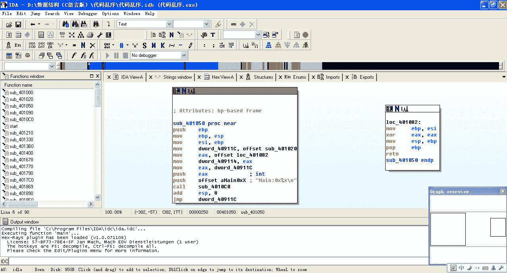

# 演示代码乱序反掉 IDA 流程图

> 原文：[`www.pediy.com/kssd/pediy12/131888.html`](https://www.pediy.com/kssd/pediy12/131888.html)

先引用下玩命老大的话：  
0.什么是乱序  
   乱序就是打乱原来的流程。  
   很多朋友逆向程序时,会把一个程序直接丢到 IDA 里会出现一副流程图。我们现在要做的就是把这副  
流程图打乱。但是并不影响原先流程的逻辑。乱序的原理其实比较简单。说白了就是做 HOOK 然后填充  
花指令。最后在跳转会原先的地址。看下我们的代码，  

代码:

```
#include<stdio.h>
typedef void(\*My\_Main)(void);
typedef void(\*My\_Main1)(void);
My\_Main MyMain;  
My\_Main1 MyMain1;
int Addr;
void Func1(void)
{
  printf("Func1\\n");
  \_asm jmp Addr   //跳回源地址
}
void Func(void)
{
  printf("Func\\n");
  MyMain1=&Func1;
  \_asm jmp MyMain1  //跳到上面的函数
}
int main(void)
{
  \_asm mov esi,ebp  //保存 ESP，以便返回到编译器的预处理代码
  MyMain=&Func;
               //这两条汇编代码保存最后个函数返回的地址
  \_asm mov eax,a
  \_asm mov Addr,eax 
  printf("Main:0x%x\\n",MyMain);
  \_asm jmp MyMain;
a:
  \_asm mov ebp,esi //恢复 ESP
  return 0;
}

```

在看下 IDA 的流程图  
  
