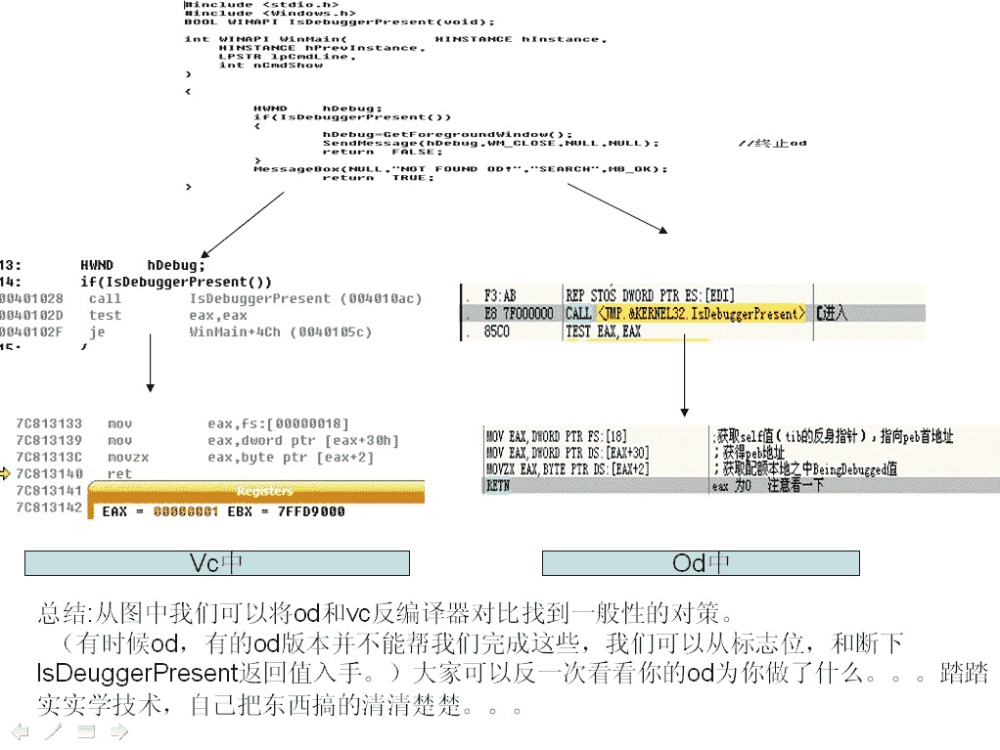
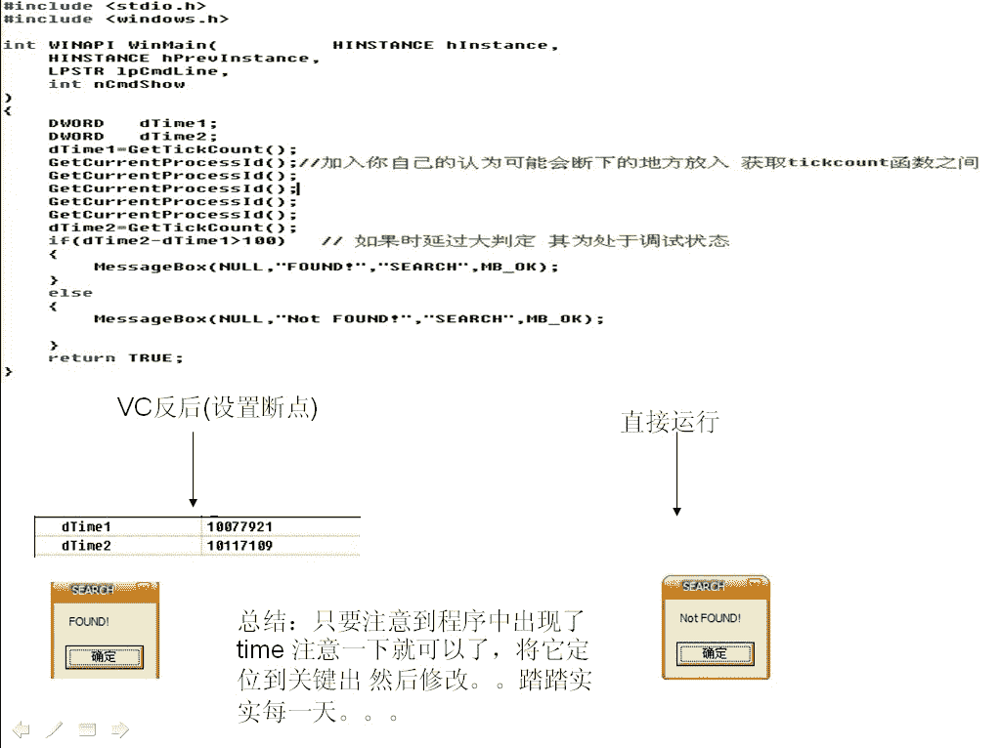

# 老鸟飞过。。。来坛里几个月了发一下新手学习笔记（未完。。）

> 原文：[`www.pediy.com/kssd/pediy11/126408.html`](https://www.pediy.com/kssd/pediy11/126408.html)

目的：学习  
     发帖目的： 共同学习和记录学习 （每星期希望都能坚持发。。）  
     内容：对反跟踪技术原理的学习。。  
     虽然看雪那本书上讲了很多，但本菜 还是认为 自己动手 坐一下比较好，虽然很简单。。  
     第一节：对 peb 标志位的检测：  
  
  
相应扩展习题：（在双进程保护中进行解除）Exam\_CrackMe4.rar  
相应示例代码：  
#include <stdio.h>  
#include <Windows.h>  
BOOL WINAPI IsDebuggerPresent(void);  
  
int WINAPI WinMain(          HINSTANCE hInstance,  
    HINSTANCE hPrevInstance,  
    LPSTR lpCmdLine,  
    int nCmdShow  
)  
  
{  
    
  HWND  hDebug;  
  if(IsDebuggerPresent())  
  {  
    hDebug=GetForegroundWindow();    
    SendMessage(hDebug,WM\_CLOSE,NULL,NULL);    //终止 od  
    return  FALSE;  
  }  
  MessageBox(NULL,"NOT FOUND OD!","SEARCH",MB\_OK);  
    return  TRUE;  
}  
  
  
很简单 自己动手，但也可以学很多东西。。  
  
2.调试时间限制：加密解密上 提到过：但没有真正让我感受到 所以自己就动手写了：  
  
  
 示例源码：  
#include <stdio.h>  
#include <windows.h>  
  
int WINAPI WinMain(          HINSTANCE hInstance,  
    HINSTANCE hPrevInstance,  
    LPSTR lpCmdLine,  
    int nCmdShow  
)  
{  
  DWORD  dTime1;  
  DWORD  dTime2;  
  dTime1=GetTickCount();  
  GetCurrentProcessId();//加入你自己的认为可能会断下的地方放入 获取 tickcount 函数之间  
  GetCurrentProcessId();  
  GetCurrentProcessId();  
  GetCurrentProcessId();  
  GetCurrentProcessId();  
  dTime2=GetTickCount();  
  if(dTime2-dTime1>100)  // 如果时延过大判定 其为处于调试状态  
  {  
    MessageBox(NULL,"FOUND!","SEARCH",MB\_OK);  
  }  
  else  
  {  
    MessageBox(NULL,"Not FOUND!","SEARCH",MB\_OK);  
    
  }  
  return TRUE;  
}  
  
未完待续。。。。  
希望在雪坛里里面，加速进步。。。。