# VMware 虚拟机上如何调试运行 DNF

> 原文：[`www.pediy.com/kssd/pediy12/129810.html`](https://www.pediy.com/kssd/pediy12/129810.html)

以前调试游戏都是在实体机调试的，没有用虚拟机，因为看了它 HOOK 了三个函数，无法再虚拟机上使用，曾经看到有人更改 KdDisableDebugger 让其直接返回，能在虚拟机上使用，今天测试了一下，游戏一旦加载驱动直接蓝屏，今天就想办法让它不蓝屏，并可以调试（据听说有的人的虚拟机可以正常运行，不知道为啥！！！！！！难道我人品问题）。  
  
不做任何处理直接在虚拟机中运行，系统蓝了如图：  
 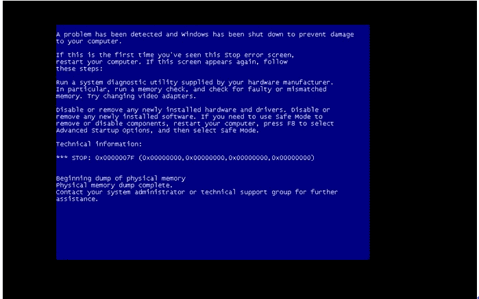  
  
然后咱开始处理了，这东西不难，难的是思路，这里来讲一下，系统蓝屏，调试器又收不到信号，同时用工具检测到，游戏的驱动挂钩了  
KDCOM.dll:KdReceivePacket  //这两个是 COM 串口的接受和发送数据  
KDCOM.dll:KdSendPacket      //主要用来方式别人双机调试   
这两个函数  
同时用 IDA 检测到使用了 KdDisableDebugger 来禁用双机调试  
因此正常的思路是把他们全部恢复过来，禁用 KdDisableDebugger 十分简单，我不赞同直接修改 KdDisableDebugger 的代码，反而喜欢直接把调用 KdDisableDebugger 的代码给 NOP 掉，至于如何 NOP，看完下面的估计你就会的差不多了。  
首先找到对:KdReceivePacket 和 KdSendPacket   HOOK 的代码，这个我是在实体机上找到的，因为在实体机上一挂系统调试器就没法截屏，没有图十分遗憾，抽个空找个照相机照下来，这个以后补上。  
一下是对这两个函数进行 HOOK 的代码：  
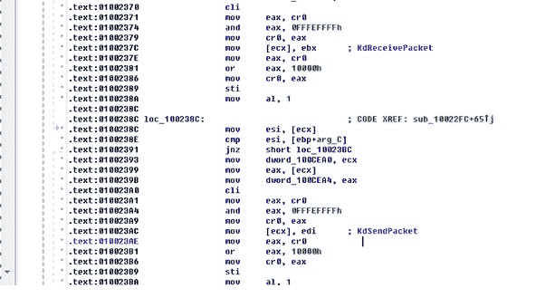  
   
  
找到这两个就好办了，然后挂上双机调试，开启游戏，但是别点登陆，否则系统又蓝了！  
   
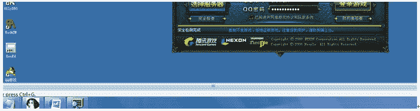  
回到 WINDBG，然后下断点，bp          nt!IopLoadDriver+0x66a  
系统不同，下的地址也不同，以前我说过，不在重复  
最后在给个贴图  
  
  
 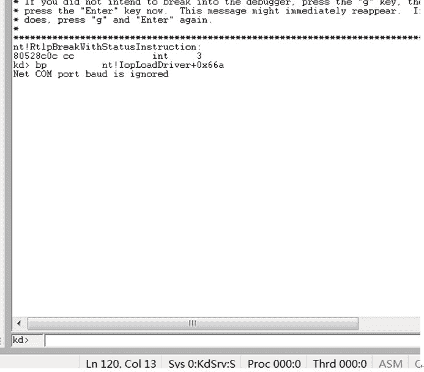  
  
然后 g 运行  
回到虚拟机，登陆游戏吧！  
一会就中断到调试器中了，  
 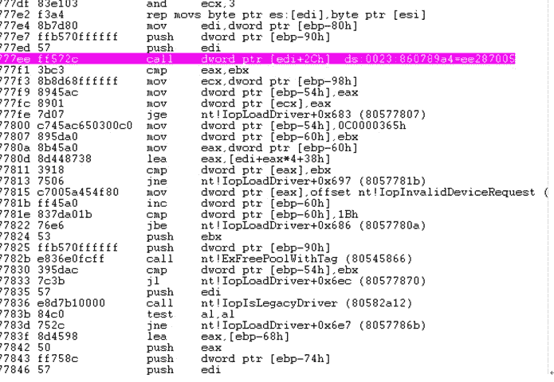  
进入这个 CALL  
  
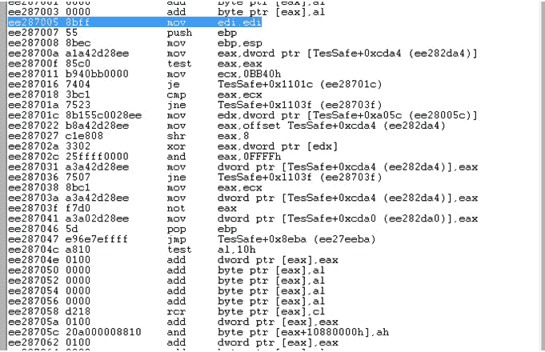  
   
算出它的驱动的基地址  
这里算出基地址是 EE276000  
然后找到它 HOOK 的地址  
输入命令  
s -b EE276000 L5000 89 19 0F 20 C0 0D 00 00 01  
得到如下图  
  
 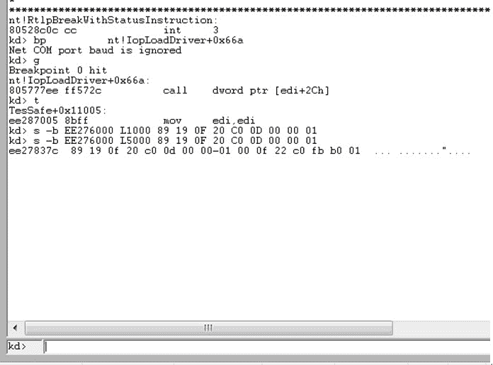  
  
然后反汇编 uf ee27837c  
得到如下  
   
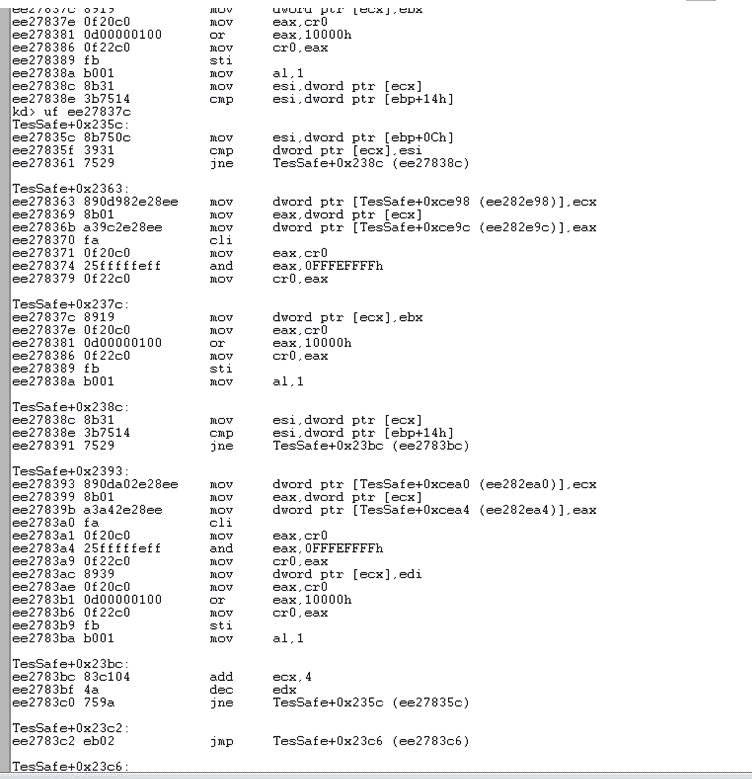  
还等什么，把 HOOK 的位置直接 NOP 掉就行了  
  
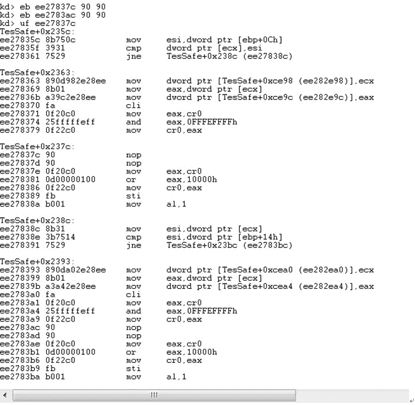  
  
   
然后输入 G  
得到如下所示  
   
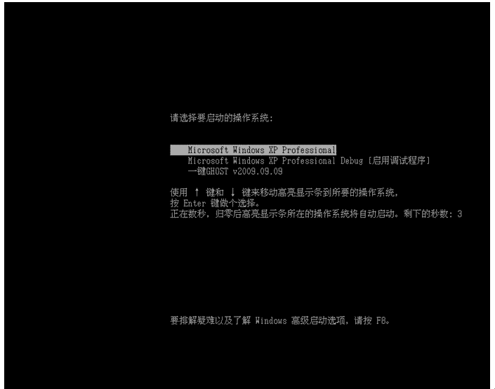  
  
啊！咋从新启动计算机了，呵呵别着急，因为咱只处理了两个地方，还有个 KdDisableDebugger  
没有处理，即使处理了，游戏也可能检测到系统运行在虚拟机环境中，至于如何不让他重启，且听下回分解！这里先给个思路，驱动中的重启代码  
  
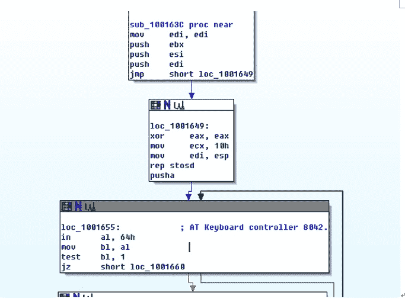  
   
根据它就能找到了  
休息会，找重启代码的就不贴了，下次再贴  
搞掉重启后 系统还是蓝屏，但蓝屏后断下来了，调试器也能收到调试信息，游戏的驱动加载完毕了  
  
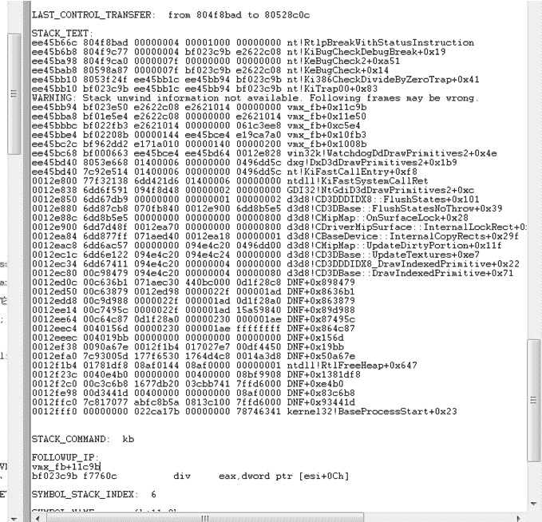  
，VMX\_FB 出错，  
初步排除是虚拟机显卡的事情，然后我从网上找了个虚拟机显卡，比较早的，还是 VM5 的，我这个是是 VM7 的，没办法，试试呗，  
   
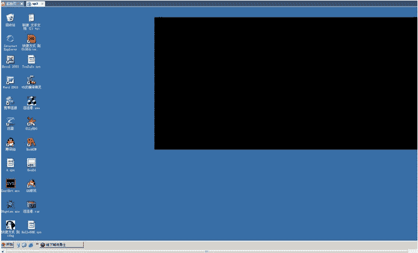  
进去了，有声音，就是黑屏，100%是虚拟机显卡的事情了，下次再找个合适的虚拟机显卡驱动吧。（我的操作系统是 W7）。这里还有一个 KdDisableDebugger 还没处理，下次再说。