# 向 PE 中注入代码

> 原文：[`www.pediy.com/kssd/pediy08/pediy8-749.htm`](https://www.pediy.com/kssd/pediy08/pediy8-749.htm)

Inject your code to a Portable Executable file  
向 PE 中注入代码  
By Ashkbiz Danehkar   
  
原文：http://www.codeproject.com/system/inject2exe.asp  
译者：arhat  
时间：2006 年 4 月 16 日  
关键词：PE 调试器 反汇编器 OEP SEH 导入表  
  

**Inject your code to a Portable Executable file**

**向****PE****中注入代码**  
**By [Ashkbiz Danehkar](http://www.codeproject.com/script/profile/whos_who.asp?id=1599836) **  
  

原文：http://www.codeproject.com/system/inject2exe.asp  
译者：arhat  
时间：2006 年 4 月 16 日  
关键词：PE 调试器 反汇编器 OEP SEH 导入表

  
This article demonstrates five steps to inject your code in a portable executable (EXE, DLL, OCX,...) file without recompiling source code. 

这篇文章介绍了在不重编译源码的前提下，怎样通过 5 个步骤把你的代码注入 PE 格式的文件（EXE, DLL, OCX,...）。

**Downloads**

*   PE Viewer 
*   PE Maker - Step 1 - Add new Section. 
*   PE Maker - Step 2 - Travel towards OEP. 
*   PE Maker - Step 3 - Support Import Table. 
*   PE Maker - Step 4 - Support DLL and OCX. 
*   PE Maker - Step 5 - Final work. 
*   CALC.EXE - test file 

 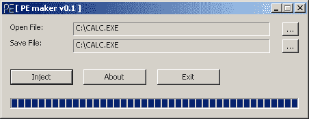

**Contents**

*   [0\. Preface](http://www.codeproject.com/system/inject2exe.asp#Preface0#Preface0) 
*   [1\. Prerequisite](http://www.codeproject.com/system/inject2exe.asp#Prerequisite1#Prerequisite1) 
*   [2\. Portable Executable file format](http://www.codeproject.com/system/inject2exe.asp#PortableExecutablefileformat2#PortableExecutablefileformat2) 

*   [2.1 The MS-DOS data](http://www.codeproject.com/system/inject2exe.asp#TheMSDOSdata2_1#TheMSDOSdata2_1) 
*   [2.2 The Windows NT data](http://www.codeproject.com/system/inject2exe.asp#TheWindowsNTdata2_2#TheWindowsNTdata2_2) 
*   [2.3 The Section Headers and Sections](http://www.codeproject.com/system/inject2exe.asp#TheSectionHeadersandSections2_3#TheSectionHeadersandSections2_3) 

*   [3\. Debugger, Disassembler and some Useful Tools](http://www.codeproject.com/system/inject2exe.asp#DebuggerDisassemblerandsomeUsefulTools3#DebuggerDisassemblerandsomeUsefulTools3) 

*   [3.1 Debuggers](http://www.codeproject.com/system/inject2exe.asp#Debuggers3_1#Debuggers3_1) 

*   [3.1.1 SoftICE](http://www.codeproject.com/system/inject2exe.asp#SoftICE3_1_1#SoftICE3_1_1) 
*   [3.1.2 OllyDbg](http://www.codeproject.com/system/inject2exe.asp#OllyDbg3_1_2#OllyDbg3_1_2) 
*   [3.1.3 Which parts are important in a debugger interface?](http://www.codeproject.com/system/inject2exe.asp#Whichpartsareimportantinadebuggerinterface3_1_3#Whichpartsareimportantinadebuggerinterface3_1_3) 

*   [3.2 Disassembler](http://www.codeproject.com/system/inject2exe.asp#Disassembler3_2#Disassembler3_2) 

*   [3.2.1 Proview disassembler](http://www.codeproject.com/system/inject2exe.asp#Proviewdisassembler3_2_1#Proviewdisassembler3_2_1) 
*   [3.2.2 W32Dasm](http://www.codeproject.com/system/inject2exe.asp#W32Dasm3_2_2#W32Dasm3_2_2) 
*   [3.2.3 IDA Pro](http://www.codeproject.com/system/inject2exe.asp#IDAPro3_2_3#IDAPro3_2_3) 

*   [3.3 Some Useful Tools](http://www.codeproject.com/system/inject2exe.asp#SomeUsefulTools3_3#SomeUsefulTools3_3) 

*   [3.3.1 LordPE](http://www.codeproject.com/system/inject2exe.asp#LordPEs3_3_1#LordPEs3_3_1) 
*   [3.3.2 PEiD](http://www.codeproject.com/system/inject2exe.asp#PEiD3_3_2#PEiD3_3_2) 
*   [3.3.3 Resource Hacker](http://www.codeproject.com/system/inject2exe.asp#ResourceHacker3_3_3#ResourceHacker3_3_3) 
*   [3.3.4 WinHex](http://www.codeproject.com/system/inject2exe.asp#WinHex3_3_4#WinHex3_3_4) 
*   [3.3.5 CFF Explorer](http://www.codeproject.com/system/inject2exe.asp#CFFExplorer3_3_5#CFFExplorer3_3_5) 

*   [4\. Add new section and Change OEP](http://www.codeproject.com/system/inject2exe.asp#AddnewsectionandChangeOEP4#AddnewsectionandChangeOEP4) 

*   [4.1 Retrieve and Rebuild PE file](http://www.codeproject.com/system/inject2exe.asp#RetrieveandRebuildPEfile4_1#RetrieveandRebuildPEfile4_1) 
*   [4.2 Create Data for new Section](http://www.codeproject.com/system/inject2exe.asp#CreateDatafornewSection4_2#CreateDatafornewSection4_2) 
*   [4.3 Some notes regarding creating a new PE file](http://www.codeproject.com/system/inject2exe.asp#SomenotesregardingcreatenewPEfile4_3#SomenotesregardingcreatenewPEfile4_3) 
*   [4.4 Some notes regarding linking this VC Project](http://www.codeproject.com/system/inject2exe.asp#SomenotesregardinglinkthisVCProject4_4#SomenotesregardinglinkthisVCProject4_4) 

*   [5\. Store Important Data and Reach Original OEP](http://www.codeproject.com/system/inject2exe.asp#StoreImportantDataandReachtoOriginalOEP5#StoreImportantDataandReachtoOriginalOEP5) 

*   [5.1 Restore the first Registers Context](http://www.codeproject.com/system/inject2exe.asp#RestorethefirstRegistersContext5_1#RestorethefirstRegistersContext5_1) 
*   [5.2 Restore the Original Stack](http://www.codeproject.com/system/inject2exe.asp#RestoretheOriginalStack5_2#RestoretheOriginalStack5_2) 
*   [5.3 Approach OEP by Structured Exception Handling](http://www.codeproject.com/system/inject2exe.asp#ApproachOEPbyStructuredExceptionHandlin5_3#ApproachOEPbyStructuredExceptionHandlin5_3) 

*   [5.3.1 Implement Exception Handler](http://www.codeproject.com/system/inject2exe.asp#ImplementExceptionHandler5_3_1#ImplementExceptionHandler5_3_1) 
*   [5.3.2 Attain OEP by adjusting the Thread Context](http://www.codeproject.com/system/inject2exe.asp#AttainOEPbyadjustmenttheThreadContext5_3_2#AttainOEPbyadjustmenttheThreadContext5_3_2) 

*   [6\. Build an Import Table and Reconstruct the Original Import Table](http://www.codeproject.com/system/inject2exe.asp#BuildanImportTableandReconstructtheOriginalImportTable6#BuildanImportTableandReconstructtheOriginalImportTable6) 

*   [6.1 Construct the Client Import Table](http://www.codeproject.com/system/inject2exe.asp#ConstructtheClientImportTable6_1#ConstructtheClientImportTable6_1) 
*   [6.2 Using other API functions in run-time](http://www.codeproject.com/system/inject2exe.asp#UsingotherAPIfunctionsinruntime6_2#UsingotherAPIfunctionsinruntime6_2) 
*   [6.3 Fix up the Original Import Table](http://www.codeproject.com/system/inject2exe.asp#FixuptheOriginalImportTable6_3#FixuptheOriginalImportTable6_3) 

*   [7\. Support DLL and OCX](http://www.codeproject.com/system/inject2exe.asp#SupportDLLandOCX7#SupportDLLandOCX7) 

*   [7.1 Twice OEP approach](http://www.codeproject.com/system/inject2exe.asp#TwiceOEPapproach7_1#TwiceOEPapproach7_1) 
*   [7.2 Implement Relocation Table](http://www.codeproject.com/system/inject2exe.asp#ImplementRelocationTable7_2#ImplementRelocationTable7_2) 
*   [7.3 Build a Special Import table](http://www.codeproject.com/system/inject2exe.asp#BuildaSpecialImporttable7_3#BuildaSpecialImporttable7_3) 

*   [8\. Preserve the Thread Local Storage](http://www.codeproject.com/system/inject2exe.asp#PreservetheThreadLocalStorage8#PreservetheThreadLocalStorage8) 
*   [9\. Inject your code](http://www.codeproject.com/system/inject2exe.asp#Injectyourcode9#Injectyourcode9) 
*   [10\. Conclusion](http://www.codeproject.com/system/inject2exe.asp#Conclusion10#Conclusion10) 

**0 ****Preface**

**0 ****序言**

It might be, you demand to comprehend the ways a virus program injects its procedure in to the interior of a portable executable file and corrupts it, or you are interested in implementing a packer or a protector for your specific intention to encrypt the data of your portable executable (PE) file. This article is committed to represent a brief intuition to realize the performance which is accomplished by EXE tools or some kind of mal-wares.

或许，你想知道病毒怎样把病毒体注入 PE 内来感染它；或许，你为了加密 PE 中的数据，想了解 packer 或 protector 的实现。那么，本文就是为你准备的，文中介绍了一些 EXE 工具或 mal-wares 的实现。

You can employ the source code of this article to create your custom EXE builder. It could be used to make an EXE protector in the right way, or with a wrong intention, to pullulate a virus. However, my purpose of writing this article has been to gaze on the first application, so I will not be responsible for the immoral usage of these methods.

你可以使用本文的源码定制 EXE builder，也可利用它制作 EXE protector，或者在不当意图的驱使下，制作病毒。不过，我写此文的目的是为传播知识，而不是教唆谁谁制作恶意病毒，因此，对那些恶意利用这些方法的行为，我概不负责。

**1 Prerequisite**

**1 ****先决条件**

There are no specific mandatory prerequisites to follow the topics in this article. If you are familiar with debugger and also the portable file format, I suggest you to drop the sections 2 and 3, the whole of these sections have been made for people who don’t have any knowledge regarding the EXE file format and also debuggers.

关于本文介绍的主题，没有强制性的先决条件。如果你已经熟悉调试器及 PE 文件的格式，我建议你跳过第 2 和第三部分，它们是为初学者准备的。

**2 Portable Executable file ****format**

**2 PE****文件格式**

The Portable Executable file format was defined to provide the best way for the Windows Operating System to execute code and also to store the essential data which is needed to run a program, for example constant data, variable data, import library links, and resource data. It consists of MS-DOS file information, Windows NT file information, Section Headers, and Section images, [Table 1](http://www.codeproject.com/system/inject2exe.asp#Table1#Table1).

PE 文件格式为 Windows 操作系统执行代码、保存程序运行所需的基本数据（例如，常量，变量，导入表，资源数据等）提供了最好的方法。它包含 MS-DOS 文件信息，Windows NT 文件信息，区块头，区块映像，见表 1。

**2.1 The MS-DOS data**

**2.1 MS-DOS****数据**

These data let you remember the first days of developing the Windows Operating System, the days. We were at the beginning of a way to achieve a complete Operating System like [Windows NT 3.51](http://en.wikipedia.org/wiki/Windows_NT_3.51) (I mean, [Win3.1](http://en.wikipedia.org/wiki/Windows_3.1), [Win95](http://en.wikipedia.org/wiki/Windows_95), [Win98](http://en.wikipedia.org/wiki/Windows_98) were not perfect [OS](http://en.wikipedia.org/wiki/Operating_System)s). The MS-DOS data causes that your executable file calls a function inside MS-DOS and [the MS-DOS Stub program](http://msdn.microsoft.com/library/default.asp?url=/library/en-us/vccore98/HTML/_core_.2f.stub.asp) lets it display: **"This program can not be run in MS-DOS mode"** or **"This program can be run only in Windows mode"**, or some things like these comments when you try to run a Windows EXE file inside [MS-DOS 6.0](http://en.wikipedia.org/wiki/MS-DOS), where there is no footstep of Windows. Thus, this data is reserved for the code to indicate these comments in the [MS-DOS](http://en.wikipedia.org/wiki/MS-DOS) [operating system](http://en.wikipedia.org/wiki/Operating_System). The most interesting part of the [MS-DOS](http://en.wikipedia.org/wiki/MS-DOS) data is "**MZ**"! Can you believe, it refers to the name of "[Mark Zbikowski](http://en.wikipedia.org/wiki/Mark_Zbikowski)", one of the first Microsoft programmers?

这些数据让我们想起了开发 Windows 操作系统之初的那些日子。从一开始到完成类似于[Windows NT 3.51](http://en.wikipedia.org/wiki/Windows_NT_3.51)（我的意思是，[Win3.1](http://en.wikipedia.org/wiki/Windows_3.1)， [Win95](http://en.wikipedia.org/wiki/Windows_95)，[Win98](http://en.wikipedia.org/wiki/Windows_98)还不是真正意义上的操作系统）的完整操作系统。当你在[MS-DOS 6.0](http://en.wikipedia.org/wiki/MS-DOS)下运行 Windows EXE 文件时，EXE 文件将根据 MS-DOS 数据调用 MS-DOS 内部函数和[MS-DOS Stub program](http://msdn.microsoft.com/library/default.asp?url=/library/en-us/vccore98/HTML/_core_.2f.stub.asp)，显示**"This program can not be run in MS-DOS mode"**或**"This program can be run only in Windows mode"**之类的注释信息。因此，[MS-DOS](http://en.wikipedia.org/wiki/MS-DOS) [操作系统](http://en.wikipedia.org/wiki/Operating_System)是为了显示这些注释而保留这些数据的。[MS-DOS](http://en.wikipedia.org/wiki/MS-DOS)数据中最有意思的部分是“**MZ**”！你可能会想，它是来自“[Mark Zbikowski](http://en.wikipedia.org/wiki/Mark_Zbikowski)”――微软的第一代程序员？

To me, only the offset of the PE signature in the [MS-DOS](http://en.wikipedia.org/wiki/MS-DOS) data is important, so I can use it to find the position of the [Windows NT](http://en.wikipedia.org/wiki/Windows_NT) data. I just recommend you to take a look at [Table 1](http://www.codeproject.com/system/inject2exe.asp#Table1#Table1), then observe the structure of IMAGE\_DOS\_HEADER in the *<winnt.h>* header in the *<Microsoft Visual Studio .net path>\\VC7\\PlatformSDK\\include\\* folder or the *<Microsoft Visual Studio 6.0 path>\\VC98\\include\\* folder. I do not know why the Microsoft team has forgotten to provide some comment about this structure in the [MSDN](http://msdn.microsoft.com/) library!

对我来说，在[MS-DOS](http://en.wikipedia.org/wiki/MS-DOS)数据中，只有 PE 特征的偏移量比较重要，通过它我可以找到[Windows NT](http://en.wikipedia.org/wiki/Windows_NT)数据的位置。我建议你仔细查看表 1，然后研究*<winnt.h>*头文件（位于*<Microsoft Visual Studio .net path>\\VC7\\PlatformSDK\\include\\*或*<Microsoft Visual Studio 6.0 path>\\VC98\\include\\*目录中）中的 IMAGE\_DOS\_HEADER 结构。我不知道微软的开发团队为什么会忘了在[MSDN](http://msdn.microsoft.com/) library 中提供这个结构的注释！

typedef struct \_IMAGE\_DOS\_HEADER { // DOS .EXE header "MZ"

    WORD   e\_magic;                // Magic number

    WORD   e\_cblp;                 // Bytes on last page of file

    WORD   e\_cp;                   // Pages in file

    WORD   e\_crlc;                 // Relocations

    WORD   e\_cparhdr;              // Size of header in paragraphs

    WORD   e\_minalloc;             // Minimum extra paragraphs needed

    WORD   e\_maxalloc;             // Maximum extra paragraphs needed

    WORD   e\_ss;                   // Initial (relative) SS value

    WORD   e\_sp;                   // Initial SP value

    WORD   e\_csum;                 // Checksum

    WORD   e\_ip;                   // Initial IP value

    WORD   e\_cs;                   // Initial (relative) CS value

    WORD   e\_lfarlc;               // File address of relocation table

    WORD   e\_ovno;                 // Overlay number

    WORD   e\_res\[4\];               // Reserved words

    WORD   e\_oemid;                // OEM identifier (for e\_oeminfo)

    WORD   e\_oeminfo;              // OEM information; e\_oemid specific

    WORD   e\_res2\[10\];             // Reserved words

    LONG   e\_lfanew;               // File address of the new exe header

  } IMAGE\_DOS\_HEADER, \*PIMAGE\_DOS\_HEADER;

e\_lfanew is the offset which refers to the position of the Windows NT data. I have provided a program to obtain the header information from an EXE file and to display it to you. To use the program, just try:

e\_lfanew 是引用 Windows NT 数据位置的偏移量。我提供了一个程序，它可以从 EXE 文件得到头信息，并把这显示出来。要运行这个程序，只需输入：

**PE Viewer**

*   [Download source files - 132 Kb](http://www.codeproject.com/system/inject2exe/peviewer.zip) 

 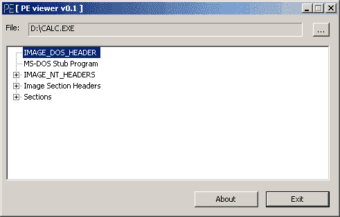

 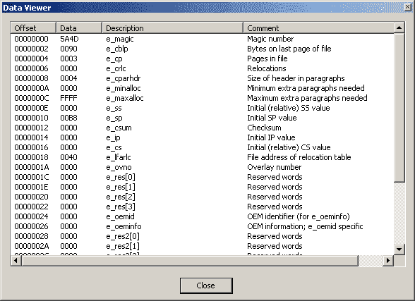

 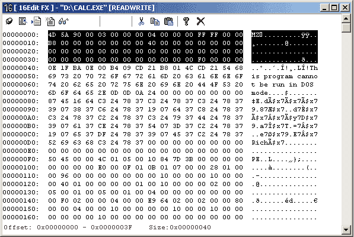

This sample is useful for the whole of this article.

这个例子在整篇文章中都会用到。

**Table 1 - Portable Executable file**** format structure**

| MS-DOS   
information || IMAGE\_DOS\_  
HEADER || DOS EXE Signature || 00000000  ASCII "MZ"00000002  DW 009000000004  DW 000300000006  DW 000000000008  DW 00040000000A  DW 00000000000C  DW FFFF0000000E  DW 000000000010  DW 00B800000012  DW 000000000014  DW 000000000016  DW 000000000018  DW 00400000001A  DW 00000000001C  DB 00……0000003B  DB 000000003C  DD 000000F0 |
| --- | --- | --- | --- |
| DOS\_PartPag |
| DOS\_PageCnt |
| DOS\_ReloCnt |
| DOS\_HdrSize |
| DOS\_MinMem |
| DOS\_MaxMem |
| DOS\_ReloSS |
| DOS\_ExeSP |
| DOS\_ChkSum |
| DOS\_ExeIPP |
| DOS\_ReloCS |
| DOS\_TablOff |
| DOS\_Overlay |
| …  
Reserved words  
… |
| Offset to PE signature |
| MS-DOS Stub   
Program || 00000040    
­º  
.´.Í!¸\\LÍ!This program canno00000060  t be run in DOS mode....$....... |
| Windows NT   
information IMAGE\_  
NT\_HEADERS || Signature || PE signature (PE) || 000000F0  ASCII "PE" |
| IMAGE\_  
FILE\_HEADER || Machine || 000000F4  DW 014C000000F6  DW 0003000000F8  DD 3B7D8410000000FC  DD 0000000000000100  DD 0000000000000104  DW 00E000000106  DW 010F |
| NumberOfSections |
| TimeDateStamp |
| PointerToSymbolTable |
| NumberOfSymbols |
| SizeOfOptionalHeader |
| Characteristics |
| IMAGE\_  
OPTIONAL\_  
HEADER32 || MagicNumber || 00000108  DW 010B0000010A  DB 070000010B  DB 000000010C  DD 0001280000000110  DD 00009C0000000114  DD 0000000000000118  DD 000124750000011C  DD 0000100000000120  DD 0001400000000124  DD 0100000000000128  DD 000010000000012C  DD 0000020000000130  DW 000500000132  DW 000100000134  DW 000500000136  DW 000100000138  DW 00040000013A  DW 00000000013C  DD 0000000000000140  DD 0001F00000000144  DD 0000040000000148  DD 0001D7FC0000014C  DW 00020000014E  DW 800000000150  DD 0004000000000154  DD 0000100000000158  DD 001000000000015C  DD 0000100000000160  DD 0000000000000164  DD 00000010     |
| MajorLinkerVersion |
| MinorLinkerVersion |
| SizeOfCode |
| SizeOfInitializedData |
| SizeOfUninitializedData |
| AddressOfEntryPoint |
| BaseOfCode |
| BaseOfData |
| ImageBase |
| SectionAlignment |
| FileAlignment |
| MajorOSVersion |
| MinorOSVersion |
| MajorImageVersion |
| MinorImageVersion |
| MajorSubsystemVersion |
| MinorSubsystemVersion |
| Reserved |
| SizeOfImage |
| SizeOfHeaders |
| CheckSum |
| Subsystem |
| DLLCharacteristics |
| SizeOfStackReserve |
| SizeOfStackCommit |
| SizeOfHeapReserve |
| SizeOfHeapCommit |
| LoaderFlags |
| NumberOfRvaAndSizes |
| IMAGE\_  
DATA\_DIRECTORY\[16\] || Export Table |
| Import Table |
| Resource Table |
| Exception Table |
| Certificate File |
| Relocation Table |
| Debug Data |
| Architecture Data |
| Global Ptr |
| TLS Table |
| Load Config Table |
| Bound Import Table |
| Import Address Table |
| Delay Import Descriptor |
| COM+ Runtime Header |
| Reserved |
| Sections   
information || IMAGE\_  
SECTION\_  
HEADER\[0\] || Name\[8\] || 000001E8  ASCII".text"000001F0  DD 000126B0000001F4  DD 00001000000001F8  DD 00012800000001FC  DD 0000040000000200  DD 0000000000000204  DD 0000000000000208  DW 00000000020A  DW 00000000020C  DD 60000020    CODE|EXECUTE|READ |
| VirtualSize |
| VirtualAddress |
| SizeOfRawData |
| PointerToRawData |
| PointerToRelocations |
| PointerToLineNumbers |
| NumberOfRelocations |
| NumberOfLineNumbers |
| Characteristics |
| …  
…  
…  
IMAGE\_  
SECTION\_  
HEADER\[n\] || 00000210  ASCII".data"; SECTION00000218  DD 0000101C ; VirtualSize = 0x101C0000021C  DD 00014000 ; VirtualAddress = 0x1400000000220  DD 00000A00 ; SizeOfRawData = 0xA0000000224  DD 00012C00 ; PointerToRawData = 0x12C0000000228  DD 00000000 ; PointerToRelocations = 0x00000022C  DD 00000000 ; PointerToLineNumbers = 0x000000230  DW 0000     ; NumberOfRelocations = 0x000000232  DW 0000     ; NumberOfLineNumbers = 0x000000234  DD C0000040 ; Characteristics =                         INITIALIZED\_DATA|READ|WRITE00000238  ASCII".rsrc"; SECTION00000240  DD 00008960 ; VirtualSize = 0x896000000244  DD 00016000 ; VirtualAddress = 0x1600000000248  DD 00008A00 ; SizeOfRawData = 0x8A000000024C  DD 00013600 ; PointerToRawData = 0x1360000000250  DD 00000000 ; PointerToRelocations = 0x000000254  DD 00000000 ; PointerToLineNumbers = 0x000000258  DW 0000     ; NumberOfRelocations = 0x00000025A  DW 0000     ; NumberOfLineNumbers = 0x00000025C  DD 40000040 ; Characteristics =                         INITIALIZED\_DATA|READ |
| SECTION\[0\] || 00000400  EA 22 DD 77 D7 23 DD 77  ê"Ýw×#Ýw00000408  9A 18 DD 77 00 00 00 00  šÝw....00000410  2E 1E C7 77 83 1D C7 77  .‑ÇwƒÇw00000418  FF 1E C7 77 00 00 00 00  ÿ‑Çw....00000420  93 9F E7 77 D8 05 E8 77  “ŸçwØèw00000428  FD A5 E7 77 AD A9 E9 77  ý¥çw­©éw00000430  A3 36 E7 77 03 38 E7 77  £6çw 

* * *

8çw 

00000438  41 E3 E6 77 60 8D E7 77  Aãæw\`çw

00000440  E6 1B E6 77 2B 2A E7 77  ææw+\*çw

00000448  7A 17 E6 77 79 C8 E6 77  zæwyÈæw

00000450  14 1B E7 77 C1 30 E7 77  çwÁ0çw

…

 |
| …  
…  
…  
SECTION\[n\] || …0001BF00  63 00 2E 00 63 00 68 00  c...c.h.0001BF08  6D 00 0A 00 43 00 61 00  m...C.a.0001BF10  6C 00 63 00 75 00 6C 00  l.c.u.l.0001BF18  61 00 74 00 6F 00 72 00  a.t.o.r.0001BF20  11 00 4E 00 6F 00 74 00  .N.o.t.0001BF28  20 00 45 00 6E 00 6F 00   .E.n.o.0001BF30  75 00 67 00 68 00 20 00  u.g.h. .0001BF38  4D 00 65 00 6D 00 6F 00  M.e.m.o.0001BF40  72 00 79 00 00 00 00 00  r.y.....0001BF48  00 00 00 00 00 00 00 00  ........0001BF50  00 00 00 00 00 00 00 00  ........0001BF58  00 00 00 00 00 00 00 00  ........0001BF60  00 00 00 00 00 00 00 00  ........0001BF68  00 00 00 00 00 00 00 00  ........0001BF70  00 00 00 00 00 00 00 00  ........0001BF78  00 00 00 00 00 00 00 00  ........ |

**2.2 The Windows NT data**

**2.2 Windows NT****数据**

As mentioned in the preceding section, e\_lfanew storage in the MS-DOS data structure refers to the location of the Windows NT information. Hence, if you assume that the pMem pointer relates the start point of the memory space for a selected portable executable file, you can retrieve the MS-DOS header and also the Windows NT headers by the following lines, which you also can perceive in the [PE viewer](http://www.codeproject.com/system/inject2exe.asp#PEViewerDownloadLink#PEViewerDownloadLink) sample (*pelib.cpp*, PEStructure::OpenFileName()):

前面提到，e\_lfanew 保存在 MS-DOS 数据结构里，引用 Windows NT 信息的位置。因此，如果你假设 pMem 指针与被选的 PE 文件的内存空间起始点有关联，你可以通过下面的代码找回 MS-DOS 头和 Windows NT 头，你也可以在[PE viewer](http://www.codeproject.com/system/inject2exe.asp#PEViewerDownloadLink#PEViewerDownloadLink)例子里观察这些内容（*pelib.cpp*, PEStructure::OpenFileName()）：

IMAGE\_DOS\_HEADER        image\_dos\_header;

IMAGE\_NT\_HEADERS        image\_nt\_headers;

PCHAR pMem;

…

memcpy(&image\_dos\_header, pMem, 

       sizeof(IMAGE\_DOS\_HEADER));

memcpy(&image\_nt\_headers,

       pMem+image\_dos\_header.e\_lfanew, 

       sizeof(IMAGE\_NT\_HEADERS));

It seems to be very simple, the retrieval of the headers information. I recommend inspecting the MSDN library regarding the [IMAGE\_NT\_HEADERS](http://msdn.microsoft.com/library/default.asp?url=/library/en-us/debug/base/image_nt_headers_str.asp) structure definition. It makes comprehensible to grasp what the image NT header maintains to execute a code inside the Windows NT OS. Now, you are conversant with the Windows NT structure, it consists of the "PE" Signature, the [File Header](http://msdn.microsoft.com/library/default.asp?url=/library/en-us/debug/base/image_file_header_str.asp), and the [Optional Header](http://msdn.microsoft.com/library/default.asp?url=/library/en-us/debug/base/image_optional_header_str.asp). Do not forget to take a glimpse at their comments in the [MSDN](http://msdn.microsoft.com/) Library and besides in [Table 1](http://www.codeproject.com/system/inject2exe.asp#Table1#Table1).

找回头信息似乎很简单。你建议你查看 MSDN library 中与[IMAGE\_NT\_HEADERS](http://msdn.microsoft.com/library/default.asp?url=/library/en-us/debug/base/image_nt_headers_str.asp)结构定义相关的内容。它通俗易懂地讲解了在 Windows NT 操作系统中，NT 头的什么映像在维护执行代码。现在，你应该对 Windows NT 结构比较熟悉了，它包含“PE”特征，[File Header](http://msdn.microsoft.com/library/default.asp?url=/library/en-us/debug/base/image_file_header_str.asp)，和[Optional Header](http://msdn.microsoft.com/library/default.asp?url=/library/en-us/debug/base/image_optional_header_str.asp)。除了表 1 的内容外，不要忘了查看[MSDN](http://msdn.microsoft.com/) Library 中有关它们的注释。

One the whole, I consider merely, on the most circumstances, the following cells of the [IMAGE\_NT\_HEADERS](http://msdn.microsoft.com/library/default.asp?url=/library/en-us/debug/base/image_nt_headers_str.asp) structure:

通常来说，我只考虑[IMAGE\_NT\_HEADERS](http://msdn.microsoft.com/library/default.asp?url=/library/en-us/debug/base/image_nt_headers_str.asp)结构中最重要的一些单元，如：

FileHeader->NumberOfSections

OptionalHeader->AddressOfEntryPoint

OptionalHeader->ImageBase

OptionalHeader->SectionAlignment

OptionalHeader->FileAlignment

OptionalHeader->SizeOfImage

OptionalHeader->

  DataDirectory\[IMAGE\_DIRECTORY\_ENTRY\_IMPORT\]->VirtualAddress

OptionalHeader->DataDirectory\[IMAGE\_DIRECTORY\_ENTRY\_IMPORT\]->Size

You can observe clearly, the main purpose of these values, and their role when the internal virtual memory space allocated for an EXE file by the Windows OS is fully allocated, if you pay attention to their explanations in [MSDN](http://msdn.microsoft.com/) library, so I am not going to repeat the MSDN annotations here.

如果你研究过[MSDN](http://msdn.microsoft.com/) library 中关于它们的解释，那么当 Windows NT 为 EXE 文件分配虚拟内存空间时，你应该可以清楚看出分配的这些值的主要用途，以及它们所扮演的角色。所以，我不准备在这里重复 MSDN 里的注释。

I should mention a brief comment regarding the PE data directories, or [OptionalHeader](http://msdn.microsoft.com/library/default.asp?url=/library/en-us/debug/base/image_optional_header_str.asp)\-> [DataDirectory\[\]](http://msdn.microsoft.com/library/default.asp?url=/library/en-us/debug/base/image_data_directory_str.asp), as I think there are a few aspects of interest concerning them. When you come to survey the Optional header through the Windows NT information, you will find that there are *16* directories at the end of the Optional Header, where you can find the consecutive directories, including their Relative Virtual Address and Size. I just mention here, the notes from *<winnt.h>* to clarify these information:

我大概介绍一下 PE 数据目录，或[OptionalHeader](http://msdn.microsoft.com/library/default.asp?url=/library/en-us/debug/base/image_optional_header_str.asp)\-> [DataDirectory\[\]](http://msdn.microsoft.com/library/default.asp?url=/library/en-us/debug/base/image_data_directory_str.asp)，因为我认为它们有一些有趣的方面。当你通过 Windows NT 信息纵览 Optional header 时，会发现 Optional header 结尾有 16 个目录，这些目录是连续的，包含它们的 RVA 和大小。我提一下，*<winnt.h>*里的注释解释了这些信息：

#define IMAGE\_DIRECTORY\_ENTRY\_EXPORT          0   // Export Directory

#define IMAGE\_DIRECTORY\_ENTRY\_IMPORT          1   // Import Directory

#define IMAGE\_DIRECTORY\_ENTRY\_RESOURCE        2   // Resource Directory

#define IMAGE\_DIRECTORY\_ENTRY\_EXCEPTION       3   // Exception Directory

#define IMAGE\_DIRECTORY\_ENTRY\_SECURITY        4   // Security Directory

#define IMAGE\_DIRECTORY\_ENTRY\_BASERELOC       5   // Base Relocation Table

#define IMAGE\_DIRECTORY\_ENTRY\_DEBUG           6   // Debug Directory

#define IMAGE\_DIRECTORY\_ENTRY\_ARCHITECTURE    7   // Architecture Specific Data

#define IMAGE\_DIRECTORY\_ENTRY\_GLOBALPTR       8   // RVA of GP

#define IMAGE\_DIRECTORY\_ENTRY\_TLS             9   // TLS Directory

#define IMAGE\_DIRECTORY\_ENTRY\_LOAD\_CONFIG    10   // Load Configuration Directory

#define IMAGE\_DIRECTORY\_ENTRY\_BOUND\_IMPORT   11   // Bound Import Directory in headers

#define IMAGE\_DIRECTORY\_ENTRY\_IAT            12   // Import Address Table

#define IMAGE\_DIRECTORY\_ENTRY\_DELAY\_IMPORT   13   // Delay Load Import Descriptors

#define IMAGE\_DIRECTORY\_ENTRY\_COM\_DESCRIPTOR 14   // COM Runtime descriptor

The last one (15) was reserved for use in future; I have not yet seen any purpose to use it even in PE64.

最后一个（15）保留在将来使用；然而，我还没有见过它用于何种目的，甚至在 PE64 里。

For instance, if you desire to perceive the relative virtual address (RVA) and the size of the resource data, it is enough to retrieve them by: 

例如，你想查看资源数据的 RVA 和大小，通过下面的代码就可以找到它们：

DWORD dwRVA = image\_nt\_headers.OptionalHeader->

  DataDirectory\[IMAGE\_DIRECTORY\_ENTRY\_RESOURCE\]->VirtualAddress;

DWORD dwSize = image\_nt\_headers.OptionalHeader->

  DataDirectory\[IMAGE\_DIRECTORY\_ENTRY\_RESOURCE\]->Size;

To comprehend more regarding the significance of data directories, I forward you to section 3.4.3, [Microsoft Portable Executable and the Common Object File Format Specification](http://www.microsoft.com/whdc/system/platform/firmware/PECOFF.mspx) document by Microsoft, and furthermore section 6 of this document, where you discern the various types of sections and their applications. We will discuss the section's advantage subsequently.

为了充分理解数据目录，我建议你先阅读微软提供的[Microsoft Portable Executable and the Common Object File Format Specification](http://www.microsoft.com/whdc/system/platform/firmware/PECOFF.mspx)文档的 3.4.3 节，以及第六部分，在那里，你可以看到各种类型的区段以及它们的应用。我们随后将讨论这些区段的优势。

**2.3 The Section Headers and Sections**

**2.3 ****区段头和区段**

We currently observe how the portable executable files declare the location and the size of a section on a disk storage file and inside the virtual memory space allocated for the program with [IMAGE\_NT\_HEADERS](http://msdn.microsoft.com/library/default.asp?url=/library/en-us/debug/base/image_nt_headers_str.asp)\-> [OptionalHeader](http://msdn.microsoft.com/library/default.asp?url=/library/en-us/debug/base/image_optional_header_str.asp)\->SizeOfImage by the Windows task manager, as well the characteristics to demonstrate the type of the section. To understand better the Section header as my previous declaration, I suggest having a short gape on the [IMAGE\_SECTION\_HEADER](http://msdn.microsoft.com/library/default.asp?url=/library/en-us/debug/base/image_section_header_str.asp) structure definition in the MSDN library. For an EXE packer developer, VirtualSize, VirtualAddress, SizeOfRawData, PointerToRawData, and Characteristics cells have significant rules. While developing an EXE packer, you should be clever enough to play with them. There are somethings to be noted while you modify them; you should take care to align the VirtualSize and VirtualAddress according to [OptionalHeader](http://msdn.microsoft.com/library/default.asp?url=/library/en-us/debug/base/image_optional_header_str.asp)\->SectionAlignment, as well as SizeOfRawData and PointerToRawData in line with [OptionalHeader](http://msdn.microsoft.com/library/default.asp?url=/library/en-us/debug/base/image_optional_header_str.asp)\->FileAlignment. Otherwise, you will corrupt your target EXE file and it will never run. Regarding Characteristics, I pay attention mostly to establish a section by IMAGE\_SCN\_MEM\_READ | IMAGE\_SCN\_MEM\_WRITE | IMAGE\_SCN\_CNT\_INITIALIZED\_DATA, I prefer my new section has ability to initialize such data during running process; such as import table; besides, I need it to be able to modify itself by the loader with my settings in the section characteristics to read- and writeable.

我们现在正在观察 PE 文件怎样在磁盘文件，及 Windows 任务管理器通过[IMAGE\_NT\_HEADERS](http://msdn.microsoft.com/library/default.asp?url=/library/en-us/debug/base/image_nt_headers_str.asp)\-> [OptionalHeader](http://msdn.microsoft.com/library/default.asp?url=/library/en-us/debug/base/image_optional_header_str.asp)\->SizeOfImage 为程序分配的虚拟内存空间里声明区段的位置和大小，以及示范区段类型的特性。为了更好的理解我前面声明的区段头，我建议你在 MSDN library 定义[IMAGE\_SECTION\_HEADER](http://msdn.microsoft.com/library/default.asp?url=/library/en-us/debug/base/image_section_header_str.asp)结构的地方做短暂停留。对于 EXE packer 开发者来说，VirtualSize VirtualSize，VirtualAddress， SizeOfRawData， PointerToRawData，和 Characteristics 单元非常重要；必须熟悉它们，以把它们玩弄于掌股之中。当你修改它们时，需要注意的是：应该依照[OptionalHeader](http://msdn.microsoft.com/library/default.asp?url=/library/en-us/debug/base/image_optional_header_str.asp)\->SectionAlignment， SizeOfRawData，以及和[OptionalHeader](http://msdn.microsoft.com/library/default.asp?url=/library/en-us/debug/base/image_optional_header_str.asp)\->FileAlignment 一致的 PointerToRawData，仔细对齐 VirtualSize 和 VirtualAddress。否则，将破坏 EXE 文件，而导致它终身残废。关于 Characteristics，我非常关注通过 IMAGE\_SCN\_MEM\_READ | IMAGE\_SCN\_MEM\_WRITE | IMAGE\_SCN\_CNT\_INITIALIZED\_DATA 来建立区段，我更喜欢我的新区段可以在运行过程中初始化这些数据；例如输入表；除此之外，我还需要它能通过我在区段里设置的读/写属性，在加载时实现自我修改。

Moreover, you should pay attention to the section names, you can know the purpose of each section by its name. I will just forward you to section 6: [Microsoft Portable Executable and the Common Object File Format Specification](http://www.microsoft.com/whdc/system/platform/firmware/PECOFF.mspx) documents. I believe, it represents the totality of sections by their names, [Table 2](http://www.codeproject.com/system/inject2exe.asp#TabLe2#TabLe2).

此外，你还应该注意区段名，通过名字你可以大致了解每个区段的作用。我建议你可以先阅读[Microsoft Portable Executable and the Common Object File Format Specification](http://www.microsoft.com/whdc/system/platform/firmware/PECOFF.mspx)文档的第六部分。我认为，它已经囊括了所有的区段，见表 2。

**Table 2 - Section names**

| ".text" || Code Section |
| --- | --- |
| "CODE" || Code Section of file linked by Borland Delphi or Borland Pascal |
| ".data" || Data Section |
| "DATA" || Data Section of file linked by Borland Delphi or Borland Pascal |
| ".rdata" || Section for Constant Data  |
| ".idata" || Import Table |
| ".edata"  || Export Table |
| ".tls" || TLS Table |
| ".reloc" || Relocation Information |
| ".rsrc" || Resource Information |

To comprehend the section headers and also the sections, you can run the sample [PE viewer](http://www.codeproject.com/system/inject2exe.asp#PEViewerDownloadLink#PEViewerDownloadLink). By this PE viewer, you only can realize the application of the section headers in a file image, so to observe the main significance in the Virtual Memory, you should try to load a PE file by a debugger, and the next section represents the main idea of using the virtual address and –size in the virtual memory by using a debugger. The last note is about [IMAGE\_NT\_HEADERS](http://msdn.microsoft.com/library/default.asp?url=/library/en-us/debug/base/image_nt_headers_str.asp)\-> [FileHeader](http://msdn.microsoft.com/library/default.asp?url=/library/en-us/debug/base/image_file_header_str.asp)\-><CODE>NumberOfSections, that provides a number of sections in a PE file, do not forget to adjust it whenever you remove or add some sections to a PE file, I am talking about section injection!

为了充分理解区段头和区段，你可以运行[PE viewer](http://www.codeproject.com/system/inject2exe.asp#PEViewerDownloadLink#PEViewerDownloadLink)。但是通过 PE viewer，你只能了解区段头在文件映像中的情况，因此，为了观察重要的虚拟内存中的部分，你应该尝试用调试器加载 PE 文件，我们接下来将介绍在调试器中怎样利用虚拟内存中的虚拟地址和–size。最后要注意的是[IMAGE\_NT\_HEADERS](http://msdn.microsoft.com/library/default.asp?url=/library/en-us/debug/base/image_nt_headers_str.asp)\-> [FileHeader](http://msdn.microsoft.com/library/default.asp?url=/library/en-us/debug/base/image_file_header_str.asp)\-><CODE>NumberOfSections，它提供 PE 文件的区段数，无论你增加/删除区段，都不要忘了调整它，因为我正在讨论的是区段注入？

**3 Debugger****, Disassembler and some Useful Tools**

**3 ****调试器，反汇编器和一些有用的工具**

In this part, you will become familiar with the necessary and essential equipments to develop your PE tools.

在这部分，将介绍开发 PE 工具所必需的基本装备。

**3.1 Debuggers**

**3.1 ****调试器**

The first essential prerequisite, to become a PE tools developer, is to have enough experience with bug tracer tools. Furthermore, you should know most of the assembly instructions. To me, the Intel documents are the best references. You can obtain them from the Intel site for IA-32, and on top of that IA-64; the future belongs to IA-64 CPUs, Windows XP 64-bit, and also PE64!

成为 PE 工具开发者的基本条件是要有使用 bug 跟踪工具的丰富经验；此外，还应该熟悉大部分汇编指令。为我来说，Intel 文档是最好的参考书。你可以从 Intel 网站上找到 IA-32 或 IA-64 的文档；未来属于 IA-64CPU，64 位 Windows XP，以及 PE64！

*   [IA-32 Intel Architecture Software Developer’s Manuals](http://www.intel.com/design/pentium4/manuals/index_new.htm#1). 
*   [Intel Itanium Architecture Assembly Language Reference Guide](http://www.intel.com/software/products/compilers/docs/linux/ref/asm_lan_lx.htm#cover.htm). 
*   [The Intel Itanium Processor Developer Resource Guide](http://www.intel.com/cd/ids/developer/asmo-na/eng/19415.htm). 

To trace a PE file, [SoftICE](http://en.wikipedia.org/wiki/SoftICE) by [Compuware Corporation](http://www.compuware.com/), I knew it also as named [NuMega](http://en.wikipedia.org/wiki/Numega) when I was at high school, is the best [debugger](http://en.wikipedia.org/wiki/Debugger) in the world. It implements process tracing by using [kernel mode](http://en.wikipedia.org/wiki/Kernel_mode) method debugging without applying Windows debugging [application programming interface](http://en.wikipedia.org/wiki/Application_programming_interface) (API) functions. In addition, I am going to introduce one perfect debugger in [user mode](http://en.wikipedia.org/wiki/User_mode) level. It utilizes the [Windows debugging API](http://msdn.microsoft.com/library/default.asp?url=/library/en-us/debug/base/debugging_reference.asp) to trace a PE file and also attaches itself to an active [process](http://en.wikipedia.org/wiki/Computer_process). These [API](http://en.wikipedia.org/wiki/Application_programming_interface) functions have been provided by Microsoft teams, inside the Windows Kernel32 library, to trace a specific process, by using Microsoft tools, or perhaps, to make your own debugger! Some of those [API](http://en.wikipedia.org/wiki/Application_programming_interface) functions inlude: [CreateThread()](http://msdn.microsoft.com/library/default.asp?url=/library/en-us/dllproc/base/createthread.asp), [CreateProcess()](http://msdn.microsoft.com/library/default.asp?url=/library/en-us/dllproc/base/createprocess.asp), [OpenProcess()](http://msdn.microsoft.com/library/default.asp?url=/library/en-us/dllproc/base/openprocess.asp), [DebugActiveProcess()](http://msdn.microsoft.com/library/default.asp?url=/library/en-us/debug/base/debugactiveprocess.asp), [GetThreadContext()](http://msdn.microsoft.com/library/default.asp?url=/library/en-us/debug/base/getthreadcontext.asp), [SetThreadContext()](http://msdn.microsoft.com/library/default.asp?url=/library/en-us/debug/base/setthreadcontext.asp), [ContinueDebugEvent()](http://msdn.microsoft.com/library/default.asp?url=/library/en-us/debug/base/continuedebugevent.asp), [DebugBreak()](http://msdn.microsoft.com/library/default.asp?url=/library/en-us/debug/base/debugbreak.asp), [ReadProcessMemory()](http://msdn.microsoft.com/library/default.asp?url=/library/en-us/debug/base/readprocessmemory.asp), [WriteProcessMemory()](http://msdn.microsoft.com/library/default.asp?url=/library/en-us/debug/base/writeprocessmemory.asp), [SuspendThread()](http://msdn.microsoft.com/library/default.asp?url=/library/en-us/dllproc/base/suspendthread.asp), and [ResumeThread()](http://msdn.microsoft.com/library/default.asp?url=/library/en-us/dllproc/base/resumethread.asp).

对跟踪分析 PE 文件来说，[Compuware Corporation](http://www.compuware.com/)（当我上中学的时候，它的名字是[NuMega](http://en.wikipedia.org/wiki/Numega)）公司的[SoftICE](http://en.wikipedia.org/wiki/SoftICE)是当今最好的[调试器](http://en.wikipedia.org/wiki/Debugger)之一。它以[kernel mode](http://en.wikipedia.org/wiki/Kernel_mode)调试，不使用 Windows 调试 API（[application programming interface](http://en.wikipedia.org/wiki/Application_programming_interface)）函数。除此之外，我还准备介绍一款完美的、[user mode](http://en.wikipedia.org/wiki/User_mode)下的调试器。它用[Windows debugging API](http://msdn.microsoft.com/library/default.asp?url=/library/en-us/debug/base/debugging_reference.asp)跟踪分析 PE 文件，也能附上活动[进程](http://en.wikipedia.org/wiki/Computer_process)。微软在 Windows Kernel32 library 里提供这些 API 函数，微软的工具，或许，你定制的调试器，可以利用它们跟踪具体的进程！这些函数包括：[CreateThread()](http://msdn.microsoft.com/library/default.asp?url=/library/en-us/dllproc/base/createthread.asp), [CreateProcess()](http://msdn.microsoft.com/library/default.asp?url=/library/en-us/dllproc/base/createprocess.asp), [OpenProcess()](http://msdn.microsoft.com/library/default.asp?url=/library/en-us/dllproc/base/openprocess.asp), [DebugActiveProcess()](http://msdn.microsoft.com/library/default.asp?url=/library/en-us/debug/base/debugactiveprocess.asp), [GetThreadContext()](http://msdn.microsoft.com/library/default.asp?url=/library/en-us/debug/base/getthreadcontext.asp), [SetThreadContext()](http://msdn.microsoft.com/library/default.asp?url=/library/en-us/debug/base/setthreadcontext.asp), [ContinueDebugEvent()](http://msdn.microsoft.com/library/default.asp?url=/library/en-us/debug/base/continuedebugevent.asp), [DebugBreak()](http://msdn.microsoft.com/library/default.asp?url=/library/en-us/debug/base/debugbreak.asp), [ReadProcessMemory()](http://msdn.microsoft.com/library/default.asp?url=/library/en-us/debug/base/readprocessmemory.asp), [WriteProcessMemory()](http://msdn.microsoft.com/library/default.asp?url=/library/en-us/debug/base/writeprocessmemory.asp), [SuspendThread()](http://msdn.microsoft.com/library/default.asp?url=/library/en-us/dllproc/base/suspendthread.asp), and [ResumeThread()](http://msdn.microsoft.com/library/default.asp?url=/library/en-us/dllproc/base/resumethread.asp)。

**3.1.1**** SoftICE**

It was in 1987; Frank Grossman and Jim Moskun decided to establish a company called [NuMega Technologies](http://en.wikipedia.org/wiki/Numega) in Nashua, NH, in order to develop some equipments to trace and test the reliability of Microsoft Windows software programs. Now, it is a part of [Compuware Corporation](http://en.wikipedia.org/wiki/Compuware) and its product has participated to accelerate the reliability in Windows software, and additionally in Windows driver developments. Currently, everyone knows the Compuware DriverStudio which is used to establish an environment for implementing the elaboration of a kernel driver or a system file by aiding the [Windows Driver Development Kit (DDK)](http://www.microsoft.com/whdc/ddk/winddk.mspx). It bypasses the involvement of DDK to implement a portable executable file of kernel level for a Windows system software developer. For us, only one instrument of DriverStudio is important, [SoftICE](http://en.wikipedia.org/wiki/SoftICE), this debugger can be used to trace every portable executable file, a PE file for user mode level or a PE file for kernel mode level.

早在 1987 年；Frank Grossman 和 Jim Moskun 决定在新罕布什尔的 Nashua 成立一家叫做[NuMega Technologies](http://en.wikipedia.org/wiki/Numega)公司，为跟踪测试微软 Windows 程序的可靠性开发一些软件产品。现在，它成为[Compuware Corporation](http://en.wikipedia.org/wiki/Compuware)的一部分，它的产品用于快速提升 Windows 软件的可靠性，加速 Windows 驱动开发进程。现在，每个人都知道用 Compuware DriverStudio 辅助[Windows Driver Development Kit (DDK)](http://www.microsoft.com/whdc/ddk/winddk.mspx)建立内核驱动或系统文件的开发环境。它为 Windows 系统软件开发者提供了绕过 DDK 的复杂性，实现内核级 PE 文件的便利。对我们来说，只需要 DriverStudio 的一部分――[SoftICE](http://en.wikipedia.org/wiki/SoftICE)，可以用这个调试器跟踪每一个 PE 文件，不管是在用户模式，还是在内核模式。

**Figure 1 - SoftICE Window**

| EAX=00000000 EBX=7FFDD000 ECX=0007FFB0 EDX=7C90EB94 ESI=FFFFFFFF  
EDI=7C919738 EBP=0007FFF0 ESP=0007FFC4 EIP=010119E0 o d i s z a p c  
CS=0008 DS=0023 SS=0010 ES=0023 FS=0030 GS=0000 SS:0007FFC4=87C816D4F  |
| --- |
| 0023:01013000 00 00 00 00 00 00 00 00-00 00 00 00 00 00 00 00 ................  
0023:01013010 01 00 00 00 20 00 00 00\-0A 00 00 00 0A 00 00 00 ................  
0023:01013020 20 00 00 00 00 00 00 00-53 63 69 43 61 6C 63 00 ........SciCalc.  
0023:01013030 00 00 00 00 00 00 00 00-62 61 63 6B 67 72 6F 75 ........backgrou  
0023:01013040 6E 64 00 00 00 00 00 00-2E 00 00 00 00 00 00 00 nd.............. |
| 0010:0007FFC4 4F 6D 81 7C 38 07 91 7C\-FF FF FF FF 00 90 FD 7F Om |8 ‘| .   
0010:0007FFD4 ED A6 54 80 C8 FF 07 00-E8 B4 F5 81 FF FF FF FF T .   
0010:0007FFE4 F3 99 83 7C 58 6D 81 7C\-00 00 00 00 00 00 00 00 Xm |........   
0010:0007FFF4 00 00 00 00 E0 19 01 01-00 00 00 00 00 00 00 00 .... ....  |
| 010119E0 PUSH EBP  
010119E1 MOV EBP,ESP  
010119E3 PUSH -1  
010119E5 PUSH 01001570  
010119EA PUSH 01011D60  
010119EF MOV EAX,DWORD PTR FS:\[0\]  
010119F5 PUSH EAX  
010119F6 MOV DWORD PTR FS:\[0\],ESP  
010119FD ADD ESP,-68  
01011A00 PUSH EBX  
01011A01 PUSH ESI  
01011A02 PUSH EDI  
01011A03 MOV DWORD PTR SS:\[EBP-18\],ESP  
01011A06 MOV DWORD PTR SS:\[EBP-4\],0 |
| :\_  
  
 |

**3.1.2**** OllyDbg**

It was about 4 years ago, that I first saw this debugger by chance. For me, it was the best choice, I was not so wealthy to purchase SoftICE, and at that time, SoftICE only had good functions for [DOS](http://en.wikipedia.org/wiki/DOS), [Windows 98](http://en.wikipedia.org/wiki/Windows_98), and [Windows 2000](http://en.wikipedia.org/wiki/Windows_2000). I found that this debugger supported all kinds of Windows versions. Therefore, I started to learn it very fast, and now it is my favorite debugger for the Windows OS. It is a debugger that can be used to trace all kinds of portable executable files except a [Common Language Infrastructure (CLI)](http://en.wikipedia.org/wiki/Common_Language_Infrastructure) file format in user mode level, by using the [Windows debugging API](http://msdn.microsoft.com/library/default.asp?url=/library/en-us/debug/base/debugging_reference.asp). **Oleh Yuschuk**, the author, is one of worthiest software developers I have seen in my life. He is a Ukrainian who now lives in Germany. I should mention here that his debugger is the best choice for hacker and cracker parties around the world! It is a freeware! You can try it from [OllyDbg Homepage](http://www.ollydbg.de/).

大约 4 年前，一次偶然的机会，我第一次见到了这个调试器。对我来说，它是最好的选择，因为在当时，我没有很多钱购买 SoftICE，而且那时的 SoftICE 只在[DOS](http://en.wikipedia.org/wiki/DOS)，[Windows 98](http://en.wikipedia.org/wiki/Windows_98)，[Windows 2000](http://en.wikipedia.org/wiki/Windows_2000)上跑得比较好；而这个调试器支持所有版本的 Windows。因此，我马上学习怎样使用它，现在，它已成为我最喜爱的调试器。它使用[Windows debugging API](http://msdn.microsoft.com/library/default.asp?url=/library/en-us/debug/base/debugging_reference.asp)，可以跟踪用户模式下除[Common Language Infrastructure (CLI)](http://en.wikipedia.org/wiki/Common_Language_Infrastructure)文件格式之外的所有 PE 文件。它的作者――**Oleh Yuschuk**，是我见过的最杰出的程序员。他是乌克兰人，生活在德国。这里我还要提一下，他的调试器是全世界黑客和 cracker 的最佳选择！它是自由软件！建议你试试，它的主页是[OllyDbg Homepage](http://www.ollydbg.de/)。

**Figure 2 - OllyDbg CPU Window**

 

**3.1.3**** Which parts are important in a debugger interface?**

**3.1.3****在调试器中哪个界面比较重要**

I have introduced two debuggers without talking about how you can employ them, and also which parts you should pay attention more. Regarding using debuggers, I refer you to their instructions in help documents. However, I want to explain shortly the important parts of a debugger; of course, I am talking about low-level debuggers, or in other words, machine-language debuggers of the x86 CPU families.

我已经介绍了两个调试器，却没有论及该怎样使用它们，也有说明你应该注意哪部分。关于调试器及其命令的使用，它们的帮助文档里有很好的说明。然而，我还是简短的说明一下调试器中的重要部分；当然，我正在谈论的是低级调试器，或者换句话说，x86CPU 系列的机器语言调试器。

All of low-level debuggers consist of the following subdivisions:

低级调试器都会包含下面的部分：

1.  Registers viewer. 

| EAX |
| --- |
| ECX |
| EDX |
| EBX |
| ESP |
| EBP |
| ESI |
| EDI |
| EIP |
| o d t s z a p c |

2.  Disassembler or Code viewer. 

| 010119E0 PUSH EBP010119E1 MOV EBP,ESP010119E3 PUSH -1010119E5 PUSH 01001570010119EA PUSH 01011D60010119EF MOV EAX,DWORD PTR FS:\[0\]010119F5 PUSH EAX010119F6 MOV DWORD PTR FS:\[0\],ESP010119FD ADD ESP,-6801011A00 PUSH EBX01011A01 PUSH ESI01011A02 PUSH EDI01011A03 MOV DWORD PTR SS:\[EBP-18\],ESP01011A06 MOV DWORD PTR SS:\[EBP-4\],0  |
| --- |

3.  Memory watcher. 

| 0023:01013000 00 00 00 00 00 00 00 00-00 00 00 00 00 00 00 00 ................  
0023:01013010 01 00 00 00 20 00 00 00\-0A 00 00 00 0A 00 00 00 ................  
0023:01013020 20 00 00 00 00 00 00 00-53 63 69 43 61 6C 63 00 ........SciCalc.  
0023:01013030 00 00 00 00 00 00 00 00-62 61 63 6B 67 72 6F 75 ........backgrou  
0023:01013040 6E 64 00 00 00 00 00 00-2E 00 00 00 00 00 00 00 nd..............  |
| --- |

4.  Stack viewer. 

| 0010:0007FFC4 4F 6D 81 7C 38 07 91 7C\-FF FF FF FF 00 90 FD 7F Om |8 ‘| .   
0010:0007FFD4 ED A6 54 80 C8 FF 07 00-E8 B4 F5 81 FF FF FF FF T .   
0010:0007FFE4 F3 99 83 7C 58 6D 81 7C\-00 00 00 00 00 00 00 00 Xm |........  
0010:0007FFF4 00 00 00 00 E0 19 01 01-00 00 00 00 00 00 00 00 .... ....  |
| --- |

5.  Command line, command buttons, or shortcut keys to follow the debugging process. 
6.  命令行，命令按钮，或一些快捷键。

| Command || SoftICE || OllyDbg |
| --- | --- | --- |
| Run || F5 || F9 |
| Step Into || F11 || F7 |
| Step Over || F10 || F8 |
| Set Break Point || F8 || F2 |

You can compare [Figure 1](http://www.codeproject.com/system/inject2exe.asp#Figure1#Figure1) and [Figure 2](http://www.codeproject.com/system/inject2exe.asp#Figure2#Figure2) to distinguish the difference between SoftICE and OllyDbg. When you want to trace a PE file, you should mostly consider these five subdivisions. Furthermore, every debugger comprises of some other useful parts; you should discover them by yourself.

你可以比较[Figure 1](http://www.codeproject.com/system/inject2exe.asp#Figure1#Figure1)和[Figure 2](http://www.codeproject.com/system/inject2exe.asp#Figure2#Figure2)，分辨 SoftICE 和 OllyDbg 之间的异同。当你准备跟踪分析 PE 文件时，主要要考虑这五个部分。此外，调试器还包括一些其它的有用部分；你应该自己去发现。

**3.2 Disassembler**

**3.2 ****反汇编器**

We can consider OllyDbg and SoftICE as excellent disassemblers, but I also want to introduce another disassembler tool which is famous in the reverse engineering world.

OllyDbg 和 SoftICE 不仅是最好的调试器，也是相当不错的反汇编器，虽然如此，但我仍想介绍逆向工程领域中最著名的反汇编器。

**3.2.1 P****roview disassembler**

[Proview](http://community.reverse-engineering.net/viewforum.php?f=50&sid=a77c210bc1030dd395452bb7e1f67439) or [PVDasm](http://pvdasm.reverse-engineering.net/) is an admirable disassembler by the [Reverse-Engineering-Community](http://community.reverse-engineering.net/); it is still under development and bug fixing. You can find its disassmbler source engine and employ it to create your own disassembler.

[Proview](http://community.reverse-engineering.net/viewforum.php?f=50&sid=a77c210bc1030dd395452bb7e1f67439)或[PVDasm](http://pvdasm.reverse-engineering.net/)是[Reverse-Engineering-Community](http://community.reverse-engineering.net/)中倍受赞誉的反汇编器；它仍处在发展过程中。你可找到它的反汇编引擎，并利用它建立属于自己的反汇编器。

**3.2.2**** W32Dasm**

[W32DASM](http://www.softpedia.com/get/Programming/Debuggers-Decompilers-Dissasemblers/WDASM.shtml) can disassemble both 16 and 32 bit executable file formats. In addition to its disassembling ability, you can employ it to analyze import, export and resource data directories data.

[W32DASM](http://www.softpedia.com/get/Programming/Debuggers-Decompilers-Dissasemblers/WDASM.shtml)可以反汇编 16 和 32 位的可执行文件格式。除了它的反汇编能力，你还可以利用它分析导入表，导出表，资源数据和目录数据。

**3.2.3**** IDA Pro**

All reverse-engineering experts know that [IDA Pro](http://www.datarescue.com/idabase/idaproc.htm) can be used to investigate, not only x86 instructions, but that of various kinds of CPU types like AVR, PIC, and etc. It can illustrate the assembly source of a portable executable file by using colored graphics and tables, and is very useful for any newbie in this area. Furthermore, it has the capability to trace an executable file inside the user mode level in the same way as OllyDbg.

所有的逆向工程专家都知道[IDA Pro](http://www.datarescue.com/idabase/idaproc.htm)可用于研究各种类型的 CPU（例如 AVR，PIC，等等），而不仅仅是 x86 平台。它可以用彩色图形和表格图解 PE 文件的汇编语句，这对这个领域类的新手来说非常有帮助。此外，它还可以像 OllyDbg 一样，在用户模式下跟踪（调试）可执行文件。

**3.3 Some Useful Tools**

**3.3 ****一些有用的工具**

A good PE tools developer is conversant with the tools which save his time, so I recommend to select some appropriate instruments to investigate the base information under a portable executable file.

优秀的 PE 工具开发者应该熟练掌握多种工具，才能节省时间，因此，我精心挑选了一些工具，可以用它们研究 PE 文件里的基本信息。

**3.3.1**** LordPE**

[LordPE](http://www.softpedia.com/get/Programming/File-Editors/LordPE.shtml) by [y0da](http://scifi.pages.at/yoda9k/aboutme.htm) is still the first choice to retrieve PE file information with the possibility to modify them.

[y0da](http://scifi.pages.at/yoda9k/aboutme.htm)的[LordPE](http://www.softpedia.com/get/Programming/File-Editors/LordPE.shtml)仍是查看 PE 文件信息的第一选择，并可以修改其中的内容。

 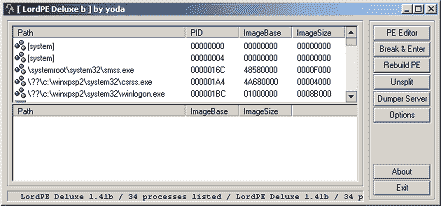

**3.3.2 P****EiD**

[PE iDentifier ](http://peid.has.it/)is valuable to identify the type of compilers, packers, and cryptors of PE files. As of now, it can detect more than 500 different signature types of PE files.

[PE iDentifier ](http://peid.has.it/)非常棒，它可以识别编译器，packers，PE 文件的 cryptors 的类型。到目前为止，它可以检测 500 种以上的 PE 文件类型。

 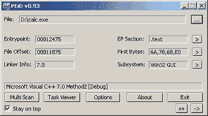

**3.3.3**** Resource Hacker**

[Resource Hacker ](http://www.angusj.com/resourcehacker/)can be employed to modify resource directory information; icon, menu, version info, string table, and etc.

可以用[Resource Hacker ](http://www.angusj.com/resourcehacker/)修改资源目录信息；图标，菜单，版本信息，字符串表，等等。

 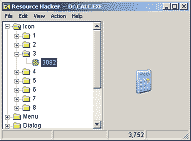

**3.3.4**** WinHex**

[WinHex](http://www.winhex.com/winhex/index-m.html), it is clear what you can do with this tool.

[WinHex](http://www.winhex.com/winhex/index-m.html)，通过它的名字，就可以了解它能做什么了。

 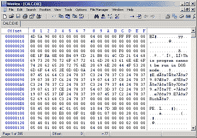

**3.3.5**** CFF Explorer**

Eventually, [CFF Explorer ](http://www.pmode.net/CFF.php)by [Ntoskrnl ](http://www.pmode.net/USERS/116/UserInfo.xml)is what you wish to have as a PE Utility tool in your dream; it supports PE32/64, PE rebuild included [Common Language Infrastructure (CLI)](http://en.wikipedia.org/wiki/Common_Language_Infrastructure) file, in other words, the [.NET file](http://en.wikipedia.org/wiki/Microsoft_.NET), a resource modifier, and much more facilities which can not be found in others, just try and discover every unimaginable option by hand.

最后，[Ntoskrnl ](http://www.pmode.net/USERS/116/UserInfo.xml)的[CFF Explorer ](http://www.pmode.net/CFF.php)可能是你梦中都想拥有的 PE 工具；它支持 PE32/64，PE rebuild（包括[Common Language Infrastructure (CLI)](http://en.wikipedia.org/wiki/Common_Language_Infrastructure)文件，换句话说，支持[.NET file](http://en.wikipedia.org/wiki/Microsoft_.NET)），资源修改器，和许多其它工具中不曾见过的便利功能，只有亲自试用，才能发现那些不可思议的选项。

 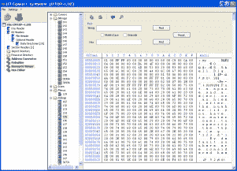

**4 Add new section and Change OEP**

**4****增加新区段并修改****OEP**

We are ready to do the first step of making our project. So I have provided a library to add a new section and rebuild the portable executable file. Before starting, I like you get familiar with the headers of a PE file, by using [OllyDbg](http://www.ollydbg.de/). You should first open a PE file, that pops up a menu, **View->Executable file**, again get a popup menu **Special->PE header**. And you will observe a scene similar to [Figure 3](http://www.codeproject.com/system/inject2exe.asp#Figure3#Figure3). Now, come to Main Menu **View->Memory**, try to distinguish the sections inside the **Memory map** window.

我们准备进行本项目的第一步。因此，我提供了一个 library 来增加一个新区段并重建 PE 文件。在开始之前，我希望你用[OllyDbg](http://www.ollydbg.de/)熟悉 PE 文件的头。你首先应该打开一个 PE 文件，然后选择菜单**View->Executable modules**（原文是 Executable file，我根据 OllyDbg 1.10 版本修改成 Executable modules），在弹出的窗口中选中要查看的文件并单击右键，在弹出的菜单中选择**Special->PE header**。你将可以看到类似[Figure 3](http://www.codeproject.com/system/inject2exe.asp#Figure3#Figure3)的内容。现在，在主菜单中选择**View->Memory**，试着在**Memory map**窗口里区分区段。提供话说 ker XP,3.51

**Figure 3**

| 00000000000000020000000400000006000000080000000A0000000C0000000E00000010000000120000001400000016000000180000001A0000001C0000001D0000001E0000001F000000200000002100000022000000230000002400000025000000260000002700000028000000290000002A0000002B0000002C0000002D0000002E0000002F000000300000003100000032000000330000003400000035000000360000003700000038000000390000003A0000003B0000003C ||  4D 5A 9000 0300 0000 0400 0000 FFFF 0000 B800 0000 0000 0000 4000 0000 00 00 00 00 00 00 00 00 00 00 00 00 00 00 00 00 00 00 00 00 00 00 00 00 00 00 00 00 00 00 00 00 F0000000   ||  ASCII "MZ" DW 0090 DW 0003 DW 0000 DW 0004 DW 0000 DW FFFF DW 0000 DW 00B8 DW 0000 DW 0000 DW 0000 DW 0040 DW 0000 DB 00 DB 00 DB 00 DB 00 DB 00 DB 00 DB 00 DB 00 DB 00 DB 00 DB 00 DB 00 DB 00 DB 00 DB 00 DB 00 DB 00 DB 00 DB 00 DB 00 DB 00 DB 00 DB 00 DB 00 DB 00 DB 00 DB 00 DB 00 DB 00 DB 00 DB 00 DB 00 DD 000000F0  ||  DOS EXE Signature DOS\_PartPag = 90 (144.) DOS\_PageCnt = 3 DOS\_ReloCnt = 0 DOS\_HdrSize = 4 DOS\_MinMem = 0 DOS\_MaxMem = FFFF (65535.) DOS\_ReloSS = 0 DOS\_ExeSP = B8 DOS\_ChkSum = 0 DOS\_ExeIP = 0 DOS\_ReloCS = 0 DOS\_TablOff = 40 DOS\_Overlay = 0                                 Offset to PE signature |
| --- | --- | --- | --- |

I want to explain how we can plainly change the Offset of Entry Point (OEP) in our [sample file](http://www.codeproject.com/system/inject2exe.asp#CalcEXE1TestDownloadLink#CalcEXE1TestDownloadLink), *CALC.EXE* of Windows XP. First, by using a PE Tool, and also using our PE Viewer, we find OEP, 0x00012475, and Image Base, 0x01000000. This value of OEP is the Relative Virtual Address, so the Image Base value is used to convert it to the Virtual Address.

首先，我想说明我们应该怎样改变[sample file](http://www.codeproject.com/system/inject2exe.asp#CalcEXE1TestDownloadLink#CalcEXE1TestDownloadLink)――Windows XP 的*CALC.EXE*――的 OEP（Offset of Entry Point）。首先，用 PE Viewer 发现 OEP 是 0x00012475，Image Base 是 0x01000000。OEP 的值是 RVA（Relative Virtual Address），因此，用 Image Base 的值把它转换为 VA（Virtual Address）。

| **Virtual\_Address = Image\_Base + Relative\_Virtual\_Address** |
| --- |

DWORD OEP\_RVA = image\_nt\_headers->OptionalHeader.AddressOfEntryPoint ; 

*// OEP\_RVA = 0x00012475*

DWORD OEP\_VA = image\_nt\_headers->OptionalHeader.ImageBase + OEP\_RVA ; 

*// OEP\_VA = 0x01000000 + 0x00012475 = 0x01012475*

**PE Maker - Step 1**

*   [Download source files - 54.7 Kb](http://www.codeproject.com/system/inject2exe/pemaker1.zip) 

**CALC.EXE - test file**

*   [Download test PE file - 49.5 Kb](http://www.codeproject.com/system/inject2exe/test1.zip) 

DynLoader(), in *loader.cpp*, is reserved for the data of the new section, in other words, the **Loader**.

*loader.cpp*中的 DynLoader()是为新区段的数据保留的，换句话说，是**Loader**。

**DynLoader Step 1**

\_\_stdcall void DynLoader()

{

\_asm

{

*//----------------------------------*

    DWORD\_TYPE(DYN\_LOADER\_START\_MAGIC)

*//----------------------------------*

    MOV EAX,01012475h *// << Original OEP*

    JMP EAX

*//----------------------------------*

    DWORD\_TYPE(DYN\_LOADER\_END\_MAGIC)

*//----------------------------------*

}

}

Unfortunately, this source can only be applied for the [sample test file](http://www.codeproject.com/system/inject2exe.asp#CalcEXE1TestDownloadLink#CalcEXE1TestDownloadLink). We should complete it by saving the value of the original OEP in the new section, and use it to reach the real OEP. I have accomplished it in Step 2 (Section 5).

不幸地是，这个源码只能用于[sample test file](http://www.codeproject.com/system/inject2exe.asp#CalcEXE1TestDownloadLink#CalcEXE1TestDownloadLink)。我们应该把原始的 OEP 保存在新区段里，然后用它寻找真正的 OEP，来完成这个例子。我将在项目的第 2 步（第五部分）完成它。

**4.1 Retrieve and Rebuild PE file**

**4.1 ****找回并重建****PE****文件**

I have made a simple class library to recover PE information and to use it in a new PE file.

我提供一个简单的类库，可用于恢复 PE 信息，并在新 PE 文件中使用这些信息。

**CPELibrary Class Step 1**

*//----------------------------------------------------------------*

class CPELibrary 

{

private:

    *//-----------------------------------------*

    PCHAR                   pMem;

    DWORD                   dwFileSize;

    *//-----------------------------------------*

protected:

    *//-----------------------------------------*

    PIMAGE\_DOS\_HEADER       image\_dos\_header;

    PCHAR                   pDosStub;

    DWORD                   dwDosStubSize, dwDosStubOffset;

    PIMAGE\_NT\_HEADERS       image\_nt\_headers;

    PIMAGE\_SECTION\_HEADER   image\_section\_header\[MAX\_SECTION\_NUM\];

    PCHAR                   image\_section\[MAX\_SECTION\_NUM\];

    *//-----------------------------------------*

protected:

    *//-----------------------------------------*

    DWORD PEAlign(DWORD dwTarNum,DWORD dwAlignTo);

    void AlignmentSections();

    *//-----------------------------------------*

    DWORD Offset2RVA(DWORD dwRO);

    DWORD RVA2Offset(DWORD dwRVA);

    *//-----------------------------------------*

    PIMAGE\_SECTION\_HEADER ImageRVA2Section(DWORD dwRVA);

    PIMAGE\_SECTION\_HEADER ImageOffset2Section(DWORD dwRO);

    *//-----------------------------------------*

    DWORD ImageOffset2SectionNum(DWORD dwRVA);

    PIMAGE\_SECTION\_HEADER AddNewSection(char\* szName,DWORD dwSize);

    *//-----------------------------------------*

public:

    *//-----------------------------------------*

    CPELibrary();

    ~CPELibrary();

    *//-----------------------------------------*

    void OpenFile(char\* FileName);

    void SaveFile(char\* FileName);    

    *//-----------------------------------------*

};

By [Table 1](http://www.codeproject.com/system/inject2exe.asp#Table1#Table1), the usage of image\_dos\_header, pDosStub, image\_nt\_headers, image\_section\_header \[MAX\_SECTION\_NUM\], and image\_section\[MAX\_SECTION\_NUM\] is clear. We use OpenFile() and SaveFile() to retrieve and rebuild a PE file. Furthermore, AddNewSection() is employed to create the new section, the important step.

在[Table 1](http://www.codeproject.com/system/inject2exe.asp#Table1#Table1)中，image\_dos\_header, pDosStub, image\_nt\_headers, image\_section\_header \[MAX\_SECTION\_NUM\]，和 image\_section\[MAX\_SECTION\_NUM\]的用法已经写得很清楚。我们用 OpenFile()和 SaveFile()找回并重建 PE 文件。此外，用 AddNewSection()修建新区段，这是重要的一步。

**4.2 Create Data for new Section**

**4.2 ****为新区段创建数据**

In *pecrypt.cpp*, I have represented another class, CPECryptor, to comprise the data of the new section. Nevertheless, the data of the new section is created by DynLoader() in *loader.cpp*, [DynLoader Step 1](http://www.codeproject.com/system/inject2exe.asp#DynLoaderStep1#DynLoaderStep1). We use the CPECryptor class to enter this data in to the new section, and also some other stuff.

在*pecrypt.cpp*里，我提供了另外一个类――CPECryptor，用它组建新区段的数据。然而，新区段的数据是被*loader.cpp*里的 DynLoader()（在[DynLoader Step 1](http://www.codeproject.com/system/inject2exe.asp#DynLoaderStep1#DynLoaderStep1)中介绍的）创建的。因此，我们用 CPECryptor 类把这些数据（也有其它的数据）输入新区段。

**CPECryptor Class Step 1**

*//----------------------------------------------------------------*

class CPECryptor: public CPELibrary

{

private:

    *//----------------------------------------*

    PCHAR pNewSection;

    *//----------------------------------------*

    DWORD GetFunctionVA(void\* FuncName);

    void\* ReturnToBytePtr(void\* FuncName, DWORD findstr);

    *//----------------------------------------*

protected:

    *//----------------------------------------*

public:    

    *//----------------------------------------*

    void CryptFile(int(\_\_cdecl \*callback) (unsigned int, unsigned int));

    *//----------------------------------------*

};

*//----------------------------------------------------------------*

**4.3 Some notes regarding creating a new PE file**

**4.3 ****创建新****PE****文件时应该注意的地方**

*   Align the VirtualAddress and the VirtualSize of each section by SectionAlignment: 

·                image\_section\_header\[i\]->VirtualAddress=

·                    PEAlign(image\_section\_header\[i\]->VirtualAddress,

·                    image\_nt\_headers->OptionalHeader.SectionAlignment);

·                 

·                image\_section\_header\[i\]->Misc.VirtualSize=

·                    PEAlign(image\_section\_header\[i\]->Misc.VirtualSize,

    image\_nt\_headers->OptionalHeader.SectionAlignment);

*   Align the PointerToRawData and the SizeOfRawData of each section by FileAlignment: 

·                image\_section\_header\[i\]->PointerToRawData =

·                    PEAlign(image\_section\_header\[i\]->PointerToRawData,

·                            image\_nt\_headers->OptionalHeader.FileAlignment);

·                 

·                image\_section\_header\[i\]->SizeOfRawData =

·                    PEAlign(image\_section\_header\[i\]->SizeOfRawData,

            image\_nt\_headers->OptionalHeader.FileAlignment);

*   Correct the SizeofImage by the virtual size and the virtual address of the last section: 

·                image\_nt\_headers->OptionalHeader.SizeOfImage = 

·                          image\_section\_header\[LastSection\]->VirtualAddress +

          image\_section\_header\[LastSection\]->Misc.VirtualSize;

*   Set the Bound Import Directory header to zero, as this directory is not very important to execute a PE file: 

·                image\_nt\_headers->

·                  OptionalHeader.DataDirectory\[IMAGE\_DIRECTORY\_ENTRY\_BOUND\_IMPORT\].

·                  VirtualAddress = 0;

·                image\_nt\_headers->

  OptionalHeader.DataDirectory\[IMAGE\_DIRECTORY\_ENTRY\_BOUND\_IMPORT\].Size = 0;

**4.4 Some notes regarding linking this VC Project**

**4.4 ****关于连接这个****VC****项目时应该注意的地方**

*   Set *Linker->General->Enable Incremental Linking* to **No (/INCREMENTAL:NO)**. 

 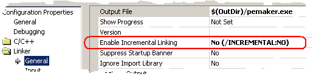

You can comprehend the difference between incremental link and no-incremental link by looking at the following picture:

通过下图，你应该能理解增量连接与非增量连接之间的区别：

 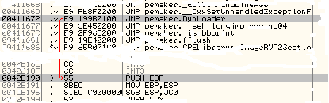

To acquire the virtual address of DynLoader(), we obtain the virtual address of JMP pemaker.DynLoader in the incremental link, but by no-incremental link, the real virtual address is gained by the following code:

为了得到 DynLoader()的 virtual address，我们在增量连接里可以得到 JMP pemaker.DynLoader 的 virtual address，但是在非增量连接里，只能通过下面的代码得到真正的 virtual address：

DWORD dwVA= (DWORD) DynLoader;

This setting is more critical in the incremental link when you try to find the beginning and ending of the **Loader**, DynLoader(), by CPECryptor::ReturnToBytePtr():

当你设法通过 CPECryptor::ReturnToBytePtr()找出 DynLoader()――**Loader**的开始和结束部分，在增量连接里的这个设置显得尤为重要。

void\* CPECryptor::ReturnToBytePtr(void\* FuncName, DWORD findstr)

{

    void\* tmpd;

    \_\_asm

   {

        mov eax, FuncName

        jmp df

hjg:    inc eax

df:     mov ebx, \[eax\]

        cmp ebx, findstr

        jnz hjg

        mov tmpd, eax

    }

    return tmpd;

}

**5 Store Important Data and Reach Original OEP**

**5 ****保存重要的数据并找到原始的****OEP**

Right now, we save the Original OEP and also the Image Base in order to reach to the virtual address of OEP. I have reserved a free space at the end of DynLoader() to store them, [DynLoader Step 2](http://www.codeproject.com/system/inject2exe.asp#DynLoaderStep2#DynLoaderStep2).

为了找到 OEP 的 virtual address，我们立即保存原始的 OEP 和 Image Base。我在 DynLoader()的尾部预留了一块空地来保存它们，[DynLoader Step 2](http://www.codeproject.com/system/inject2exe.asp#DynLoaderStep2#DynLoaderStep2)。

**PE Maker - Step 2**

*   [Download source files - 58.3 Kb](http://www.codeproject.com/system/inject2exe/pemaker2.zip) 

**DynLoader Step 2**

\_\_stdcall void DynLoader()

{

\_asm

{

*//----------------------------------*

    DWORD\_TYPE(DYN\_LOADER\_START\_MAGIC)

*//----------------------------------*

Main\_0:

    PUSHAD

    *// get base ebp*

    CALL Main\_1

Main\_1:    

    POP EBP

    SUB EBP,OFFSET Main\_1

    MOV EAX,DWORD PTR \[EBP+\_RO\_dwImageBase\]

    ADD EAX,DWORD PTR \[EBP+\_RO\_dwOrgEntryPoint\]

    PUSH EAX

    RETN *// >> JMP to Original OEP*

*//----------------------------------*

    DWORD\_TYPE(DYN\_LOADER\_START\_DATA1)

*//----------------------------------*

\_RO\_dwImageBase:                DWORD\_TYPE(0xCCCCCCCC)

\_RO\_dwOrgEntryPoint:            DWORD\_TYPE(0xCCCCCCCC)

*//----------------------------------*

    DWORD\_TYPE(DYN\_LOADER\_END\_MAGIC)

*//----------------------------------*

}

}

The new function, CPECryptor::CopyData1(), will implement the copy of the Image Base value and the Offset of Entry Point value into 8 bytes of free space in the loader.

新函数――CPECryptor::CopyData1()――将把 Image Base 值和 OEP 值复制到 loader 里空闲空间的 8 字节里。

**5.1 Restore the first Registers Context**

**5.1 ****恢复最初寄存器的上下文**

It is important to recover the Original Context of the thread. We have not yet done it in the [DynLoader Step 2](http://www.codeproject.com/system/inject2exe.asp#DynLoaderStep2#DynLoaderStep2) source code. We can modify the source of DynLoader() to repossess the first Context.

恢复线程的原始上下文很重要。不过，我们在[DynLoader Step 2](http://www.codeproject.com/system/inject2exe.asp#DynLoaderStep2#DynLoaderStep2)的源码里并没有这样做。我们可以修改 DynLoader()的源码，重新得到最初的上下文。

\_\_stdcall void DynLoader()

{

\_asm

{

*//----------------------------------*

    DWORD\_TYPE(DYN\_LOADER\_START\_MAGIC)

*//----------------------------------*

Main\_0:

    PUSHAD*// Save the registers context in stack*

    CALL Main\_1

Main\_1:    

    POP EBP*// Get Base EBP*

    SUB EBP,OFFSET Main\_1

    MOV EAX,DWORD PTR \[EBP+\_RO\_dwImageBase\]

    ADD EAX,DWORD PTR \[EBP+\_RO\_dwOrgEntryPoint\]

    MOV DWORD PTR \[ESP+1Ch\],EAX *// pStack.Eax <- EAX*

    POPAD *// Restore the first registers context from stack*

    PUSH EAX

    XOR  EAX, EAX

    RETN *// >> JMP to Original OEP*

*//----------------------------------*

    DWORD\_TYPE(DYN\_LOADER\_START\_DATA1)

*//----------------------------------*

\_RO\_dwImageBase:                DWORD\_TYPE(0xCCCCCCCC)

\_RO\_dwOrgEntryPoint:            DWORD\_TYPE(0xCCCCCCCC)

*//----------------------------------*

    DWORD\_TYPE(DYN\_LOADER\_END\_MAGIC)

*//----------------------------------*

}

}

**5.2 Restore the Original Stack**

**5.2 ****恢复原始的栈**

We can also recover the original stack by setting the value of the beginning stack + 0x34 to the Original OEP, but it is not very important. Nevertheless, in the following code, I have accomplished the loader code by a simple trick to reach OEP in addition to redecorating the stack. You can observe the implementation by tracing using [OllyDbg](http://www.ollydbg.de/) or SoftICE.

我们也可以在原始 OEP 的基础上，设置栈的起始值+0x34 来恢复原来的栈，但它不是非常重要。不过，在下面的代码中，我通过一个小技巧找到 OEP 并重新修饰栈来完成 loader 代码。你可以用[OllyDbg](http://www.ollydbg.de/)或 SoftICE 观察具体的实现。

\_\_stdcall void DynLoader()

{

\_asm

{

*//----------------------------------*

    DWORD\_TYPE(DYN\_LOADER\_START\_MAGIC)

*//----------------------------------*

Main\_0:

    PUSHAD *// Save the registers context in stack*

    CALL Main\_1

Main\_1:    

    POP EBP

    SUB EBP,OFFSET Main\_1

    MOV EAX,DWORD PTR \[EBP+\_RO\_dwImageBase\]

    ADD EAX,DWORD PTR \[EBP+\_RO\_dwOrgEntryPoint\]

    MOV DWORD PTR \[ESP+54h\],EAX *// pStack.Eip <- EAX*

    POPAD *// Restore the first registers context from stack*

    CALL \_OEP\_Jump

    DWORD\_TYPE(0xCCCCCCCC)

\_OEP\_Jump:

    PUSH EBP

    MOV EBP,ESP

    MOV EAX,DWORD PTR \[ESP+3Ch\] *// EAX <- pStack.Eip*

    MOV DWORD PTR \[ESP+4h\],EAX  *// \_OEP\_Jump RETURN pointer <- EAX*

    XOR EAX,EAX

    LEAVE

    RETN

*//----------------------------------*

    DWORD\_TYPE(DYN\_LOADER\_START\_DATA1)

*//----------------------------------*

\_RO\_dwImageBase:                DWORD\_TYPE(0xCCCCCCCC)

\_RO\_dwOrgEntryPoint:            DWORD\_TYPE(0xCCCCCCCC)

*//----------------------------------*

    DWORD\_TYPE(DYN\_LOADER\_END\_MAGIC)

*//----------------------------------*

}

}

**5.3 Approach OEP by Structured Exception Handling**

**5.3 ****通过****SEH****接近****OEP**

An exception is generated when a program falls into a fault code execution and an error happens, so in such a special condition, the program immediately jumps to a function called the exception handler from exception handler list of the [Thread Information Block](http://www.codeproject.com/system/inject2exe.asp#ThreadInformationBlock#ThreadInformationBlock).

当程序陷入故障或发生错误时会生成异常，在特殊的条件下，程序立即转到一个函数，调用[Thread Information Block](http://www.codeproject.com/system/inject2exe.asp#ThreadInformationBlock#ThreadInformationBlock)异常处理程序列表中的异常处理程序。

The next example of a [try-except statement](http://msdn.microsoft.com/library/default.asp?url=/library/en-us/vccelng/htm/key_s-z_4.asp) in C++ clarifies the operation of [structured exception handling](http://msdn.microsoft.com/library/default.asp?url=/library/en-us/debug/base/about_structured_exception_handling.asp). Besides the assembly code of this code, it elucidates the structured exception handler installation, the raise of an exception, and the exception handler function.

接下来介绍的[try-except statement](http://msdn.microsoft.com/library/default.asp?url=/library/en-us/vccelng/htm/key_s-z_4.asp)例子，用 C++阐明了[structured exception handling](http://msdn.microsoft.com/library/default.asp?url=/library/en-us/debug/base/about_structured_exception_handling.asp)的操作。除这个代码之外的汇编代码说明了 SEH 安装，引发异常，和异常处理程序函数。

#include "stdafx.h"

#include "windows.h"

 

void RAISE\_AN\_EXCEPTION()

{    

\_asm

{

    INT 3

    INT 3

    INT 3

    INT 3

}

}

 

int \_tmain(int argc, \_TCHAR\* argv\[\])

{

    \_\_try

    {

        \_\_try{

            printf("1: Raise an Exception\\n");

            RAISE\_AN\_EXCEPTION();

        }

        \_\_finally

        {

            printf("2: In Finally\\n");

        }

    }

    \_\_except( printf("3: In Filter\\n"), EXCEPTION\_EXECUTE\_HANDLER )

    {

        printf("4: In Exception Handler\\n");

    }

    return 0;

}

**; main()**

00401000: PUSH EBP

00401001: MOV EBP,ESP

00401003: PUSH -1

00401005: PUSH 00407160

**; \_\_try {**

; the structured exception handler (SEH) installation 

0040100A: PUSH \_except\_handler3  

0040100F: MOV EAX,DWORD PTR FS:\[0\]

00401015: PUSH EAX

00401016: MOV DWORD PTR FS:\[0\],ESP

0040101D: SUB ESP,8

00401020: PUSH EBX

00401021: PUSH ESI

00401022: PUSH EDI

00401023: MOV DWORD PTR SS:\[EBP-18\],ESP

**;     \_\_try {**

00401026: XOR ESI,ESI

00401028: MOV DWORD PTR SS:\[EBP-4\],ESI

0040102B: MOV DWORD PTR SS:\[EBP-4\],1

00401032: PUSH OFFSET "1: Raise an Exception"

00401037: CALL printf

0040103C: ADD ESP,4

; the raise a exception, INT 3 exception

; RAISE\_AN\_EXCEPTION()

0040103F: INT3      

00401040: INT3

00401041: INT3

00401042: INT3

**;     } \_\_finally {**

00401043: MOV DWORD PTR SS:\[EBP-4\],ESI

00401046: CALL 0040104D

0040104B: JMP 00401080

0040104D: PUSH OFFSET "2: In Finally"

00401052: CALL printf

00401057: ADD ESP,4

0040105A: RETN

**;     }**

**; }**

**; \_\_except( **

0040105B: JMP 00401080

0040105D: PUSH OFFSET "3: In Filter"

00401062: CALL printf

00401067: ADD ESP,4

0040106A: MOV EAX,1 ; EXCEPTION\_EXECUTE\_HANDLER = 1

0040106F: RETN

**;     , EXCEPTION****\_EXECUTE\_HANDLER )**

**; {**

; the exception handler funtion

00401070: MOV ESP,DWORD PTR SS:\[EBP-18\]

00401073: PUSH OFFSET "4: In Exception Handler"

00401078: CALL printf

0040107D: ADD ESP,4

**; }**

00401080: MOV DWORD PTR SS:\[EBP-4\],-1

0040108C: XOR EAX,EAX

; restore previous SEH

0040108E: MOV ECX,DWORD PTR SS:\[EBP-10\]

00401091: MOV DWORD PTR FS:\[0\],ECX

00401098: POP EDI

00401099: POP ESI

0040109A: POP EBX

0040109B: MOV ESP,EBP

0040109D: POP EBP

0040109E: RETN

Make a Win32 console project, and link and run the preceding C++ code, to perceive the result:

生成一个 Win32 控制台项目，连接并运行前面所说的 C++代码，观察结果：

| **1: Raise an Exception  
3: In Filter  
2: In Finally  
4: In Exception Handler  
\_  
  
  
** |
| --- |

This program runs the exception expression, printf("3: In Filter\\n");, when an exception happens, in this example the INT 3 exception. You can employ other kinds of exception too. In [OllyDbg](http://www.ollydbg.de/), **Debugging options->Exceptions**, you can see a short list of different types of exceptions.

当异常发生时，这个程序运行到异常表达式――printf("3: In Filter\\n");，在这个例子里是 INT 3 异常。当然，你也可以使用其它类型的异常。在[OllyDbg](http://www.ollydbg.de/)里，选择**Debugging options->Exceptions**，你可以看到不同类型的异常的简短列表。

 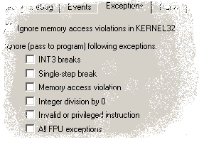

**5.3.1**** Implement Exception Handler**

**5.3.1****实现异常处理程序**

We desire to construct a structured exception handler in order to reach OEP. Now, I think you have distinguished the SEH installation, the exception raise, and the exception expression filter, by foregoing the assembly code. To establish our exception handler approach, we need to comprise the following codes:

我们想构造一个 SEH 来寻找 OEP。现在，我想你通过阅读前面的汇编代码，应该已经可以区分 SEH 安装，引发异常，和异常表达式过滤器了。为了建立我们的异常处理方法，我们需要包括下面的代码：

*   **SEH installation**: 

·                    LEA EAX,\[EBP+\_except\_handler1\_OEP\_Jump\]

·                    PUSH EAX

·                    PUSH DWORD PTR FS:\[0\]

    MOV DWORD PTR FS:\[0\],ESP

*   **An Exception Raise**: 

    INT 3

*   **Exception handler expression filter**: 

·                \_except\_handler1\_OEP\_Jump:

·                    PUSH EBP

·                    MOV EBP,ESP

·                    ...

·                    MOV EAX, EXCEPTION\_CONTINUE\_SEARCH // EXCEPTION\_CONTINUE\_SEARCH = 0

·                    LEAVE

    RETN

So we yearn for making the ensuing C++ code in assembly language to inaugurate our engine to approach the Offset of Entry Point by SEH.

因此，我们渴望通过 SEH，使随后的 C++代码利用汇编代码生成接近 OEP 的引擎。

\_\_try *// SEH installation*

{

    \_\_asm 

    {

        INT 3 *// An Exception Raise*

    }

}

\_\_except( ..., EXCEPTION\_CONTINUE\_SEARCH ){}

*// Exception handler expression filter*

In assembly code...

    *; ----------------------------------------------------*

    *; the structured exception handler (SEH) installation*

    ***; \_\_try {***

    LEA EAX,\[EBP+\_except\_handler1\_OEP\_Jump\]

    PUSH EAX

    PUSH DWORD PTR FS:\[0\]

    MOV DWORD PTR FS:\[0\],ESP

    *; ----------------------------------------------------*

    *; the raise a INT 3 exception*

    INT 3

    INT 3

    INT 3

    INT 3

    ***; }***

***; \_\_except( ... ***

    *; ----------------------------------------------------*

    *; exception handler expression filter*

\_except\_handler1\_OEP\_Jump:

    PUSH EBP

    MOV EBP,ESP

    ... 

    MOV EAX, EXCEPTION\_CONTINUE\_SEARCH *;** EXCEPTION\_CONTINUE\_SEARCH = 0*

    LEAVE

    RETN

    ***; ,****** EXCEPTION\_CONTINUE\_SEARCH ) { }***

The exception value, \_\_except(..., Value), determines how the exception is handled, it can have three values, 1, 0, -1. To understand them, refer to the [try-except statement](http://msdn.microsoft.com/library/default.asp?url=/library/en-us/vccelng/htm/key_s-z_4.asp) description in the MSDN library. We set it to EXCEPTION\_CONTINUE\_SEARCH (0), not to run the exception handler function, therefore by this value, the exception is not recognized, is simply ignored, and the thread continues its code-execution.

异常值――\_\_except(..., Value)――决定异常怎样被处理，它有三种值，1，0，\-1。为了理解它们，在 MSDN library 中查阅[try-except statement](http://msdn.microsoft.com/library/default.asp?url=/library/en-us/vccelng/htm/key_s-z_4.asp)描述。我们在这里把它设为 EXCEPTION\_CONTINUE\_SEARCH (0)，不运行异常处理程序函数，因此，通过设置这个值，系统不认可这个异常，只是忽略它，线程将继续执行代码。

**How the SEH installation is implemented**

As you perceived from the illustrated code, the SEH installation is done by the FS segment register. Microsoft Windows 32 bit uses the FS segment register as a pointer to the data block of the main thread. The first 0x1C bytes comprise the information of the [Thread Information Block (TIB)](http://www.codeproject.com/system/inject2exe.asp#ThreadInformationBlock#ThreadInformationBlock). Therefore, FS:\[00h\] refers to ExceptionList of the main thread, [Table 3](http://www.codeproject.com/system/inject2exe.asp#Table3#Table3). In our code, we have pushed the pointer to \_except\_handler1\_OEP\_Jump in the stack and changed the value of ExceptionList, FS:\[00h\], to the beginning of the stack, ESP.

像你从插图的代码中看到的，SEH 安装被 FS 段寄存器完成。微软 32 位 Windows 用 FS 段寄存器作为指向主线程数据块的指针。第一个 0x1C 字节包括[Thread Information Block (TIB)](http://www.codeproject.com/system/inject2exe.asp#ThreadInformationBlock#ThreadInformationBlock)信息。因此，FS:\[00h\]指向主线程的 ExceptionList，见[Table 3](http://www.codeproject.com/system/inject2exe.asp#Table3#Table3)。在我们的代码中，我们把指向\_except\_handler1\_OEP\_Jump 的指针压入栈，把 ExceptionList――FS:\[00h\]的值改为栈的开头――ESP。

**Thread Information Block (TIB)**

typedef struct \_NT\_TIB32 {

    DWORD ExceptionList;

    DWORD StackBase;

    DWORD StackLimit;

    DWORD SubSystemTib;

    union {

        DWORD FiberData;

        DWORD Version;

    };

    DWORD ArbitraryUserPointer;

    DWORD Self;

} NT\_TIB32, \*PNT\_TIB32;

**Table 3 - FS segment register and Thread Information Block**

| DWORD PTR FS:\[00h\] || ExceptionList |
| --- | --- |
| DWORD PTR FS:\[04h\] || StackBase |
| DWORD PTR FS:\[08h\] || StackLimit |
| DWORD PTR FS:\[0Ch\] || SubSystemTib |
| DWORD PTR FS:\[10h\] || FiberData / Version |
| DWORD PTR FS:\[14h\] || ArbitraryUserPointer |
| DWORD PTR FS:\[18h\] || Self |

**5.3.2 A****ttain OEP by adjusting the Thread Context **

**5.3.2****通过调整线程上下文得到****OEP**

In this part, we effectuate our performance by accomplishing the OEP approach. We change the Context of the thread and ignore every simple exception handling, and let the thread continue the execution, but in the original OEP!

在这一部分，我们通过完成 OEP 方法实现我们的执行。我们改变线程的上下文，忽略每一个简单的异常处理，让线程继续执行，除了在原始的 OEP 里！

When an exception happens, the context of the processor during the time of the exception is saved in the stack. By [EXCEPTION\_POINTERS](http://msdn.microsoft.com/library/default.asp?url=/library/en-us/debug/base/exception_pointers_str.asp), we have access to the pointer of ContextRecord. The ContextRecord has the [CONTEXT](http://msdn.microsoft.com/library/default.asp?url=/library/en-us/debug/base/context_str.asp) data structure,[ Table 4](http://www.codeproject.com/system/inject2exe.asp#Table4#Table4), this is the thread context during the exception time. When we ignore the exception by EXCEPTION\_CONTINUE\_SEARCH (0), the instruction pointer as well the context will be set to ContextRecord in order to return to the previous condition. Therefore, if we change the Eip of the [Win32 Thread Context](http://www.codeproject.com/system/inject2exe.asp#Win32ThreadContextstructure#Win32ThreadContextstructure) to the Original Offset of Entry Point, it will come clearly into OEP. 

当异常发生时，解决异常时的、处理器的上下文保存在栈里。通过[EXCEPTION\_POINTERS](http://msdn.microsoft.com/library/default.asp?url=/library/en-us/debug/base/exception_pointers_str.asp)，我们可以访问 ContextRecord 的指针。ContextRecord 有[CONTEXT](http://msdn.microsoft.com/library/default.asp?url=/library/en-us/debug/base/context_str.asp)数据结构，见[ Table 4](http://www.codeproject.com/system/inject2exe.asp#Table4#Table4)，这是异常期间的线程上下文。当我们通过 EXCEPTION\_CONTINUE\_SEARCH (0)忽略异常时，指令指针（EIP）为了返回到原来的状态，会把上下文设为 ContextRecord。因此，如果我们把[Win32 Thread Context](http://www.codeproject.com/system/inject2exe.asp#Win32ThreadContextstructure#Win32ThreadContextstructure)的 Eip 改为原始的 OEP，很明显，它将得到 OEP。

    MOV EAX, ContextRecord

    MOV EDI, dwOEP                   *; EAX <- dwOEP*

    MOV DWORD PTR DS:\[EAX+0B8h\], EDI *; pContext.Eip <- EAX*

**Win32 Thread Context structure**

#define MAXIMUM\_SUPPORTED\_EXTENSION     512

 

typedef struct \_CONTEXT {

    *//-----------------------------------------*

    DWORD ContextFlags;

    *//-----------------------------------------*

    DWORD   Dr0;

    DWORD   Dr1;

    DWORD   Dr2;

    DWORD   Dr3;

    DWORD   Dr6;

    DWORD   Dr7;

    *//-----------------------------------------*

    FLOATING\_SAVE\_AREA FloatSave;

    *//-----------------------------------------*

    DWORD   SegGs;

    DWORD   SegFs;

    DWORD   SegEs;

    DWORD   SegDs;

    *//-----------------------------------------*

    DWORD   Edi;

    DWORD   Esi;

    DWORD   Ebx;

    DWORD   Edx;

    DWORD   Ecx;

    DWORD   Eax;

    *//-----------------------------------------*

    DWORD   Ebp;

    DWORD   Eip;

    DWORD   SegCs;

    DWORD   EFlags;

    DWORD   Esp;

    DWORD   SegSs;

    *//-----------------------------------------*

    BYTE    ExtendedRegisters\[MAXIMUM\_SUPPORTED\_EXTENSION\];

    *//----------------------------------------*

} CONTEXT, 

\*LPCONTEXT;

**Table 4 - CONTEXT**

| Context Flags || 0x00000000 || ContextFlags |
| --- | --- | --- |
| Context Debug Registers || 0x00000004 || Dr0 |
| 0x00000008 || Dr1 |
| 0x0000000C || Dr2 |
| 0x00000010 || Dr3 |
| 0x00000014 || Dr6 |
| 0x00000018 || Dr7 |
| Context Floating Point || 0x0000001C || FloatSave || StatusWord |
| 0x00000020 || StatusWord |
| 0x00000024 || TagWord |
| 0x00000028 || ErrorOffset |
| 0x0000002C || ErrorSelector |
| 0x00000030 || DataOffset |
| 0x00000034 || DataSelector |
| 0x00000038  
...  
0x00000087 || RegisterArea \[0x50\] |
| 0x00000088 || Cr0NpxState |
| Context Segments || 0x0000008C || SegGs |
| 0x00000090 || SegFs |
| 0x00000094 || SegEs |
| 0x00000098 || SegDs |
| Context Integer || 0x0000009C || Edi |
| 0x000000A0 || Esi |
| 0x000000A4 || Ebx |
| 0x000000A8 || Edx |
| 0x000000AC || Ecx |
| 0x000000B0 || Eax |
| Context Control || 0x000000B4 || Ebp |
| 0x000000B8 || Eip |
| 0x000000BC || SegCs |
| 0x000000C0 || EFlags |
| 0x000000C4 || Esp |
| 0x000000C8 || SegSs |
| Context Extended Registers || 0x000000CC  
...  
0x000002CB || ExtendedRegisters\[0x200\] |

By the following code, we have accomplished the main purpose of coming to OEP by the structured exception handler:

通过下面的代码，我们通过 SEH 可以找到 OEP：

\_\_stdcall void DynLoader()

{

\_asm

{

*//----------------------------------*

    DWORD\_TYPE(DYN\_LOADER\_START\_MAGIC)

*//----------------------------------*

Main\_0:

    PUSHAD  */**/ Save the registers context in stack*

    CALL Main\_1

Main\_1:    

    POP EBP

    SUB EBP,OFFSET Main\_1 *// Get Base EBP*

    MOV EAX,DWORD PTR \[EBP+\_RO\_dwImageBase\]

    ADD EAX,DWORD PTR \[EBP+\_RO\_dwOrgEntryPoint\]

    MOV DWORD PTR \[ESP+10h\],EAX    *// pStack.Ebx <- EAX*

    LEA EAX,\[EBP+\_except\_handler1\_OEP\_Jump\]

    MOV DWORD PTR \[ESP+1Ch\],EAX    *// pStack.Eax <- EAX*

    POPAD  */**/ Restore the first registers context from stack*

    *//----------------------------------------------------*

    *// the structured exception handler (SEH) installation *

    PUSH EAX

    XOR  EAX, EAX

    PUSH DWORD PTR FS:\[0\]        *// NT\_TIB32.ExceptionList*

    MOV DWORD PTR FS:\[0\],ESP    *// NT\_TIB32.ExceptionList <-ESP*

    *//----------------------------------------------------*

    *// the raise a INT 3 exception*

    DWORD\_TYPE(0xCCCCCCCC)

    *//--------------------------------------------------------*

*// -------- exception handler expression filter ----------*

\_except\_handler1\_OEP\_Jump:

    PUSH EBP

    MOV EBP,ESP

    *//------------------------------*

    MOV EAX,DWORD PTR SS:\[EBP+010h\]    *// PCONTEXT: pContext <- EAX*

    *//==============================*

    PUSH EDI

    *// restore original SEH*

    MOV EDI,DWORD PTR DS:\[EAX+0C4h\]    *// pContext.Esp*

    PUSH DWORD PTR DS:\[EDI\]

    POP DWORD PTR FS:\[0\]

    ADD DWORD PTR DS:\[EAX+0C4h\],8    *// pContext.Esp*

    *//------------------------------*

    *// set the Eip to the OEP*

    MOV EDI,DWORD PTR DS:\[EAX+0A4h\] *// EAX <- pContext.Ebx*

    MOV DWORD PTR DS:\[EAX+0B8h\],EDI *// pContext.Eip <- EAX*

    *//------------------------------*

    POP EDI

    *//==============================*

    MOV EAX, EXCEPTION\_CONTINUE\_SEARCH

    LEAVE

    RETN

*//----------------------------------*

    DWORD\_TYPE(DYN\_LOADER\_START\_DATA1)

*//----------------------------------*

\_RO\_dwImageBase:                DWORD\_TYPE(0xCCCCCCCC)

\_RO\_dwOrgEntryPoint:            DWORD\_TYPE(0xCCCCCCCC)

*//----------------------------------*

    DWORD\_TYPE(DYN\_LOADER\_END\_MAGIC)

*//----------------------------------*

}

}

**6 Build an Import Table and Reconstruct the Original Import Table**

**6 ****建立导入表并重构原来的导入表**

To use the Windows [dynamic link library (DLL)](http://en.wikipedia.org/wiki/Microsoft_Dynamic_Link_Library) in Windows application programming, there are two ways:

为了在 Windows 应用程序中使用 Windows [dynamic link library (DLL)](http://en.wikipedia.org/wiki/Microsoft_Dynamic_Link_Library)，有两个方法可供选择：

*   **Using Windows libraries by additional dependencies**: 

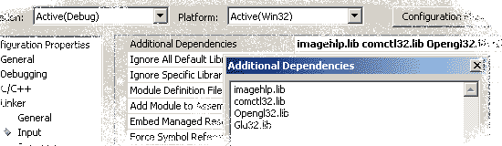

*   **Using Windows dynamic link libraries in run-time**: 

·                *// DLL function signature*

·                typedef HGLOBAL (\*importFunction\_GlobalAlloc)(UINT, SIZE\_T);

·                ...

·                importFunction\_GlobalAlloc \_\_GlobalAlloc;

·                 

·                *// Load DLL file*

·                HINSTANCE hinstLib = LoadLibrary("Kernel32.dll");

·                if (hinstLib == NULL)

·                {

·                    *// Error - unable to load DLL*

·                }

·                 

·                *// Get function pointer*

·                \_\_GlobalAlloc = 

·                    (importFunction\_GlobalAlloc)GetProcAddress(hinstLib,  

·                                                         "GlobalAlloc");

·                if (addNumbers == NULL) 

·                {

·                     *// Error - unable to find DLL function*

·                }

·                 

FreeLibrary(hinstLib);

When you make a Windows application project, the linker includes at least *kernel32.dll* in the base dependencies of your project. Without [LoadLibrary()](http://msdn.microsoft.com/library/default.asp?url=/library/en-us/dllproc/base/loadlibrary.asp) and [GetProcAddress()](http://msdn.microsoft.com/library/default.asp?url=/library/en-us/dllproc/base/getprocaddress.asp) of *Kernel32.dll*, we can not load a DLL in run-time. The dependencies information is stored in the import table section. By [Dependency Walker](http://www.microsoft.com/resources/documentation/Windows/XP/all/reskit/en-us/Default.asp?url=/resources/documentation/Windows/XP/all/reskit/en-us/prmb_tol_kewf.asp), it is not so difficult to observe the DLL module and the functions which are imported into a PE file.

当你 make Windows 应用程序项目时，连接器在项目的基本依赖关系中至少会包括*kernel32.dll*。没有*kernel32.dll*的[LoadLibrary()](http://msdn.microsoft.com/library/default.asp?url=/library/en-us/dllproc/base/loadlibrary.asp)和[GetProcAddress()](http://msdn.microsoft.com/library/default.asp?url=/library/en-us/dllproc/base/getprocaddress.asp)，我们不能在 run-time 加载 DLL。依赖关系的信息保存在导入表区段里。通过[Dependency Walker](http://www.microsoft.com/resources/documentation/Windows/XP/all/reskit/en-us/Default.asp?url=/resources/documentation/Windows/XP/all/reskit/en-us/prmb_tol_kewf.asp)，可以看到被导入 PE 文件的 DLL 模块和函数。

 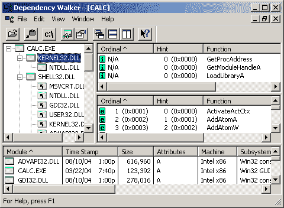

We attempt to establish our custom import table to conduct our project. Furthermore, we have to fix up the original import table at the end in order to run the real code of the program.

我们设法建立定制的导入表来管理我们自己的项目。此外，为了运行程序真正的代码，我们必须修复原始的导入表。

**PE Maker - Step 3**

*   [Download source files - 65.4 Kb](http://www.codeproject.com/system/inject2exe/pemaker3.zip) 

**6.1 Construct the Client Import Table**

**6.1 ****构造客户端导入表**

I strongly advise you to read the section 6.4 of the [Microsoft Portable Executable and the Common Object File Format Specification](http://www.microsoft.com/whdc/system/platform/firmware/PECOFF.mspx) document. This section contains the principal information to comprehend the import table performance.

我强烈建议你阅读[Microsoft Portable Executable and the Common Object File Format Specification](http://www.microsoft.com/whdc/system/platform/firmware/PECOFF.mspx)文档的 6.4 节。这一节包含导入表实现的主要信息。

The import table data is accessible by a second data directory of the optional header from PE headers, so you can access it by using the following code:

从 PE 头的 optional header 的 second data directory 可以访问导入表数据，因此，你可以用下面的代码访问它：

DWORD dwVirtualAddress = image\_nt\_headers->

  OptionalHeader.DataDirectory\[IMAGE\_DIRECTORY\_ENTRY\_IMPORT\].VirtualAddress;

DWORD dwSize = image\_nt\_headers->

  OptionalHeader.DataDirectory\[IMAGE\_DIRECTORY\_ENTRY\_IMPORT\].Size;

The VirtualAddress refers to structures by IMAGE\_IMPORT\_DESCRIPTOR. This structure contains the pointer to the imported DLL name and the relative virtual address of the first thunk.

VirtualAddress 通过 IMAGE\_IMPORT\_DESCRIPTOR 指向结构。这个结构包含指向导入的 DLL 名和 first thunk 的 RVA 的指针。

typedef struct \_IMAGE\_IMPORT\_DESCRIPTOR {

    union {

        DWORD   Characteristics;

        DWORD   OriginalFirstThunk;

    };

    DWORD   TimeDateStamp;

    DWORD   ForwarderChain;

    DWORD   Name;         *// the imported DLL name*

    DWORD   FirstThunk;   *// the relative virtual address of the first thunk*

} IMAGE\_IMPORT\_DESCRIPTOR, \*PIMAGE\_IMPORT\_DESCRIPTOR;

When a program is running, the Windows task manager sets the thunks by the virtual address of the function. The virtual address is found by the name of the function. At first, the thunks hold the relative virtual address of the function name, [Table 5](http://www.codeproject.com/system/inject2exe.asp#Table5#Table5); during execution, they are fixed up by the virtual address of the functions, [Table 6](http://www.codeproject.com/system/inject2exe.asp#Table6#Table6).

当程序运行时，Windows 任务管理器通过函数的 virtual address 设置 thunks。通过函数名可以发现 virtual address。起先，thunks 持有函数名的 RVA，见[Table 5](http://www.codeproject.com/system/inject2exe.asp#Table5#Table5)；在执行期间，通过函数的 virtual address 修复它们。

**Table 5 - The Import Table in file image**

| IMAGE\_IMPORT\_  
DESCRIPTOR\[0\] || OriginalFirstThunk ||   ||   |
| --- | --- | --- | --- |
| TimeDateStamp |
| ForwarderChain |
| Name\_RVA || \------> || "kernel32.dll",0 |
| FirstThunk\_RVA || \------> || proc\_1\_name\_RVA || \------> || 0,0,"LoadLibraryA",0 |
|   || proc\_2\_name\_RVA || \------> || 0,0,"GetProcAddress",0 |
| proc\_3\_name\_RVA || \------> || 0,0,"GetModuleHandleA",0 |
| ... ||   ||   |
| IMAGE\_IMPORT\_  
DESCRIPTOR\[1\] ||   |
| ... ||   |
| IMAGE\_IMPORT\_  
DESCRIPTOR\[n\] ||   |

**Table 6 - The Import Table in virtual memory**

| IMAGE\_IMPORT\_DESCRIPTOR\[0\] || OriginalFirstThunk ||   |
| --- | --- | --- |
| TimeDateStamp |
| ForwarderChain |
| Name\_RVA || \------> || "kernel32.dll",0 |
| FirstThunk\_RVA || \------> || proc\_1\_VA |
|   || proc\_2\_VA |
| proc\_3\_VA |
| ... |
| IMAGE\_IMPORT\_DESCRIPTOR\[1\] ||   |
| ... ||   |
| IMAGE\_IMPORT\_DESCRIPTOR\[n\] ||   |

We want to make a simple import table to import LoadLibrary(), and GetProcAddress() from *Kernel32.dll*. We need these two essential API functions to cover other API functions in run-time. The following assembly code shows how easily we can reach our solution:

我们想生成一个简单的导入表，从*Kernel32.dll*中导入 LoadLibrary()和 GetProcAddress()。我们需要在 run-time，这两个基本的 API 函数能包含其它的 API 函数。下面的汇编代码显示我们可以很容易做到：

0101F000: 

00000000 ; OriginalFirstThunk

0101F004: 00000000 ; TimeDateStamp

0101F008: 00000000 ; ForwarderChain

0101F00C: 0001F034 ; Name;       ImageBase + 0001F034 -> 0101F034 -> "Kernel32.dll",0

0101F010: 0001F028 ; FirstThunk; ImageBase + 0001F028 -> 0101F028

0101F014: 00000000

0101F018: 00000000

0101F01C: 00000000

0101F020: 00000000

0101F024: 00000000

0101F028: 0001F041 ; ImageBase + 0001F041 -> 0101F041 -> 0,0,"LoadLibraryA",0

0101F02C: 0001F050 ; ImageBase + 0001F050 -> 0101F050 -> 0,0,"GetProcAddress",0

0101F030: 00000000

0101F034: 'K' 'e' 'r' 'n' 'e' 'l' '3' '2' '.' 'd' 'l' 'l' 00

0001F041: 00 00 'L' 'o' 'a' 'd' 'L' 'i' 'b' 'r' 'a' 'r' 'y' 'A' 

00

0001F050: 00 00 'G' 'e' 't' 'P' 'r' 'o' 'c' 'A' 'd' 'd' 'r' 'e' 's' 's'

 00

After running...

在运行后...

0101F000: 

00000000 ; OriginalFirstThunk

0101F004: 00000000 ; TimeDateStamp

0101F008: 00000000 ; ForwarderChain

0101F00C: 0001F034 ; Name;       ImageBase + 0001F034 -> 0101F034 -> "Kernel32.dll",0

0101F010: 0001F028 ; FirstThunk; ImageBase + 0001F028 -> 0101F028

0101F014: 00000000

0101F018: 00000000

0101F01C: 00000000

0101F020: 00000000

0101F024: 00000000

0101F028: 7C801D77 ; -> Kernel32.LoadLibrary()

0101F02C: 7C80AC28 ; -> Kernel32.GetProcAddress()

0101F030: 00000000

0101F034: 'K' 'e' 'r' 'n' 'e' 'l' '3' '2' '.' 'd' 'l' 'l' 

00

0001F041: 00 00 'L' 'o' 'a' 'd' 'L' 'i' 'b' 'r' 'a' 'r' 'y' 'A'

 00

0001F050: 00 00 'G' 'e' 't' 'P' 'r' 'o' 'c' 'A' 'd' 'd' 'r' 'e' 's' 's'

 00

I have prepared a class library to make every import table by using a client string table. The CITMaker class library in *itmaker.h*, it will build an import table by sz\_IT\_EXE\_strings and also the relative virtual address of the import table.

我准备了一个类库，它可以用客户端字符串表生成全部的导入表。*itmaker.h*中 CITMaker 类库，通过 sz\_IT\_EXE\_strings 和导入表的 RVA 建立导入表。

static const char \*sz\_IT\_EXE\_strings\[\]=

{

    "Kernel32.dll",

    "LoadLibraryA",

    "GetProcAddress",

    0,,

    0,

};

We subsequently employ this class library to establish an import table to support DLLs and OCXs, so this is a general library to present all possible import tables easily. The next step is clarified in the following code.

我们随后用这个类库建立一个导入表，以支持 DLL 和 OCX，因此，这是一个通用的 library，可以很容易的呈现可能的导入表。下面的代码阐明了接下来的步骤。

CITMaker \*ImportTableMaker = new CITMaker( IMPORT\_TABLE\_EXE );

...

pimage\_section\_header=AddNewSection( ".xxx", dwNewSectionSize );

*// build import table by the current virtual address*

ImportTableMaker\->Build

( pimage\_section\_header->VirtualAddress ); 

memcpy( pNewSection, ImportTableMaker\->pMem, 

ImportTableMaker\->dwSize );

...

memcpy( image\_section\[image\_nt\_headers->FileHeader.NumberOfSections-1\], 

        pNewSection, 

        dwNewSectionSize );

...

image\_nt\_headers->OptionalHeader.

  DataDirectory\[IMAGE\_DIRECTORY\_ENTRY\_IMPORT\].VirtualAddress 

  = pimage\_section\_header->VirtualAddress;

image\_nt\_headers->OptionalHeader.

  DataDirectory\[IMAGE\_DIRECTORY\_ENTRY\_IMPORT\].Size 

  = ImportTableMaker\->dwSize;

...

delete ImportTableMaker;

The import table is copied at the beginning of the new section, and the relevant data directory is adjusted to the relative virtual address of the new section and the size of the new import table

导入表被复制到新区段的开头，依据新区段的 RVA 和新导入表的大小调整相应的数据目录。

**6.2 Using other API functions in run-time**

**6.2 ****在****run-time****使用其它的****API****函数**

At this time, we can load other DLLs and find the process address of other functions by using [LoadLibrary()](http://msdn.microsoft.com/library/default.asp?url=/library/en-us/dllproc/base/loadlibrary.asp) and [GetProcAddress()](http://msdn.microsoft.com/library/default.asp?url=/library/en-us/dllproc/base/getprocaddress.asp):

这一次，我们可以通过[LoadLibrary()](http://msdn.microsoft.com/library/default.asp?url=/library/en-us/dllproc/base/loadlibrary.asp)和[GetProcAddress()](http://msdn.microsoft.com/library/default.asp?url=/library/en-us/dllproc/base/getprocaddress.asp)加载其它的 DLL，并找出其它函数的进程地址：

lea edi, @"Kernel32.dll"

//-------------------

push edi

mov eax,offset \_p\_LoadLibrary

call \[ebp+eax\] //LoadLibrary(lpLibFileName);

//-------------------

mov esi,eax    // esi -> hModule

lea edi, @"GetModuleHandleA"

//-------------------

push edi

push esi

mov eax,offset \_p\_GetProcAddress

call \[ebp+eax\] //GetModuleHandle=GetProcAddress(hModule, lpProcName);

//--------------------

I want to have a complete imported function table similar in performance done in a real EXE file. If you look inside a PE file, you will discover that an API call is done by an indirection jump through the virtual address of the API function:

我想有一个和真实的 EXE 文件类似的完整的导入函数表。如果你查看 PE 文件的内部，你将发现 API 调用其实是通过 API 函数的 virtual address 的间接转移来实现的：

**JMP DWORD PTR \[XXXXXXXX\]**

...

0101F028: 7C801D77      ; Virtual Address of kernel32.LoadLibrary()

...

0101F120: JMP DWORD PTR \[0101F028\]

...

0101F230: CALL 0101F120 ;  JMP to kernel32.LoadLibrary

...

It makes it easy to expand the other part of our project by this performance, so we construct two data tables: first for API virtual addresses, and the second for the JMP \[XXXXXXXX\].

它通过这种实现使它更容易扩展这个项目的其它部分，因此，我们构造两个数据表：第一个用于 API virtual addresses，第二个用于 JMP \[XXXXXXXX\]。

#define \_\_jmp\_api               byte\_type(0xFF) byte\_type(0x25)

\_\_asm

{

...

*//----------------------------------------------------------------*

\_p\_GetModuleHandle:             dword\_type(0xCCCCCCCC)

\_p\_VirtualProtect:              dword\_type(0xCCCCCCCC)

\_p\_GetModuleFileName:           dword\_type(0xCCCCCCCC)

\_p\_CreateFile:                  dword\_type(0xCCCCCCCC)

\_p\_GlobalAlloc:                 dword\_type(0xCCCCCCCC)

*//----------------------------------------------------------------*

\_jmp\_GetModuleHandle:           \_\_jmp\_api   dword\_type(0xCCCCCCCC)

\_jmp\_VirtualProtect:            \_\_jmp\_api   dword\_type(0xCCCCCCCC)

\_jmp\_GetModuleFileName:         \_\_jmp\_api   dword\_type(0xCCCCCCCC)

\_jmp\_CreateFile:                \_\_jmp\_api   dword\_type(0xCCCCCCCC)

\_jmp\_GlobalAlloc:               \_\_jmp\_api   dword\_type(0xCCCCCCCC)

*//----------------------------------------------------------------*

...

}

In the succeeding code, we has concluded our ambition to install a custom internal import table! (We can not call it import table.)

在随后的代码中，我们野心勃勃地想安装一个定制的内部导入表！（我们不能把它称为导入表。）

    ...

    lea edi,\[ebp+\_p\_szKernel32\]

    lea ebx,\[ebp+\_p\_GetModuleHandle\]

    lea ecx,\[ebp+\_jmp\_GetModuleHandle\]

    add ecx,02h

\_api\_get\_lib\_address\_loop:

        push ecx

        push edi

        mov eax,offset \_p\_LoadLibrary

        call \[ebp+eax\]    //LoadLibrary(lpLibFileName);

        pop ecx

        mov esi,eax       // esi -> hModule

        push edi

        call \_\_strlen

        add esp,04h

        add edi,eax

\_api\_get\_proc\_address\_loop:

            push ecx

            push edi

            push esi

            mov eax,offset \_p\_GetProcAddress

            call \[ebp+eax\]//GetModuleHandle=GetProcAddress(hModule, lpProcName);

            pop ecx

            mov \[ebx\],eax

            mov \[ecx\],ebx // JMP DWORD PTR \[XXXXXXXX\] 

            add ebx,04h

            add ecx,06h

            push edi

            call \_\_strlen

            add esp,04h

            add edi,eax

            mov al,byte ptr \[edi\]

        test al,al

        jnz \_api\_get\_proc\_address\_loop

        inc edi

        mov al,byte ptr \[edi\]

    test al,al

    jnz \_api\_get\_lib\_address\_loop

    ...

**6.3 Fix up the Original Import Table**

**6.3 ****修复原始的导入表**

In order to run the program again, we should fix up the thunks of the actual import table, otherwise we have a corrupted target PE file. Our code must correct all of the thunks the same as [Table 5](http://www.codeproject.com/system/inject2exe.asp#Table5#Table5) to [Table 6](http://www.codeproject.com/system/inject2exe.asp#Table6#Table6). Once more, [LoadLibrary()](http://msdn.microsoft.com/library/default.asp?url=/library/en-us/dllproc/base/loadlibrary.asp) and [GetProcAddress()](http://msdn.microsoft.com/library/default.asp?url=/library/en-us/dllproc/base/getprocaddress.asp) aid us in our effort to reach our intention.

为了再次运行这个程序，我们应该修复真正的导入表的 thunks，否则，我们的 PE 文件将不健全。我们的代码必须纠正所有的 thunks，就像[Table 5](http://www.codeproject.com/system/inject2exe.asp#Table5#Table5)与[Table 6](http://www.codeproject.com/system/inject2exe.asp#Table6#Table6)一样。[LoadLibrary()](http://msdn.microsoft.com/library/default.asp?url=/library/en-us/dllproc/base/loadlibrary.asp)和[GetProcAddress()](http://msdn.microsoft.com/library/default.asp?url=/library/en-us/dllproc/base/getprocaddress.asp)将再次帮助我们。

    ...

    mov ebx,\[ebp+\_p\_dwImportVirtualAddress\]

    test ebx,ebx

    jz \_it\_fixup\_end

    mov esi,\[ebp+\_p\_dwImageBase\]

    add ebx,esi                   // dwImageBase + dwImportVirtualAddress

\_it\_fixup\_get\_lib\_address\_loop:

        mov eax,\[ebx+00Ch\]        // image\_import\_descriptor.Name

        test eax,eax

        jz \_it\_fixup\_end

        

        mov ecx,\[ebx+010h\]        // image\_import\_descriptor.FirstThunk

        add ecx,esi

        mov \[ebp+\_p\_dwThunk\],ecx // dwThunk

        mov ecx,\[ebx\]             // image\_import\_descriptor.Characteristics

        test ecx,ecx

        jnz \_it\_fixup\_table

            mov ecx,\[ebx+010h\]

\_it\_fixup\_table:

        add ecx,esi

        mov \[ebp+\_p\_dwHintName\],ecx // dwHintName

        add eax,esi  // image\_import\_descriptor.Name + dwImageBase = ModuleName

        push eax  // lpLibFileName

        mov eax,offset \_p\_LoadLibrary

        call \[ebp+eax\]             // LoadLibrary(lpLibFileName);

 

        test eax,eax

        jz \_it\_fixup\_end

        mov edi,eax

\_it\_fixup\_get\_proc\_address\_loop:

            mov ecx,\[ebp+\_p\_dwHintName\] // dwHintName

            mov edx,\[ecx\]            // image\_thunk\_data.Ordinal

            test edx,edx

            jz \_it\_fixup\_next\_module

            test edx,080000000h      // .IF( import by ordinal )

            jz \_it\_fixup\_by\_name

                and edx,07FFFFFFFh   // get ordinal

                jmp \_it\_fixup\_get\_addr

\_it\_fixup\_by\_name:

            add edx,esi  // image\_thunk\_data.Ordinal + dwImageBase = OrdinalName

            inc edx

            inc edx                  // OrdinalName.Name

\_it\_fixup\_get\_addr:

            push edx //lpProcName

            push edi                 // hModule                        

            mov eax,offset \_p\_GetProcAddress

            call \[ebp+eax\] // GetProcAddress(hModule, lpProcName);

 

            mov ecx,\[ebp+\_p\_dwThunk\] // dwThunk

            mov \[ecx\],eax  // correction the thunk

            // dwThunk => next dwThunk

            add dword ptr \[ebp+\_p\_dwThunk\], 004h

            // dwHintName => next dwHintName

            add dword ptr \[ebp+\_p\_dwHintName\],004h

        jmp \_it\_fixup\_get\_proc\_address\_loop

\_it\_fixup\_next\_module:

        add ebx,014h      // sizeof(IMAGE\_IMPORT\_DESCRIPTOR)

    jmp \_it\_fixup\_get\_lib\_address\_loop

\_it\_fixup\_end:

    ...

**7 Support DLL and OCX**

**7 ****支持****DLL****和****OCX**

Now, we intend to include the [dynamic link library (DLL)](http://en.wikipedia.org/wiki/Microsoft_Dynamic_Link_Library) and [OLE-ActiveX Control](http://en.wikipedia.org/wiki/OCX) in our PE builder project. Supporting them is very easy if we pay attention to the two time arrival into the Offset of Entry Point, the relocation table implementation, and the client import table.

现在，我打算在我们的 PE builder 项目中包括[dynamic link library (DLL)](http://en.wikipedia.org/wiki/Microsoft_Dynamic_Link_Library)和[OLE-ActiveX Control](http://en.wikipedia.org/wiki/OCX)。如果我们注意到到达 OEP，重定位表实现，和客户端导入表的两次时机，支持它们将是非常容易的事情。

**PE Maker - Step 4**

*   [Download source files - 68.6 Kb](http://www.codeproject.com/system/inject2exe/pemaker4.zip) 

**7.1 Twice OEP approach**

The Offset of Entry Point of a DLL file or an OCX file is touched by the main program atleast twice:

主程序至少有两次机会碰到 DLL 文件或 OCX 文件的 OEP：

*   **Constructor**: 
*   **构造函数**：

When a DLL is loaded by [LoadLibrary()](http://msdn.microsoft.com/library/default.asp?url=/library/en-us/dllproc/base/loadlibrary.asp), or an OCX is registered by using [LoadLibrary()](http://msdn.microsoft.com/library/default.asp?url=/library/en-us/dllproc/base/loadlibrary.asp) and [GetProcAddress()](http://msdn.microsoft.com/library/default.asp?url=/library/en-us/dllproc/base/getprocaddress.asp) through calling [DllRegisterServer()](http://msdn.microsoft.com/library/default.asp?url=/library/en-us/com/html/4442206b-b2ad-47d7-8add-18002c44c5a2.asp), the first of the OEP arrival is done.

当通过[LoadLibrary()](http://msdn.microsoft.com/library/default.asp?url=/library/en-us/dllproc/base/loadlibrary.asp)加载 DLL，或通过调用[DllRegisterServer()](http://msdn.microsoft.com/library/default.asp?url=/library/en-us/com/html/4442206b-b2ad-47d7-8add-18002c44c5a2.asp)的[LoadLibrary()](http://msdn.microsoft.com/library/default.asp?url=/library/en-us/dllproc/base/loadlibrary.asp)和[GetProcAddress()](http://msdn.microsoft.com/library/default.asp?url=/library/en-us/dllproc/base/getprocaddress.asp)注册 OCX 时，将第一次碰到 OEP。

hinstDLL = LoadLibrary( "test1.dll" );

hinstOCX = LoadLibrary( "test1.ocx" );

\_DllRegisterServer = GetProcAddress( hinstOCX, "DllRegisterServer" );

\_DllRegisterServer(); *// ocx register*

*   **Destructor**: 
*   **析构函数****：**

When the main program frees the library usage by [FreeLibrary()](http://msdn.microsoft.com/library/default.asp?url=/library/en-us/dllproc/base/freelibrary.asp), the second OEP arrival happens.

当主程序通过[FreeLibrary()](http://msdn.microsoft.com/library/default.asp?url=/library/en-us/dllproc/base/freelibrary.asp)释放 library 使用时，会第二次碰到 OEP。

FreeLibrary( hinstDLL );

FreeLibrary( hinstOCX );

To perform this, I have employed a trick, that causes in the second time again, the instruction pointer (EIP) traveling towards the original OEP by the structured exception handler.

为了做这些，我略施雕虫小技，在第二次里通过 SEH 再次促使 EIP 移向原始的 OEP。

\_main\_0:

    pushad  // save the registers context in stack

    call \_main\_1

\_main\_1:    

    pop ebp

    sub ebp,offset \_main\_1 // get base ebp

    //---------------- support dll, ocx  -----------------

\_support\_dll\_0: 

    jmp \_support\_dll\_1 // nop; nop; // << trick // in the second time OEP

    jmp \_support\_dll\_2

\_support\_dll\_1:

    //----------------------------------------------------

    

    ...

    

    //---------------- support dll, ocx  1 ---------------

    mov edi,\[ebp+\_p\_dwImageBase\]

    add edi,\[edi+03Ch\]// edi -> IMAGE\_NT\_HEADERS

    mov ax,word ptr \[edi+016h\]// edi -> image\_nt\_headers->FileHeader.Characteristics

    test ax,IMAGE\_FILE\_DLL

    jz \_support\_dll\_2

        mov ax, 9090h // << trick

        mov word ptr \[ebp+\_support\_dll\_0\],ax

\_support\_dll\_2:

    //----------------------------------------------------

    ...

    into OEP by SEH ...

I hope you have caught the trick in the preceding code, but this is not all of it, we have problem in ImageBase, when the library has been loaded in different image bases by the main program. We should write some code to find the real image base and store it to use forward.

我希望你能在前面的代码中发现这个小技巧，但这并不是它的全部，当主程序把 library 加载到不同的 image bases，我们在 ImageBase 会出问题。为了使用转发，我们应该写一些代码，找出真正的 image base 并把它们保存起来。

    mov eax,\[esp+24h\] // the real imagebase

    mov ebx,\[esp+30h\] // oep

    cmp eax,ebx

    ja \_no\_dll\_pe\_file\_0

        cmp word ptr \[eax\],IMAGE\_DOS\_SIGNATURE

        jne \_no\_dll\_pe\_file\_0

            mov \[ebp+\_p\_dwImageBase\],eax

\_no\_dll\_pe\_file\_0:

This code finds the real image base by investigating the stack information. By using the real image base and the formal image base, we should correct all memory calls inside the image program!! Don't be afraid, it will be done simply by the relocating the table information.

这段代码通过栈信息找出真正的 image base。通过使用真正的 image base 和形式上的 image base，我们可以纠正程序映像中所有的内存调用！！不用担心，通过重定位表的信息可以很容易做到。

**7.2 Implement Relocation Table**

**7.2 ****实现重定位表**

To understand the relocation table better, you can take a look at the section 6.6 of [Microsoft Portable Executable and Common Object File Format Specification](http://www.microsoft.com/whdc/system/platform/firmware/PECOFF.mspx) document. The relocation table contains many packages to relocate the information related to the virtual address inside the virtual memory image. Each package comprise of a 8 bytes header to exhibit the base virtual address and the number of data, demonstrated by the IMAGE\_BASE\_RELOCATION data structure.

为了更好地理解重定位表，你可以研读[Microsoft Portable Executable and Common Object File Format Specification](http://www.microsoft.com/whdc/system/platform/firmware/PECOFF.mspx)文档的 6.6 节。重定位表包含许多与虚拟内存映像内部的 virtual address 相关联的重定位信息的 packages。每个 package 由展示 base virtual address 的 8 字节头部和一些数据组成。IMAGE\_BASE\_RELOCATION 数据结构就是范例。

typedef struct \_IMAGE\_BASE\_RELOCATION {

    DWORD   VirtualAddress;

    DWORD   SizeOfBlock;

} IMAGE\_BASE\_RELOCATION, \*PIMAGE\_BASE\_RELOCATION;

**Table 7 - The Relocation Table**

| Block\[1\] || VirtualAddress |
| --- | --- |
| SizeOfBlock |
| type:4 || offset:12 || type:4 || offset:12 |
| type:4 || offset:12 || type:4 || offset:12 |
| type:4 || offset:12 || type:4 || offset:12 |
| ... || ... || ... || ... |
| type:4 || offset:12 || 00 || 00 |
| Block\[2\] || VirtualAddress |
| SizeOfBlock |
| type:4 || offset:12 || type:4 || offset:12 |
| type:4 || offset:12 || type:4 || offset:12 |
| type:4 || offset:12 || type:4 || offset:12 |
| ... || ... || ... || ... |
| type:4 || offset:12 || 00 || 00 |
| ... || ...  |
| Block\[n\] || VirtualAddress |
| SizeOfBlock |
| type:4 || offset:12 || type:4 || offset:12 |
| type:4 || offset:12 || type:4 || offset:12 |
| type:4 || offset:12 || type:4 || offset:12 |
| ... || ... || ... || ... |
| type:4 || offset:12 || 00 || 00 |

[Table 7](http://www.codeproject.com/system/inject2exe.asp#Table7#Table7) illustrates the main idea of the relocation table. Furthermore, you can upload a DLL or an OCX file in [OllyDbg](http://www.ollydbg.de/) to observe the relocation table, the *".reloc"* section through *Memory map window*. By the way, we find the position of the relocation table by using the following code in our project:

[Table 7](http://www.codeproject.com/system/inject2exe.asp#Table7#Table7)图解重定位表的主要概念。此外，你可以把 DLL 或 OCX 载入[OllyDbg](http://www.ollydbg.de/)，通过*Memory map window*的*".reloc"*区段观察重定位表。顺便说一下，我们在项目中通过下面的代码发现重定位表的位置：

DWORD dwVirtualAddress = image\_nt\_headers->

  OptionalHeader.DataDirectory\[IMAGE\_DIRECTORY\_ENTRY\_BASERELOC\].

  VirtualAddress;

DWORD dwSize = image\_nt\_headers->

  OptionalHeader.DataDirectory\[IMAGE\_DIRECTORY\_ENTRY\_BASERELOC\].Size;

By OllyDbg, we have the same as the following for the *".reloc"* section, by using the Long Hex viewer mode. In this example, the base virtual address is **0x1000** and the size of the block is **0x184**.

在 OllyDbg 里，通过使用 Long Hex viewer 模式，我们的*".reloc"*区段与下面的一样。在这个例子里，base virtual address 是**0x1000**，块大小是**0x184**。

008E1000 : 00001000  00000184  30163000  30403028

008E1010 : 30683054  308C3080  30AC309C  30D830CC

008E1020 : 30E030DC  30E830E4  30F030EC  310030F4

008E1030 : 3120310D  315F3150  31A431A0  31C031A8

008E1040 : 31D031CC  31F431EC  31FC31F8  32043200

008E1050 : 320C3208  32143210  324C322C  32583254

008E1060 : 3260325C  32683264  3270326C  32B03274

It relocates the data in the subsequent virtual addresses:

在随后的 virtual addresses 里它重定位数据：

0x1000 + 0x0000 = 0x1000

0x1000 + 0x0016 = 0x1016

0x1000 + 0x0028 = 0x1028

0x1000 + 0x0040 = 0x1040

0x1000 + 0x0054 = 0x1054

...

Each package performs the relocation by using consecutive 4 bytes form its internal information. The first byte refers to the type of relocation and the next three bytes are the offset which must be used with the base virtual address and the image base to correct the image information.

每个 package 通过使用来自它的内部信息的连续的 4 字节来实现重定位。第一个字节引用重定位的类型，接下来的三个字节是必须与 base virtual address 和 image base 一起使用的偏移量，用于纠正映像信息。

| type || offset |
| --- | --- |
| 03 || 00 || 00 || 00 |

**What is the type**

The type can be one of the following values:

类型可以下面的某个值：

*   IMAGE\_REL\_BASED\_ABSOLUTE (0): no effect. 
*   IMAGE\_REL\_BASED\_HIGH (1): relocate by the high 16 bytes of the base virtual address and the offset. 
*   IMAGE\_REL\_BASED\_LOW (2): relocate by the low 16 bytes of the base virtual address and the offset. 
*   IMAGE\_REL\_BASED\_HIGHLOW (3): relocate by the base virtual address and the offset. 

**What is done in the relocation?**

By relocation, some values inside the virtual memory are corrected according to the current image base by the *".reloc"* section packages.

通过重定位，通过*".reloc"*区段 packages，依照当前的 image base，修正虚拟内存内的某些值。

| **delta\_ImageBase = current\_ImageBase - image\_nt\_headers->OptionalHeader.ImageBase** |
| --- |

mem\[ current\_ImageBase + 0x1000 \] = 

   mem\[ current\_ImageBase + 0x1000 \] + delta\_ImageBase ;

mem\[ current\_ImageBase + 0x1016 \] = 

   mem\[ current\_ImageBase + 0x1016 \] + delta\_ImageBase ;

mem\[ current\_ImageBase + 0x1028 \] = 

   mem\[ current\_ImageBase + 0x1028 \] + delta\_ImageBase ;

mem\[ current\_ImageBase + 0x1040 \] = 

   mem\[ current\_ImageBase + 0x1040 \] + delta\_ImageBase ;

mem\[ current\_ImageBase + 0x1054 \] = 

  mem\[ current\_ImageBase + 0x1054 \] + delta\_ImageBase ;

...

I have employed the following code from Morphine packer to implement the relocation.

为了实现重定位，我使用了来自 Morphine packer 的代码，如下所示。

    ...

\_reloc\_fixup:

    mov eax,\[ebp+\_p\_dwImageBase\]

    mov edx,eax

    mov ebx,eax

    add ebx,\[ebx+3Ch\] // edi -> IMAGE\_NT\_HEADERS

    mov ebx,\[ebx+034h\]// edx ->image\_nt\_headers->OptionalHeader.ImageBase

    sub edx,ebx // edx -> reloc\_correction // delta\_ImageBase

    je \_reloc\_fixup\_end

    mov ebx,\[ebp+\_p\_dwRelocationVirtualAddress\]

    test ebx,ebx

    jz \_reloc\_fixup\_end

    add ebx,eax

\_reloc\_fixup\_block:

    mov eax,\[ebx+004h\]          //ImageBaseRelocation.SizeOfBlock

    test eax,eax

    jz \_reloc\_fixup\_end

    lea ecx,\[eax-008h\]

    shr ecx,001h

    lea edi,\[ebx+008h\]

\_reloc\_fixup\_do\_entry:

        movzx eax,word ptr \[edi\]//Entry

        push edx

        mov edx,eax

        shr eax,00Ch            //Type = Entry >> 12

        mov esi,\[ebp+\_p\_dwImageBase\]//ImageBase

        and dx,00FFFh

        add esi,\[ebx\]

        add esi,edx

        pop edx

\_reloc\_fixup\_HIGH:              // IMAGE\_REL\_BASED\_HIGH  

        dec eax

        jnz \_reloc\_fixup\_LOW

            mov eax,edx

            shr eax,010h        //HIWORD(Delta)

            jmp \_reloc\_fixup\_LOW\_fixup        

\_reloc\_fixup\_LOW:               // IMAGE\_REL\_BASED\_LOW 

            dec eax

        jnz \_reloc\_fixup\_HIGHLOW

        movzx eax,dx            //LOWORD(Delta)

\_reloc\_fixup\_LOW\_fixup:

            add word ptr \[esi\],ax// mem\[x\] = mem\[x\] + delta\_ImageBase

        jmp \_reloc\_fixup\_next\_entry

\_reloc\_fixup\_HIGHLOW:           // IMAGE\_REL\_BASED\_HIGHLOW

            dec eax

        jnz \_reloc\_fixup\_next\_entry

        add \[esi\],edx           // mem\[x\] = mem\[x\] + delta\_ImageBase

\_reloc\_fixup\_next\_entry:

        inc edi

        inc edi                 //Entry++

        loop \_reloc\_fixup\_do\_entry

\_reloc\_fixup\_next\_base:

    add ebx,\[ebx+004h\]

    jmp \_reloc\_fixup\_block

\_reloc\_fixup\_end:

    ...

**7.3 Build a Special Import table**

**7.3 ****建立特殊的导入表**

In order to support the [OLE-ActiveX Control](http://en.wikipedia.org/wiki/OCX) registration, we should present an appropriate import table to our target OCX and DLL file.

为了支持[OLE-ActiveX Control](http://en.wikipedia.org/wiki/OCX)注册，我们应当呈现一个适当的导入表到目标 OCX 和 DLL 文件。

Therefore, I have established an import table by the following string:

因此，我通过下面的字符串建立导入表：

const char \*sz\_IT\_OCX\_strings\[\]=

{

    "Kernel32.dll",

    "LoadLibraryA",

    "GetProcAddress",

    "GetModuleHandleA",

    0,

    "User32.dll",

    "GetKeyboardType",

    "WindowFromPoint",

    0,

    "AdvApi32.dll",

    "RegQueryValueExA",

    "RegSetValueExA",

    "StartServiceA",

    0,

    "Oleaut32.dll",

    "SysFreeString",

    "CreateErrorInfo",

    "SafeArrayPtrOfIndex",

    0,

    "Gdi32.dll",

    "UnrealizeObject",

    0,

    "Ole32.dll",

    "CreateStreamOnHGlobal",

    "IsEqualGUID",

    0,

    "ComCtl32.dll",

    "ImageList\_SetIconSize",

    0,

    0,

};

Without these API functions, the library can not be loaded, and moreover the [DllregisterServer()](http://msdn.microsoft.com/library/default.asp?url=/library/en-us/com/html/4442206b-b2ad-47d7-8add-18002c44c5a2.asp) and [DllUregisterServer()](http://msdn.microsoft.com/library/default.asp?url=/library/en-us/com/html/b71137a7-284e-4521-a3b2-9dad9c9d3c54.asp) will not operate. In CPECryptor::CryptFile, I have distinguished between EXE files and DLL files in the initialization of the new import table object during creation:

没有这些 API 函数，将不能加载 library，此外，[DllregisterServer()](http://msdn.microsoft.com/library/default.asp?url=/library/en-us/com/html/4442206b-b2ad-47d7-8add-18002c44c5a2.asp)和[DllUregisterServer()](http://msdn.microsoft.com/library/default.asp?url=/library/en-us/com/html/b71137a7-284e-4521-a3b2-9dad9c9d3c54.asp)也不能工作。在 CPECryptor::CryptFile 里，我在形成期间，在新导入表对象的初始化过程中区分 EXE 文件和 DLL 文件：

if(( image\_nt\_headers->FileHeader.Characteristics 

             & IMAGE\_FILE\_DLL ) == IMAGE\_FILE\_DLL )

{

    ImportTableMaker = new CITMaker( IMPORT\_TABLE\_OCX );

}

else

{

    ImportTableMaker = new CITMaker( IMPORT\_TABLE\_EXE );

}

**8 Preserve the Thread Local Storage**

**8 ****保存****TLS**

By using Thread Local Storage (TLS), a program is able to execute a multithreaded process, this performance mostly is used by [Borland](http://www.borland.com/) linkers: [Delphi](http://www.borland.com/us/products/delphi/index.html) and [C++ Builder](http://www.borland.com/us/products/cbuilder/index.html). When you pack a PE file, you should take care to keep clean the TLS, otherwise, your packer will not support Borland Delphi and C++ Builder linked EXE files. To comprehend TLS, I refer you to section 6.7 of the [Microsoft Portable Executable and Common Object File Format Specification](http://www.microsoft.com/whdc/system/platform/firmware/PECOFF.mspx) document, you can observe the TLS structure by IMAGE\_TLS\_DIRECTORY32 in *winnt.h*.

通过使用 TLS（Thread Local Storage），程序可以执行多线程，主要是[Borland](http://www.borland.com/)连接器：[Delphi](http://www.borland.com/us/products/delphi/index.html)和[C++ Builder](http://www.borland.com/us/products/cbuilder/index.html)使用它们。当你打包 PE 文件时，应该仔细保持 TLS 的清洁，否则，你的 packer 将不支持 Borland Delphi 和 C++ Builder 连接的 EXE 文件。为了理解 TLS，我建议你阅读[Microsoft Portable Executable and Common Object File Format Specification](http://www.microsoft.com/whdc/system/platform/firmware/PECOFF.mspx)文档的 6.7 节，你可以用*winnt.h*中的 IMAGE\_TLS\_DIRECTORY32 观察 TLS 结构。

typedef struct \_IMAGE\_TLS\_DIRECTORY32 {

    DWORD   StartAddressOfRawData;

    DWORD   EndAddressOfRawData;

    DWORD   AddressOfIndex;

    DWORD   AddressOfCallBacks;

    DWORD   SizeOfZeroFill;

    DWORD   Characteristics;

} IMAGE\_TLS\_DIRECTORY32, \* PIMAGE\_TLS\_DIRECTORY32;

To keep safe the TLS directory, I have copied it in a special place inside the loader:

为了保持 TLS 目录的安全，我把它复制到 loadre 里特殊的地方：

...

\_tls\_dwStartAddressOfRawData:   dword\_type(0xCCCCCCCC)

\_tls\_dwEndAddressOfRawData:     dword\_type(0xCCCCCCCC)

\_tls\_dwAddressOfIndex:          dword\_type(0xCCCCCCCC)

\_tls\_dwAddressOfCallBacks:      dword\_type(0xCCCCCCCC)

\_tls\_dwSizeOfZeroFill:          dword\_type(0xCCCCCCCC)

\_tls\_dwCharacteristics:         dword\_type(0xCCCCCCCC)

...

It is necessary to correct the TLS directory entry in the Optional Header:

有必要在 Optional Header 里纠正 TLS 目录的入口：

if(image\_nt\_headers->

  OptionalHeader.DataDirectory\[IMAGE\_DIRECTORY\_ENTRY\_TLS\].

  VirtualAddress!=0)

{

    memcpy(&pDataTable->image\_tls\_directory,

           image\_tls\_directory,

           sizeof(IMAGE\_TLS\_DIRECTORY32));    

    dwOffset=DWORD(pData1)-DWORD(pNewSection);

    dwOffset+=sizeof(t\_DATA\_1)-sizeof(IMAGE\_TLS\_DIRECTORY32);

    image\_nt\_headers->

      OptionalHeader.DataDirectory\[IMAGE\_DIRECTORY\_ENTRY\_TLS\].

      VirtualAddress=dwVirtualAddress + dwOffset;

}

**9 Inject your code**

**9 ****注入你的代码**

We are ready to place our code inside the new section. Our code is a "Hello World!" message by [MessageBox()](http://msdn.microsoft.com/library/default.asp?url=/library/en-us/winui/winui/windowsuserinterface/windowing/dialogboxes/dialogboxreference/dialogboxfunctions/messagebox.asp) from *user32.dll*.

我们准备把我们的代码放入新区段里。我们的代码利用*user32.dll*的[MessageBox()](http://msdn.microsoft.com/library/default.asp?url=/library/en-us/winui/winui/windowsuserinterface/windowing/dialogboxes/dialogboxreference/dialogboxfunctions/messagebox.asp)显示"Hello World!"消息。

    ...

    push MB\_OK | MB\_ICONINFORMATION

    lea eax,\[ebp+\_p\_szCaption\]

    push eax

    lea eax,\[ebp+\_p\_szText\]

    push eax

    push NULL

    call \_jmp\_MessageBox

    // MessageBox(NULL, szText, szCaption, MB\_OK | MB\_ICONINFORMATION) *;*

    ...

**PE Maker - Step 5**

*   [Download source files - 71.7 Kb](http://www.codeproject.com/system/inject2exe/pemaker5.zip) 

 

**10 ****Conclusion**

**10 ****结论**

By this article, you have perceived how easily we can inject code to a portable executable file. You can complete the code by using the source of other packers, create a packer in the same way as [Yoda's Protector](http://yodap.sourceforge.net/), and make your packer undetectable by mixing up with [Morphine](http://www.hxdef.org/download.php) source code. I hope that you have enjoyed this brief discussion of one part of the reverse engineering field. See you again in the next discussion!

通过这篇文章，你看到了向 PE 文件中注入代码并不难。你可以用其它 packers 的源码完成编码，以[Yoda's Protector](http://yodap.sourceforge.net/)类似的方式创建 packer，通过与[Morphine](http://www.hxdef.org/download.php)源码混合使你的 packer 无法检测。我希望你能喜欢这篇文章，并能再次见到你！

**Ashkbiz Danehkar**

|  \[if gte vml 1\]><v:shape id="\_x0000\_i1041" type="#\_x0000\_t75" alt="" style='width:1.5pt;height:1.5pt'> <v:imagedata src="Inject%20your%20code%20to%20a%20Portable%20Executable%20fil1.files/image017.jpg" o:href="http://www.codeproject.com/script/profile/images/%7bBABD49A1-25D7-4303-ADE7-800FC6561D3D%7d.jpg"/> </v:shape><!\[endif\]  || Click [here](http://www.codeproject.com/script/profile/whos_who.asp?vt=arts&id=1599836) to view Ashkbiz Danehkar's online profile. |
| --- | --- |

 

| **Other popular articles:**

*   [Driver Development Part 1: Introduction to Drivers](http://www.codeproject.com/system/driverdev.asp)  
    This article will go into the basics of creating a simple driver. 
*   [Driver Development Part 2: Introduction to Implementing IOCTLs](http://www.codeproject.com/system/driverdev2.asp)  
    This article will go deeper into the basics of creating a simple driver. 
*   [Eliminating Explorer's delay when deleting an in-use file](http://www.codeproject.com/system/NoDeleteDelay.asp)  
    How to track down and patch an annoyance in Windows Explorer's code. 
*   [A simple demo for WDM Driver development](http://www.codeproject.com/system/WDM_Driver_development.asp)  
    WDM Driver programming introduction with three Pseudo Drivers.

 |
| --- |

 

  

 4dd466d0e1e0cc123afbe504da2462ca