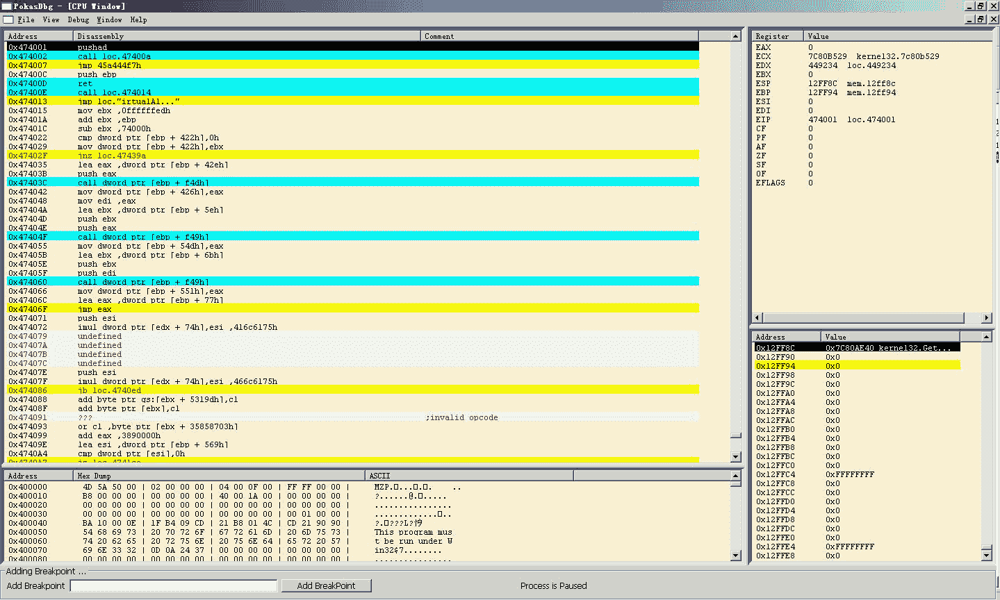

# 一款初步的虚拟机调试器+虚拟机脱壳机示例

> 原文：[`www.pediy.com/kssd/pediy12/130847.html`](https://www.pediy.com/kssd/pediy12/130847.html)

转自  
[`sourceforge.net/projects/x86emu`](http://sourceforge.net/projects/x86emu)  
[`sourceforge.net/projects/pokasdbg`](http://sourceforge.net/projects/pokasdbg)  
虚拟机有源码，IDE 无源码  

上传的附件
|  || x86emu+dbg.part1.rar  
 |
|  || x86emu+dbg.part2.rar  
 |
|  || x86emu+dbg.part3.rar  
 |
|  || x86emu+dbg.part4.rar  
 |