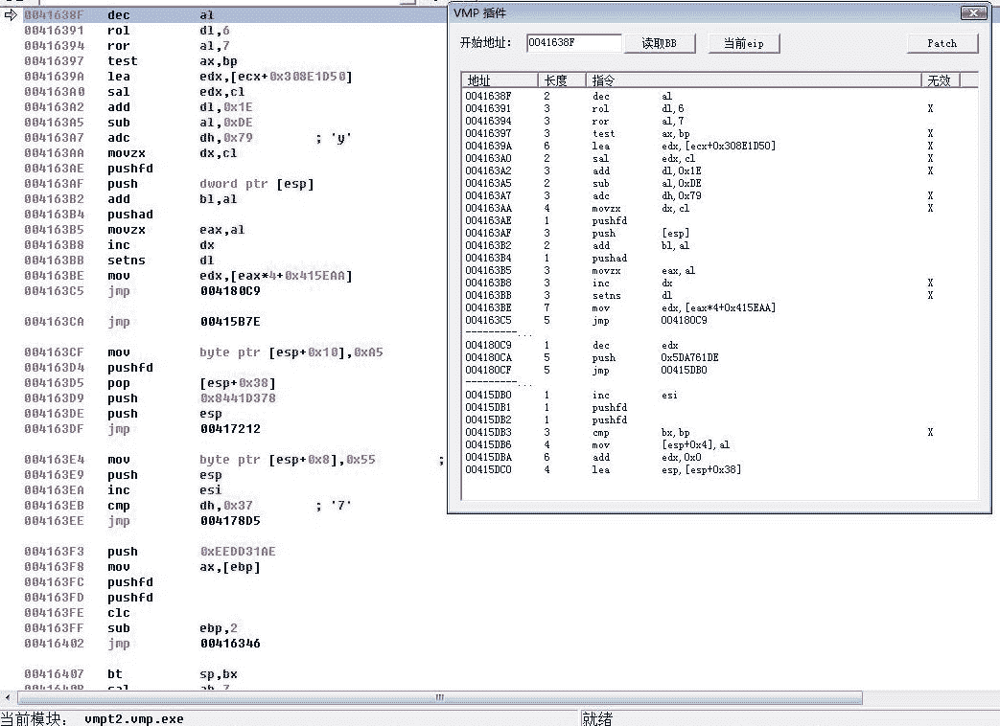
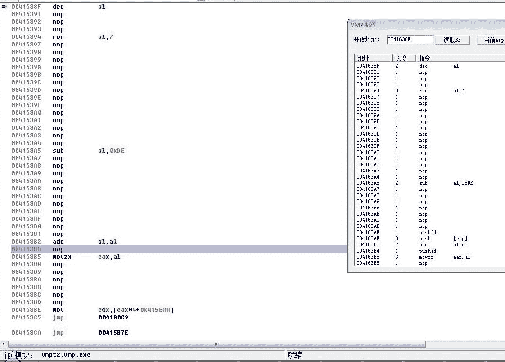
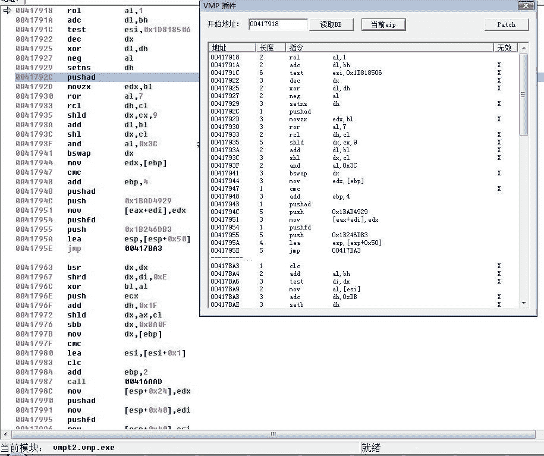
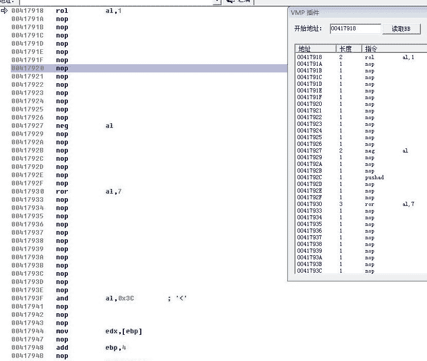

# VMProtect 代码还原技术

> 原文：[`www.pediy.com/kssd/pediy12/126005.html`](https://www.pediy.com/kssd/pediy12/126005.html)

最近逛看雪比较多，发现大家对 VMProtect 这个壳比较害怕，所以找了个最新的版本分析了一下，发现他有很多垃圾指令，并且还使用了虚拟机保护，而且每个被他加壳后的程序，虚拟机的代码好像还不一样。如果要做 VMProtect 的自动脱壳机，应该是要先去掉垃圾指令，再重组指令，再自动识别虚拟机指令的含义，最后重组虚拟机代码，还原出加壳前的 EXE。  
    看了一下 VMProtect 的垃圾花指令，其实是很有规律的，主要就是在某一条指令前加上多条无效指令，例如下面这条指令：  
        mov eax, ebx  
VMProtect 可能会在这条指令前面加上这些无效指令：  
       mov al, cl  
       sete eax  
因此，根据最后一条指令是很容易识别出前面的垃圾指令的。  
  
折腾了一个下午，写了个花指令去除程序（离自动脱壳还很远，不过如果只是要调试的话应该很容易了）。  
基本原理如下：  
  
1.从指定位置或当前 eip 处开始读取 BB 块（如果遇到 e8，e9 跳转就相应的转到目标地址继续读取），生成指令描述表  
2.第 1 次扫描指令描述表识别 clc、stc、cmc 无效指令  
3.第 2 次扫描指令描述表识别 test、cmp 无效指令  
4.第 3 次倒着扫描指令描述表，识别赋值、运算等无效指令  
5.扫描 push、pop 指令  
  
  
看一下运行效果：  
取虚拟机指令的代码：  
  
还原后的效果：  
  
  
  
再找一个虚拟机指令处理代码：  
  
还原后的效果：  
