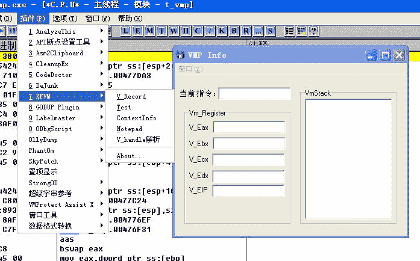

# Vmprotect 之 OD 插件

> 原文：[`www.pediy.com/kssd/pediy11/124213.html`](https://www.pediy.com/kssd/pediy11/124213.html)

Vmprotect 之 OD 插件  
　　　　　　　　　-西风  
　　　　　　　　　-如果转载，请保持原文  
  
  一直想做一个 VMP 的自动化工具，但我总是想法的巨人，行动的矮子，加之本人并非 IT 出身，计算机仅是一个爱好而已，CODE 能力极其低下，所以，至今上图的工具还没有完成,等我完成的时候，我会与大家分享，不过，过程可能会有点漫长，感谢小伟提供的帮助，没有他的分析和同他的讨论，我想我至今还处在思索阶段。这里只能说说我的思路。  
    
  1、站在巨人的肩上  
  对于开发平台的选择，思考过注入，重新制作调试工具，无赖于 CODE 能力低下，非 IT 出身，半灌水的能力让我很痛苦，最终还是选择了 OD 平台，OD 有丰富的 API 接口，利用 OD 本身，就是一个超级调试平台，　于是，我还是选择了 OD 平台。  
  2、插件 OR 脚本  
  最初我试图使用脚本，前期的效果非常好，但随着我试图分析清 VM 后的算法，脚本残缺的数据结构，不完全的指令系统，使这个过程变得不太快乐，于是我选择了前者，使用插件。  
  3、静态 OR 动态  
  OD 分析 VMP 更向是一个纵深的过程，越深越痛苦，就像盗梦空间一样，你会变得分不清现实或是梦境，所以，我们需要一个横向展示的工具，展示出 VMP 真实的寄存器，堆栈，指令，当然这是是指 VMP 的指令，而不是 X86 指令，这样，使我们分析 VM 化的算法变成现实。  
  最初我希望静态的分析 VMP 的 handler，但提取和只别关键字和过程很是痛苦，在乱序和垃圾中寻找可用的语句，而且误判的情况较多，这里我使用到了模拟指令，过程有点像使用 IDA 一样，优点是速度快，结构比较清楚，不过，就像 IDA 中一样，你无法实时判断寄存中的值和分支，只有像车轮一样，两边都走一下，当然这可以形成一个树结构，这也是我希望在这个插件中完成的。最终我选择了动态，即实时运行扫描，扫描每一条指令，结合相关的值来判断 handler，当然同一个 handler 只走一遍，ximo 的方式同我相反，他是完成了动态，再转做静态，再次感叹我低下的 CODE 能力。  
  4、如何分析 handler  
  第一个问题，如何判断你在梦中还是现实中，你需要一个图腾，只有你知道图腾的重量，运行状态，否则你将会在梦中迷失，不停的循环找不到出口，你死掉，就可以很快的回到实现了。  
  出口在哪？  
  进入 VM 中，实际是一个区段，就像梦境与现实始终是分离了，所以，我们关注区段就可以找到我们是否在 vm 中，我们始终关注 ret 指令，就像我们在梦中关注死亡一样，可以让我们很快找到出口，一般一两次 ret 后，最后一个 ret 就是出口，标记一下出口，会很有用。  
  入口在哪？  
  你从不曾记得梦是从哪开始的，你是怎么来到这里的，你回想一下，会发现你不知道你是如何开始的，在 VM 中，我们不停的循环，就在一个大循环中，入口只有一次，然后你就不再知道你怎么来这 handler 中了，没有图腾你就迷失了，无法搞清楚是现实还是梦境，所以，我们进入 VM 区段后，一定要记住，第一个 ret 就是循环的开始，第一个 ret 的前的代码与循环的分界点，那就是入口了。  
  每一层梦都有特征，每个 handler 也是一样，你必须关注垃圾代码以外的，总结出特征，ESP 在 VMP 作用不是太大，不用太过关注，相反你得关注，esi,ebp，因为，在梦中，世界是颠倒的，你得颠倒来看，handler 的特征就不说了，这方面文章太多了，多看看 ximo 的帖子，会得到更多，我分析 handler 的时候，总是使用汇编，用最简单的指令，来看 handler 的构成，记住，构造一个复杂的梦境，会让意念难以查觉。  
  再谈谈 vmp 的改进，梦中梦，vm 中的 vm，handler 中的 handler，用 vm 来模拟 vm，你会发现你不停的进入每一层 VM，每进入一层，速度都将比上一层慢 20 倍，但是，层数多了，你会发现，你很危险了，进入混沌，你就得重来了，所以，VM 中的 VM 应该是下一个反破解的方向。  
  5、如何识别 hnadler  
  我们需要关注是什么，不要去关注为什么，就像梦中一样，你只需关注，你在做什么，不需关注为什么，我们完成上面的特征定位后，剩下的就是识别。  
  去掉不合理的，梦中的火车是可以开上公路的，这明显是不合理的，handler 中有少的是不合常理的应用，  rol ah,0x4，btr eax,0x17，这类似的代码夹杂在常规指令中，本就没有意义，扫描时去掉，我们只取有用的。  
  下次继续  
  
    
  再次感谢小伟的支持，同他的讨论，使我提高很快。