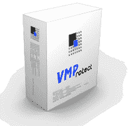
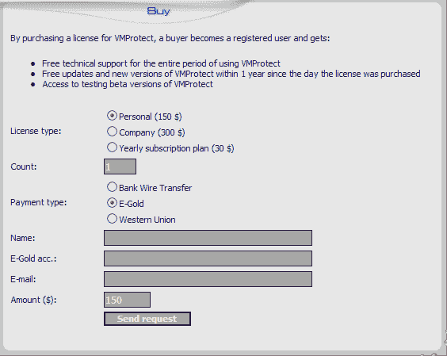

# VMProtect 使用技巧汇集\_\_ 最好的虚拟机保护软件之一

> 原文：[`www.pediy.com/kssd/pediy09/pediy09-532.htm`](https://www.pediy.com/kssd/pediy09/pediy09-532.htm)

> **VMProtect**  
>    
>   
> 官方站点：[`www.vmprotect.ru/`](http://www.vmprotect.ru/)  
> 作 者：PolyTech （俄国）  
>    
> VMProtect 是目前最强大的虚拟机保护软件之一，适合 Visual Basic(native)，Visual C，Delphi，ASM 等本地编译的目标程序，支持 EXE，DLL，SYS。支持 Windows 各系统，具有很好的兼容性和稳定性。  
>    
> 
> 下载地址  
> VMProtect 1.22.3 以前版本都没功能限制，更高版本需要注册才能获得。强度方面，低版本都有不错的表现，可以使用。  
>    
> [VMProtect 0.71](http://www.pediy.com/tools/PACK/Protectors/VMProtect/vmprotect0.71.rar)[  
> VMProtect 1.02](http://www.pediy.com/tools/PACK/Protectors/VMProtect/vmprotect1.02.zip)  
> [VMProtect 1.03](http://www.pediy.com/tools/PACK/Protectors/VMProtect/vmprotect103.rar)  
> [VMProtect 1.05](http://www.pediy.com/tools/PACK/Protectors/VMProtect/vmprotect105.rar)  
> [VMProtect 1.07](http://www.pediy.com/tools/PACK/Protectors/VMProtect/vmprotect107.rar)  
> [VMProtect 1.08](http://www.pediy.com/tools/PACK/Protectors/VMProtect/vmprotect108.rar)  
> [VMProtect 1.09](http://www.pediy.com/tools/PACK/Protectors/VMProtect/vmprotect109.rar)  
> [VMProtect 1.11](http://www.pediy.com/tools/PACK/Protectors/VMProtect/vmprotect1.1.rar)  
> [VMProtect 1.20](http://www.pediy.com/tools/PACK/Protectors/VMProtect/VMProtect1.2.rar)  
> [VMProtect 1.21](http://www.pediy.com/tools/PACK/Protectors/VMProtect/VMProtect1.21.rar)  
> [VMProtect 1.22.3](http://www.pediy.com/tools/PACK/Protectors/VMProtect/vmprotect1.22.rar)  
>   
> 购买方法  
> 如果要使用新功能，在强度，稳定性和兼容性有更高的要求，如多线程支持的更好等，可以购买高版本。  
> 1.首先登陆 VMProtect 官方主页，进入购买链接[`www.vmprotect.ru/buy.php`](http://www.vmprotect.ru/buy.php)  
>   
>    
> 2.如果没有信用卡，可以选用 E-GOLD，然后 E-GOLD 直接汇款给 VMProtect，数小时后，VMProtect 官方会将 key 及正式版寄给你。  
> E-GOLD 可以到淘宝网购买。有关 E-GOLD 请参考：[`www.e-gold.org.cn/`](http://www.e-gold.org.cn/)  
> 你也可以通过代理或西联来购买。  
>    
> 注意：VMProtect 注册协议是不允许公开分析他们的目标程序的，用 VMProtect 保护的程序带有水印，因此将 VMProtect 注册版保护的程序公开给大家研究是要冒风险的，很可能 key 会被 BAN。另外，购买 key 的朋友如果公开散发，也可能导致 VMProtect 会将中国的 IP 封掉（以前己封过一次）。VMProtect 目前己做的很稳定和强大，希望他能发展的更好。  
>   
> 使用方法  
> **1.指定代码**  
> 必须告诉 VMProtect 你要加密的代码具体地址，这对使用者有一定的要求，至少要懂一些跟踪技术，可以用调试器，如 OllyDbg 跟踪到程序需要保护的地址，然后添加地址到 VMProtect。  
> 在这以一个记事本程序为例来演示一下使用方法。  
>    
> 　 运行 VMProtect 后，打开 NOTEPAD.EXE 文件。单击 Dump 标签，输入要加密的起始地址，光标来到要加密代码起始地址后，点击菜单“project/new procedure”,会出现一个新的项目，如下图。  
>   
>    
>    
>    
> **2.用 SDK 标记代码**  
> 　 用调试器获得地址的操作过程比较专业，不太方便。VMProtect v1.2 以上支持 SDK 了，可以编程时插入一个标记，然后在加密时，VMProtect 会认出这些标记，并在有标记的地方进行保护。在程序源码中，用这对标签将一些核心代码包含，编译成 EXE 文件。然后用 VMProtect 打开 EXE，单击“Project”菜单下的“New procedure”或者单击工具栏中的“New procedure”按钮，在弹出的添加地址窗口中会自动将 SDK 定义代码的地址填上。然后在 VMProtect 的“Options”窗口中设置相应的选项，最后单击工具栏中的“Compilation (F9)”按钮，便可对目标软件进行保护。  
>    
> Delphi 中的标记模式  
> 代码:
> 
> ```
> asm                             
>   db $EB,$10,'VMProtect begin',0       //标记开始处.
> end;
> //想保护的程序代码
> asm
>   db $EB,$0E,'VMProtect end',0         //标记结束处.
> end;
>   
> ```
> 
>     ?  
>    
> VC 的 VMProtect 的宏 ：  
>    
> 代码:
> 
> ```
>  
>  
>  #define  VMBEGIN 
>  \_\_asm    //标记开始处.
>     {  
>       \_emit 0xEB
>       \_emit 0x10  
>       \_emit 0x56  
>       \_emit 0x4D  
>       \_emit 0x50 
>       \_emit 0x72 
>       \_emit 0x6F 
>       \_emit 0x74 
>       \_emit 0x65 
>       \_emit 0x63 
>       \_emit 0x74 
>       \_emit 0x20 
>       \_emit 0x62 
>       \_emit 0x65 
>       \_emit 0x67 
>       \_emit 0x69 
>       \_emit 0x6E 
>       \_emit 0x00
>     }
>     //想保护的程序代码
>  #define  VMEND
>     \_\_asm  //标记结束处.
>     {  
>       \_emit 0xEB
>       \_emit 0x0E  
>       \_emit 0x56   
>       \_emit 0x4D   
>       \_emit 0x50 
>       \_emit 0x72 
>       \_emit 0x6F 
>       \_emit 0x74 
>       \_emit 0x65 
>       \_emit 0x63 
>       \_emit 0x74 
>       \_emit 0x20 
>       \_emit 0x65 
>       \_emit 0x6E 
>       \_emit 0x64 
>       \_emit 0x00
>  
>   
> ```
> 
>     ?  
> **3.用 map 文件**  
> VMProtect 支持 Map 文件来定位函数，设置编译器，让其生成 Map 文件。将目标文件和 Map 文件放在一起（文件名要相同），用 VMProtect 打开文件后，执行菜单“New procedure”时能够列出很多内部函数，这时只需要选择想加密的函数进行后续处理了。  
>   
> 　 VMProtect 是当前一款很强的虚拟机保护软件，经过 VMProtect 处理的软件，能大大提高破解者的分析成本，是目前一种比较理想的保护方式。VMProtect 关键是用好，一定要将程序关键代码进行处理，必要时用 OllyDBG 检查一下被处理的代码。  
> 另外，经虚拟机处理代码效率会降低，因此一些对效率要求比较高的代码就不适合用 VMProtect 进行处理。  
>    
> 注：  
> 1.本文章从[`www.pediy.com/bbshtml/bbs8/pediy8-835.htm`](http://www.pediy.com/bbshtml/bbs8/pediy8-835.htm)中整理而来。 
> 
>   

 4dd466d0e1e0cc123afbe504da2462ca