# Themida v1.8.0.0 Demo 虚拟机分析(Part1+Part2+Part3+Part4+Part5+Part6+Part7+Part8)

> 原文：[`www.pediy.com/kssd/pediy08/pediy8-808-1.htm`](https://www.pediy.com/kssd/pediy08/pediy8-808-1.htm)

 

Themida 的 VM 从 v1.1.1.0 到 v1.8.0.0 基本没有大的变化。从文档看新版本支持更多的指令集,不过在逆向的过程中我并没有看出来,也许是只动过 Demo 版本的原因。原来准备看注册版的,恰好变形代码部分增强,又放下了。

前几次手工修复代码后,累得失去了写文章的兴趣,这次是文章先行。目前我写不出通用的解码程序,所以仅仅是篇文章。截图是调试时做的,有的图上的注释可能不够准确,没有再一一修改。细节太多,错误难免。另外,以前零零散散写过一些东西,难免会有炒冷饭的部分,见谅 J。

下面的所有讨论都针对 Themida v1.8.0.0 Demo。

Virtual Machine 入口代码

下面以 Themida v1.8.0.0 Demo 自己的 stolen codes 执行过程为例。

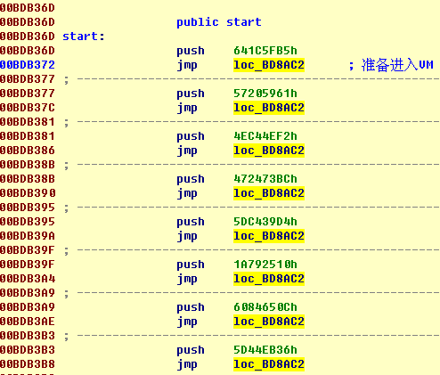

 

在 Dump 点的代码如图。连续的 PUSH/JMP 代码,JMP 的目的地址相同。代码下面是这块被保护代码(stolen codes)对应 PCODE 数据地址信息。

 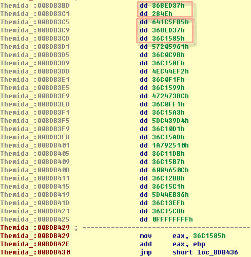

前 2 个 DWORD 有自己的含义。后面每 3 个 DWORD 为 1 组,对应上面的 1 个 PUSH/JMP 指令对,具体含义后面解释。以 FFFFFFFFh 结束。可以看到,PUSH 的 DWORD 就是对应组内的第 1 个 DWORD。

跟进 loc\_BD8AC2。

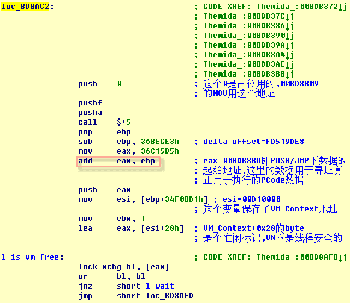

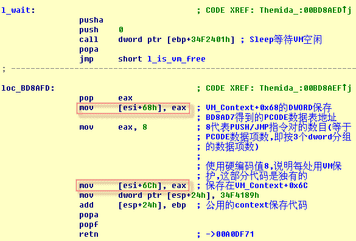

这部分代码是 stolen codes 专有的,每处用 VM 保护的代码都有自己的 1 份。在 VM\_Context 内保存了 2 个值, PCODE 数据表地址和这块代码内包含的 PUSH/JMP 指令对数。ret 到公用的 context 保存代码。

 

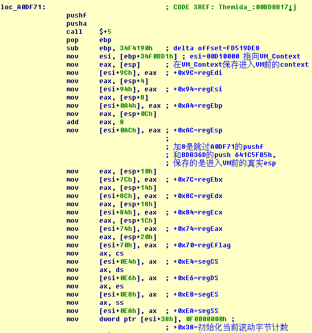

在 VM\_Context 内保存进入 VM 前的环境。

 

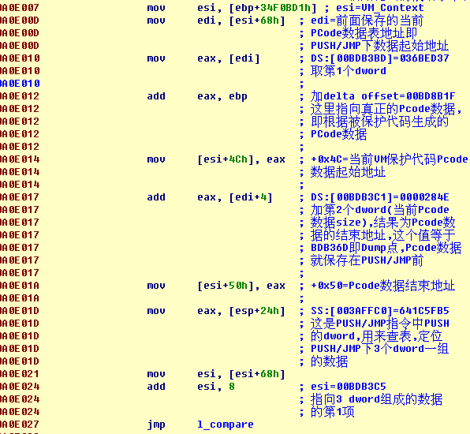

 

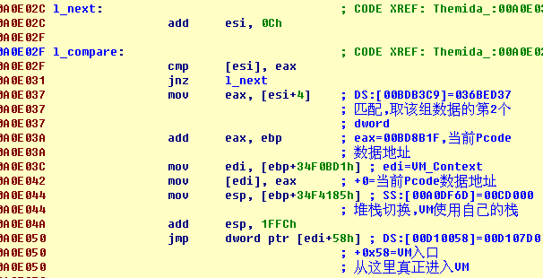

 

现在再来看看 Dump 点的代码和数据。

 

首先,为什么会有多个 PUSH/JMP? VM 对代码的保护是“平面”的,如果被保护代码中包含有 call,Themida 不会将被调用函数的代码也纳入 VM 保护。执行到该处时,控制退出 VM。执行完返回时,需要用 PUSH/JMP 重新进入 VM。stolen codes 对应的代码出现了 8 个 PUSH/JMP 指令对,意味着这段代码内存在 7 个 call(第 8 次进入 VM 后,退出 VM 时控制返回到 OEP 处 stolens codes 结束后的代码地址)。

 

相应的,每次进入 VM,需要指定对应的 PCode 数据(可以看作 PCode 的指令指针),即整个 stolen codes 对应的 PCode 数据也被分成 8 部分。PUSH/JMP 中 PUSH 的值实际是个 key,用来在下面的数据表中搜索对应的 PCode 地址。

 

把 Delta Offset 加到地址数据上可以看得更清楚。

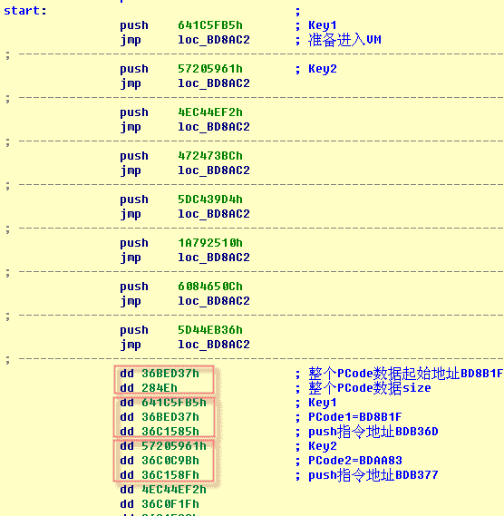

 

上面数据组内的第 3 项代表了 PUSH/JMP 中 PUSH 指令的地址。实际上,前面的描述不够准确,这里不一定是 PUSH Imm32。看看下面这段代码(来自 Code Virtualizer Demo 1.0.1.0)。

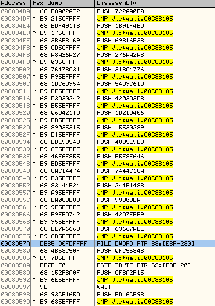

注意最后的 3 组。PUSH/JMP 前出现了别的指令。

FILD DWORD PTR SS:\[EBP-230\]

FSTP TBYTE PTR SS:\[EBP-20\]

WAIT

 

这些是 Themida VM 不能模仿的指令。此时上述第 3 个 dword 指向非模仿指令的地址。VM\_Context+0x6C 处的 dword 代表可模仿指令对应的数据项数。这种情况下,该值小于 PUSH/JMP 下面的实际数据项数。

 

被保护代码中每出现 1 条 VM 不能模仿的指令,就会生成 1 组这样的指令。执行时退出 VM,执行非模仿指令,再重新进入 VM。不过这些细节暂时不必理会。后面会详细解释 handler 的类型与执行细节。

 

VM 的内存结构\_\_\_\_\_\_\_\_\_\_\_\_\_\_\_\_\_\_\_\_\_\_\_\_\_\_\_\_\_\_\_\_\_\_\_\_\_\_\_\_\_\_\_\_\_\_\_\_\_\_\_\_\_\_\_\_\_

 

在较早的版本中,VM 代码保存在多块内存中。大约从 1.3.0.0 开始,代码合并到了 1 块内存。VM 由 6 部分组成。下面为注入的 tracer(hi shooooJ)对 VirtualAlloc 的拦截记录(实际分配时会按页对齐)。Dump 后补这 6 个区段就可以了(Virtual Machine Anti-Dumper 会导致运行失败)。

 

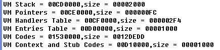

 

# VM Stack                                                                            

VM 使用的 8KB stack

 

# VM 2-Bytes-Opcode Table1                                                            

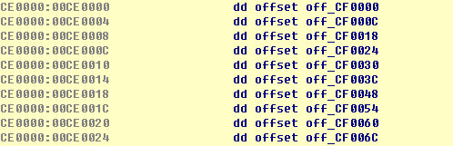

这是张地址表,指针地址是连续的(这里了和截图不同的名字)。

 

# VM 2-Bytes-Opcode Table2                                                            

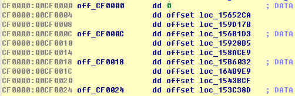

Handler 地址表,每 3 个地址为 1 组,被上面表内某项所指。非 0 值代表 1 个 handler 地址,共 158 项。

 

# VM 1-Byte-Opcode Table                                                           

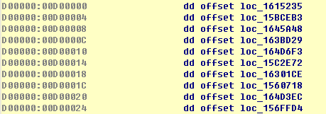

另 1 张 Handler 地址表,共 62 项。用 PUSH/JMP 进入 VM 时,第 1 个 handler 地址是从这张表查的。反过来,158 个 Handler 地址数据中,除去这 62 项外的其余 Handler 永远不会在 VM 入口使用。注意这张表内所有的 handler 地址,在上面包含 158 个非 0 值的表内都有。

进入 VM 时的查表代码。

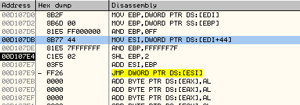

取 PCode 数据第 1 字节,其低 7 位用来查 VM 1-Byte-Opcode Table。

 

# VM Codes                                                                             

虚拟机 handler 代码。

 

# VM Context and Stub Codes                                                          

全局的 VM\_Context 及上图的进入 VM 查表代码。

 

 

VM OPCODE\_\_\_\_\_\_\_\_\_\_\_\_\_\_\_\_\_\_\_\_\_\_\_\_\_\_\_\_\_\_\_\_\_\_\_\_\_\_\_\_\_\_\_\_\_\_\_\_\_\_\_\_\_\_\_

 

为了理解 opcode,先复习一下 Intel 指令格式。以下内容 Copy 自<The Art of Disassembly>。

 

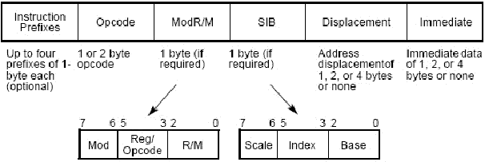

 

![文本框: We said that the processor has a decoding table, that means it requires a signature to be decoded. We can think about the \[CODE\] block as this signature,that tells the processor exactly what instruction to execute, and what kinds of rules should the instruction have.](../Images/7df77eb30d13c3d12088b6c395d12c7a.jpg)

 

 

 

唯一的非可选项为 Opcode。

Opcode 的本质是处理器用来查解码表的索引。通过查表,才能获知究竟要执行什么操作,需要什么操作数。实际的操作取决于处理器对查表结果的解释。再来看 Thmida VM 中出现的 3 张表。分两种情况。

 

*进入 VM 时的查表动作,使用 1-Byte-Opcode Table                                    *

 

取 PCode 数据第 1 字节的低 7 位,用作查 1-Byte-Opcode 表的索引。该索引值就是 1 字节的 opcode 编码。7 位的可取值范围为 0-127(当前该表有 62 项数据,即 0-61)。当执行的 VM 指令为 JMP/Jxx 时,如果要执行跳转操作,也会使用 1 字节 opcode,用前面提到的查表代码进入对应的 handler。

 

*在 VM 内连续执行 PCode 时,使用 2-Bytes-Opcode Table                               *

 

在 VM 内连续执行时,会从 PCode 数据内解出 2 个字节值,用于定位执行下一条 pcode 指令的 handler。Byte1 用来查 2-Bytes-Opcode Table1。假设为 0,取第 1 项。

 

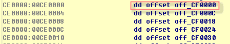

地址数据为 CF0000。指向 2-Bytes-Opcode Table2 内某项。

 

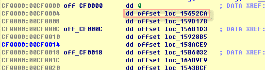

 

假设 Byte2 为 1,定位到 CF0000 处 3 个 dword 的第 2 项,即 handler 地址。2 个 byte 实际就是 2 字节 opcode 编码(00 01)。

 

第 1 张表当前有 63 项,即 opcode1 取值为 0-62。第 2 张表内的 dword 每 3 个为 1 组,只能为 0-2,即 opcode2 取值为 0-2。地址值为 0 的数据项可能代表保留的 opcode 编码。

 

注意,1 字节 opcode 表内所有的 handler 地址,在 2 字节 opcode 表内都存在,即所有的 1 字节 opcode 都与某个 2 字节 opcode 重叠,指向相同的 handler。看起来 1 字节 opcode 完全是多余的,为什么不只使用 2 字节 opcode? 

 

为了提高执行效率,Themida 在每个 handler 内包含了分发代码, 从 pcode 数据内解码出下一条指令的 opcode,查表得到对应的 handler 地址,以 jmp esi 跳过去继续执行。这样可避免用一个巨大的 switch-case 语句来判断 opcode 值。这种技巧称为 Threaded Interpretation。

 

当前执行指令对应的 pcode 数据内包含有下一条指令的 opcode(2 bytes)和 pcode 数据地址(1 byte)。

 

进入 VM 时,第 1 条指令的 pcode 数据内包含有下一条指令的 2 字节 opcode 数据。第 1 条指令自己的 opcode 为 pcode+0 字节的低 7 位(pcode 数据的地址来自 PUSH/JMP 下的对应数据,由前面图中的准备代码保存到 VM\_Context+0 处)。即这项 pcode 数据包含了 2 条指令的 opcode 信息。如果只用 2 字节编码,显然 pcode 数据将占用更多的空间。我的理解是使用 1 字节编码的目的是节省空间。

 

另外,1 字节 opcode 实际上涵盖了 VM 的全部指令,所有的 2 字节 opcode 都与某个 1 字节 opcode 重叠。这个后面再讲。

 4dd466d0e1e0cc123afbe504da2462ca