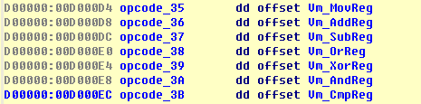
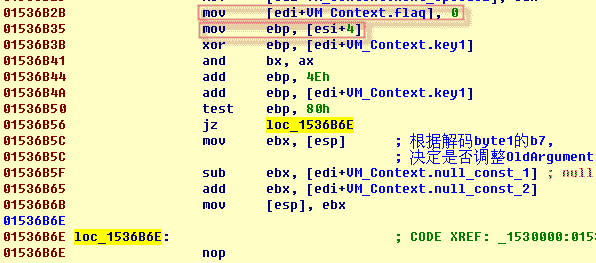
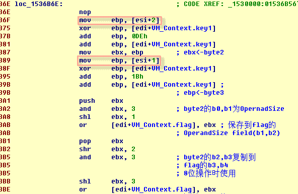
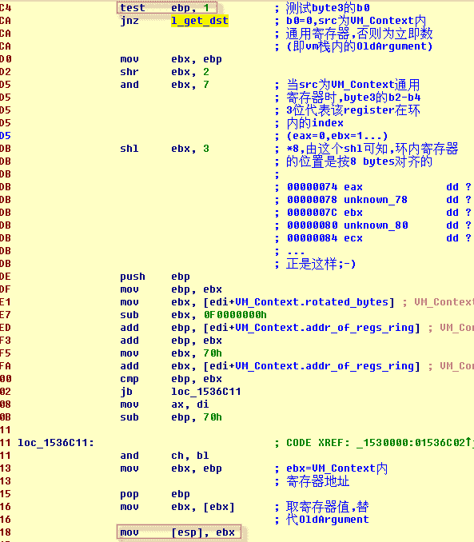
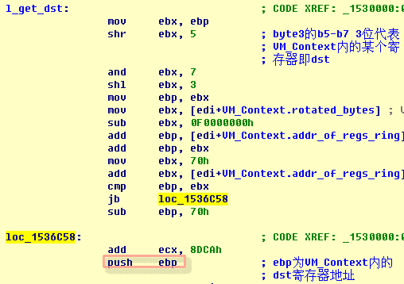
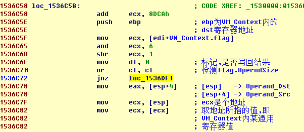
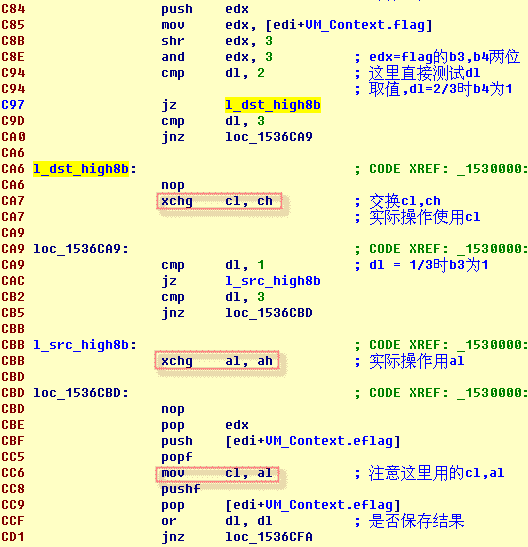
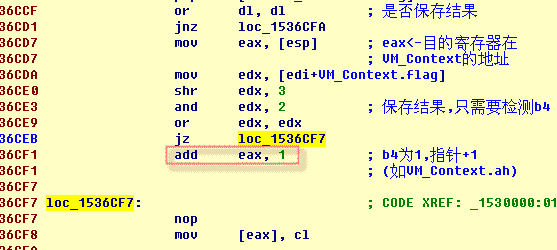
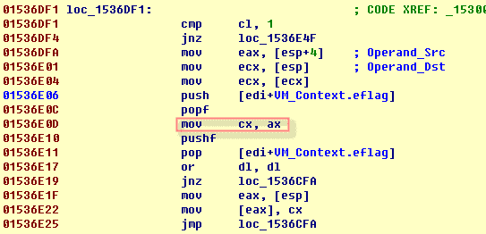
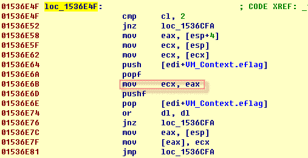

# Themida v1.8.0.0 Demo 虚拟机分析

> 原文：[`www.pediy.com/kssd/pediy08/pediy8-808-5.htm`](https://www.pediy.com/kssd/pediy08/pediy8-808-5.htm)

Handler Type 2\_\_

第 2 类 handler 的结构要清晰一些,如果不算 2 字节 opcode 中的重复部分,这类 handler 有 7 个。特征是 PCODE.OpcodeTail 数据为 3 字节,操作数类型为 RegReg/RegImm,即这类指令的 dst 为 VM\_Context 内的通用寄存器,src 为 VM\_Context 内的通用寄存器或立即数。

 

下面以 Vm\_MovReg 为例说明。

 

这类 handler 将 VM\_Context.flag 的初始值预置为 0。解码 byte1,对这个字节的使用与 Type1 中的 byte2 相似, 若 b7 位为 1,使用 VM\_Context 内+60h,+64h 的 2 个 dword 修改 vm 栈内由 key1 解码的 OldArgument。由于这 2 个 dword 似乎总为 0,这里不会产生实质的影响。

 

解码 byte2,byte3(不再费事去取名了,就是按解码的顺序编号)。byte2 的 b0,b1 对应值为 OperandSize,复制到 flag.OperandSize 域。b2,b3 被复制到 flag 的 b3,b4,这 2 位的含义下面说明。

 

 

解析源操作数。检测 byte3 的 b0 位,若 b0 为 1,则 Operand\_Src 为立即数(即 vm 栈内的 OldArgument),不需要额外处理,跳到解析 Operand\_Dst 的代码。

 

否则,Operand\_Src 为 VM\_Context 内的某个通用寄存器,取 byte3 的 b2-b4 3 位,其对应值为该寄存器在通用寄存器环内的 index。根据当前滚动字节数计算出实际地址,取其所指 dword 替换掉 vm 栈内的 OldArgument。

 

解析目的操作数。byte3 的 b5-b7 3 位代表 Operand\_Dst 寄存器在环内的 index,取其实际地址压栈。此时 vm 栈内为:

 

\[esp\]     -> Operand\_Dst,VM\_Context 内通用寄存器地址

\[esp+4\]  -> Operand\_Src,立即数或 VM\_Context 内某个通用寄存器值

 

开始执行实际操作。检测 flag.OperandSize,非 8 位操作跳走。先看下面的 8 位操作。eax 为源操作数,ecx 为目的寄存器内的原值。对于 MOV 指令,这个原值并不需要,显然这些代码是程序生成的。

 

下面的代码要检测 flag 的 b3,b4 位,这里先给出 Type2 handler 对 flag 的解释。

 

 

| ***b7*** || ***b6 *** || ***b5*** || ***b4*** || ***b3*** || ***b2  b1*** || ***b0*** |
| --- | --- | --- | --- | --- | --- | --- |
|  || 

###  

 ||   || 

###### DstUseHigher8B

对于 8 位操作,该位为 1 表示 dst 使用高 8 位字节 || SrcUseHigher8B 对于 8 位操作,该位为 1 表示 dst 使用高 8 位字节 || 

##### *OperandSize*

0 -> 8 位 1 -> 16 位 2 -> 32 位 ||   |

 

b3,b4 位只对 8 位操作才有用。注意 eax,ecx 的数据是 dword 形式。b4 位对应目的操作数,b3 对应源操作数。b4 或 b3 为 1,代表使用高 8 位字节。这里的表达不大清楚,简单地说,b4 为 1 表示真正的 dst 是 ch,b3 为 1 表示 src 用 ah。

 

Vm\_MovReg 的 8 位操作,不需要多解释了 J。

将栈内的结果写回 VM\_Context,这里还要检测 1 次 b4。

 

下面看看 16 位操作,这个就直截了当了。

 

32 位。

 4dd466d0e1e0cc123afbe504da2462ca