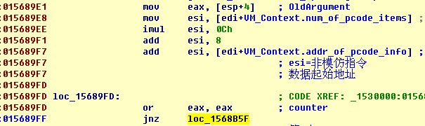
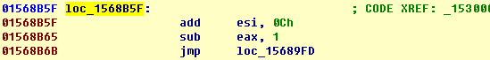
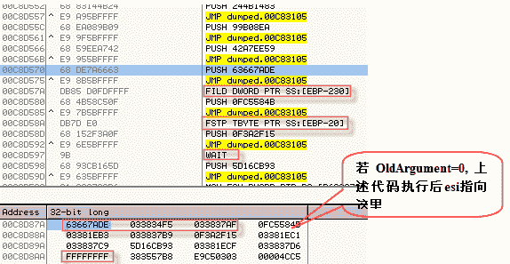
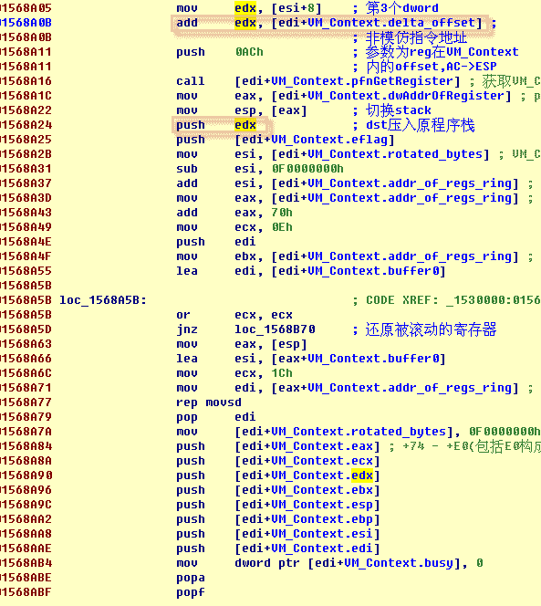
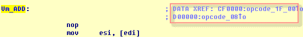

# Themida v1.8.0.0 Demo 虚拟机分析 – Part7 

> 原文：[`www.pediy.com/kssd/pediy08/pediy8-808-7.htm`](https://www.pediy.com/kssd/pediy08/pediy8-808-7.htm)

Handler Type 4

 

这类 handler 很简单, 在 1 字节编码 opcode 中只有 1 个,使用 2 字节 OpcodeDetail 数据,可以合并到 Type 1 里。之所以单独列出来是因为其功能比较特殊,用于执行非模仿指令。

 

只列出与功能相关的代码。

只使用 Key1 解码的 OldArgument,由 switch-case 压入的 NewArgument 未用。

 

VM\_Context.num\_of\_pcode\_items 为当前 VM 保护代码可以在 VM 内执行的代码块数。在 Part1 中已经提到过了,当存在 VM 不能模仿的代码时,这个值比 PUSH/JMP 下实际的数据项数小。

 

OldArgument 是个 index,指定应使用非模仿指令数据的第几项,以解析退出 VM 后的执行地址。上面的代码跳过 PUSH/JMP 下的“正常”数据,根据 index 值定位非模仿指令所属数据。

 

还是以 Part1 里那段 CVDemo 的代码来说明。

 

dump 窗口红框内的数据对应最后 1 段“正常”的 VM 保护代码。在其后的 3 组数据对应 3 条非模仿指令。

 

 

取数据项第 3 个 dword,加 DeltaOffset 即非模仿指令地址。后面的就不多说了,恢复环境退出 VM。

 

至此我们已经分析完了 Themida VM 所有 handler 类型。下面给出完整的 VM 指令集。2 字节 opcode 全部是 1 字节 opcode 的复制品,重叠的 handler 其对应关系也可变。

 

1 字节 opcode 08 与 2 字节 opcode 1F 00 使用的是同 1 个 handler,但换个程序与 08 对应的可能是另一个 2 字节 opcode,即 Themida VM 的 2 字节 opcode 是个动态指令集。1 字节 opcode 的含义及访问 PCODE 各 field 时使用的 offset 是固定的,当然作者完全可以把这个也搞成动态的 J。下面只列出 1 字节 opcode,功能以伪码说明(opcode 的名字不一定合适 J)。

 

Themida VM Instruction Set\_\_\_\_\_\_\_\_\_\_\_\_\_\_\_\_\_\_\_\_\_\_\_\_\_\_\_\_\_\_\_\_\_\_\_\_\_\_\_\_\_\_\_\_\_

 

| ***Opcode*** || ***Type*** || ***Mnemonics*** |
| --- | --- | --- |
| ***00*** || ***1*** || 

#### Vm\_Push

只支持 32 位操作 if((flag.ByRef) || (flag.OperateEsp)){   if(flag.FS)push fs:\[NewArgument\]else  push \[NewArgument\]}else    push NewArgument |
| ***01*** || ***1*** || 

#### Vm\_POP

if(flag.EFlag)   dst = VM\_Context.Eflag   ; 等价于 popfelse   dst = NewArgument if(flag.FS)   pop fs:\[dst\] ; (OperandSize = 8/16/32 位)else   pop \[dst\] ; (OperandSize = 8/16/32 位) |
| ***02*** || 

### 1

 || ***Vm\_Mov***   只支持 32 位操作 mov \[NewArgument\],OldArgument |
| ***03*** || ***3*** || ***Vm\_Jxx***这个难以用伪码描述;-) |
| ***04*** || 

### 1

 || 

#### Vm\_Push0

在 VM 栈内压入 0(32 位)push 0 |
| ***05*** || ***4*** || 

#### Vm\_ExecuteNoEmulatedOpcode

jmp NonEmulatedOpcode\[OldArgument\] |
| ***06*** || ***1*** || 

#### Vm\_IMUL32

if(flag.Stack){   imul \[esp+4\],\[esp\] (OperandSize = 16/32 位)} |
| ***07*** || ***1*** || 

#### Vm\_ADC

if(flag.Stack){    adc \[esp+4\],\[esp\] (OperandSize = 8/16/32 位)}else if(flag.ByRef){VM\_Context.register = adc(\[NewArgument\],OldArgument) ; 32 位} |
| ***08*** || ***1*** || 

#### Vm\_ADD

if(flag.Stack){    add \[esp+4\],\[esp\] (OperandSize = 8/16/32 位)}else if(flag.ByRef){VM\_Context.register = add(\[NewArgument\],OldArgument) ; 32 位} |
| ***09*** || ***1*** || 

#### Vm\_AND

if(flag.Stack){    and \[esp+4\],\[esp\] (OperandSize = 8/16/32 位)}else if(flag.ByRef){VM\_Context.register = and(\[NewArgument\],OldArgument) ; 32 位} |
| ***0A*** || ***1*** || 

#### Vm\_CMP

if(flag.Stack){    cmp \[esp+4\],\[esp\] (OperandSize = 8/16/32 位)}else if(flag.ByRef){VM\_Context.register =  cmp(\[NewArgument\],OldArgument) ; 32 位这里显然有 bug,可以看出这些代码是用同一个函数生成的,如 MakeOpcodeWithTwoOperandsJ}  |
| ***0B*** || ***1*** || 

#### Vm\_OR

if(flag.Stack){    or \[esp+4\],\[esp\] (OperandSize = 8/16/32 位)}else if(flag.ByRef){VM\_Context.register =  or(\[NewArgument\],OldArgument) ; 32 位} |
| ***0C*** || ***1*** || 

#### Vm\_SUB

if(flag.Stack){    sub \[esp+4\],\[esp\] (OperandSize = 8/16/32 位)}else if(flag.ByRef){VM\_Context.register =  sub(\[NewArgument\],OldArgument) ; 32 位} |
| ***0D*** || ***1*** || 

#### Vm\_TEST

if(flag.Stack){    test \[esp+4\],\[esp\] (OperandSize = 8/16/32 位)}else if(flag.ByRef){VM\_Context.register =  test(\[NewArgument\],OldArgument) ;32 位    与 Vm\_CMP 同样的 bug}  |
| ***0E*** || ***1*** || 

#### Vm\_XOR

if(flag.Stack){    xor \[esp+4\],\[esp\] (OperandSize = 8/16/32 位)}else if(flag.ByRef){VM\_Context.register =  xor(\[NewArgument\],OldArgument) ; 32 位} |
| ***0F*** || ***1*** || 

#### Vm\_MOVZX8

if(flag.Stack){if(1 == OperandSize) ; 16<-8   movzx word ptr \[esp+4\],byte ptr \[esp\]else if(2 == OperandSize) ; 32<-8   movzx dword ptr \[esp+4\],byte ptr \[esp\]} |
| ***10*** || ***1*** || 

#### Vm\_MOVZX16

if(flag.Stack){if(1 == OperandSize) ; 16<-8   movzx word ptr \[esp+4\],byte ptr \[esp\]else if(2 == OperandSize) ; 32<-16   movzx dword ptr \[esp+4\],word ptr \[esp\]       与上面的区别在可处理 16 位值}  |
| ***11*** || ***1*** || 

#### Vm\_Push0

在 VM 栈内压入 0(32 位)push 0(与 04)重复 |
| ***12*** || ***1*** || 

#### Vm\_INC

if(flag.Stack){    add \[esp+4\],1 ; 8/16/32 位}执行前 VM 栈内有 2 个值,\[esp\]=1,\[esp+4\]为 dst,handler 内直接用硬编码值 1,对应 INC |
| ***13*** || ***1*** || 

#### Vm\_RCL

if(flag.Stack){    rcl \[esp+4\],\[esp\] (OperandSize = 8/16/32 位)}else if(flag.ByRef){VM\_Context.register =  rcl(\[NewArgument\],OldArgument) ; 32 位} |
| ***14*** || ***1*** || 

#### Vm\_RCR

if(flag.Stack){    rcr \[esp+4\],\[esp\] (OperandSize = 8/16/32 位)}else if(flag.ByRef){VM\_Context.register =  rcr(\[NewArgument\],OldArgument) ; 32 位} |
| ***15*** || ***1*** || 

#### Vm\_ROL

if(flag.Stack){    rol \[esp+4\],\[esp\] (OperandSize = 8/16/32 位)}else if(flag.ByRef){VM\_Context.register =  rol(\[NewArgument\],OldArgument) ; 32 位} |
| ***16*** || ***1*** || 

#### Vm\_ROR

if(flag.Stack){    ror \[esp+4\],\[esp\] (OperandSize = 8/16/32 位)}else if(flag.ByRef){VM\_Context.register =  ror(\[NewArgument\],OldArgument) ; 32 位} |
| ***17*** || ***1*** || 

#### Vm\_SAL

(实际代码用 shl)if(flag.Stack){    sal \[esp+4\],\[esp\] (OperandSize = 8/16/32 位)}else if(flag.ByRef){VM\_Context.register =  sal(\[NewArgument\],OldArgument) ; 32 位} |
| ***18*** || ***1*** || 

#### Vm\_SAR

if(flag.Stack){    sar \[esp+4\],\[esp\] (OperandSize = 8/16/32 位)}else if(flag.ByRef){VM\_Context.register = sar(\[NewArgument\],OldArgument) ; 32 位} |
| ***19*** || ***1*** || 

#### Vm\_SHL

(实际代码用 shl 实现,由于 shl/shr = sal/sar,根据指令的前后关系,这里命名为 shl)if(flag.Stack){    shl \[esp+4\],\[esp\] (OperandSize = 8/16/32 位)}else if(flag.ByRef){VM\_Context.register = shl(\[NewArgument\],OldArgument) ; 32 位} |
| ***1A*** || ***1*** || 

#### Vm\_SHR

if(flag.Stack){    shr \[esp+4\],\[esp\] (OperandSize = 8/16/32 位)}else if(flag.ByRef){VM\_Context.register = shr(\[NewArgument\],OldArgument) ; 32 位} |
| ***1B*** || ***1*** || 

#### Vm\_DEC

if(flag.Stack){    sub \[esp+4\],1 ; 8/16/32 位}执行前 VM 栈内有 2 个值,\[esp\]=1,\[esp+4\]为 dst,handler 内直接用硬编码值 1 |
| ***1C*** || ***1*** || 

#### Vm\_ExitVM

这里看起来没做什么,取进入 handler 时的\[esp\]->eax,mov eax,eax,再用 stosd 送回 vm 栈.如果写解码程序会发现,这里解出的下 1 个 pcode 数据地址超出了当前 pcode 数据地址范围,2 个 opcode 也超出取值范围.估计这代表 pcode 数据结束 |
| ***1D*** || ***1*** || 

#### Vm\_MOVSX8

if(flag.Stack){if(1 == OperandSize)   movsx word ptr \[esp+4\],byte ptr \[esp\]else if(2 == OperandSize)   movsx dword ptr \[esp+4\],byte ptr \[esp\]} |
| ***1E*** || ***1*** || 

#### Vm\_MOVSX16

if(flag.Stack){if(1 == OperandSize) ; 16<-8   movsx word ptr \[esp+4\],byte ptr \[esp\]else if(2 == OperandSize) ; 32<-16   movsx dword ptr \[esp+4\],word ptr \[esp\]} 与上面的区别在这里,可处理 16 位值 |
| ***1F*** || ***1*** || 

#### Vm\_CLC

clc  |
| ***20*** || ***1*** || 

#### Vm\_CLD

cld |
| ***21*** || ***1*** || ***Vm\_NOP***  nop |
| ***22*** || ***1*** || 

#### Vm\_CMC

cmc |
| ***23*** || ***1*** || 

#### Vm\_STC

stc |
| ***24*** || ***1*** || 

#### Vm\_STD

std |
| ***25*** || ***1*** || 

#### Vm\_STI

sti |
| ***26*** || ***1*** || 

#### VM\_SetEbpDeltaOffset

VM\_Context.ebp = VM\_Context.delta\_offset |
| ***27*** || ***1*** || 

#### Vm\_BT

if(flag.Stack){bt \[esp+4\],\[esp\] ; (OperandSize = 16/32 位)} |
| ***28*** || ***1*** || 

#### Vm\_BTC

if(flag.Stack){btc \[esp+4\],\[esp\] ; (OperandSize = 16/32 位)} |
| ***29*** || ***1*** || 

#### Vm\_BTR

if(flag.Stack){btr \[esp+4\],\[esp\] ; (OperandSize = 16/32 位)} |
| ***2A*** || ***1*** || 

#### Vm\_BTS

if(flag.Stack){bts \[esp+4\],\[esp\] ; (OperandSize = 16/32 位)} |
| ***2B*** || ***1*** || 

#### Vm\_SBB

if(flag.Stack){    sbb \[esp+4\],\[esp\] (OperandSize = 8/16/32 位)}else if(flag.ByRef){VM\_Context.register = sbb(\[NewArgument\],OldArgument) ; 32 位} |
| ***2C*** || ***1*** || 

#### Vm\_MUL

注意结果保存方式,\[esp\],\[esp+4\]都用了 if(flag.Stack){   mul \[esp+4\],\[esp\] (OperandSize = 8/16/32 位)} |
| ***2D*** || ***1*** || 

#### Vm\_IMUL8

注意结果保存方式,\[esp\],\[esp+4\]都用了 if(flag.Stack){   imul \[esp+4\],\[esp\] (OperandSize = 8/16/32 位)}与 opcode 06 比较,前者不支持 8 位,只保存结果的低位部分 |
| ***2E*** || ***1*** || 

#### Vm\_DIV

if(flag.Stack){   div \[esp+8\]:\[esp+4\],\[esp\] (OperandSize = 8/16/32 位)}div 为 16b/8b,32b/16b,64b/32b,vm 栈上实际有 3 个 dword,按需要解释其 size,注意计算结果的保存方式 |
| ***2F*** || ***1*** || 

#### Vm\_IDIV

if(flag.Stack){   idiv \[esp+8\]:\[esp+4\],\[esp\] (OperandSize = 8/16/32 位)}idiv 为 16b/8b,32b/16b,64b/32b,vm 栈上实际有 3 个 dword,按需要解释其 size,注意计算结果的保存方式 |
| ***30*** || ***1*** || 

#### Vm\_BSWAP

if(flag.Stack){    bswap \[esp\] ; (OperandSize = 8/16/32 位)}Bug?从 Intel 手册看,bswap 只应对 32 位寄存器使用.Themida 对 8/32 位操作用 bswap eax,对 16 位用 bswap ax(用 0x66 前缀),可能有问题 |
| ***31*** || ***1*** || 

#### Vm\_NEG

if(flag.Stack){    neg \[esp\] ; (OperandSize = 8/16/32 位)} |
| ***32*** || ***1*** || 

#### Vm\_NOT

if(flag.Stack){    not \[esp\] ; (OperandSize = 8/16/32 位)} |
| ***33*** || ***1*** || 

#### Vm\_Push0

在 VM 栈内压入 0(32 位)push 0 |
| ***34*** || ***1*** || 

#### Vm\_Push0

在 VM 栈内压入 0(32 位)push 0 |
| ***35*** || ***2*** || 

#### Vm\_MovReg

  |
| ***36*** || ***2*** || 

#### Vm\_AddReg

  |
| ***37*** || ***2*** || 

#### Vm\_SubReg

  |
| ***38*** || ***2*** || 

#### Vm\_OrReg

  |
| ***39*** || ***2*** || 

#### Vm\_XorReg

  |
| ***3A*** || ***2*** || 

#### Vm\_AndReg

  |
| ***3B*** || ***2*** || 

#### Vm\_CmpReg

  |
| ***3C*** || ***1*** || 

#### Vm\_Load

mov VM\_Context.register,NewArgument |
| ***3D*** || ***1*** || 

#### Vm\_Push0

在 VM 栈内压入 0(32 位)push 0 |

 

 4dd466d0e1e0cc123afbe504da2462ca