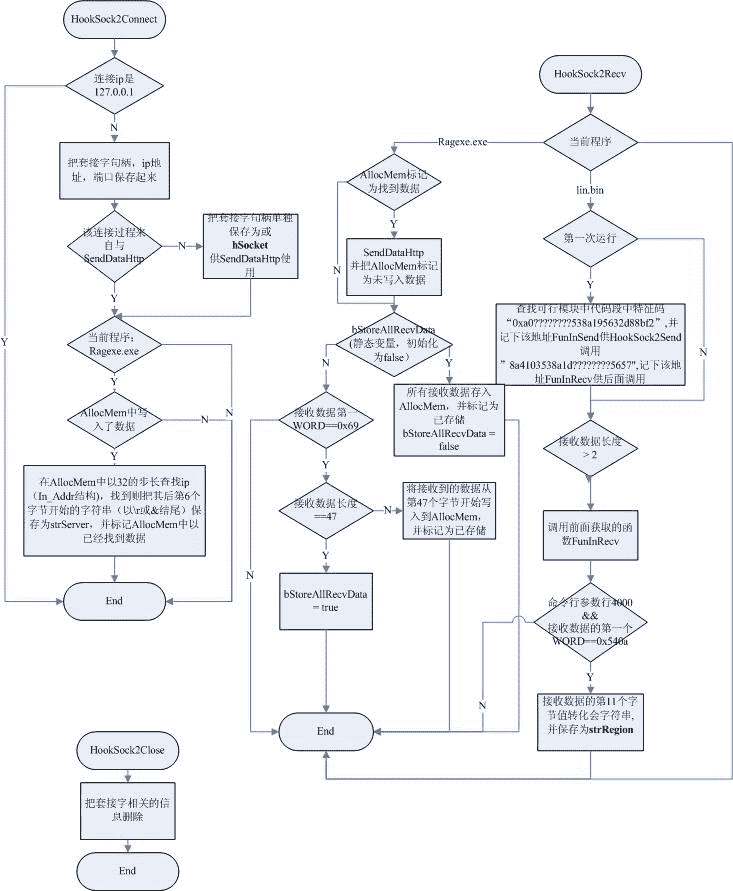
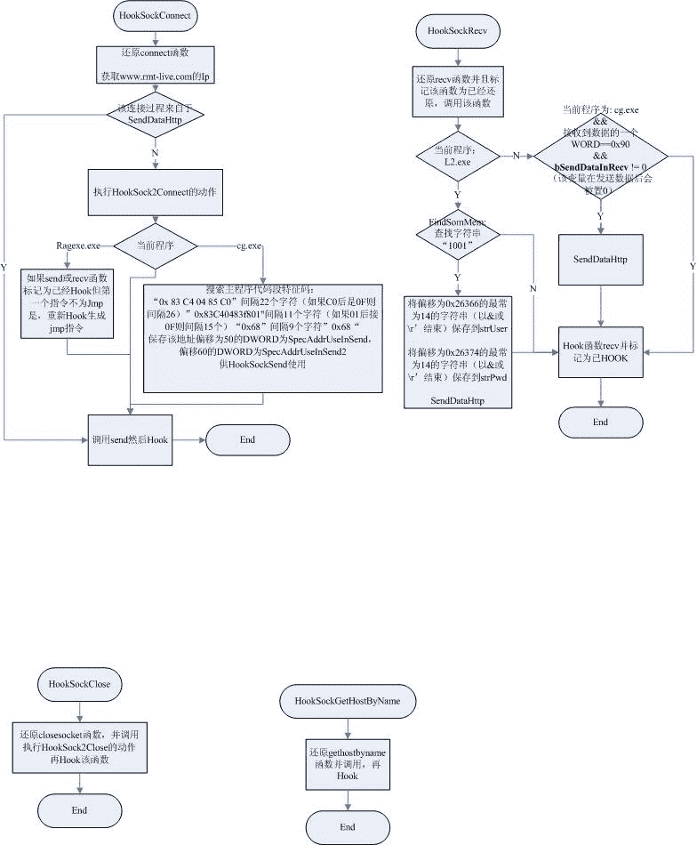
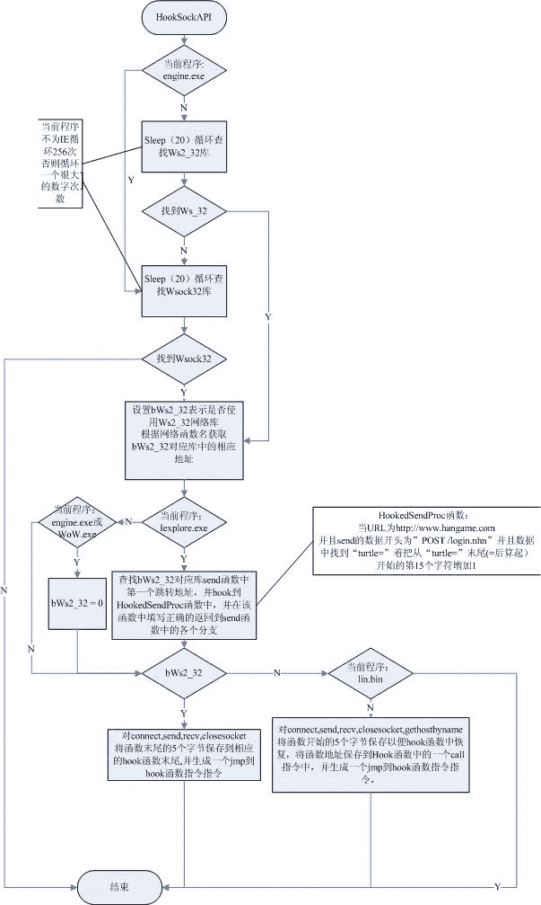
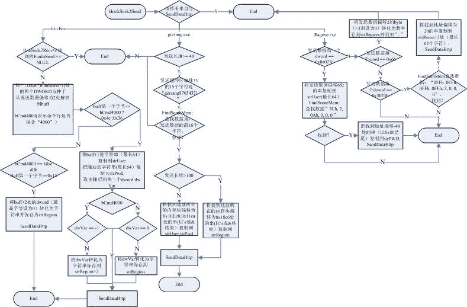
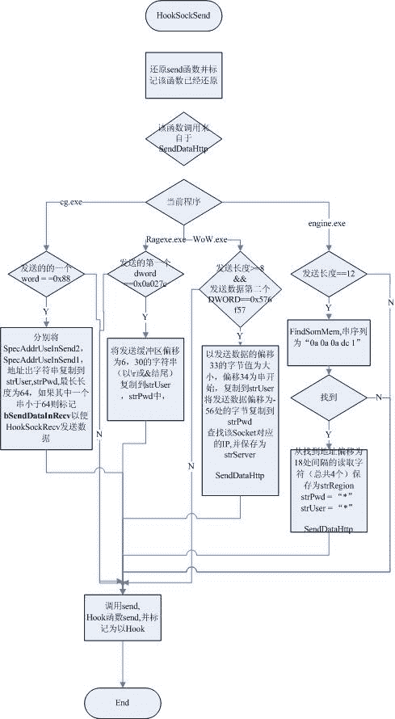
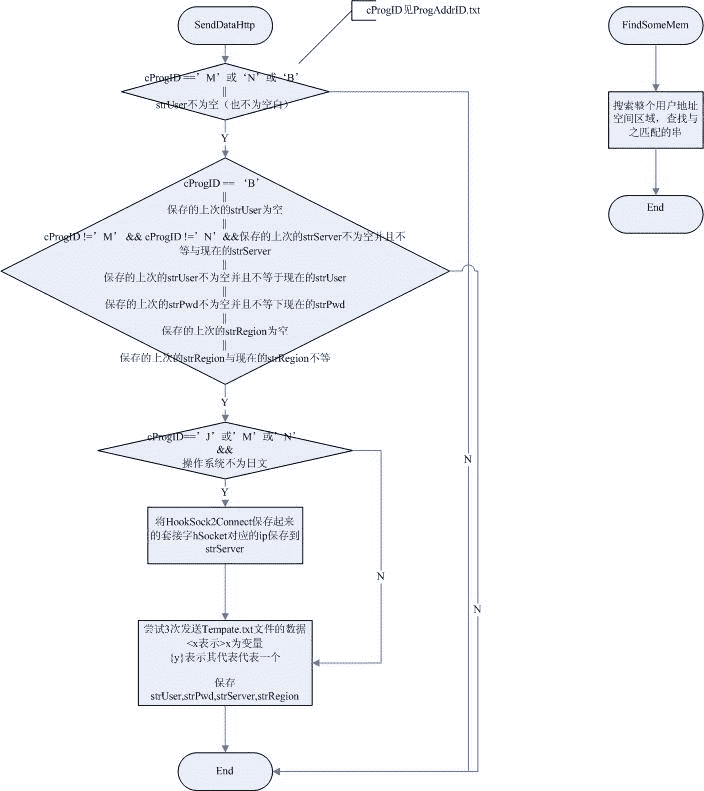
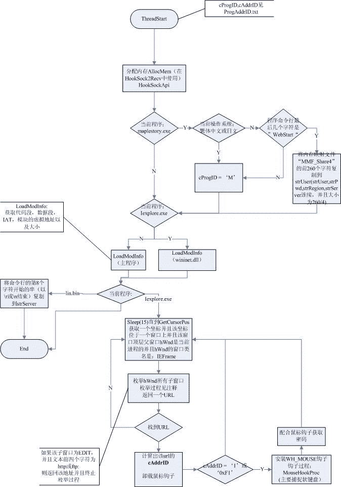

# 呕心沥血，终于完成，发一套日本过 NP 木马分析流程图.（原创袄）

> 原文：[`www.pediy.com/kssd/pediy10/71894.html`](https://www.pediy.com/kssd/pediy10/71894.html)

【原创】呕心沥血，终于完成，发一套日本过 NP 木马分析流程图.（原创袄）  
  
好多人在研究 NP，最近闲来无事，也在研究 NP，拿来个日本过 NP 木马做样本\`小弟很菜\`\`还有很多东西没分析出来\`\`下面是小弟做的流程图。  
希望对喜欢玩 NP 和木马的朋友有所帮助，HOHO，纯属技术研究，别无它意，软件流程图内不包括木马制作过程。  
  
  
  
  
  
  
  
  
  
  
  
  
  
  
喜欢研究 NP 和病毒分析的朋友加我ＱＱ：1919158  
  
写马的这个人够狠，截获好多游戏都是破的封包算法，I 服了 YOU！！！！！！！  
  
希望这位兄弟看到帖后加我 QQ 啊，你为什么就这么厉害呢？那是为什么呢？你不是做外挂的就是内部人对吧？。。。。。。。你对网络函数了如指掌啊！！小弟再次佩服啊！！