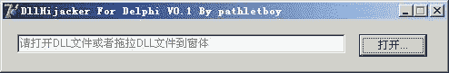

# DllHijacker For Delphi

> 原文：[`www.pediy.com/kssd/pediy10/71084.html`](https://www.pediy.com/kssd/pediy10/71084.html)

生成用于 Dll 劫持的 Delphi 模板，部分 DLL 需要修改代码后才能支持劫持。  
界面如下  
  
  
生成 ws2help.dll 的模板如下  

代码:

```
library ws2help; 

//============================================================================== 
// DllHijacker By pathletboy 
//============================================================================== 

uses 
Windows; 

{$R \*.res} 

var 
ModHandle: Cardinal; 
POldWahCloseApcHelper: Pointer; 
POldWahCloseHandleHelper: Pointer; 
POldWahCloseNotificationHandleHelper: Pointer; 
POldWahCloseSocketHandle: Pointer; 
POldWahCloseThread: Pointer; 
POldWahCompleteRequest: Pointer; 
POldWahCreateHandleContextTable: Pointer; 
POldWahCreateNotificationHandle: Pointer; 
POldWahCreateSocketHandle: Pointer; 
POldWahDestroyHandleContextTable: Pointer; 
POldWahDisableNonIFSHandleSupport: Pointer; 
POldWahEnableNonIFSHandleSupport: Pointer; 
POldWahEnumerateHandleContexts: Pointer; 
POldWahInsertHandleContext: Pointer; 
POldWahNotifyAllProcesses: Pointer; 
POldWahOpenApcHelper: Pointer; 
POldWahOpenCurrentThread: Pointer; 
POldWahOpenHandleHelper: Pointer; 
POldWahOpenNotificationHandleHelper: Pointer; 
POldWahQueueUserApc: Pointer; 
POldWahReferenceContextByHandle: Pointer; 
POldWahRemoveHandleContext: Pointer; 
POldWahWaitForNotification: Pointer; 

procedure WahCloseApcHelper; asm jmp POldWahCloseApcHelper end; 
procedure WahCloseHandleHelper; asm jmp POldWahCloseHandleHelper end; 
procedure WahCloseNotificationHandleHelper; asm jmp POldWahCloseNotificationHandleHelper end; 
procedure WahCloseSocketHandle; asm jmp POldWahCloseSocketHandle end; 
procedure WahCloseThread; asm jmp POldWahCloseThread end; 
procedure WahCompleteRequest; asm jmp POldWahCompleteRequest end; 
procedure WahCreateHandleContextTable; asm jmp POldWahCreateHandleContextTable end; 
procedure WahCreateNotificationHandle; asm jmp POldWahCreateNotificationHandle end; 
procedure WahCreateSocketHandle; asm jmp POldWahCreateSocketHandle end; 
procedure WahDestroyHandleContextTable; asm jmp POldWahDestroyHandleContextTable end; 
procedure WahDisableNonIFSHandleSupport; asm jmp POldWahDisableNonIFSHandleSupport end; 
procedure WahEnableNonIFSHandleSupport; asm jmp POldWahEnableNonIFSHandleSupport end; 
procedure WahEnumerateHandleContexts; asm jmp POldWahEnumerateHandleContexts end; 
procedure WahInsertHandleContext; asm jmp POldWahInsertHandleContext end; 
procedure WahNotifyAllProcesses; asm jmp POldWahNotifyAllProcesses end; 
procedure WahOpenApcHelper; asm jmp POldWahOpenApcHelper end; 
procedure WahOpenCurrentThread; asm jmp POldWahOpenCurrentThread end; 
procedure WahOpenHandleHelper; asm jmp POldWahOpenHandleHelper end; 
procedure WahOpenNotificationHandleHelper; asm jmp POldWahOpenNotificationHandleHelper end; 
procedure WahQueueUserApc; asm jmp POldWahQueueUserApc end; 
procedure WahReferenceContextByHandle; asm jmp POldWahReferenceContextByHandle end; 
procedure WahRemoveHandleContext; asm jmp POldWahRemoveHandleContext end; 
procedure WahWaitForNotification; asm jmp POldWahWaitForNotification end; 

exports 
WahCloseApcHelper, 
WahCloseHandleHelper, 
WahCloseNotificationHandleHelper, 
WahCloseSocketHandle, 
WahCloseThread, 
WahCompleteRequest, 
WahCreateHandleContextTable, 
WahCreateNotificationHandle, 
WahCreateSocketHandle, 
WahDestroyHandleContextTable, 
WahDisableNonIFSHandleSupport, 
WahEnableNonIFSHandleSupport, 
WahEnumerateHandleContexts, 
WahInsertHandleContext, 
WahNotifyAllProcesses, 
WahOpenApcHelper, 
WahOpenCurrentThread, 
WahOpenHandleHelper, 
WahOpenNotificationHandleHelper, 
WahQueueUserApc, 
WahReferenceContextByHandle, 
WahRemoveHandleContext, 
WahWaitForNotification; 

begin 
ModHandle:= LoadLibrary('C:\\WINDOWS\\system32\\ws2help.dll'); 
if ModHandle > 0 then 
begin 
   POldWahCloseApcHelper:= GetProcAddress(ModHandle, 'WahCloseApcHelper'); 
   POldWahCloseHandleHelper:= GetProcAddress(ModHandle, 'WahCloseHandleHelper'); 
   POldWahCloseNotificationHandleHelper:= GetProcAddress(ModHandle, 'WahCloseNotificationHandleHelper'); 
   POldWahCloseSocketHandle:= GetProcAddress(ModHandle, 'WahCloseSocketHandle'); 
   POldWahCloseThread:= GetProcAddress(ModHandle, 'WahCloseThread'); 
   POldWahCompleteRequest:= GetProcAddress(ModHandle, 'WahCompleteRequest'); 
   POldWahCreateHandleContextTable:= GetProcAddress(ModHandle, 'WahCreateHandleContextTable'); 
   POldWahCreateNotificationHandle:= GetProcAddress(ModHandle, 'WahCreateNotificationHandle'); 
   POldWahCreateSocketHandle:= GetProcAddress(ModHandle, 'WahCreateSocketHandle'); 
   POldWahDestroyHandleContextTable:= GetProcAddress(ModHandle, 'WahDestroyHandleContextTable'); 
   POldWahDisableNonIFSHandleSupport:= GetProcAddress(ModHandle, 'WahDisableNonIFSHandleSupport'); 
   POldWahEnableNonIFSHandleSupport:= GetProcAddress(ModHandle, 'WahEnableNonIFSHandleSupport'); 
   POldWahEnumerateHandleContexts:= GetProcAddress(ModHandle, 'WahEnumerateHandleContexts'); 
   POldWahInsertHandleContext:= GetProcAddress(ModHandle, 'WahInsertHandleContext'); 
   POldWahNotifyAllProcesses:= GetProcAddress(ModHandle, 'WahNotifyAllProcesses'); 
   POldWahOpenApcHelper:= GetProcAddress(ModHandle, 'WahOpenApcHelper'); 
   POldWahOpenCurrentThread:= GetProcAddress(ModHandle, 'WahOpenCurrentThread'); 
   POldWahOpenHandleHelper:= GetProcAddress(ModHandle, 'WahOpenHandleHelper'); 
   POldWahOpenNotificationHandleHelper:= GetProcAddress(ModHandle, 'WahOpenNotificationHandleHelper'); 
   POldWahQueueUserApc:= GetProcAddress(ModHandle, 'WahQueueUserApc'); 
   POldWahReferenceContextByHandle:= GetProcAddress(ModHandle, 'WahReferenceContextByHandle'); 
   POldWahRemoveHandleContext:= GetProcAddress(ModHandle, 'WahRemoveHandleContext'); 
   POldWahWaitForNotification:= GetProcAddress(ModHandle, 'WahWaitForNotification'); 
end; 
end. 

```

关键单元代码如下  
代码:

```
{\*\*\*\*\*\*\*\*\*\*\*\*\*\*\*\*\*\*\*\*\*\*\*\*\*\*\*\*\*\*\*\*\*\*\*\*\*\*\*\*\*\*\*\*\*\*\*\*\*\*\*\*\*\*\*} 
{                                                       } 
{       DllHijacker                                     } 
{                                                       } 
{       版权所有 (C) 2008 pathletboy                    } 
{                                                       } 
{\*\*\*\*\*\*\*\*\*\*\*\*\*\*\*\*\*\*\*\*\*\*\*\*\*\*\*\*\*\*\*\*\*\*\*\*\*\*\*\*\*\*\*\*\*\*\*\*\*\*\*\*\*\*\*} 

unit Common; 

interface 

uses 
  Windows, Messages, SysUtils, Variants, Classes, Graphics, Controls, Forms, 
  Dialogs; 

type 
  TBuildDprStatus = (SUCCESS, FILE\_NOT\_FOUND, FILE\_READ\_ERROR, FILE\_NOT\_PE, 
    FILE\_NOT\_DLL, FILE\_NOT\_HAVE\_EXPORTTABLE, SAVEFILE\_ERROR, UNKNOW\_ERROR); 

function BuildDpr(const FileName: string): TBuildDprStatus; 
implementation 

function BuildDpr(const FileName: string): TBuildDprStatus; 

  function RvaToRaw(const ImageSectionHeader: PImageSectionHeader; Rva: 
    Cardinal): Cardinal; 
  var 
    Temp: PImageSectionHeader; 
  begin 
    Temp := ImageSectionHeader; 
    while Temp.VirtualAddress <> 0 do 
    begin 
      if (Rva >= Temp.VirtualAddress) and (Rva < (Temp.VirtualAddress 
        + Temp.Misc.VirtualSize)) then 
      begin 
        Result := Temp.PointerToRawData + Rva - Temp.VirtualAddress; 
        Break; 
      end; 
      inc(Temp); 
    end; 
  end; 

var 
  TargetFile: TMemoryStream; 
  DosHead: TImageDosHeader; 
  NtHead: TImageNtHeaders; 
  ExportTable: TImageExportDirectory; 
  ExportTableAddress: Cardinal; 
  //ExportTableSize: Cardinal; 
  ExportFunctionNameAddress: Cardinal; 
  ArrayFunctionNames: array of string; 
  i: Integer; 
  OneChar: Char; 
  DprFileName: string; 
  DprSourceFile: TStringList; 
  PSectionHeader: PImageSectionHeader; 
begin 
  Result := UNKNOW\_ERROR; 

  if not FileExists(FileName) then 
  begin 
    Result := FILE\_NOT\_FOUND; 
    Exit; 
  end; 

  TargetFile := TMemoryStream.Create; 
  try 

    try 
      TargetFile.LoadFromFile(FileName); 
      TargetFile.Read(DosHead, SizeOf(DosHead)); 
      if DosHead.e\_magic <> IMAGE\_DOS\_SIGNATURE then 
      begin 
        Result := FILE\_NOT\_PE; 
        Exit; 
      end; 

      TargetFile.Seek(DosHead.\_lfanew, soFromBeginning); 
      TargetFile.Read(NtHead, SizeOf(NtHead)); 
      if NtHead.Signature <> IMAGE\_NT\_SIGNATURE then 
      begin 
        Result := FILE\_NOT\_PE; 
        Exit; 
      end; 

      if NtHead.FileHeader.Characteristics and IMAGE\_FILE\_DLL = 0 then 
      begin 
        Result := FILE\_NOT\_DLL; 
        Exit; 
      end; 

      if NtHead.OptionalHeader.DataDirectory\[0\].Size = 0 then //ExportTable 
      begin 
        Result := FILE\_NOT\_HAVE\_EXPORTTABLE; 
        Exit; 
      end; 
      PSectionHeader := Pointer(DWORD(TargetFile.Memory) + DosHead.\_lfanew + 
        SizeOf(NtHead)); 

      ExportTableAddress := RvaToRaw(PSectionHeader, 
        NtHead.OptionalHeader.DataDirectory\[0\].VirtualAddress); 

      //ExportTableSize := NtHead.OptionalHeader.DataDirectory\[0\].Size; 
      TargetFile.Seek(ExportTableAddress, soFromBeginning); 
      TargetFile.Read(ExportTable, SizeOf(ExportTable)); 
      TargetFile.Seek(RvaToRaw(PSectionHeader, 
        DWORD(ExportTable.AddressOfNames)), 
        soFromBeginning); 
      TargetFile.Read(ExportFunctionNameAddress, 
        SizeOf(ExportFunctionNameAddress)); 
      TargetFile.Seek(RvaToRaw(PSectionHeader, ExportFunctionNameAddress), 
        soFromBeginning); 
      SetLength(ArrayFunctionNames, ExportTable.NumberOfNames); 
      for i := 0 to ExportTable.NumberOfNames - 1 do 
      begin 
        TargetFile.Read(OneChar, SizeOf(OneChar)); 
        while OneChar <> #0 do 
        begin 
          ArrayFunctionNames\[i\] := ArrayFunctionNames\[i\] + OneChar; 
          TargetFile.Read(OneChar, SizeOf(OneChar)); 
        end; 
        OutputDebugString(PChar(Format('函数名序号:%d 函数名:%s', \[i, 
          ArrayFunctionNames\[i\]\]))); 
      end; 

      DprFileName := StringReplace(ExtractFileName(FileName), 
        ExtractFileExt(FileName), '', \[rfReplaceAll\]); 
      DprSourceFile := TStringList.Create; 
      try 
        try 
          DprSourceFile.Add(Format('library %s;', \[DprFileName\])); 
          DprSourceFile.Add(''); 
          DprSourceFile.Add('//=============================================================================='); 
          DprSourceFile.Add('// DllHijacker By pathletboy'); 
          DprSourceFile.Add('//=============================================================================='); 
          DprSourceFile.Add(''); 
          DprSourceFile.Add('uses'); 
          DprSourceFile.Add(' Windows;'); 

          DprSourceFile.Add(''); 
          DprSourceFile.Add('{$R \*.res}'); 
          DprSourceFile.Add(''); 
          DprSourceFile.Add('var'); 
          DprSourceFile.Add(' ModHandle: Cardinal;'); 
          for i := 0 to ExportTable.NumberOfNames - 1 do 
          begin 
            DprSourceFile.Add(' POld' + ArrayFunctionNames\[i\] + ': Pointer;'); 
          end; 
          DprSourceFile.Add(''); 

          for i := 0 to ExportTable.NumberOfNames - 1 do 
          begin 
            DprSourceFile.Add('procedure ' + ArrayFunctionNames\[i\] + 
              '; asm jmp POld' + ArrayFunctionNames\[i\] + ' end;'); 
          end; 
          DprSourceFile.Add(''); 

          DprSourceFile.Add('exports'); 
          for i := 0 to ExportTable.NumberOfNames - 1 do 
          begin 
            if i <> ExportTable.NumberOfNames - 1 then 
              DprSourceFile.Add(' ' + ArrayFunctionNames\[i\] + ',') 
            else 
              DprSourceFile.Add(' ' + ArrayFunctionNames\[i\] + ';'); 
          end; 
          DprSourceFile.Add(''); 

          DprSourceFile.Add('begin'); 
          DprSourceFile.Add(' ModHandle:= LoadLibrary(''' + FileName + ''');'); 
          DprSourceFile.Add(' if ModHandle > 0 then'); 
          DprSourceFile.Add(' begin'); 
          for i := 0 to ExportTable.NumberOfNames - 1 do 
          begin 
            DprSourceFile.Add('   POld' + ArrayFunctionNames\[i\] + 
              ':= GetProcAddress(ModHandle, ''' + ArrayFunctionNames\[i\] + 
              ''');'); 
          end; 
          DprSourceFile.Add(' end;'); 
          DprSourceFile.Add('end.'); 

          DprSourceFile.SaveToFile(ExtractFilePath(Application.ExeName) + 
            DprFileName + '.dpr'); 
          OutputDebugString(PChar(DprFileName + '.dpr Saved!')); 
        except 
          Result := SAVEFILE\_ERROR; 
          Exit; 
        end; 
      finally 
        DprSourceFile.Free; 
      end; 

      OutputDebugString(PChar(DprFileName)); 
      Result := SUCCESS; 
    except 
      Result := FILE\_READ\_ERROR; 
      Exit; 
    end; 
  finally 
    TargetFile.Free; 
  end; 

end; 

end. 

```

完整的代码下载

上传的附件
|  || DllHijacker4D.rar  
 |