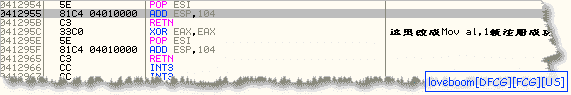

# Armadillo 3.7X-4.X Code Injection

> 原文：[`www.pediy.com/kssd/pediy07/pediy7-547.htm`](https://www.pediy.com/kssd/pediy07/pediy7-547.htm)

Armadillo 3.7X—4.X Code Injection  
  
【目     标】:SWF Decompiler MX 2005b Build 50408  
【工     具】:Olydbg1.1(diy 版)   
【任     务】:不脱壳直接用代码注入技术破解目标程序   
【操作平台】:Win2003  
【作     者】: LOVEBOOM\[DFCG\]\[FCG\]\[US\]  
【相关链接】: ……  
【简要说明】： ARM 的壳现在已经是比较 BT 了，脱壳也有段时间了，脱 arm 已经没有什么新意，相关的文章也很多，多数时间是靠体力活，这次试着不脱壳直接破解，这个灵感和动力来源于 Kort，在这里先谢过他。也望他能够谅解我那可怜的 E 文.他给我的那些代码给我了帮助(虽然原作者的代码写的不是那么好)。这篇文章是关于单进程的 CODE Injection，以后有空，会去试试 CopyMemII 的 Code Injection  
【详细过程】:  
开始前我想说的：做什么事都最好先分析一下，你要达到什么目的，这过程中可能会出现的问题，如果问题出现你的对策。最好不要什么事动不动就去问别人，你如果真的做到你感觉不会再去也不迟。有了这几点之后，才是做，好了，言归正传。  
我们先来一个一个的找出问题所在然后再去解决。  
问题一：  
  运行主程序，程序会提示你有 15 天试用期。改一下系统时间看看软件有没有什么反应，改后，软件提示你要注册才能继续试用.  
再把时间改回来，还是报过期。问题一也就产生了。第一个问题：**壳通过某些会在系统里做个标记，记录你的是程序是否过期；时间检测**  
问题二：  
我们要破解他，破解的过程中肯定要修改原壳的流程。我们尝试修改一下文件，随便找个空地方改一两个字符就行了。修改运行一下就会出现以下错误信息：

  
   
看到这条信息我们就应该想到壳会有检测，当你修改后壳会拒绝运行，第二个问题产生了。  
第二个问题：**壳检测程序的完整性；**  
  
问题三：  
这个问题是由上面的问题引发出来的，因为我们要修改原壳的流程，所以我们知道原壳什么什么地方可以改，改成什么样子更好，用 OD 载入 OD 后让程序程序提示。经过几次跟踪后发现我们要修改的代码在壳第二次申请空间的地址空间里。第三个问题：**找 PATCH 点；**  
  
  
问题四：  
找到 patch 点后，我就是要找出我们真正需要破解的地方，同样打开 OD， 到达 OEP 后，慢慢跟踪就会发现壳会抽程序的代码，到了 OEP 后还会动态加密/还原代码。跟踪发现以下地址可疑：

  
   
在 41295c 处改成 mov al,1 就注册成功，到这里第四个问题也产生了，第四个问题：**找需要破解的地方；**  
  
问题五：  
我们改成 mov al,1 后，程序没有注册提示了，但没过多久，程序会异常退出，看来程序或壳还是有检测，重新来过，设置内存访问断点后发现以下两个地方会读取 41295c 处的代码。  
   
……  
005A9CD2  |.  8A11          |MOV DL,BYTE PTR DS:\[ECX\]                ;  1,这里第一个检测代码点  
005A9CD4  |.  8B45 08       |MOV EAX,DWORD PTR SS:\[EBP+8\]  
005A9CD7  |.  33C2          |XOR EAX,EDX  
005A9CD9  |.  25 FF000000   |AND EAX,0FF  
005A9CDE  |.  8B4D 08       |MOV ECX,DWORD PTR SS:\[EBP+8\]  
005A9CE1  |.  C1E9 08       |SHR ECX,8  
005A9CE4  |.  8B1485 8CBA5D>|MOV EDX,DWORD PTR DS:\[EAX\*4+5DBA8C\]  
005A9CEB  |.  33D1          |XOR EDX,ECX  
005A9CED  |.  8955 08       |MOV DWORD PTR SS:\[EBP+8\],EDX  
005A9CF0  |.  8B45 0C       |MOV EAX,DWORD PTR SS:\[EBP+C\]  
005A9CF3  |.  83C0 01       |ADD EAX,1  
005A9CF6  |.  8945 0C       |MOV DWORD PTR SS:\[EBP+C\],EAX  
005A9CF9  |.  8B4D 0C       |MOV ECX,DWORD PTR SS:\[EBP+C\]  
005A9CFC  |.  33D2          |XOR EDX,EDX  
005A9CFE  |.  8A11          |MOV DL,BYTE PTR DS:\[ECX\]                ;  2,这里第二个检测代码点  
……  
这里我们试下改代码结果发现没问题，因此我们第五个问题就是：**去除破解检测.**  
  
现在基本我们要的东西分析完毕，大概分成五个部分完成(当然我分的比较杂，如果你自己有你的分析方法最好)。现在开始解决问题了。  
问题解决：  
第一个问题：  
经过跟踪发现，只要注册成功了，就不会有过期提示，信息框是进入主程序后才提示的，应该是用的 SDK 吧。  
第二个问题：  
用 OD 载入目标，你的 OD 最好是自己修改或别人改过 OutputDebugStringA 漏洞的。否则你还要防一下这个 ANTI-DEBUG。  
我们直接改内存后，运行没有什么问题，这样就可以肯定要 CreateFileA 来读取加壳的文件。跟踪几次后发现用 SetFilePointer 可以比较快的定位到 CRC 处理的代码代码：  
下断 SetFilePointer，运行中断后返回：  
00E92F99    FFB5 9CFDFFFF   PUSH DWORD PTR SS:\[EBP-264\]  
00E92F9F    FF15 E021EA00   CALL DWORD PTR DS:\[EA21E0\]               ; kernel32.SetFilePointer  
00E92FA5    53              PUSH EBX                                 ; 返回到这里  
00E92FA6    8D85 B8FEFFFF   LEA EAX,DWORD PTR SS:\[EBP-148\]  
00E92FAC    50              PUSH EAX  
00E92FAD    FFB5 88F9FFFF   PUSH DWORD PTR SS:\[EBP-678\]  
00E92FB3    57              PUSH EDI  
……  
经过一段长路之后来到关键代码处：  
00E932F6    8B0D 58B8EA00   MOV ECX,DWORD PTR DS:\[EAB858\]            ; SWFDecom.005D7370  
00E932FC    8B81 80000000   MOV EAX,DWORD PTR DS:\[ECX+80\]  
00E93302    3341 74         XOR EAX,DWORD PTR DS:\[ECX+74\]  
00E93305    3341 60         XOR EAX,DWORD PTR DS:\[ECX+60\]  
00E93308    3345 DC         XOR EAX,DWORD PTR SS:\[EBP-24\]            ; 这里\[EBP-24\]处就是保存 CRC 值  
00E9330B    8985 D0F7FFFF   MOV DWORD PTR SS:\[EBP-830\],EAX  
我们先记下正确的 CRC 值。  
Stack SS:\[EBP-24\]=6E7A1EBA 这样第二个问题解决了，我们找到了正确的 CRC 值和需要修改的处  
  
第 三个问题：  
由第二个问题我们看到了 00E9xxx 这个地址是动态申请的，因此我们找出哪一次申请了这个空间，申请空间一般要用到 VirtualAlloc,VirtualEx,GlobalAlloc，再次用 OD 载入下断 BP VirtualAlloc,第二次中断后就是分配 00E70000 的那个空间，我们需要修改的地方就是在这个段里。现在第三个问题的第一个 PATCH 点已经找到：  
0059D2E3    8945 E0         MOV DWORD PTR SS:\[EBP-20\],EAX            ; 返回到这里后的第一个 patch 点  
0059D2E6    837D E0 00      CMP DWORD PTR SS:\[EBP-20\],0  
Patch 1 就是: 59d2e3  
现在的时候壳还没有还原出代码呀，因此我们还要再找第二个 patch 点，第二个 patch 点就是在还原完代码后，执行 CRC 检测代码之前的地址。跟踪一会就会找到这里：  
0058A32E    55              PUSH EBP                                 ; 还原完代码后会执行这里的代码  
0058A32F    8BEC            MOV EBP,ESP  
0058A331    83EC 5C         SUB ESP,5C  
0058A334    833D C0725D00 0>CMP DWORD PTR DS:\[5D72C0\],0              ; 我选择这里作为 patch 点  
0058A33B    0F85 54010000   JNZ 0058A495  
0058A341    8B45 08         MOV EAX,DWORD PTR SS:\[EBP+8\]  
0058A344    83C0 01         ADD EAX,1  
0058A347    8945 F0         MOV DWORD PTR SS:\[EBP-10\],EAX  
……  
第二个 patch 地址为： 0058A334  
到这里就可以动手吗?还不行，这两个 patch 点处不能修改进入 OEP 后的代码，这样我们就得先找到 OEP,然后在跳去 OEP 附近找到 patch 点。  
再次重来打开 OD 载入目标程序，在.text 段下 F2 断点，然后运行，这里断下：  
005A9C22    8A11            MOV DL,BYTE PTR DS:\[ECX\]                 ; 这里断下  
005A9C24    8B45 08         MOV EAX,DWORD PTR SS:\[EBP+8\]  
005A9C27    33C2            XOR EAX,EDX  
005A9C29    25 FF000000     AND EAX,0FF  
005A9C2E    8B4D 08         MOV ECX,DWORD PTR SS:\[EBP+8\]  
005A9C31    C1E9 08         SHR ECX,8  
005A9C34    8B1485 8CBA5D00 MOV EDX,DWORD PTR DS:\[EAX\*4+5DBA8C\]  
005A9C3B    33D1            XOR EDX,ECX  
005A9C3D    8955 08         MOV DWORD PTR SS:\[EBP+8\],EDX  
005A9C40    8B45 0C         MOV EAX,DWORD PTR SS:\[EBP+C\]  
005A9C43    83C0 01         ADD EAX,1  
005A9C46    8945 0C         MOV DWORD PTR SS:\[EBP+C\],EAX  
005A9C49    8B4D 0C         MOV ECX,DWORD PTR SS:\[EBP+C\]  
005A9C4C    33D2            XOR EDX,EDX  
005A9C4E    8A11            MOV DL,BYTE PTR DS:\[ECX\]  
005A9C50    8B45 08         MOV EAX,DWORD PTR SS:\[EBP+8\]  
……  
005A9DCD    8B45 08         MOV EAX,DWORD PTR SS:\[EBP+8\]  
005A9DD0    83F0 FF         XOR EAX,FFFFFFFF  
005A9DD3    5D              POP EBP  
005A9DD4    C3              RETN                                     ; 如果觉得慢就直接在这里 F4 执行到这里  
……  
0058AFA7    83C4 0C         ADD ESP,0C  
0058AFAA    83F0 FF         XOR EAX,FFFFFFFF  
0058AFAD    5D              POP EBP  
0058AFAE    C3              RETN                                     ; 这里再次返回  
断下后，执行到返回。  
00E80A24    83C4 0C         ADD ESP,0C                  ;最后返回到这里  
00E80A27    C3              RETN  
   
返回后查找命令：  
SUB ECX,EDX  
CALL ECX  
可以找到两处：  
00E9C74A    FF76 0C         PUSH DWORD PTR DS:\[ESI+C\]  
00E9C74D    2BCA            SUB ECX,EDX                               ; 第一次找到这里  
00E9C74F    FFD1            CALL ECX  
00E9C751    EB 1B           JMP SHORT 00E9C76E  
00E9C753    83FF 01         CMP EDI,1  
00E9C756    75 18           JNZ SHORT 00E9C770  
00E9C758    FF76 04         PUSH DWORD PTR DS:\[ESI+4\]  
00E9C75B    FF76 08         PUSH DWORD PTR DS:\[ESI+8\]  
00E9C75E    6A 00           PUSH 0  
00E9C760    52              PUSH EDX  
00E9C761    8B50 74         MOV EDX,DWORD PTR DS:\[EAX+74\]  
00E9C764    3350 60         XOR EDX,DWORD PTR DS:\[EAX+60\]  
00E9C767    3350 2C         XOR EDX,DWORD PTR DS:\[EAX+2C\]             ; 这里就是我们第三个 patch 点  
00E9C76A    2BCA            SUB ECX,EDX                               ; 第二次找到这里  
00E9C76C    FFD1            CALL ECX                                  ; 这里进去就是 OEP  
00E9C76E    8BD8            MOV EBX,EAX  
第三个 patch 地址为： 00E9C767  
这样第三个问题解决了，后面的几问题由第三个问题延伸下就可以解决问题。  
因为第三个问题找 patch 点的地方是静态的，所以我们就可以直接修改代码。  
问题解决了，现在只需动手写点代码就行了。  
   
相关 PATCH 代码：  
0059D2E3   .  8945 E0       MOV DWORD PTR SS:\[EBP-20\],EAX            ;  这里跳去我们自己的处理处  
0059D2E6   >  837D E0 00    CMP DWORD PTR SS:\[EBP-20\],0  
Patch 代码：  
0059D2E3    E8 D0A10100     CALL 005B74B8                            ; 返回到这里后的第一个 patch 点  
0059D2E8    E0 00           LOOPDNE SHORT 0059D2EA            ;这不补 NOP 是省得后面写代码:-P  
……  
0058A334  |.  833D C0725D0u0>CMP DWORD PTR DS:\[5D72C0\],0              ;  这里用于改变代码  
0058A33B  |.  0F85 54010000 JNZ 0058A495  
Patch 代码：  
0058A334    E8 B1D10200     CALL 005B74EA                            ; 我选择这里作为 patch 点  
0058A339    90              NOP  
0058A33A    90              NOP  
主 Patch 代码：  
005B74EA  /$  50            PUSH EAX                                 ;  保存现场  
005B74EB  |.  A1 E0745B00   MOV EAX,DWORD PTR DS:\[5B74E0\]            ;  因为这里在未申请空间之前会运行一次，所以这里加个判断  
005B74F0  |.  83F8 00       CMP EAX,0  
005B74F3  |.  74 35         JE SHORT 005B752A                        ;  如果还没有申请空间则跳  
005B74F5  |.  90            NOP  
005B74F6  |.  90            NOP  
005B74F7  |.  05 02330200   ADD EAX,23302                            ;  定位 PATCH CRC 的地址  
005B74FC  |.  66:C700 90E8  MOV WORD PTR DS:\[EAX\],0E890  
005B7501  |.  83C0 02       ADD EAX,2  
005B7504  |.  53            PUSH EBX  
005B7505  |.  BB 40755B00   MOV EBX,005B7540  
005B750A  |.  2BD8          SUB EBX,EAX  
005B750C  |.  83EB 04       SUB EBX,4  
005B750F  |.  8918          MOV DWORD PTR DS:\[EAX\],EBX  
005B7511  |.  5B            POP EBX  
005B7512  |.  8D4424 04     LEA EAX,DWORD PTR SS:\[ESP+4\]  
005B7516  |.  8328 05       SUB DWORD PTR DS:\[EAX\],5  
005B7519  |.  8B00          MOV EAX,DWORD PTR DS:\[EAX\]               ;  操作完成还原 patch 前的代码，防止壳 CRC 检测  
005B751B  |.  C700 833DC072 MOV DWORD PTR DS:\[EAX\],72C03D83  
005B7521  |.  C740 04 5D000>MOV DWORD PTR DS:\[EAX+4\],0F00005D  
005B7528  |.  EB 07         JMP SHORT 005B7531  
005B752A  |>  833D C0725D00>CMP DWORD PTR DS:\[5D72C0\],0  
005B7531  |>  58            POP EAX  
005B7532  \\.  C3            RETN  
005B7533      00            DB 00  
005B7534      00            DB 00  
005B7535      00            DB 00  
005B7536      00            DB 00  
005B7537      00            DB 00  
005B7538      00            DB 00  
005B7539      00            DB 00  
005B753A      00            DB 00  
005B753B      00            DB 00  
005B753C      00            DB 00  
005B753D      00            DB 00  
005B753E      00            DB 00  
005B753F      00            DB 00  
005B7540   .  50            PUSH EAX                                 ;  处理 CRC 的 patch 代码  
005B7541   .  C745 DC BA1E7>MOV DWORD PTR SS:\[EBP-24\],6E7A1EBA       ;  把 CRC 值改为原有值  
005B7548   .  8D4424 04     LEA EAX,DWORD PTR SS:\[ESP+4\]  
005B754C   .  8328 06       SUB DWORD PTR DS:\[EAX\],6  
005B754F   .  8B00          MOV EAX,DWORD PTR DS:\[EAX\]  
005B7551      C700 33417433 MOV DWORD PTR DS:\[EAX\],33744133          ;  还原现场  
005B7557   .  66:C740 04 41>MOV WORD PTR DS:\[EAX+4\],6041  
005B755D   .  05 65940000   ADD EAX,9465  
005B7562   .  53            PUSH EBX  
005B7563 > .  C600 E8       MOV BYTE PTR DS:\[EAX\],0E8  
005B7566   .  BB A0755B00   MOV EBX,005B75A0  
005B756B   .  2BD8          SUB EBX,EAX  
005B756D   .  83EB 05       SUB EBX,5  
005B7570   .  8958 01       MOV DWORD PTR DS:\[EAX+1\],EBX  
005B7573   .  57            PUSH EDI                                 ;  这里自私的东西，不用抄进去  
005B7574   .  BF 8B755B00   MOV EDI,005B758B  
005B7579   >  8A07          MOV AL,BYTE PTR DS:\[EDI\]  
005B757B   .  3C 00         CMP AL,0  
005B757D   .  74 05         JE SHORT 005B7584  
005B757F   .  F6D0          NOT AL  
005B7581   .  AA            STOS BYTE PTR ES:\[EDI\]  
005B7582   .^ EB F5         JMP SHORT 005B7579  
005B7584   >  5F            POP EDI  
005B7585   .  5B            POP EBX  
005B7586   .  58            POP EAX  
005B7587   .  C3            RETN  
005B7588      00            DB 00  
005B7589      00            DB 00  
005B758A      00            DB 00  
005B758B      BC            DB BC  
005B758C      8D            DB 8D  
005B758D      9E            DB 9E  
005B758E      9C            DB 9C  
005B758F      94            DB 94  
005B7590      9A            DB 9A  
005B7591      9B            DB 9B  
005B7592      DF            DB DF  
005B7593      9D            DB 9D  
005B7594      86            DB 86  
005B7595      DF            DB DF  
005B7596      93            DB 93  
005B7597      90            NOP  
005B7598      89            DB 89  
005B7599      9A            DB 9A  
005B759A      9D            DB 9D  
005B759B      90            NOP  
005B759C      90            NOP  
005B759D      92            DB 92  
005B759E      00            DB 00  
005B759F      00            DB 00  
005B75A0   .  50            PUSH EAX                                 ;  跳去 oep 前的 patch 代码  
005B75A1   .  8D4424 04     LEA EAX,DWORD PTR SS:\[ESP+4\]  
005B75A5   .  8328 05       SUB DWORD PTR DS:\[EAX\],5  
005B75A8   .  8B00          MOV EAX,DWORD PTR DS:\[EAX\]  
005B75AA   .  C700 33502C2B MOV DWORD PTR DS:\[EAX\],2B2C5033          ;  还原现场  
005B75B0   .  C640 04 CA    MOV BYTE PTR DS:\[EAX+4\],0CA  
005B75B4   .  B8 5C294100   MOV EAX,0041295C  
005B75B9   .  66:C700 B001  MOV WORD PTR DS:\[EAX\],1B0                ;  把上面的破解点改成 mov al,1  
005B75BE   .  B8 D29C5A00   MOV EAX,005A9CD2  
005B75C3   .  53            PUSH EBX  
005B75C4   .  BB F0755B00   MOV EBX,005B75F0  
005B75C9   .  53            PUSH EBX  
005B75CA   .  2BD8          SUB EBX,EAX  
005B75CC   .  83EB 05       SUB EBX,5  
005B75CF   .  C600 E8       MOV BYTE PTR DS:\[EAX\],0E8                ;  patch CRC 还原代码点  
005B75D2   .  8958 01       MOV DWORD PTR DS:\[EAX+1\],EBX  
005B75D5   .  B8 FE9C5A00   MOV EAX,005A9CFE  
005B75DA   .  5B            POP EBX  
005B75DB   .  2BD8          SUB EBX,EAX  
005B75DD   .  83EB 05       SUB EBX,5  
005B75E0   .  C600 E8       MOV BYTE PTR DS:\[EAX\],0E8                ;  patch CRC 还原代码点  
005B75E3   .  8958 01       MOV DWORD PTR DS:\[EAX+1\],EBX  
005B75E6   .  5B            POP EBX  
005B75E7   .  58            POP EAX  
005B75E8   .  C3            RETN  
005B75E9      90            NOP  
005B75EA      90            NOP  
005B75EB      90            NOP  
005B75EC      00            DB 00  
005B75ED      00            DB 00  
005B75EE      00            DB 00  
005B75EF      00            DB 00  
005B75F0   .  81F9 5C294100 CMP ECX,0041295C                         ;  CRC 还原代码 patch 代码  
005B75F6   .  74 0A         JE SHORT 005B7602                        ;  处理方法为当壳取我们破解点的代码时，填上正确的值  
005B75F8   .  81F9 5D294100 CMP ECX,0041295D  
005B75FE   .  74 06         JE SHORT 005B7606  
005B7600   .  EB 08         JMP SHORT 005B760A  
005B7602   >  B2 33         MOV DL,33  
005B7604   .  EB 06         JMP SHORT 005B760C  
005B7606   >  B2 C0         MOV DL,0C0  
005B7608   .  EB 02         JMP SHORT 005B760C  
005B760A   >  8A11          MOV DL,BYTE PTR DS:\[ECX\]                 ;  执行原代码  
005B760C   >  8B45 08       MOV EAX,DWORD PTR SS:\[EBP+8\]  
005B760F   .  C3            RETN  
patch 代码写后，保存运行一次发现程序还会异常，看看错误提示就是知道原来壳让不让我们写.text 段，用 lordpe 修改一下，改成可写就行了。  
OK，现在再运行就没问题了，CODE Injectioned，当然，这个是弱的,单进程，patch 还不如脱来的得快:-),但愿不久的下次我有时间写 copy memII 的 code injection。  
  
Greetz:  
 Fly.Jingulong,yock,tDasm.David.hexer,hmimys,ahao.UFO(brother).alan(sister).all of my friends and you!  
  
By loveboom\[DFCG\]\[FCG\]\[US\]  
Email:loveboom#163.com  
Date:4/29/2006 6:13:00 PM 

 4dd466d0e1e0cc123afbe504da2462ca