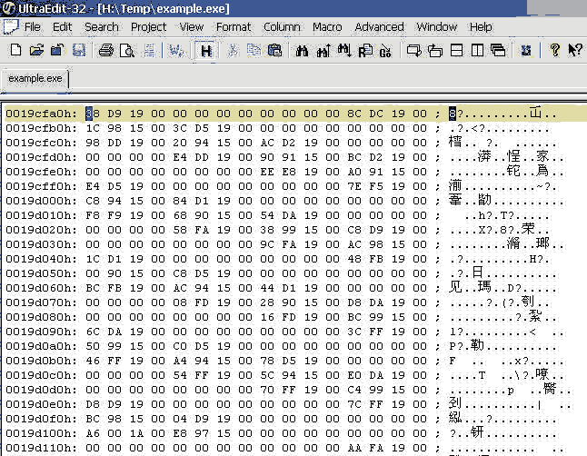
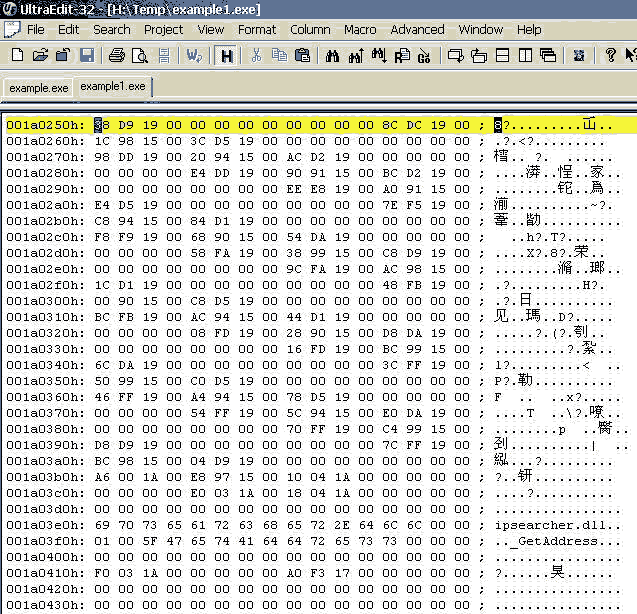

# 邹丹的补丁教学

> 原文：[`www.pediy.com/kssd/pediy03/forum1289.htm`](https://www.pediy.com/kssd/pediy03/forum1289.htm)

**怎样为程序打补丁（一）―――基础篇**

声明：

一．本文实用于初学者，需要具备一定的汇编和系统底层的知识。  
二．本文只是为了让广大网友共同提高一些基础知识，本人决无卖弄之意，只供需要这方面知识的读者阅读，如果你是高手，或者不需要这方面知识，请跳过。  
三．本文的实例均为普通程序，如有雷同，敬请谅解。  
四．本文欢迎传抄转载，如果是商业用途，请联系本人。[`www.zoudan.com`](http://www.zoudan.com/) zoudan@sina.com  

   打补丁是常见的一种软件升级和更新手段。打补丁的形式很多，本文所述的方式基本上为修改原程序二进制代码的方式，适用于 Windows95 之后的平台（Win32）。  

   Windows95（Win32）以后的可执行文件都是 PE 格式，.exe、.ocx、.dll.等等都是常见的 PE 格式的文件映像，看一个文件是否为 PE 文件，不是看它的扩展名，而是看它的文件头中是否有 PE 文件头标示和具体的文件内容。比如常见的软件"追捕"中那个 wry.dll，就不是一个 PE 格式的 Dll（动态连接库）文件，通常用 16 进制编辑软件打开文件首部观察便可得知。关于 PE 文件的具体格式和教程不是本文的描述范围，大家可以查阅相关的资料，我网站上那篇"关于 95 下的可执行文件加密研究"中也有比较详尽的描述。  

   PE 文件是一个程序代码、数据的集合。其中的程序代码是该执行文件本身的，它可能通过动态连接的形式访问其他附属的程序或者动态连接库，通常一个程序文件中包含了大量的系统调用和对其他程序及动态连接库的调用。  
  
   言归正传，无论是破解，程序改良或者程序升级，在改动不大，且没有源程序参考的情况下，最直接的方法就是更改 PE 可执行文件。大家都知道我制作的补丁程序，基本上就是直接修改程序文件，使之达到我们需要得到的功能。  
  
   一个 PE 可执行文件中通常有很多段（section），分别描述不通的数据结构和代码。最基本的几种段有.code(.text)（代码段）、.data（数据段）、.rdata、.rscs（资源）等等，这些段的名称可以是程序自定，决定它们属性的不是他的名称，而是 PE 文件头中的描述。有很多查看 PE 文件结构和内容的软件，我向大家推荐 Borland C 自带的一个叫 Tdump 的小软件，很简单和方便，在现在的 Borland C++ Builder 和 Borland C 中都有，大家可以用他来了解 PE 文件的内部信息。  
  
   一般来说，修改资源段中的东西最为简单。那些对话框、字符串、位图等等。修改这些资源很容易，因为有很多这方面的软件，最常见的就是 VC++，只要用 VC 用资源修改方式打开程序文件，所有这个程序相关的资源就会很容易的修改了。大家可以随便找几个程序来试试手，挪挪对话框，改改属性，编辑文字，画画位图，很容易上手和熟悉。  

   修改程序文件的其他地方就没有修改资源段容易了，程序当然都是汇编机器代码，数据也是未知的结构。关于怎样看懂、跟踪、了解程序的运作就是一件非常经验的事情，不同的程序不同的方法，没有定式，它们唯一的共同点就是都是汇编代码，都能用软件反汇编和动态调试。这也已经超出了本文的范畴，我想它需要扎实的汇编基础，系统底层知识以及丰富的程序调试经验，不可能在很快的时间内掌握。这需要耐心，长时间的实战以及积累。在此我向大家推荐我常用的工具，静态的反汇编可以用 IDA pro，使用该软件你会发现枯燥乏味的汇编代码变得井井有条，且多了很多帮助理解的注释，当然还有很多重要程序库的符号，比如 MFC 库类，标准 C 库等等。该程序是最好的反汇编工具，为我们读懂苦涩的机器指令提供了良好的互动环境。光静态分析汇编代码无疑是极其困难的，光靠眼睛看不可能看到寄存器，内存单元数据等等和程序运行息息相关的东西。关键是汇编代码苦涩难懂，动态的调试就成了我们深入了解程序、调试程序、探测程序的最重要的手段。我所提到的动态调试是汇编级别的，并非任何高级语言。值得提到的是有些程序带有调试符号信息，那会为我们动态调试提供很大很大的便利，不过一般 Release 版本都不会把调试信息链接到最终的程序文件中，粗心的程序员有可能犯这个错误。总之，汇编级的调试一般来说都非常的艰苦，不过动态调试和静态阅读相结合还是会使效率提高很多。动态调试的软件很多，而且都支持汇编级别的调试。一般集成变成环境都带有这种工具，比如 VC++，C++ Builder 等等。专业调试软件有 W32dasm、Trw、Soft-ice 等等，在这个领域里，Soft-ice 无疑是绝对的佼佼者。我觉得几乎没有 Soft-ice 触及不到的深度，Soft-ice 为我们了解系统的任何一个细节提供了可能，从 DOS 时代到 windows 时代，Soft-ice 无疑是动态调试领域最重要的工具。好话说得够多了，我不是在为它打广告，实事的确如此，网上很容易下载到它的各种版本。Soft-ice 虽然很厉害，但是对初学者来说的确不容易掌握，且更需要扎实的底层基础。掌握了它就为掌握了系统的最底层提供了可能，这无疑是个核武器。  

   关于具体怎么放置补丁程序，用 DLL 动态连接库方式编制复杂的补丁程序等等细节问题我将在以后的文章中介绍，请各位网友密切留意。  
  
** 本篇总结：  
1． 本系列文章讨论的主要话题和范围。  
2． PE 文件是 Win32 平台的可执行文件。  
3． 关于修改资源段的问题。  
4． 其他一些相关知识的介绍。  
5． 几种工具的推荐及其简要介绍。**  
  
  

邹丹 于 2001 年 7 月 2 日

**怎样为程序打补丁（二）―――提高篇**

声明：

一．本文实用于初学者，需要具备一定的汇编和系统底层的知识。  
二．本文只是为了让广大网友共同提高一些基础知识，本人决无卖弄之意，只供需要这方面知识的读者阅读，如果你是高手，或者不需要这方面知识，请跳过。  
三．本文的实例均为普通程序，如有雷同，敬请谅解。  
四．本文欢迎传抄转载，如果是商业用途，请联系本人。http://www.zoudan.com zd\_dan@263.com  

   不知道各位把“基础篇”中的内容搞懂没有，我现在要带领大家提高啦，请各位用心听讲!  
  
    这次要教大家的是如何为程序添加功能。大家都知道，在可执行文件当中只有少量的空间和位置可以放置我们的补丁程序，这就注定了要实现比较复杂的功能是非常有局限的。想象一下，如果在人家程序中添加大量的汇编代码，且只能是汇编代码（不要问我为什么），并且调试运行。因为是在人家的运行环境中运行，必须维护大量的寄存器，地址空间，堆栈等等，那将是何其困难和痛苦的一件事情。汇编能作很多事情，但是也不是万能，要用汇编实现很多复杂的功能简直就是变态的行为。我为大家制作的 FolkQQ 补丁程序，其实汇编代码也就几十行，功能也很简单，就几十个字节。但这已经使我够痛苦的了，如果再多些，常人是吃不消的（调试运行这些代码很费力，如果一个地方错了至少得重敲，而且死机重起是常事）。 

      看到这里，可能有同学会问，像你的 SE 补丁系列，实现了 IP 地址到具体物理地址的转换，难道也是你用汇编写的吗（用汇编写这个会死人的）？当然不是，大家注意到有个 IPsearcher.dll，这是一个动态链接库，看名字就知道这是关于 IP 地址转换成实际地址功能的东东。对，所有的转换工作就是在其中完成。他是我用 VC 写的，程序很简单，但是如果用汇编写那就复杂了。我想我自己都没有毅力把它用汇编写完，然后一个一个字节一个一个指令的敲到人家的程序中去。 

    呵呵，今天要教大家的就是如何在补丁程序中实现复杂的功能，具体问题在上面已经描述了，方法就是为程序附带一个动态链接库，把所有复杂的功能都留在 DLL 里面，让高级语言去作低级语言难于实现的功能，留出接口，供被打补丁的使用即可。 

    关于什么是 DLL，我想不用我再多说了。简单的理解就是一个函数库，别人调用它，它具体完成，就这么简单。大家可以用软件看看我写的那个 IPsearcher.dll（用 tdump，或者 VC 中的工具 depends.exe）,可以看到其中只有一个函数接口，叫“\_GetAddress”。给它一个 IP 地址的作为参数，它就能返回那个 IP 地址的实际地址。具体它的实现不在我们今天的讨论范围当中。 

    问题的关键就是如何在要被打补丁的程序中调用到这个动态链接库，让它为我们添加的补丁程序服务。 

      再往下看，就需要各位同学具备一定的 Win32 PE 格式的可执行文件的基础了（可以参考我以前写的“关于 Win95 下的可执行文件的加密研究”和“基础篇”）。在 PE 文件中，指定了该程序要使用到的所有动态链接库，还有要调用的哪个函数接口。这些信息都写在一个叫 Import Table 的数据结构当中。它描述了某个动态链接库的某个函数接口的调用地址，这个是为了使系统能够为该程序装入动态链接库并且重定位接口地址信息的。 

    可能大家有点晕菜了，没关系。让我用一个实例来解释一下 Import Table。我们用 tdump 打开一个 PE 格式的可执行文件： 

C:\\>tdump example.exe |more  
Turbo Dump Version 5.0.16.12 Copyright (c) 1988, 2000 Inprise Corporation 

........ 

Name RVA Size  
\------------------ -------- --------  
Exports 00000000 00000000  
Imports 0019CFA0 0000017C  
Resources 00287000 00077F18 

........ 

\# Name VirtSize RVA PhysSize Phys off Flags  
\-- -------- -------- -------- -------- -------- --------  
01 .text 00157744 00001000 00158000 00001000 60000020 \[CER\]  
02 .rdata 0004723A 00159000 00048000 00159000 40000040 \[IR\]  
03 .data 000E5C28 001A1000 0002A000 001A1000 C0000040 \[IRW\] 

....... 

Section: Import  
ImportLookUpTblRVA:0019D938  
Time Stamp: 00000000  
Forwarder Chain: 00000000 (index of first forwarder reference)  
  
Imports from WINMM.dll  
(hint = 0071) mixerOpen  
(hint = 0065) mixerClose  
(hint = 006B) mixerGetLineControlsA 

    先说说第一个出现红字的地方，这是这个程序的 Import Table 的 RVA 地址（什么是 RVA 自己查）和长度；第二个红字是 1A1000，它大于 19CFA0，说明什么呢，Import Table 的地址在.rdata 段当中（好像知道了也没什么用，呵呵，写都写了，也不管这么多了）；第三个红字的地方就是 tdump 解析出的 Import Table 具体的内容，比如有个叫 WINMM.DLL 的动态链接库，需要调用它的序列号是 0ach 的 waveOutClose 函数。诸如此类的后面还有很多很多，通常一个程序需要调用至少是几个的动态链接库（kernel32.dll，user32.dll 等等）。 

    那 Import Table 在文件中具体的样子是什么呢，同学们可以用 UltraEdit 打开偏移为 19CFA0 的地方看看。然后结合我给出的数据结构和 tdump 解析出的结果，具体分析和理解一下。 

以下摘抄于“关于 Win95 下的可执行文件的加密研究” 

   .idata 块以一个 IMAGE\_IMPORT\_DESCRIPTOR 数组开始。每一个被 PE 文件隐式连结进来的 DLL 都有一个 IMAGE\_IMPORT\_DESCRIPTOR。在这个数组中，没有字段指出该结构数组的项数，但它的最后一个单元是 NULL，可以由此计数算出该数组的项数。IMAGE\_IMPORT\_DESCRIPTOR 的格式如下：  
Dword Characteristics  
   该字段是一个指针数组的 RVA 偏移。其中每一个指针都指向一个 IMAGE\_IMPORT\_BY\_NAME 结构  
Dword TimeDateStamp  
   时间及日期标志，可以忽略。  
Dword ForwarderChain  
   正向链结索引。我们的资料中没有函数正向链结的格式，也没有这一样的例子。  
Dword Name  
   以 NULL 结尾的 ASCII 字符的 RVA 地址，该字符串包含输入的 DLL 名，比如“Kernel32.dll”或“USER32.DLL”。  
PIMAGE\_THUNK\_DATA FirstThunk  
   该字段是在 Image\_thunk\_data 联合结构中的 RVA 偏移。大多数情况下，Image\_thunk\_data 是指 IMAGE\_IMPORT\_BY\_NAME 结构的指针。如果不是一个指针的话，那它就是该功能在 DLL 中的序号。  
  
IMAGE\_IMPORT\_DESCRIPTOR 重要的部分有输入的 DLL 名字及两个 IMAGE\_IMPORT\_BY\_NAME 指针数组。在执行文件中，这两个指针数组彼此平行，末尾都是以 Null 表示数组的结束。下图给出了这种关系的图形描述。  

     为什么由两个并行的指针数组指向 IMAGE\_IMPORT\_BY\_NAME 结构呢？第一个 Characteristics 是单独的一项，而且不可改写，它有时被称为提示名表（Hint Name Table）。第二个数组（FirstThunk 所指）是由 PE 装入器重写的。装载程序迭代搜索数组中的每一个指针，找到每一个 IMAGE\_IMPORT\_BY\_NAME 结构所指的输入函数的地址，然后装载器找到程序的地址改写 IMAGE\_IMPORT\_BY\_NAME 指针。Jmp dword ptr \[xxxxxxxx\]中的\[xxxxxxxx\]是指 First Thunk 数组中的一个入口。因为它被称为输入地址表（Import Address Table）。 

     好了，不知道大家看明白了没有，对 Import Table 不解的地方可以仔细查看我的文章，那里面有很详细的阐述。 

     我们的目标已经很明确了，把我们自己的 DLL 描述添加到被打补丁程序的 Import table 当中，让系统在装入该程序的同时，装入我们自己的 DLL，并且做好重定位，为我们的补丁程序调用 DLL 中的接口做好准备。 

     我们可以直接修改 Import Table，如果空间足够，我们可以这么干。但是 Import Table 往往是个很小一块数据，可以为一个段，也可以塞在程序的任何地方。所以 Import Table 的往往前后都是其他数据，我们要加一项都是很困难的事情（其实一项也就 20 个字节）。那如果前后都是有数据的怎么半，没关系，直接全部挪到其他空闲的地方去（什么地方空闲，请看“基础篇”）。但一定要记得的是，必须修改 PE 部首的字段（第一个红字所描述的地方），改到你自己的 Import Table 所在的地方，当然，长度也要修改（通常一个 DLL 就是一项，一项就是 20 个字节）。  

     最重要最关键的就是自己构造一个 Import Table 的表项了。（喝口水，稍等） 

   关于表项的具体数据结构和描述已经在上面讲述了。用 UltraEdit 改二进制文件就像是给病人开刀，要格外小心谨慎。要记住，每个数据的每一位都像是病人身上的肉肉，动刀前先要有信心，要有把握，谨慎，仔细，把稳。。。。 

     算了，说得我自己都紧张了，还是我一手一手示范讲解吧。（上个 WC，不好意思）

     回来了，我接着和大家聊。让我们先来看看一个实际 PE 可之行文件的 16 进制映像吧。就拿那个程序为例，我们已经知道它的 Import Table 的起始 RVA 地址(0019CFA0)，用 UltraEdit 打开该程序，按那个 Goto 按钮，接着输入地址“0x19CFA0”回车。这样你就会在编辑其中看到该文件 Import Table 的样子。（如下图）

  大家可以看到这个可执行文件的从 19cfa0 到 19d11b 共 17C 个字节的 Import Table，其中最后 20 个字节是一个空表项，它表示这个 Import Table 的结束。可以看到，在 Import Table 结束之后仍然有大量的未知数据，这就给我们添加表项带来了困难。该怎么办呢，前面已经提到，挪到其他地方去。怎么挪？

1。先找空地方，我们找到 001A0250，它在.rdata 和.data 中间，大家可以自己用 UltraEdit 找各个段的接逢处，往往有空余的空间。（怎么找空隙请参阅“基础篇”）

2。把 UltraEdit 的光标移动到地址 19cfa0 到 19d11f（0x180h 个字节），然后按 Ctrl-c 拷贝。然后移动光标到 1A0250，选住空白的 0x180h 个字节好（如果不选住再粘贴就是插入了），按 Ctrl-V。这样我们就把以前的 Import Table 拷贝到了新的地方（以前 Import Table 19cfa0 的数据不用删除）。

3。拷贝完了之后还需要把 PE 文件头 Dir Table 中的 Import Table 的首址 RVA 指向到新的地方。具体做法是，在文件头部查找 16 进制数 A0 CF 19 00(也就是 19cfa0)， 把它改成 50 02 1A 00 （1a0250），然后紧接着后面两个自己是 Import Table 的长度，以前是 17Ch，现在改成 17Ch+14h=190h。（14h=20，这是一个表项的长度）

  挪完了，让我们用 tdump 检查一下文件：

Name RVA Size  
\------------------ -------- --------  
Exports 00000000 00000000  
Imports 001A0250 00000190

.......

Section: Import  
ImportLookUpTblRVA:0019D938  
Time Stamp: 00000000  
Forwarder Chain: 00000000 (index of first forwarder reference)  
  
Imports from WINMM.dll  
(hint = 0071) mixerOpen  
(hint = 0065) mixerClose  
(hint = 006B) mixerGetLineControlsA

  第一个红字的地方说明我们已经把 Import Table 的首址改到了 1a0250 长度是 190 了。第二个红字的地方说明新的 Import Table 的表项数据是可靠的。

  好了，最关键的最激动人心的时候到了，让我们真正为这个新的 Import Table 添加表项，添加表项必须是要建立在你已经完全对 Import Table 结构了解的基础上，输入的过程就是输入一些 16 进制数和字符串。下面是输入好后的屏幕切图，我将结合该图为大家讲解。

   好了，大家已经看到了，这是添加好表项以后的 Import Table，其中 1a0250 到 1a03b8 和以前的 Import Table 一模一样。以前的 Import Table 在 1a03b8 以后是 20 个字节的全零结束符。1a03b9 到 1a03cc 是我们添加的表项，后面的 20 个字节是新的结束符。然后空了 16 个字节，接着是 DLL 信息。

   让我把新表项的每一个字段都给大家讲解一下。

   1a03b9 开始，第一个 DWORD 是 1a0410。地址 1a0410 是指向的 1a03f0，1a03f0 这是一个 DLL 接口的描述（具体结构请自行查阅资料）。可以看到 01 00（0001）是\_GetAddress 函数在 DLL 中的序列号（IPsearcher.dll 中只有一个函数接口，序号是 1），然后是一个以 0 结尾的字符串“\_GetAddress”这是函数的名称。

   表项的第二个第三个 DWORD 是 timestamp 和向后的指针链，不管（只有一个函数，所以指针链是 0，表示结束）。

   第四个 DWORD 是 1a03e0，它指向 DLL 文件的文件名，图例中是“ipsearcher.dll”，当然也需要以 0 结尾。

   第五个 DWORD 是 1a0418，这个地址是在图例中有数值，其实可以不管。因为这个地址是系统在装入 DLL 之后填写的该函数接口的具体地址。我们的补丁程序就是调用这个地址中的地址来调用\_GetAddress 这个函数。具体怎么访问呢？程序装入地址是 40000h，所以该地址在装入之后就是 40000h+1a0418h=5a0418h。我们的补丁程序使用 call dword ptr \[5a0418\]就可以调用\_GetAddress 了。

   

   呵呵，修改 Import Table 的工作已经结束。我使劲在讲，不知道大家明白了没有，可不要说我没照顾大家的感受！

   对了，还有一个很重要的事情。由于在系统装入 DLL 的时候需要在 1a0418 中填写函数入口地址，所以，找个地址所在的段必须可写。关于怎么修改段表，使某一个段可写，请参阅我以前的文章。

   最后当然要用我们的 tdump 查看一下我们修改 PE 文件的结果：

 Imports from WININET.dll  
(hint = 0075) InternetQueryOptionA  
(hint = 0052) InternetCanonicalizeUrlA  
(hint = 0056) InternetCloseHandle  
(hint = 007E) InternetSetFilePointer  
(hint = 0077) InternetReadFile  
(hint = 0074) InternetQueryDataAvailable  
(hint = 0088) InternetWriteFile  
(hint = 0069) InternetGetLastResponseInfoA  
(hint = 005C) InternetCrackUrlA  
(hint = 0071) InternetOpenUrlA  
(hint = 006F) InternetOpenA  
(hint = 0083) InternetSetStatusCallback  
  
Imports from ipsearcher.dll  
(hint = 0001) \_GetAddress 

   看红字，呵呵，我们已经成功了。这样，被打补丁的程序在装入的时候会自动装入 ipsearcher.dll，并且把\_GetAddress 函数的入口地址填写到 1a0418 处。

   以后该怎么办不是我们今天要探讨的内容，总之我们在被打补丁的程序中已经能够调用新的动态链接库中的函数接口了，这无疑为在补丁中添加实现复杂的功能提供了可能。

   呵呵，很有用吧。我表达能力不太好，希望大家看懂了。不懂的自己先努力查资料自己专研，实在不懂的再问我吧。

   辛苦大家看这么多，下次再见吧！

  
**本篇总结：  
1． 本系列文章讨论的主要话题和范围。  
2． PE 文件是 Win32 平台的可执行文件。  
3． 关于为程序添加动态连接库的问题。  
4． 其他一些相关知识的介绍。  
5.  需要参考我以前的文章**  
  

邹丹 于 2001 年 8 月 18

 

 4dd466d0e1e0cc123afbe504da2462ca