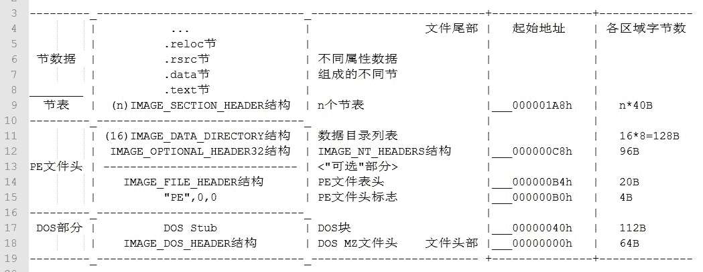
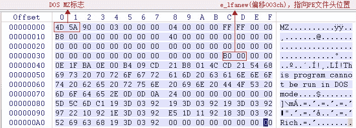
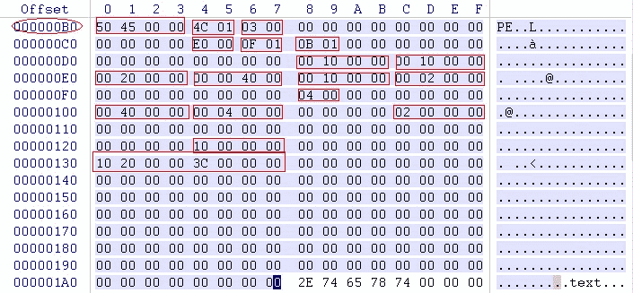
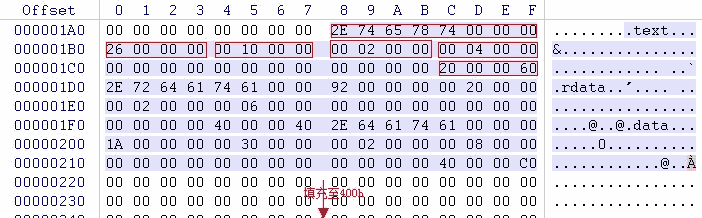
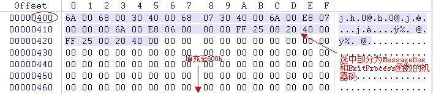
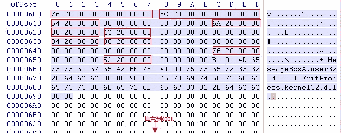
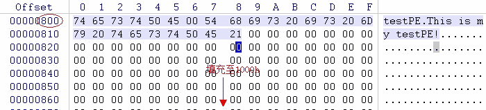
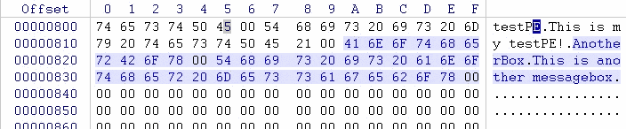
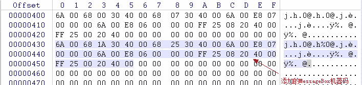
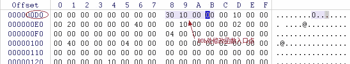

# PE 学习.动手写 PE.见缝插针

> 原文：[`www.pediy.com/kssd/pediy12/138356.html`](https://www.pediy.com/kssd/pediy12/138356.html)

注册了这么久，到现在还是菜鸟，以后要抓紧学习了。  
最近一直在看 PE 文件的相关资料，故想以此篇来做个引，希望能获得个邀请码，内容较菜，请高手木笑！  
  
以下是我整理的 PE 文件结构图，希望对各位能有所帮助：（排版神马的，真痛苦啊，画好这图后才懂得如何贴图，哎-。-）  
（菜鸟啊，连个图都搞不定，只好传个截图了，抱歉！）  
  
  
接下来，让我们动手吧！  
首先，让我们来明确下目的：  
  1.构建自己的 pe 程序，知道了 pe 文件的结构后，我们就可以按照 pe 文件的格式手工“填写”属于我们自己的程序了。  
  2.见缝插针，利用空白数据插入额外代码。  
  3.通过增加节来插入额外代码（2 的扩展）。（写晕掉了，有兴趣的同学自己实践下吧！）  
其次，明确下程序情况：  
  1.正如刚学任何语言一样，均从“Hello World！”开始，因此，我们也实现一个最简单的功能，我们的目标是弹出一个提示框。  
  2.程序至少包含三个节（.text、.rdata 和.data），从上图可知本例 PE 头大小应为 544B，又 Windows 系统规定文件的对齐粒度应为 512B，所以本程序的最终大小应为 1024+3\*512=2560B。三个节的起始地址分别为 00000400h、00000600h、00000800h。  
    
    
进入正题：  
                                一、构建 PE 文件  
1.新建一空白文件，以任意 16 进制编辑器（如 WinHex）打开此文件，接下来，如果使用 WinHex 的话，可以通过 Edit->Paste Zero Bytes 以 2560B（此程序的大小）填充本文件。  
2.针对各个部分进行数据填充，结构的详细信息请自行参考其他资料（如老罗的 Win32 汇编、坛里的各位大大的文章等），此处仅将必要的字段进行赋值，并在图中将相应的信息进行标注，以便学习。  
     2.1 DOS 文件头和块：（偷懒下）我们可直接 copy 常见 pe 文件的前 B0h 字节。如图一。  
  
     2.2 PE 文件头：  
  来到 B0h 偏移处就是 PE 文件头的开始处（如图），其重要字段设置的对应关系如下：  
  50450000 -> PE 文件头标志  
  4C01   -> CPU 类型 i386  
  0300   -> 区块数目  
  E000   -> 可选头大小  
  0F01   -> 文件属性，设置为 exe 文件  
  0B01    -> 普通可执行文件标志  
  00100000 -> 程序执行入口  
  00100000 -> 代码节起始 RVA  
  00200000 -> 数据节起始 RVA  
  00004000 -> 建议装载地址  
  00100000 -> 文件对齐值  
  00020000 -> 内存对齐值  
  0400   -> 最低子系统版本号  
  00400000 -> 内存中整个 PE 映像尺寸  
  00040000 -> 所有头加节表大小  
  02000000 -> 文件子系统，图形界面  
  10000000 -> 数据目录项数，默认 16  
  102000003C000000 -> 输入表，此处仅输入表有数据  
  
     2.3 节表：  
  节表从偏移 1A8h 开始，直至 400h，填充数据如下图所示：  
  其中，数据对应关系为：  
  .text 节  
  2E74657874000000 -> 8 字节的块名  
  26000000 ->  实际使用的数据大小  
  00100000 ->  起始位置  
  00020000 -> 节大小  
  00040000 -> 文件中偏移  
  20000060 -> 节属性  
  其余两节对应关系同.text 节。  
  
     2.4 .text 节  
  跳转到 400h 处，将所需代码的机器码填入相应位置，如下图所示，为了对齐，应填充至 600h  
  
     2.5 .rdata 节  
  此处含导入表，相对难一点。  
  跳转到 600h 处后，填充数据如下图所示，  
  
        此图的代表结构可以展示为以下四层：  
  |  (n)IMAGE\_THUNK\_DATA(original)  
  |  (n)IMAGE\_IMPORT\_DESCRIPTOR  
  |  (n)IMAGE\_THUNK\_DATA  
  |  IMAGE\_IMPORT\_BY\_NAME  
  其中，(n)IMAGE\_THUNK\_DATA(original)和 (n)IMAGE\_THUNK\_DATA 结构均需在每个结构后面添加全 0 结构以示结束；      (n)IMAGE\_IMPORT\_DESCRIPTOR 需在所有结构后面添加全 0 结构以示结束。  
  未装入内存前，(n)IMAGE\_THUNK\_DATA(original)和 (n)IMAGE\_THUNK\_DATA 数组通过 RVA 指向 IMAGE\_IMPORT\_BY\_NAME 数组；装入内存后(n)IMAGE\_THUNK\_DATA 指向 IAT。  
      
  (n)IMAGE\_IMPORT\_DESCRIPTOR 结构的前后分别指向(n)IMAGE\_THUNK\_DATA(original)和 (n)IMAGE\_THUNK\_DATA。  
  四者构成一环，指来指去。  
      
     2.6 .data 节  
  跳转到 800h 处，将所需数据填充进去，如下图所示，由于对齐原因，应填充至 1000h  
  
  
                   二、见缝插针  
  从那么多 0 字节中，聪明的你肯定发现了什么，是我们动手脚的时候了！  
  1.说明：此处只是简单的实现了篡改程序的功能，并没有在篡改后返回原来的程序，有兴趣的童鞋可以自己动手添加下增加返回原函数入口点的功能。另外，此处只是实现了在节的空隙中插入额外代码的功能。童鞋们也可以尝试下通过添加一个新的节来增加代码的功能。  
  PS：高手莫笑！！  
    
  2.首先，添加数据，如下图，转到 800h 处添加所需数据：  
    
  然后，添加执行代码，如下图，转到 400h 处添加弹出另外一个窗口的代码：  
    
  最后，跳转到 D8h（程序的执行入口）处修改入口点数据，只需加上添加代码与代码段的偏移大小即可：  
    
    
  最后的最后，来张全家图，菜鸟之作，忘各位大大多多指教！！！  
  
  
PS：本程序所用笔记，截图以及程序如下：  
PE 学习.动手写 PE.见缝插针（申请邀请码）.rar