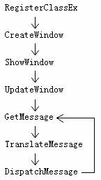
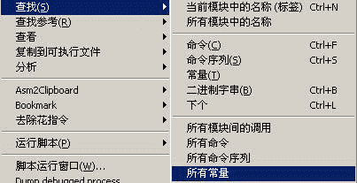

# 消息回调函数定位 3 法

> 原文：[`www.pediy.com/kssd/pediy09/pediy09-193.htm`](https://www.pediy.com/kssd/pediy09/pediy09-193.htm)

> 作者：笨笨雄/www.pediy.com
> 
> E MAIL：nemo314@gmail.com
> 
>        在 WINDOWS 系列的操作系统中，有所谓消息驱动事件的概念。系统会根据用户对应用程序的操作产生出对应的消息，发送给程序，程序则通过响应该消息进行相关的活动。例如在一个注册窗口中，当你点击“注册”这个按钮时，系统便会将 WM\_command 这个消息发送给程序，当程序收到这个消息时，便开始对注册码进行验证。这一基本框架，为我们寻找程序关键代码提供了一条捷径。
> 
>        VC 的工程向导为我们提供了一个简单的 HELLO WORLD 的例子，里面包含生成窗口最基本的代码。由于代码量很少，这比较适合我们分析窗口的建立和运行过程。
> 
>  \[if gte vml 1\]><v:shapetype id="\_x0000\_t75" coordsize="21600,21600" o:spt="75" o:preferrelative="t" path="m@4@5l@4@11@9@11@9@5xe" filled="f" stroked="f"> <v:stroke joinstyle="miter"/> <v:formulas> <v:f eqn="if lineDrawn pixelLineWidth 0"/> <v:f eqn="sum @0 1 0"/> <v:f eqn="sum 0 0 @1"/> <v:f eqn="prod @2 1 2"/> <v:f eqn="prod @3 21600 pixelWidth"/> <v:f eqn="prod @3 21600 pixelHeight"/> <v:f eqn="sum @0 0 1"/> <v:f eqn="prod @6 1 2"/> <v:f eqn="prod @7 21600 pixelWidth"/> <v:f eqn="sum @8 21600 0"/> <v:f eqn="prod @7 21600 pixelHeight"/> <v:f eqn="sum @10 21600 0"/> </v:formulas> <v:path o:extrusionok="f" gradientshapeok="t" o:connecttype="rect"/> <o:lock v:ext="edit" aspectratio="t"/> </v:shapetype><v:shape id="\_x0000\_i1025" type="#\_x0000\_t75" style='width:109.05pt; height:192.5pt'> <v:imagedata src="pediy09-193.files/image001.png" o:title=""/> </v:shape><!\[endif\] 
> 
> 窗口建立过程调用 API 的顺序
> 
>  
> 
>        CreateWindow 正如字面的意思，它的作用是建立一个窗口。它的定义如下：
> 
>  
> 
> ```
> 
> ```
> 
>   
> 
> ```
> 
> ```
> 
>   
> 
> ```
> 
> ```
> 
>   
> 
> ```
> 
> ```
> 
>   
> 
> ```
> 
> ```
> 
>   
> 
> ```
> 
> ```
> 
>   
> 
> ```
> 
> ```
> 
>   
> 
> ```
> 
> ```
> 
>   
> 
> ```
> 
> ```
> 
>   
> 
> ```
> 
> ```
> 
>   
> 
> ```
> 
> ```
> 
>   
> 
> ```
> 
> ```
> 
>   
> 
> ```
> 
> ```
> 
>   
> 
>  
> 
>        注意到`*lpClassName*``，它是由`RegisterClassEx 注册的类。定义如下：
> 
>  
> 
> ```
> 
> ```
> 
>   
> 
> ```
> 
> ```
> 
>   
> 
> ```
> 
> ```
> 
>   
> 
>  
> 
> typedef struct \_WNDCLASSEX {    // wc  
> 
>     UINT    cbSize; 
> 
>     UINT    style; 
> 
>     **WNDPROC lpfnWndProc; **
> 
>     int     cbClsExtra; 
> 
>     int     cbWndExtra; 
> 
>     HANDLE  hInstance; 
> 
>     HICON   hIcon; 
> 
>     HCURSOR hCursor; 
> 
>     HBRUSH  hbrBackground; 
> 
>     LPCTSTR lpszMenuName; 
> 
>     LPCTSTR lpszClassName; 
> 
>     HICON   hIconSm; 
> 
> } WNDCLASSEX;
> 
>  
> 
>        **WNDPROC**，这就是本文的主角了。该项填写的是消息回调函数的地址。类似地，建立对话框的两个函数，CreateDialogParam 和 DialogBoxParam 中的`**DLGPROC**``参数只是对同一样事物的不同名称。此外，应用程序也有可能通过 GetMessage 这个 API 取得并处理消息。现在，我们可以通过这些 API 取得消息处理函数的地址。`
> 
> `    ``仍然依赖 API 作为寻找关键代码并体现不出理解消息机制的优越性。它仍然易于被隐藏 API 调用，API 断点的检测等方法阻止我们找到消息处理程序的位置。在消息处理程序入口下断点，停下来之后，在当前堆栈可以得到一个返回地址，它指向系统区域。在那里，我看到有趣的东西：`
> 
> `    `
> 
> | `77DF2C93   .  68 CDABBADC   push    DCBAABCD``77DF2C98   .  56            push    esi``77DF2C99   .  FF75 18       push    dword ptr [ebp+18]``77DF2C9C   .  FF75 14       push    dword ptr [ebp+14]``77DF2C9F   .  FF75 10       push    dword ptr [ebp+10]``77DF2CA2   .  FF75 0C       push    dword ptr [ebp+C]``77DF2CA5   .  FF55 08       call    dword ptr [ebp+8]``77DF2CA8   .  817C24 04 CDA>cmp     dword ptr [esp+4], DCBAABCD` |
> | --- |
> 
> `处于 user32.dll 内部的代码`
> 
> ` `
> 
> `    77DF2CA5``处便是系统调用应用程序消息函数的代码，正如你所见的一样，系统把它的地址放在堆栈中。我们知道，程序通过一个循环，不断地接收和处理系统发送过来的消息。也就是说，该地址很可能一直存在于堆栈之中。为了寻找该地址，我们需要一个特殊标记。正如你看到的那样，系统在把控制权交给消息处理程序之前，将“DCBAABCD”这个特殊标记压入堆栈，并在消息处理程序返回之后检查这个标记以判断消息函数是否破坏了堆栈。现在让我们一起来测试这个方法，打开 NOTEPAD.exe，F9 运行它。`
> 
> ` `
> 
> ` \[if gte vml 1\]><v:shape id="\_x0000\_i1026" type="#\_x0000\_t75" style='width:178.2pt;height:198.2pt'> <v:imagedata src="pediy09-193.files/image003.png" o:title=""/> </v:shape><!\[endif\] `
> 
> ` `
> 
> `    ``在当前堆栈中，用鼠标右键激活菜单，选择“查找地址”，输入“DCBAABCD”。`
> 
> ` `
> 
> | `0006F528  |DCBAABCD``0006F52C  ]0006F548``0006F530  |77DF4764  ``返回到 USER32.77DF4764 来自 USER32.77DF2C90``0006F534  |0100248F  NOTEPAD.0100248F` |
> | --- |
> 
> ` `
> 
> `    0006F534``处保存的数据指向 NOTEPAD 的领空。在反汇编窗口可以看到下面代码：`
> 
> ` `
> 
> | `0100248F  /.  55            push    ebp``01002490  |.  8BEC          mov     ebp, esp``01002492  |.  53            push    ebx``01002493  |.  56            push    esi``01002494  |.  8B75 0C       mov     esi, dword ptr [ebp+C]``01002497  |.  57            push    edi``01002498  |.  6A 05         push    5``0100249A  |.  5A            pop     edx``0100249B  |.  3BF2          cmp     esi, edx``0100249D  |.  77 4B         ja      short 010024EA``0100249F  |.  74 17         je      short 010024B8``010024A1  |.  8BC6          mov     eax, esi``010024A3  |.  48            dec     eax``010024A4  |.  48            dec     eax``010024A5  |.  0F85 62020000 jnz     0100270D``010024AB  |.  6A 00         push    0          ; /ExitCode = 0``010024AD|.FF15 B0110001 call dword ptr [<&USER32.PostQuitMess>` |
> | --- |
> 
> ` `
> 
> `我们看到 PostQuitMessage 这个消息处理程序中常用的 API，这里便是消息处理函数了。该方法在 WIN2K 和 WINXP 下测试通过。然而，对于`CreateDialogParam 和 DialogBoxParam 却无能为力。我并不打算去找原因，因为对于这两个函数，有更好的方法。在调用这两个函数建立对话框的时候，在对话框被关闭之前，函数是绝对不会返回的。也就是说，调用该函数的参数，一直都留在堆栈之中。当然，在堆栈中找我们想要的东西，我们需要一个标记。下面先让我们来看看这两个函数的定义：
> 
>  
> 
> ```
> 
> ```
> 
>   
> 
> ```
> 
> ```
> 
>   
> 
> ```
> 
> ```
> 
>   
> 
> ```
> 
> ```
> 
>   
> 
> ```
> 
> ```
> 
>   
> 
> ```
> 
> ```
> 
>   
> 
> ```
> 
> ```
> 
>   
> 
> ` `
> 
> ```
> 
> ```
> 
>   
> 
> ```
> 
> ```
> 
>   
> 
> ```
> 
> ```
> 
>   
> 
> ```
> 
> ```
> 
>   
> 
> ```
> 
> ```
> 
>   
> 
> ```
> 
> ```
> 
>   
> 
> ```
> 
> ```
> 
>   
> 
> ` `
> 
> `    ``这两个函数的相同点都是，左边第一个参数是``**HINSTANCE**``，即应用程序的基址。左边第四个参数``**DLGPROC**``则是消息处理函数的地址。现在，我们便有了一个标记，可惜的是，需要该参数的 API 比较多，在内存中搜索这一标记时，有很多干扰数据。当然你可以写一个脚本来判断在堆栈中相应的地址，是否指向程序的代码段。这里就留给读者做练习了。`
> 
> `    ``在前面的示例中，我通过 PostQuitMessage 这个函数的调用认出消息处理函数（对编程不了解的读者可以看看 VC 自带的 HELLO WORLD 示例）。同样地，可以通过 DefWindowProc 这个只在消息处理函数中出现的 API 去确定是否消息处理函数。换一句话来说，我们同样可以通过在这些 API 下断点找到消息处理函数。`
> 
> `当然，这里仍然有一个不需要 API 便能定位消息处理函数的方法。我们知道，消息处理函数通过处理一系列的消息常量来响应用户的操作。这一常量，也可以当作是一个特征，搜索出来。一个经常会被应用程序处理的消息是 WM_Command(常量值为 111)，该消息的意义，在文章开始的地方便说明过，这里就不重复了。最后让我们用这个方法来寻找一个 CRACKME 的关键代码。`
> 
> ` `
> 
> [`bbs.pediy.com/showthread.php?t=39759`](http://bbs.pediy.com/showthread.php?t=39759)
> 
>  
> 
> 你可以通过上面地址下载到该 CRACKME。用 OD 打开该 CRACKME。在反汇编窗口，鼠标右键点击，弹出菜单。
> 
>  
> 
>  
> 
>  
> 
>  
> 
>  \[if gte vml 1\]><v:shape id="\_x0000\_i1027" type="#\_x0000\_t75" style='width:302.25pt; height:155.4pt'> <v:imagedata src="pediy09-193.files/image005.png" o:title=""/> </v:shape><!\[endif\] 
> 
> “所有常量”选项用于查找立即数
> 
>  
> 
> 查找数值 111，结果如下：
> 
>  
> 
> | 参考位于 cm01:.text 到常量 111, 条目 0 地址\=00401598 反汇编\=cmp     dword ptr \[ebp-4\], 111 |
> | --- |
> 
>  
> 
>     按照搜索结果，我们来到了处理该消息的位置。0040159F 处代码的意义，如果消息号为 111，则跳至 004015B2 执行。接下来，程序将会比较 BUTTON 的 ID 以确认用户按下了“注册”还是“关于”。既然我们是在调试，那便没必要知道 ID 号，直接在 004015B2 处下断。
> 
>  
> 
> | 00401598  |.  817D FC 11010>cmp     dword ptr \[ebp-4\], 1110040159F  |.  74 11         je      short 004015B2004015A1  |.  EB 4C         jmp     short 004015EF004015A3  |>  8B45 08       mov     eax, dword ptr \[ebp+8\]004015A6  |.  A3 00CE4000   mov     dword ptr \[40CE00\], eax004015AB  |.  E8 1AFFFFFF   call    004014CA004015B0  |.  EB 41         jmp     short 004015F3004015B2  |>  8B45 10       mov     eax, dword ptr \[ebp+10\] |
> | --- |
> 
>  
> 
>     F9 运行程序，点击“注册”，调试器便得到了控制权。F7 单步跟踪几行代码，程序在确认用户按下了“注册”之后，便把你带到注册代码的位置了。爆破？还是写注册机？就留给读者自己探索了。
> 
>  

 4dd466d0e1e0cc123afbe504da2462ca