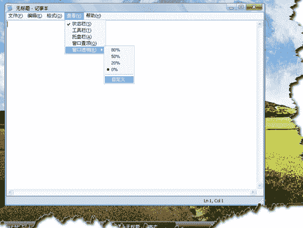

# 用 DELPHI 编写 DLL 插件为 Windows 记事本增加各种功能

> 原文：[`www.pediy.com/kssd/pediy10/84730.html`](https://www.pediy.com/kssd/pediy10/84730.html)

用 DELPHI 编写 DLL 插件为 Windows 记事本增加各种功能  
  
作者：风铃夜思雨  
主页：Http://Www.SkyGz.Com  
日期：2009-03-27  
环境：Windows XP SP3, Delphi 7  
  
简介：  
    使用 PEDIY 方式为记事本增加功能的方法也有不少了，但必须对 PE 结构以及汇编了解才可行；其过程很费时。  
  
本代码将以 DLL HOOK 插件形式为记事本增加几种功能，这里给出两个方法的代码  
  
方法一：用劫持系统 DLL 方式调用  
方法二：用 LoadPE 为记事本增加一个初始化空白函数即可调用  
  
详细可查看本目录下的代码及程序，目前已增加托盘栏、自动保存、窗口置顶、窗口透明功能；文件加密、工具栏功能未完成。  
本人不习惯写代码注释，所以代码各位就将就下看看吧。  
  
注意：千万不要把 LPK.DLL 覆盖到系统目录  
  
我要申精,呵呵。。。  
  
  
  

上传的附件
|  || CodeHook.rar  
 |
|  || notepad.rar \[解压密码：pediy\]   
 |