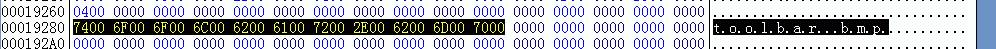
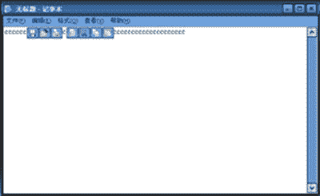
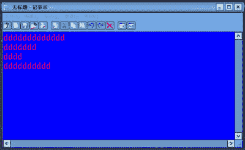

# 逆向初步,给 XP 记事本增加显/隐工具栏,从文件载入工具图片

> 原文：[`www.pediy.com/kssd/pediy08/pediy8-260.htm`](https://www.pediy.com/kssd/pediy08/pediy8-260.htm)

;===============================================修改说明===============================================  
  
【软件名称】XP 记事本(Notepad)  
【下载地址】附件(附本文)  
【应用平台】Win9x/NT/2000/XP  
【软件大小】120K  
【软件限制】未修改时,没有工具栏。  
【保护方式】--------  
【修 改 者】andy00  
【修改难度】1/10  
【修改说明】只是为了熟悉逆向工程，所以使用静态分析。  
【分析工具】Olldbg,计算器  
【参考资料】MSDN  
【软件简介】--------  
  
;===============================================附加的说明==============================================  
  
    这个程序是接着上一修改的,本文的某些东西如果看不懂请先看这一篇：  
  
    逆向初步,增加 XP 记事本功能,使用背景色,文字颜色,下划线,删除线  
  
    http://bbs.pediy.com//showthread.php?s=&threadid=23277  
  
    对于比较麻烦的修改,建议大家先弄清流程,搞清楚要哪些函数,哪些变量,然后写出伪代码,划分空闲数据与代码空间,建议两者  
各占空间,不要混合.给变量挨个分配空间,非数组的,尽量都分配双字以上,方便管理.最后再动手,不至于手忙脚乱,思路混乱  
搞到最后自己都不知道在哪里了,只好放弃.  
  
;===============================================增加的功能分析==========================================  
  
功能 1   创建工具条菜单  
功能 2   创建工具条,能够通过工具条菜单来控制显示/隐藏  
....    从文件载入工具条位图资源.这时百 toolbar.bmp  
  
  
  
;=============================================功能实现需要的信息=======================================  
  
;创建工具条  
      
    使用函数 CreateToolbarEx 或 CreateWindowEx,后一个非常麻烦,所以用前一个：  
      
HWND CreateToolbarEx(            
    HWND        hwnd,           //父窗口句柄  
    DWORD       ws,             //窗口样式  
    UINT        wID,            //窗口 ID  
    int         nBitmaps,       //位图数  
    HINSTANCE   hBMInst,        //位图所在的模块,若为 NULL,则 wBMID 必须是有效的位图句柄  
    UINT\_PTR    wBMID,          //位图在该模块中的句柄  
    LPCTBBUTTON lpButtons,      //TBBUTTON 结构  
    int         iNumButtons,    //工具栏按钮数(包含分隔符)  
    int         dxButton,       //按钮宽度  
    int         dyButton,       //按钮高度  
    int         dxBitmap,       //按钮位图宽度 16,24,32...  
    int         dyBitmap,       //按钮位图高度 16,24,32...  
    UINT        uStructSize     //TBBUTTON 结构的大小,为 14  
);  
  
    成功则返回工具条句柄,失败则返回 0  
      
; 载入工具栏位图  
  
    因为我们是要从文件载入工具栏位图,所以使用函数 LoadImage  
      
HANDLE LoadImage(           
    HINSTANCE   hinst,          //位图所在模块从文件载入此处为 0  
    LPCTSTR     lpszName,       //位图文件路径(相对或完整均可)  
    UINT        uType,          //图像类型这里是 IMAGE\_BITMAP  
    int         cxDesired,      //位图宽度,为 0 则按真实大小  
    int         cyDesired,      //位图高度,为 0 则按真实大小  
    UINT        fuLoad          //载入方式,从文件载入为 LR\_LOADFROMFILE  
);  
  
    成功返回位图句柄,失败返回 0  
      
; 删除位图对象  
      
    凡是 GDI 对象,多数要在不使用的时候释放它们的内存,位图对象也是.所以要使用函数 DeleteObject 删除它  
      
BOOL DeleteObject(  
  HGDIOBJ       hObject         // 位图句柄  
);  
  
    成功返回真,否则返回假  
      
; 设置菜单检查标记  
      
    使用函数 CheckMenuItem  
  
DWORD CheckMenuItem(           
    HMENU       hmenu,          //主菜单句柄  
    UINT        uIDCheckItem,   //子菜单 ID  
    UINT        uCheck          //检查标志,MF\_CHECKED(==8)为检查,MF\_UNCHECKED(==0)为不检查  
);  
  
  
; 获得主菜单  
      
    使用函数  
      
HMENU GetMenu(  
    HWND        hWnd            //窗口句柄  
);  
  
    成功返回菜单句柄,失败返回 0  
          
; 其它函数  
  
    对于窗口及其大小的操作难免用到这几个函数  
      
    GetClientRect,      //获取客户区区域  
    MoveWindow,         //移动/设置窗口位置/大小  
    ShowWinodw          //显示/隐藏窗口  
      
    详细请查阅 MSDN  
      
; 相关消息  
      
    WM\_SIZE  
  
        WPARAM wParam  
        LPARAM lParam  
          
参数说明:  
  
lParam  低字指出了窗口的新的客户区宽度,高字指出了窗口的新的客户区的高度.  
      
    WM\_COMMAND  
  
        WPARAM wParam  
        LPARAM lParam;  
参数说明:  
  
wParam  消息状态码,如果是加速键消息,高字为 1,如果是菜单消息,高字为 0,低字为控件/菜单/加速键 ID  
lParam  如果是控件消息,则为控件句柄,否则为 0   
  
  
;=============================================功能实现伪代码============================================  
  
#define ID\_TOOLBAR     101      //工具栏 ID  
  
TBBUTTON tbButtonsCreate \[ \] =  //创建工具栏需要的数据,详细请查阅 MSDN                                             
{  
    //0,    x,              4,                  0,        0,  0,  0  
    {0, IDM\_FILE\_NEW,       TBSTATE\_ENABLED, BTNS\_BUTTON, {0},0L, 0},  
    {1, IDM\_FILE\_OPEN,      TBSTATE\_ENABLED, BTNS\_BUTTON, {0},0L, 0},  
    {2, IDM\_FILE\_SAVE,      TBSTATE\_ENABLED, BTNS\_BUTTON, {0},0L, 0},  
    {3, IDM\_FILE\_SAVEAS,    TBSTATE\_ENABLED, BTNS\_BUTTON, {0},0L, 0},  
    {4, IDM\_FILE\_PRINTCFG,  TBSTATE\_ENABLED, BTNS\_BUTTON, {0},0L, 0},  
    {0,     0           ,   TBSTATE\_ENABLED, BTNS\_SEP,    {0},0L, 0},  
    {5, IDM\_FILE\_PRINTCFG,  TBSTATE\_ENABLED, BTNS\_BUTTON, {0},0L, 0},  
    {6, IDM\_FILE\_PRINTCFG,  TBSTATE\_ENABLED, BTNS\_BUTTON, {0},0L, 0},  
    {7, IDM\_FILE\_PRINTCFG,  TBSTATE\_ENABLED, BTNS\_BUTTON, {0},0L, 0},  
    {8, IDM\_FILE\_PRINTCFG,  TBSTATE\_ENABLED, BTNS\_BUTTON, {0},0L, 0},  
    {9, IDM\_FILE\_PRINTCFG,  TBSTATE\_ENABLED, BTNS\_BUTTON, {0},0L, 0},  
    {10, IDM\_FILE\_PRINTCFG, TBSTATE\_ENABLED, BTNS\_BUTTON, {0},0L, 0},  
    {11, IDM\_FILE\_PRINTCFG, TBSTATE\_ENABLED, BTNS\_BUTTON, {0},0L, 0},  
    {0,     0           ,   TBSTATE\_ENABLED, BTNS\_SEP,    {0},0L, 0},  
    {12, IDM\_FILE\_PRINTCFG, TBSTATE\_ENABLED, BTNS\_BUTTON, {0},0L, 0},  
    {13, IDM\_FILE\_PRINTCFG, TBSTATE\_ENABLED, BTNS\_BUTTON, {0},0L, 0},  
  
};  
  
int             cxEdit  
int             cyEdit;  
int             yEdit;  
int             cyToolBar;  
HWND            hWndToolbar,hWndEdit;  
BOOL            bShowToolBar=TRUE;  
RECT            rcClient;  
HMENU           hMenu;  
HBITMAP         hToolBarBitmap;  
WCHAR           wsBitmap\[\]="toolbar.bmp";  
  
LRESULT CALLBACK WndProc(HWND hWnd, UINT message, WPARAM wParam, LPARAM lParam)  
{  
    int wmId,       wmEvent;  
  
    switch (message)   
    {  
    case WM\_CREATE:  
        hToolBarBitmap=(HBITMAP)LoadImage(NULL,wcBitmap,IMAGE\_BITMAP,0,0,LR\_LOADFROMFILE);  //载入位图  
          
        hWndToolbar = CreateToolbarEx (hWnd,   
            WS\_CHILD | WS\_VISIBLE ,   
            ID\_TOOLBAR, 14, NULL,(UINT)hToolBarBitmap ,   
            tbButtonsCreate, 16, 0, 0, 16, 16, sizeof (TBBUTTON));      //创建工具条  
          
        hWndEdit    =CreateWindow("edit"/\*.其余参数省略...\*/);          //创建编辑框  
          
        CheckMenuItem(hMenu,IDM\_VIEW\_TOOLBAR,MF\_CHECKED);               //设置检查标志  
  
        break;  
  
    case WM\_SIZE:  
        cxEdit=LOWORD(lParam);  
        cyEdit=HIWORD(lParam);  
          
        cyEdit=cyWnd;  
        cyToolBar=0;  
        yEdit=0;  
  
        if(bShowToolBar)        //如果当前是显示的  
        {  
            cyEdit-=28;         //编辑框高度减 28  
            yEdit+=28;          //下移 28  
            cyToolBar=28;       //工具栏高度 28  
        }  
  
        MoveWindow(hWndToolbar,0,0,cxEdit,cyToolBar,TRUE);      //调整工具栏窗口  
        MoveWindow(hWndEdit,0,yEdit,cxEdit,cyEdit,TRUE);        //调整编辑框窗口  
  
        return TRUE;  
  
    case WM\_COMMAND:      
        wmId    = LOWORD(wParam);   
        wmEvent = HIWORD(wParam);   
  
        switch (wmId)  
        {     
        case IDM\_VIEW\_TOOLBAR:  //菜单 1D==1D  
  
            bShowToolBar=!bShowToolBar;       
            ShowWindow(hWndToolbar,bShowToolBar);       //显示/隐藏工具栏  
                          
            CheckMenuItem(hMenu,IDM\_VIEW\_TOOLBAR,bShowToolBar?MF\_CHECKED:MF\_UNCHECKED);     //设置/取消检查标志  
              
            GetClientRect(hWnd,&rcClient);  
  
            if(bShowToolBar)  
            {  
                rcClient.top+=30;  
            }  
              
            MoveWindow(hWndEdit,rcClient.left,rcClient.top,  
            rcClient.right-rcClient.left,rcClient.bottom-rcClient.top,TRUE);        //调整编辑框区域  
            return TRUE;  
        }  
        return DefWindowProc(hWnd, message, wParam, lParam);  
          
    case WM\_DESTROY:  
        DeleteObject(hToolBarBitmap);       //删除位图对象  
        PostQuitMessage(0);  
  
        break;        
    default:  
        return DefWindowProc(hWnd, message, wParam, lParam);  
    }  
    return 0;  
}  
  
注意由于使用函数 LoadImageW,必须使用宽字符集,第个字母占两个字节如图:  
  
   
  
;==========================================根据伪代码分配空间,输入函数====================================  
  
;============================增加输入函数=============================  
  
;需要手动输入的函数  
  
comctl32.dll    CreateToolbarEx     0001408C  
  
;已输入的函数  
USEER32.DLL     SendMessageW        01001240  
USR32.DLL       ShowWinodw          010011B0  
USR32.DLL       MoveWindow          01001220  
USR32.DLL       CheckMenuItem       01001248  
USR32.DLL       GetClientRect       01001188  
USR32.DLL       LoadImageW          010011D4  
USR32.DLL       GetMenu             01001264  
              
;============================增加程序空间=============================  
  
.andy00     VSize:10000     VOffset:14000   RSize:10000     ROffset:10A00   Flag:E0000060  
  
空间分配  
  
10A00(14000)    11000(14600)  输入表    共 600  
11100(14700)    19000(1C600)  代码      共 7F00  
19100(1C700)    1FA00(23000)  数据      共 6900    
  
  
;============================变量分配================================  
  
  
;工具条功能变量(1C704->1C914)  
  
变量类型        变量名              文件偏移            虚拟偏移  
hWnd ==DWORD PTR DS:\[1009830\]  
HWND            hWndEdit            8438                9838                ; 编辑框句柄,程序已分配  
int             cxWnd               19104               1C704               ; 编辑框宽度  
int             cyWnd               19108               1C708               ; 编辑框高度  
int             yEdit               1910C               1C70C               ; 编辑框最高位置                  
  
int             cyToolBar           19114               1C714               ; 工具条高度      
HWND            hWndToolbar         19118               1C718               ; 工具条句柄  
int             iCheckFlag          1911C               1C71C               ; 是否显示工具条  
HMENU           hMenu               19120               1C720               ; 主菜单句柄  
TBBUTTON\[\]      tbButtonsCreate     1912C->1926C        1C72C->1C86C        ; 用于创建工具条的数据  
  
COLORREF        crText              19270               1C870               ;颜色字体功能变量  
COLORREF        crBkgnd             19274               1C874               ;颜色字体功能变量  
HBRUSH          hBrBkgnd            19278               1C878               ;颜色字体功能变量  
CHOOSECOLOR     cc                  1927C->1929C        1C87C->1C89C        ;颜色字体功能变量  
  
TCHAR\[\]         szBitmapName        19280               1C880  
  
COLORREF\[\]      lpcusColor          192A0->192B0        1C8A0->1C8B0        ;颜色字体功能变量  
DWORD           tmp                 192B4               1C8B4               ;颜色字体功能变量  
  
HBITMAP         hBitmap             19300               1C900               ; 工具条位图句柄  
RECT            rcClient.left       19304               1C904               ; 客户区的矩形区域  
                rcClient.top        19308               1C908               ;   
                rcClient.right      1930C               1C90C  
                rcClient.bottom     19310               1C910  
  
  
  
准备的工具栏按钮位图  
  
  
;===========各菜单 ID,按在工具栏上从左到右的顺序排列,0 为分隔栏=============  
  
打开,新建,保存,另存,打印,空格,查找,剪切,复制,粘贴,撤消 1,撤消 2,删除,空格,字体,颜色  
  
2   1       3   4   5   0       15  300 301  302    10  10      303 0   21  1C  
  
  
  
;===============================================创建工具条=============================================  
  
;找到创建编辑框的地方  
  
0100473A   .  8B45 90           MOV     EAX, DWORD PTR SS:\[EBP\-70\]  
0100473D   .  53                PUSH    EBX                                     ; /lParam  
0100473E   .  FF75 AC           PUSH    DWORD PTR SS:\[EBP\-54\]                   ; |hInst=\[EBP-54\]  
01004741   .  83C0 9C           ADD     EAX, -64                                ; |  
01004744   .  6A 0F             PUSH    0F                                      ; |  
01004746   .  FF35 30980001     PUSH    DWORD PTR DS:\[1009830\]                  ; |hParent=hWnd=\[1009830\]  
0100474C   .  50                PUSH    EAX                                     ; |Height  
0100474D   .  FF75 8C           PUSH    DWORD PTR SS:\[EBP\-74\]                   ; |Width  
01004750   .  A1 50980001       MOV     EAX, DWORD PTR DS:\[1009850\]             ; |  
01004755   .  F7D8              NEG     EAX                                     ; |  
01004757   .  53                PUSH    EBX                                     ; |Y  
01004758   .  1BC0              SBB     EAX, EAX                                ; |  
0100475A   .  53                PUSH    EBX                                     ; |X  
0100475B   .  25 0000F0FF       AND     EAX, FFF00000                           ; |  
01004760   .  05 04013050       ADD     EAX, 50300104                           ; |  
01004765   .  50                PUSH    EAX                                     ; |Style  
01004766   .  56                PUSH    ESI                                     ; |WindowName  
01004767   .  68 94170001       PUSH    01001794                                ; |Class = "Edit"  
0100476C   .  68 00020000       PUSH    200                                     ; |ExtStyle = WS\_EX\_CLIENTEDGE  
01004771   .  FF15 E0110001     CALL    DWORD PTR DS:\[<&USER32.CreateWindowExW>>; \\CreateWindowExW  
01004777   .  90                NOP  
01004778   .  90                NOP  
01004779   .- E9 A0E90000       JMP     01014900                                ;跳到初始化画刷的代码  
0100477E   .  0F84 2A020000     JE      010049AE  
;................  
;................  
      
    由以上代码分析可以得到: hInst== SS:\[EBP\-54\]  
                            hWnd == DWORD PTR DS:\[1009830\]  
  
  
  
01014900    A3 38980001         MOV     DWORD PTR DS:\[1009838\], EAX             ; hWndEdit  
01014905    68 FFFFFF00         PUSH    0FFFFFF                                 ; 白色  
0101490A    FF15 5D400101       CALL    DWORD PTR DS:\[101405D\]                  ; 创建白色画刷 CreateSolidBrush  
01014910    A3 78C80101         MOV     DWORD PTR DS:\[101C878\], EAX             ; 保存画刷句柄  
01014915    C705 74C80101 FFFFF>MOV     DWORD PTR DS:\[101C874\], 0FFFFFF         ; 保存背景颜色白色  
0101491F    A1 38980001         MOV     EAX, DWORD PTR DS:\[1009838\]             ; 从这里开始添加创建工具条的代码  
                                                                                ; 这一句在最后加上  
01014924    3BC3                CMP     EAX, EBX                                ; 这一句在最后加上  
01014926  - E9 53FEFEFF         JMP     0100477E                                ; 这一句在最后加上  
  
  
;原来创建画刷的部分:  
  
010148FC    A3 38980001         MOV     DWORD PTR DS:\[1009838\], EAX  
01014901    68 FFFFFF00         PUSH    0FFFFFF  
01014906    FF15 5D400101       CALL    DWORD PTR DS:\[101405D\]                  ; GDI32.CreateSolidBrush  
0101490C    A3 78C80101         MOV     DWORD PTR DS:\[101C878\], EAX  
01014911    C705 74C80101 FFFFF>MOV     DWORD PTR DS:\[101C874\], 0FFFFFF  
;................  
;................  
  
;新加的部分,加载工具栏位图创建工具栏,设置"显示工具栏"iCheckFlag(保存在 RVA==1C71C)为"显示"(=MF\_CHECKED==8)  
  
0101491B      6A 10               PUSH    10                                      ; /fuLoad=LR\_LOADFROMFILE  
0101491D      90                  NOP                                             ; |从文件载入   
0101491E      90                  NOP  
0101491F      6A 00               PUSH    0                                       ; |cyDesired=0  
01014921      6A 00               PUSH    0                                       ; |cxDesired=0  
01014923      6A 00               PUSH    0                                       ; |uType=IMAGE\_BITMAP  
01014925      68 80C80101         PUSH    0101C880                                ; |UNICODE "toolbar.bmp"  
0101492A      6A 00               PUSH    0                                       ; |hinst=NULL(从文件载入)  
0101492C      FF15 D4110001       CALL    DWORD PTR DS:\[<&USER32.LoadImageW>\]     ; \\LoadImageW  
  
01014932      A3 00C90101         MOV     DWORD PTR DS:\[101C900\], EAX             ; 保存到 hBitmap(RVA==1C900)     
01014937      6A 14               PUSH    14                                      ; /sizof(TBBUTTON)              
01014939      6A 10               PUSH    10                                      ; |dyBitmap=16      
0101493B      6A 10               PUSH    10                                      ; |dxBitmap=16(16\*16 小图标)  
0101493D      6A 00               PUSH    0                                       ; |dyButton 默认  
0101493F      6A 00               PUSH    0                                       ; |dxButton 默认  
01014941      6A 10               PUSH    10                                      ; |iNumButtons=10  
01014943      68 2CC70101         PUSH    0101C72C                                ; |lpButtons=tbButtons  
01014948      FF35 00C90101       PUSH    DWORD PTR DS:\[101C900\]                  ; |wBMID=hBitmap(这里使用文件载入)  
0101494E      6A 00               PUSH    0                                       ; |hBMInst=NULL(要从文件载入)   
01014950      6A 0D               PUSH    0D                                      ; |nBitmap=13  
01014952      6A 65               PUSH    65                                      ; |wndID=65  
01014954      68 00000050         PUSH    50000000                                ; |wndStyle=WS\_CHILD|WS\_VISIBLE  
01014959      FF35 30980001       PUSH    DWORD PTR DS:\[1009830\]                  ; |hParent =hWnd  
0101495F      FF15 8C400101       CALL    DWORD PTR DS:\[101408C\]                  ; \\CreateToolbarEx  
01014965      85C0                TEST    EAX, EAX  
01014967      74 2B               JE      SHORT 01014994                          ; 创建失败则不进行下面动作交给程序处理  
01014969      A3 18C70101         MOV     DWORD PTR DS:\[101C718\], EAX             ; 保存工具条句柄到 hWndToolbar(RVA==1C718)  
0101496E      C705 1CC70101 08000>MOV     DWORD PTR DS:\[101C71C\], 8               ; 设置工具条显示状态为"显示",iCheckFlag=MF\_CHECKED  
  
01014978      FF35 30980001       PUSH    DWORD PTR DS:\[1009830\]                  ; /参数 hWnd 入栈  
0101497E      FF15 64120001       CALL    DWORD PTR DS:\[<&USER32.GetMenu>\]        ; \\GetMenu(hWnd)  
01014984      A3 20C70101         MOV     DWORD PTR DS:\[101C720\], EAX             ; 保存菜单句柄到 hMenu(RVA==1C720)  
  
01014989      6A 08               PUSH    8                                       ; uCheckFlag=MF\_CHECKED (设置选中标志,一个小勾)  
0101498B      6A 1D               PUSH    1D                                      ; 要设置的子菜单,"工具栏"菜单  
0101498D      50                  PUSH    EAX                                     ; 菜单句柄 hMenu  
0101498E      FF15 48120001       CALL    DWORD PTR DS:\[<&USER32.CheckMenuItem>\]  ; CheckMenuItem(hMenu,1D,MF\_CHECKED);  
  
01014994      A1 38980001         MOV     EAX, DWORD PTR DS:\[1009838\]             ; 原来程序的代码  
01014999      3BC3                CMP     EAX, EBX                                ; 原来程序的代码  
0101499B    - E9 DEFDFEFF         JMP     0100477E                                ; 返回原片交给程序处理  
  
  
;========================================清除位图对象,防止内存泄漏====================================  
  
;直接来到以前清楚画刷的地方  
  
01014860    FF35 78C80101       PUSH    DWORD PTR DS:\[101C878\]                  ; 画刷句柄  
01014866    FF15 68100001       CALL    DWORD PTR DS:\[<&GDI32.DeleteObject>\]    ; DeleteObject(hBrBkgnd)  
0101486C    6A 00               PUSH    0  
0101486E    FF15 F4110001       CALL    DWORD PTR DS:\[<&USER32.PostQuitMessage>>; USER32.PostQuitMessage  
01014874  - E9 44ECFEFF         JMP     010034BD  
  
  
;把以上代码改为  
  
01014860    FF35 78C80101       PUSH    DWORD PTR DS:\[101C878\]                  ; 画刷句柄  
01014866    FF15 68100001       CALL    DWORD PTR DS:\[<&GDI32.DeleteObject>\]    ; DeleteObject(hBrBkgnd)  
0101486C    FF35 00C90101       PUSH    DWORD PTR DS:\[101C900\]                  ; 位图句柄  
01014872    FF15 68100001       CALL    DWORD PTR DS:\[<&GDI32.DeleteObject>\]    ; DeleteObject(hBitmap)  
01014878    6A 00               PUSH    0  
0101487A    FF15 F4110001       CALL    DWORD PTR DS:\<&USER32.PostQuitMessage>>; USER32.PostQuitMessage  
01014880  - E9 38ECFEFF         JMP     010034BD  
  
  
    保存修改,然后运行修改过的程序,这时候,出现了工具条,但是还有问题,任何编辑框的操作都会出现,光栅出现在工具  
条"内部"的情况,而且这时候,工具条是不能用的.  
  
![  
  
    这是因为,对编辑框进行的某些操作可能导致程序收到 WM\_SIZE 消息,而记事本处理的 WM\_SIZE 的时候,默认是把编辑框  
放到客户区顶端的,所以我们必须处理 WM\_SIZE 消息  
  
  
;===========================================处理 WM\_SIZE 消息=============================================  
  
;来到 WNDPROC  
  
01003429      8BFF              MOV     EDI, EDI  
0100342B  /.  55                PUSH    EBP  
0100342C  |.  8BEC              MOV     EBP, ESP  
0100342E  |.  51                PUSH    ECX  
0100342F  |.  51                PUSH    ECX  
01003430  |.  56                PUSH    ESI  
01003431  |.  8B75 0C           MOV     ESI, DWORD PTR SS:\[EBP+C\]              ; ESI=message  
01003434    - E9 67130100       JMP     010147A0                               ; 以前修改的代码,不用关心此处,一会儿会跳回来  
01003439      90                NOP  
0100343A  |.  5A                POP     EDX  
0100343B  |.  0F87 41020000     JA      01003682  
01003441  |.  0F84 B7010000     JE      010035FE  
01003447  |.  3BF2              CMP     ESI, EDX  
01003449  |.  0F87 ED000000     JA      0100353C  
0100344F  |.  0F84 DB000000     JE      01003530  
01003455  |.  8BC6              MOV     EAX, ESI                                ; EAX=message  
01003457  |.  48                DEC     EAX                                     ; message--;  
01003458  |.  48                DEC     EAX                                     ; message--;      
01003459  |.  0F84 C7000000     JE      01003526          
0100345F  |.  83E8 03           SUB     EAX, 3                                  ; message-=3;  
01003462  |.  74 61             JE      SHORT 010034C5                          ; if(message==WM\_SIZE) GOTO 010034c5  
010034BD  |>  33C0              XOR     EAX, EAX                                ;  Default case of switch 010034CE  
010034BF  |> |5F                POP     EDI  
010034C0  |. |5E                POP     ESI  
010034C1  |. |C9                LEAVE  
010034C2  |. |C2 1000           RET     10                                      ; 退出 WNDPROC,之前不跳就完了  
  
  
;WM\_SIZE 消息的处理过程,从 01003462 跳过来  
  
010034C5  |> \\8B45 10           MOV     EAX, DWORD PTR SS:\[EBP+10\]              ;  从这儿跳到自己的代码,因为我们不关心  
010034C8  |.  33F6              XOR     ESI, ESI                                ;  wParam 的值为什么.直接处理 WM\_SIZE 消息  
;................  
;................                                                                                   
  
  
;010034C5-010034C8 两句改为  
  
010034C5    -  E9 B0180100        JMP     01014BC0                                ; ===========跳到自己的代码==========  
010034CA  |.   2BC6               SUB     EAX, ESI  
010034CC  |.   74 06              JE      SHORT 010034D4                           ;  wParam==SIZE\_RESTORED  
010034CE  |.   48                 DEC     EAX                                      ;    
010034CF  |.   74 49              JE      SHORT 0100351A                              ;  wParam==   SIZE\_MINIMIZED  
010034D1  |.   48                 DEC     EAX                                      ;   
010034D2  |.^  75 E9              JNZ     SHORT 010034BD                           ;  if(wParam!=SIZE\_MAXIMIZED)goto 010034BD  
  
010034BD  |>   33C0               XOR     EAX, EAX                                 ;  Default case of switch 010034CE  
010034BF  |>   |5F                POP     EDI  
010034C0  |.   |5E                POP     ESI  
010034C1  |.   |C9                LEAVE  
010034C2  |.   |C2 1000           RET     10                                      ; 退出 WNDPROC,之前不跳就完了  
  
  
;  
01014BC0      50                  PUSH    EAX  
01014BC1      8B45 14             MOV     EAX, DWORD PTR SS:\[EBP+14\]              ; EAX=lParam  
01014BC4      25 FFFF0000         AND     EAX, 0FFFF                              ; EAX=LOWORD(lParam),LOWARD(lParam)==窗口现在宽度  
01014BC9      A3 04C70101         MOV     DWORD PTR DS:\[101C704\], EAX             ; cxEdit  
01014BCE      8B45 14             MOV     EAX, DWORD PTR SS:\[EBP+14\]              ; EAX=lParam  
01014BD1      C1E8 10             SHR     EAX, 10                                 ; EAX=HIWORD(lParam),HIWARD(lParam)==窗口现在高度  
01014BD4      A3 08C70101         MOV     DWORD PTR DS:\[101C708\], EAX             ; cyEdit=HIWORD(lParam)  
01014BD9      833D 1CC70101 08    CMP     DWORD PTR DS:\[101C71C\], 8  
01014BE0      75 21               JNZ     SHORT 01014C03                          ; if(iCheckFlag!=MF\_CHECKED) goto 01014C03  
01014BE2      90                  NOP                                             ; 当前没有显示则跳到 01014c03        
01014BE3      90                  NOP  
01014BE4      90                  NOP  
01014BE5      90                  NOP                                             ; 如果现在工具条显示的,执行以下动作  
01014BE6      832D 08C70101 1C    SUB     DWORD PTR DS:\[101C708\], 1C              ; 编辑框高度-=3D  
01014BED      C705 0CC70101 1C000>MOV     DWORD PTR DS:\[101C70C\], 1C              ; 编辑框最高位置 yEdit=30D  
01014BF7      C705 14C70101 1C000>MOV     DWORD PTR DS:\[101C714\], 1C              ; 工具条高度 cyToolbar==30D  
01014C01      EB 14               JMP     SHORT 01014C17                          ; 如果 iCheckFlag==0 当前没有显示工具条,  
01014C03      C705 0CC70101 00000>MOV     DWORD PTR DS:\[101C70C\], 0               ; 则编辑框从客户区最高位置 yEdit=0  
01014C0D      C705 14C70101 00000>MOV     DWORD PTR DS:\[101C714\], 0               ; 工具条高度设为 0,cyToolbar=0  
  
01014C17      6A 01               PUSH    1                                       ; /bRepaint=TRUE  
01014C19      FF35 14C70101       PUSH    DWORD PTR DS:\[101C714\]                  ; |cyToolbar  
01014C1F      FF35 04C70101       PUSH    DWORD PTR DS:\[101C704\]                  ; |cxEdit  
01014C25      6A 00               PUSH    0                                       ; |yToolbar  
01014C27      6A 00               PUSH    0                                       ; |xToolbar  
01014C29      FF35 18C70101       PUSH    DWORD PTR DS:\[101C718\]                  ; |hWndToolbar  
01014C2F      FF15 20120001       CALL    DWORD PTR DS:\[<&USER32.MoveWindow>\]     ; \\MoveWindow 按参数调整窗口大小位置  
  
01014C35      6A 01               PUSH    1                                       ; /bRepaint=TRUE  
01014C37      FF35 08C70101       PUSH    DWORD PTR DS:\[101C708\]                  ; |cyEdit  
01014C3D      FF35 04C70101       PUSH    DWORD PTR DS:\[101C704\]                  ; |cxEdit  
01014C43      FF35 0CC70101       PUSH    DWORD PTR DS:\[101C70C\]                  ; |yEdit  
01014C49      6A 00               PUSH    0                                       ; |xEdit  
01014C4B      FF35 38980001       PUSH    DWORD PTR DS:\[1009838\]                  ; |hEdit  
01014C51      FF15 20120001       CALL    DWORD PTR DS:\[<&USER32.MoveWindow>\]     ; \\MoveWindow 按参数调整编辑框窗口大小位置  
  
01014C57      58                  POP     EAX                                     ; 还原 EAX 现场       
01014C58      8B45 10             MOV     EAX, DWORD PTR SS:\[EBP+10\]              ; 以下动作退出 WNDPROC,平衡堆栈,返回 1  
01014C5B      33F6                XOR     ESI, ESI  
01014C5D      B8 01000000         MOV     EAX, 1  
01014C62      5F                  POP     EDI  
01014C63      5E                  POP     ESI  
01014C64      C9                  LEAVE  
01014C65      C2 1000             RET     10  
  
    现在不管怎么样对编辑框操作,都不会有问题了,"工具栏"都老老实实地在那儿,但是,如果我们不想它在那儿怎么办呢?当我们选择  
"查看"菜单下的"工具栏"菜单时,让它显示/隐藏工具栏.  
  
    实现这个功能,当然要处理,"工具栏"菜单的 WM\_COMMAND 消息      
  
;=========================================处理菜单"工具栏"消息=========================================  
  
010149C1    83FF 1C             CMP     EDI, 1C  
010149C4    0F85 A2000000       JNZ     01014A6C  
010149CA    A1 38980001         MOV     EAX, DWORD PTR DS:\[1009838\]  
010149CF    A3 80C80101         MOV     DWORD PTR DS:\[101C880\], EAX  
010149D4    C705 7CC80101 24000>MOV     DWORD PTR DS:\[101C87C\], 24  
010149DE    C705 84C80101 00000>MOV     DWORD PTR DS:\[101C884\], 0  
010149E8    C705 88C80101 0000F>MOV     DWORD PTR DS:\[101C888\], 0FF0000  
010149F2    C705 8CC80101 00AE0>MOV     DWORD PTR DS:\[101C88C\], 0100AE00  
010149FC    C705 90C80101 01000>MOV     DWORD PTR DS:\[101C890\], 1  
01014A06    C705 94C80101 00000>MOV     DWORD PTR DS:\[101C894\], 0  
01014A10    C705 98C80101 00000>MOV     DWORD PTR DS:\[101C898\], 0  
01014A1A    C705 9CC80101 00000>MOV     DWORD PTR DS:\[101C89C\], 0  
01014A24    50                  PUSH    EAX  
01014A25    68 7CC80101         PUSH    0101C87C  
01014A2A    FF15 1C400101       CALL    DWORD PTR DS:\[<&comdlg32.ChooseColorW>\] ; comdlg32.ChooseColorW  
01014A30    09C0                OR      EAX, EAX  
01014A32    74 37               JE      SHORT 01014A6B  
01014A34    A1 88C80101         MOV     EAX, DWORD PTR DS:\[101C888\]  
01014A39    A3 74C80101         MOV     DWORD PTR DS:\[101C874\], EAX  
01014A3E    FF35 78C80101       PUSH    DWORD PTR DS:\[101C878\]  
01014A44    FF15 68100001       CALL    DWORD PTR DS:\[<&GDI32.DeleteObject>\]    ; GDI32.DeleteObject  
01014A4A    FF35 74C80101       PUSH    DWORD PTR DS:\[101C874\]  
01014A50    FF15 5D400101       CALL    DWORD PTR DS:\[101405D\]                  ; GDI32.CreateSolidBrush  
01014A56    A3 78C80101         MOV     DWORD PTR DS:\[101C878\], EAX  
01014A5B    6A 01               PUSH    1  
01014A5D    6A 00               PUSH    0  
01014A5F    FF35 38980001       PUSH    DWORD PTR DS:\[1009838\]  
01014A65    FF15 24120001       CALL    DWORD PTR DS:\[<&USER32.InvalidateRect>\] ; USER32.InvalidateRect  
01014A6B    58                  POP     EAX  
01014A6C    83FF 40             CMP     EDI, 40  
01014A6F    8995 F0FDFFFF       MOV     DWORD PTR SS:\[EBP\-210\], EDX  
01014A75  - E9 49E1FEFF         JMP     01002BC3  
  
  
  
更改为：  
  
;原有代码大部分在 http://bbs.pediy.com//showthread.php?s=&threadid=23277 有详细说明,此处不作解释  
  
010149C1    83FF 1C             CMP     EDI, 1C  
010149C4    0F85 A2000000       JNZ     01014A6C  
010149CA    50                  PUSH    EAX  
010149CB    A1 38980001         MOV     EAX, DWORD PTR DS:\[1009838\]  
010149D0    A3 80C80101         MOV     DWORD PTR DS:\[101C880\], EAX  
010149D5    C705 7CC80101 24000>MOV     DWORD PTR DS:\[101C87C\], 24  
010149DF    C705 84C80101 00000>MOV     DWORD PTR DS:\[101C884\], 0  
010149E9    C705 88C80101 0000F>MOV     DWORD PTR DS:\[101C888\], 0FF0000  
010149F3    C705 8CC80101 00AE0>MOV     DWORD PTR DS:\[101C88C\], 0100AE00  
010149FD    C705 90C80101 01000>MOV     DWORD PTR DS:\[101C890\], 1  
01014A07    C705 94C80101 00000>MOV     DWORD PTR DS:\[101C894\], 0  
01014A11    C705 98C80101 00000>MOV     DWORD PTR DS:\[101C898\], 0  
01014A1B    C705 9CC80101 00000>MOV     DWORD PTR DS:\[101C89C\], 0  
01014A25    68 7CC80101         PUSH    0101C87C  
01014A2A    FF15 1C400101       CALL    DWORD PTR DS:\[<&comdlg32.ChooseColorW>\] ; comdlg32.ChooseColorW  
01014A30    09C0                OR      EAX, EAX  
01014A32    74 37               JE      SHORT 01014A6B  
01014A34    A1 88C80101         MOV     EAX, DWORD PTR DS:\[101C888\]  
01014A39    A3 74C80101         MOV     DWORD PTR DS:\[101C874\], EAX  
01014A3E    FF35 78C80101       PUSH    DWORD PTR DS:\[101C878\]  
01014A44    FF15 68100001       CALL    DWORD PTR DS:\[<&GDI32.DeleteObject>\]    ; GDI32.DeleteObject  
01014A4A    FF35 74C80101       PUSH    DWORD PTR DS:\[101C874\]  
01014A50    FF15 5D400101       CALL    DWORD PTR DS:\[101405D\]                  ; GDI32.CreateSolidBrush  
01014A56    A3 78C80101         MOV     DWORD PTR DS:\[101C878\], EAX  
01014A5B    6A 01               PUSH    1  
01014A5D    6A 00               PUSH    0  
01014A5F    FF35 38980001       PUSH    DWORD PTR DS:\[1009838\]  
01014A65    FF15 24120001       CALL    DWORD PTR DS:\[<&USER32.InvalidateRect>\] ; USER32.InvalidateRect  
01014A6B    58                  POP     EAX  
                                                          
                                                                                  
; 判断是否点击的"工具栏"菜单  
                  
01014A6C    83FF 1D             CMP     EDI, 1D                                 ; 是否点击的"工具栏"菜单                              
01014A6F    0F85 A0000000       JNZ     01014B15                                ; 不是则交张程序处理  
  
; 以下新加代码用于"显示","隐藏"工具栏  
  
01014A75    50                  PUSH    EAX                                     ; 保存 EAX 现场  
01014A76    833D 1CC70101 08    CMP     DWORD PTR DS:\[101C71C\], 8  
01014A7D    74 0E               JE      SHORT 01014A8D                          ; 如果当前是显示,则跳到隐藏代码  
01014A7F    C705 1CC70101 08000>MOV     DWORD PTR DS:\[101C71C\], 8               ; 否则显示,置显示状态为显示  
01014A89    6A 01               PUSH    1                                       ; nCmdShow=SW\_SHOW  
01014A8B    EB 0C               JMP     SHORT 01014A99        
01014A8D    C705 1CC70101 00000>MOV     DWORD PTR DS:\[101C71C\], 0  
01014A97    6A 00               PUSH    0                                       ; nCmdSHOW=SW\_HIDE  
01014A99    FF35 18C70101       PUSH    DWORD PTR DS:\[101C718\]  
01014A9F    FF15 B0110001       CALL    DWORD PTR DS:\[<&USER32.ShowWindow>\]     ; ShowWindow(hWndToolbar,nCmdShow)  
01014AA5    FF35 1CC70101       PUSH    DWORD PTR DS:\[101C71C\]                  ; 显示状态=  
01014AAB    6A 1D               PUSH    1D                                      ; 菜单 ID  
01014AAD    FF35 20C70101       PUSH    DWORD PTR DS:\[101C720\]                  ; hMenu  
01014AB3    FF15 48120001       CALL    DWORD PTR DS:\[<&USER32.CheckMenuItem>\]  ; CheckMenuItem  
01014AB9    68 04C90101         PUSH    0101C904                                ; /&RECT  
01014ABE    FF35 30980001       PUSH    DWORD PTR DS:\[1009830\]                  ; |hWnd   
01014AC4    FF15 88110001       CALL    DWORD PTR DS:\[<&USER32.GetClientRect>\]  ; \\GetClientRect(hWnd,&RECT)  
01014ACA    833D 1CC70101 08    CMP     DWORD PTR DS:\[101C71C\], 8               ;  
01014AD1    75 07               JNZ     SHORT 01014ADA                          ; 不显示则不处理直接 MoveWindow  
01014AD3    8305 08C90101 1E    ADD     DWORD PTR DS:\[101C908\], 1E              ; 如果显示,则编辑框位置下移 1C  
01014ADA    6A 01               PUSH    1                                       ; bRepaint=TRUE;  
01014ADC    A1 10C90101         MOV     EAX, DWORD PTR DS:\[101C910\]  
01014AE1    2B05 08C90101       SUB     EAX, DWORD PTR DS:\[101C908\]  
01014AE7    57                  PUSH    EDI                                     ;   
01014AE8    56                  PUSH    ESI                                     ; 保存寄存器现场  
01014AE9    8BF8                MOV     EDI, EAX  
01014AEB    A1 0CC90101         MOV     EAX, DWORD PTR DS:\[101C90C\]  
01014AF0    2B05 04C90101       SUB     EAX, DWORD PTR DS:\[101C904\]  
01014AF6    8BF0                MOV     ESI, EAX                                ;         
01014AF8    57                  PUSH    EDI                                     ; rc.bottom-rc.top        
01014AF9    56                  PUSH    ESI                                     ; rc.right-rc.left  
01014AFA    FF35 08C90101       PUSH    DWORD PTR DS:\[101C908\]                  ; rc.right  
01014B00    FF35 04C90101       PUSH    DWORD PTR DS:\[101C904\]                  ; rc.left  
01014B06    FF35 38980001       PUSH    DWORD PTR DS:\[1009838\]                  ; hWndEdit  
01014B0C    FF15 20120001       CALL    DWORD PTR DS:\[<&USER32.MoveWindow>\]     ; MoveWindow  
01014B12    5E                  POP     ESI                                       
01014B13    5F                  POP     EDI                                       
01014B14    58                  POP     EAX                                     ; 还原寄存器现场  
  
;原有代码  
01014B15    83FF 40             CMP     EDI, 40  
01014B18    8995 F0FDFFFF       MOV     DWORD PTR SS:\[EBP\-210\], EDX             ; 被修改的代码还原  
01014B1E  - E9 A0E0FEFF         JMP     01002BC3                                ; 交给原程序处理  
  
  
    现在保存所有的修改,然后运行程序,"工具栏"已经能正常工作了,并能设置检查标志.是不是一切都 OK 了呢?  
      
    现在如果我们点击"自动换行"或者"状态栏"菜单,编辑框跑到工具栏下面去,这个是因为记事本对"自动换行"和"状态栏"两个菜单  
命令的处理,也是默认把编辑框放到客户区最高处的,如果工具栏此是时显示状态的,则会出现上面的 BUG  
  
  
  
    所以必须处理这两个命令消息.  
      
;========================================处理菜单"自动换行"(ID=20)消息=====================================  
  
; 跟踪 WM\_COMMAND 消息处理过程  
  
01002BBE   .- E9 FE1D0100       JMP     010149C1                                ; 这是以前修改的不用理它,一会儿会跳回来  
01002BC3      90                NOP  
01002BC4      90                NOP  
01002BC5      90                NOP  
01002BC6      90                NOP  
01002BC7   .  0F8F F9060000     JG      010032C6  
01002BCD   .  0F84 DB060000     JE      010032AE  
01002BD3   .  83FF 15           CMP     EDI, 15                                 ;  Switch (cases 1..21)  
01002BD6   .  0F8F CE020000     JG      01002EAA                                ;  因为 20>15 此处必跳  
;................  
;................  
  
;01002BD6 跳到此处  
  
01002EAA   > \\83FF 1A           CMP     EDI, 1A                                 ; 20>1A 此处必跳  
01002EAD   .  0F8F 66010000     JG      01003019  
;................  
;................  
  
;01002EAD 跳到此处  
  
01003019   > \\6A 1B             PUSH    1B                                       ;   
0100301B   .  5B                POP     EBX                                      ; EBX=1B  
0100301C   .  2BFB              SUB     EDI, EBX                                 ; wParam-=1B  
0100301E   .  0F84 F7010000     JE      0100321B                                 ;   
01003024   .  83EF 05           SUB     EDI, 5                                   ; wParam-=5;  
01003027   .  0F84 11010000     JE      0100313E                                 ; wParam==20(是"自动换行"菜单") 跳       
;................  
;................  
  
  
;01003027 跳到此处,"自动换行"菜单的处理代码  
  
0100313E   > \\A1 50980001       MOV     EAX, DWORD PTR DS:\[1009850\]             ;  Case 20 of switch 01002BD3  
01003143   .  F7D8              NEG     EAX  
01003145   .  1BC0              SBB     EAX, EAX  
01003147   .  25 00001000       AND     EAX, 100000  
0100314C   .  05 04012050       ADD     EAX, 50200104  
01003151   .  50                PUSH    EAX                                     ; /Arg1  
01003152   .  E8 EA290000       CALL    01005B41                                ; \\01005B41,处理自动换行菜单  
;................  
;................  
  
;跟到这里,发现用户选择了"自动换行"菜单,记事本会在这里重新创建编辑框,搞不懂为什么要这么做....  
  
01005C11  |.  57                PUSH    EDI                                     ; /lParam  
01005C12  |.  FF35 80AB0001     PUSH    DWORD PTR DS:\[100AB80\]                  ; |hInst = 01000000  
01005C18  |.  6A 0F             PUSH    0F                                      ; |hMenu = 0000000F  
01005C1A  |.  FF35 30980001     PUSH    DWORD PTR DS:\[1009830\]                  ; |hParent = 009509CA ('无标题 - 记事本',class='Notepad')  
01005C20  |.  FF75 D4           PUSH    DWORD PTR SS:\[EBP\-2C\]                   ; |Height  高度  
01005C23  |.  FF75 D0           PUSH    DWORD PTR SS:\[EBP\-30\]                   ; |Width  
01005C26  |.  57                PUSH    EDI                                     ; |Y       最高位置,默认是 0  
01005C27  |.  57                PUSH    EDI                                     ; |X = 0  
01005C28  |.  FF75 08           PUSH    DWORD PTR SS:\[EBP+8\]                    ; |Style  
01005C2B  |.  68 94130001       PUSH    01001394                                ; |WindowName = ""  
01005C30  |.  68 94170001       PUSH    01001794                                ; |Class = "Edit"  
01005C35  |.  68 00020000       PUSH    200                                     ; |ExtStyle = WS\_EX\_CLIENTEDGE  
01005C3A  |.  FF15 E0110001     CALL    DWORD PTR DS:\[<&USER32.CreateWindowExW>>; \\CreateWindowExW  
;................  
;................  
  
  
        分析以上代码,我们只需要更改创建编辑框时的两个参数,编辑框高度和编辑框的最高位置,在这里是这两句  
  
;需要修改的代码  
  
01005C20  |.  FF75 D4           PUSH    DWORD PTR SS:\[EBP\-2C\]                   ; |高度  
01005C26  |.  57                PUSH    EDI                                     ; |最高位置,默认是 0  
  
        如果当前工具栏状态是"显示",则需要更改它们,如果不是,则不需要更改.必须修改跳转到我们的判断代码  
  
          
;在这里我们修改 01005C1A,因为必须在高度入栈之前修改它们.多余字节以 NOP 填充  
      
01005C1A      - E9 91F00000       JMP     01014CB0  
01005C1F        90                NOP  
01005C20    |.  FF75 D4           PUSH    DWORD PTR SS:\[EBP\-2C\]                   ; 高度  
01005C23        FF75 D0           PUSH    DWORD PTR SS:\[EBP\-30\]  
01005C26        57                PUSH    EDI                                     ; 最高位置  
01005C27        57                PUSH    EDI  
01005C28        FF75 08           PUSH    DWORD PTR SS:\[EBP+8\]  
01005C2B    |.  68 94130001       PUSH    01001394                                ; |WindowName = ""  
01005C30    |.  68 94170001       PUSH    01001794                                ; |Class = "Edit"  
01005C35    |.  68 00020000       PUSH    200                                     ; |ExtStyle = WS\_EX\_CLIENTEDGE  
01005C3A    |.  FF15 E0110001     CALL    DWORD PTR DS:\[<&USER32.CreateWindowExW>>; \\CreateWindowExW          
;................  
;................  
  
;01005C1A 跳到此处,用于判断是否需要更改高度与最高位置  
  
01014CB0      A3 84C80101         MOV     DWORD PTR DS:\[101C884\], EAX             ; 保存 EAX 现场,这里不能 PUSH EAX  
01014CB5      FF35 30980001       PUSH    DWORD PTR DS:\[1009830\]                  ; 被修改的代码还原  
01014CBB      833D 1CC70101 08    CMP     DWORD PTR DS:\[101C71C\], 8               ; 开始判断工具栏显示状态  
01014CC2      75 0F               JNZ     SHORT 01014CD3                          ; 不相等则跳  
01014CC4      90                  NOP  
01014CC5      90                  NOP  
01014CC6      90                  NOP  
01014CC7      90                  NOP  
01014CC8      836D D4 1C          SUB     DWORD PTR SS:\[EBP\-2C\], 1C               ; 显示则高度减去 1C  
01014CCC      B8 1C000000         MOV     EAX, 1C                                 ; 最高位置+1C(往下移)  
01014CD1      EB 02               JMP     SHORT 01014CD5  
01014CD3      33C0                XOR     EAX, EAX                                ; 不显示则不修改直接入栈  
01014CD5      FF75 D4             PUSH    DWORD PTR SS:\[EBP\-2C\]  
01014CD8      FF75 D0             PUSH    DWORD PTR SS:\[EBP\-30\]                    
01014CDB      50                  PUSH    EAX                                     ; 最高位置入栈  
01014CDC      57                  PUSH    EDI  
01014CDD      A1 84C80101         MOV     EAX, DWORD PTR DS:\[101C884\]             ; 还原 EAX 现场  
01014CE2    - E9 410FFFFF         JMP     01005C28                                ; 跳回原来的创建编辑框代码  
  
  
  
;=======================================处理菜单"状态栏"(==1B)消息========================================  
  
;跟踪到 WNDPROC 里处理"状态栏"菜单的代码  
  
01003019     > \\6A 1B             PUSH    1B      
0100301B     .  5B                POP     EBX                                    ; EBX=1B  
0100301C     .  2BFB              SUB     EDI, EBX                               ; wParam-=1B  
0100301E     .  0F84 F7010000     JE      0100321B                               ; 点击了"状态栏"此处必跳  
;................  
;................  
  
;从 0100321b 一路跟踪,可以来到这儿  
  
01003273     .  2B85 E4FDFFFF     SUB     EAX, DWORD PTR SS:\[EBP\-21C\]  
01003279     .  33F6              XOR     ESI, ESI  
0100327B     .  50                PUSH    EAX                                     ; /Arg2==hegiht  
0100327C     .  8B85 E8FDFFFF     MOV     EAX, DWORD PTR SS:\[EBP\-218\]             ; |  
01003282     .  2B85 E0FDFFFF     SUB     EAX, DWORD PTR SS:\[EBP\-220\]             ; |  
01003288     .  46                INC     ESI                                     ; |  
01003289     .  50                PUSH    EAX                                     ; |Arg1=width  
0100328A     .  8935 40980001     MOV     DWORD PTR DS:\[1009840\], ESI             ; |  
01003290     .  E8 4BE7FFFF       CALL    010019E0                                ; \\Notepad\_.010019E0  
;................  
;................  
  
01001A01    |.  2305 E0A60001     AND     EAX, DWORD PTR DS:\[100A6E0\]  
01001A07    |.  6A 01             PUSH    1                                       ; /Repaint = TRUE  
01001A09    |.  2BC8              SUB     ECX, EAX                                ; |  
01001A0B    |.  51                PUSH    ECX                                     ; |Height======从这里跳=========  
01001A0C    |.  FF75 08           PUSH    DWORD PTR SS:\[EBP+8\]                    ; |Width  
01001A0F    |.  6A 00             PUSH    0                                       ; |Y = 0  
01001A11    |.  6A 00             PUSH    0                                       ; |X = 0  
01001A13    |.  FF35 38980001     PUSH    DWORD PTR DS:\[1009838\]                  ; |hWnd = 01680E64 (class='Edit',parent=01A60E30)  
01001A19    |.  FF15 20120001     CALL    DWORD PTR DS:\[<&USER32.MoveWindow>\]     ; \\MoveWindow  
01001A1F    |.  5D                POP     EBP  
01001A20    \\.  C2 0800           RET     8  
  
  
01001A0B      - E9 F0320100       JMP     01014D00                                ;==========跳到自己的代码========  
01001A10        90                NOP  
01001A11    |.  6A 00             PUSH    0                                       ; |X = 0  
01001A13    |.  FF35 38980001     PUSH    DWORD PTR DS:\[1009838\]                  ; |hWnd = NULL  
01001A19    |.  FF15 20120001     CALL    DWORD PTR DS:\[<&USER32.MoveWindow>\]     ; \\MoveWindow  
01001A1F    |.  5D                POP     EBP  
01001A20    \\.  C2 0800           RET     8  
  
  
;01001A0B 跳到此处,根据显示状态处理编辑框高度与最高位置  
  
01014D00      833D 1CC70101 08    CMP     DWORD PTR DS:\[101C71C\], 8  
01014D07      75 12               JNZ     SHORT 01014D1B                          ; 如果当前是不显示的则不处理  
01014D09      90                  NOP  
01014D0A      90                  NOP  
01014D0B      90                  NOP  
01014D0C      90                  NOP  
01014D0D      83E9 1C             SUB     ECX, 1C                                 ; 当前是显示的则编辑高度减 1C  
01014D10      51                  PUSH    ECX                                     ; 高度入栈  
01014D11      FF75 08             PUSH    DWORD PTR SS:\[EBP+8\]                    ; |Width  
01014D14      6A 1C               PUSH    1C                                      ; 编辑框最高位置设为 1C  
01014D16    - E9 F6CCFEFF         JMP     01001A11                                ; 跳回原处  
01014D1B      51                  PUSH    ECX  
01014D1C      FF75 08             PUSH    DWORD PTR SS:\[EBP+8\]                    ; |Width 当前是不显示的              
01014D1F      6A 00               PUSH    0                                       ; 则编辑框最高位置为 0  
01014D21    - E9 EBCCFEFF         JMP     01001A11                                ; 跳回原处  
  
    现在一切都没有问题了如图  
      
      
      
    ;=====THE !END======  
      
;=========================================QQ:41086722=================================================  
  
发现任何问题或者有任何建议请交流...   
附件下载：notepad\_modified\_toolbar.rar 

爽//精华//学习啊//近连几日学习楼主的文章来/  
再一次更新楼主修改版/小 Q 再一次以 17521 方法加入 TOP 与窗口透明功能  
上一次是以 http://bbs.pediy.com/showthread.php?threadid=22877  
加上 TOP/保留  
这次是加 17521 写的 DLL 功能插件（窗口透明），在完全不知到 17521 的方法下加入/  
过程序引用 peansen 的：记事本功能增加方案  
http://bbs.pediy.com/showthread.php?threadid=17376   
取精华处：  
导出这个函数，注意这个函数是\_cdecl 的。原因后面我会讲述。  
中断 RegisterClassExW 函数，很容易到这里  
01004521   |.  8945 FC           mov dword ptr ss:\[ebp-4\],eax  
01004524   |.  8D45 D0           lea eax,dword ptr ss:\[ebp-30\]  
01004527   |.  50                push eax                                        ; /pWndClassEx，下面的 mov 是对其进行赋值  
01004528   |.  C745 F4 01000000  mov dword ptr ss:\[ebp-C\],1                      ; |  
0100452F   |.  8975 E4           mov dword ptr ss:\[ebp-1C\],esi                   ; |  
01004532   |.  C745 F8 20900001  mov dword ptr ss:\[ebp-8\],NOTEPAD.01009020       ; |UNICODE "Notepad"  
01004539       C745 D8 29340001  mov dword ptr ss:\[ebp-28\],NOTEPAD.01003429//这是消息处理过程的赋值  
01004540   |.  C745 F0 06000000  mov dword ptr ss:\[ebp-10\],6                     ; |  
01004547   |.  897D D4           mov dword ptr ss:\[ebp-2C\],edi                   ; |  
0100454A   |.  897D DC           mov dword ptr ss:\[ebp-24\],edi                   ; |  
0100454D   |.  897D E0           mov dword ptr ss:\[ebp-20\],edi                   ; |  
01004550   |.  FF15 D0110001     call dword ptr ds:\[<&USER32.RegisterClassExW>\]  ; \\RegisterClassExW  
  
我想这个结构在 windows 编程中是很重要的一部分，那个 WndClassEx 结构看看 msdn 就更清楚了。  
接着我们看看消息处理过程部分  
01003421   \\.  C2 0800           retn 8  
01003424       CC                int3-------------------将从这里开始消息处理，只是一个简单的 call  
01003425       CC                int3  
01003426       CC                int3  
01003427       CC                int3  
01003428       CC                int3  
01003429       8BFF              mov edi,edi-------------消息处理过程是从这里开始的  
0100342B   /.  55                push ebp  
0100342C   |.  8BEC              mov ebp,esp  
0100342E   |.  51                push ecx  
0100342F   |.  51                push ecx  
01003430   |.  56                push esi  
01003431   |.  8B75 0C           mov esi,dword ptr ss:\[ebp+C\]  
01003434   |.  83FE 1C           cmp esi,1C                                      ;  Switch (cases 2..8001)  
  
利用 5 个 int3 和 mov edi,edi 共 7 个字节，改写一个 call 指令  
\----------------------------------------------关于 mov edi,edi--抄的  
MOV EDI,EDI is indeed a 2-byte no-op that is there to enable hot-patching.   It enables the application of a hot-fix to a function without a need for a reboot, or even a restart of a running application.   Instead, at runtime, the 2-byte NOP is replaced by a short jump to a long jump instruction that jumps to the hot-fix function.   A 2-byte instruction is required so that when patching the instruction pointer will not point in a middle of an instruction.  
\------------------------------------------------------------------------  
call dword ptr \[1013018\]（共六个，后面不一个 nop）  
然后修改 01004539 处的赋值 mov dword ptr ss:\[ebp-28\],NOTEPAD.01003429（改成 01003424）  
  
用 LordPE 查看 17521 的 plug.dll  
发现只导入一个 Plug 含数  
现在在要改的版本加入/调用接口：00024032（以你的机子而定）  
以 peansen 的：记事本功能增加方案即可  
  现在这个记事本真正的好用多了/现在正与楼主谈给记事本加个自动隐藏功能呢/