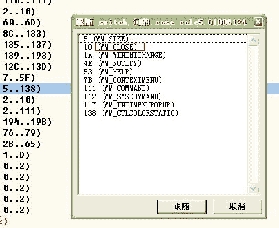
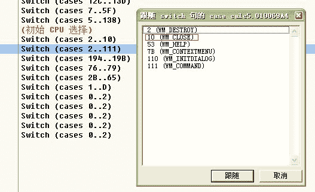
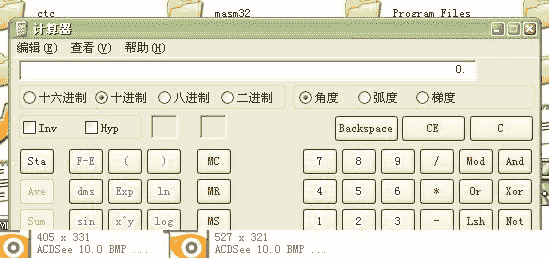

# 菜鸟 DIY---为计算器增加退出动画效果

> 原文：[`www.pediy.com/kssd/pediy10/75788.html`](https://www.pediy.com/kssd/pediy10/75788.html)

【文章标题】: 菜鸟 DIY---为计算器增加退出动画效果  
【文章作者】: stalker  
【作者邮箱】: zhangke\_1989 at hotmail dot com  
【软件名称】: calc.exe  
【下载地址】: 系统目录  
【操作平台】: Windows XP SP2  
【作者声明】: 只是感兴趣，没有其他目的。失误之处敬请诸位大侠赐教!  
\--------------------------------------------------------------------------------  
【详细过程】  
  学校的校园网慢得可以。以前我一直天真地认为，无法打开网页只有在掉线时才会发生，现在我终于醒悟了。  
  在电脑面前呆得实在是无聊，再次拿计算器来开刀，这次的目的是让它在退出的时候有点动画效果。  
  首先介绍一个 Windows API，名为 AnimateWindow，熟悉的可以跳过了。它的原型如下：  
  BOOL AnimateWindow(HWND hwnd,DWORD dwTime,DWORD dwFlags);  
  MSDN 对这个函数做了如此阐述：The AnimateWindow function enables you to produce special effects when showing   
  or hiding windows. There are four types of animation: roll, slide, collapse or expand, and alpha-blended fade.   
  简单的说就是该函数可以让你在显示或隐藏窗体的时候产生特别的效果，共有四种类型的动画。  
  参数 hwnd 是需要产生特效的窗口句柄，dwTime 为动画持续时间，dwFlags 代表使用何种动画。  
  主角介绍完了，下面正式开始------------------------------------>  
  大家都知道，要进行 DIY，首先得找对地方，我们要在计算器退出的时候产生一个动画效果，肯定得找到处理 WM\_CLOSE  
  消息的地方。OD 载入 calc.exe，右键->查找->所有分支，然后在任意一分支上点右键->列出 switch 的 case  
  列不了几次，我们就会找到，如图一所示  
  
  双击 WM\_CLOSE，就会来到相应的代码处  
  可能聪明的你会发现，在另一个 case 中也出现了 WM\_CLOSE，如图二  
  
  哪一个才是我们想找的呢？下个断点试试吧，分别双击来到各自代码处，然后下断，运行程序，再点 X 关闭程序，  
  断在哪个点哪个点就是了(^\_^)  
  实验证明，图一那个 case 是目标，点击它，来到这里  
  0100623F  |> \\A1 744D0101   mov     eax, dword ptr \[1014D74\]         ;  Case 10 (WM\_CLOSE) of switch 01006124  
  01006244  |.  33DB          xor     ebx, ebx  
  01006246  |.  3BC3          cmp     eax, ebx  
  01006248   . /74 11         je      short 0100625B  
  0100624A   . |53            push    ebx                              ; /lParam => 0  
  0100624B   . |53            push    ebx                              ; |wParam => 0  
  0100624C   . |6A 10         push    10                               ; |Message = WM\_CLOSE  
  0100624E   . |50            push    eax                              ; |hWnd  
  0100624F   . |FF15 3C110001 call    dword ptr \[<&USER32.SendMessageW>; \\SendMessageW  
  01006255   . |891D 744D0101 mov     dword ptr \[1014D74\], ebx  
  0100625B   > \\FF35 6C4D0101 push    dword ptr \[1014D6C\]              ; /hWnd = NULL  
  01006261   .  FF15 78110001 call    dword ptr \[<&USER32.DestroyWindo>; \\DestroyWindow  
  哈哈，我们只要把 0100623F 处的代码改为一个跳转，跳到我们自己的地方，然后再跳回来就可以了  
  现在就开始写我们自己的代码了吗？请别着急，还有一个问题，AnimateWindow 函数的第一个参数是窗口句柄，我们如何  
  得到计算器的主窗口句柄呢？在上一次 DIY 的时候我使用的方法是 GetForegroundWindow 来获得的，因为我实在没有想出更好的  
  方法，该方法不能够保证万无一失。  
  这次我们有很好的条件(^\_^)，请注意观察上面代码中 0100625B 处的代码  
  0100625B   > \\FF35 6C4D0101 push    dword ptr \[1014D6C\]  
  压入的是 DestroyWindow 函数的参数，而该参数就应当是计算器的主窗口句柄  
  稍微有经验的人都应该知道\[1014D6C\]相当于一个全局变量吧  
  由于我们要在 0100623F 处就让程序跳走，因此先在 0100623F 处下一个断点，运行程序，用 Spy++获得主窗口句柄，  
  点 X 关闭程序，断下来之后，在命令行输入 D 1014D6C，观察存储的值是否与 Spy++获得的窗口句柄一致。事实证明，果然是  
  一致的(^\_^)  
  下面开始找地方写代码了，我找了 010002ED 这个地方，由于计算器并没有导入 AnimateWindow 这个华丽的函数，因此需要用工具  
  或者手动增加导入函数。而我选择的是在代码中使用 LoadLibrary&GetProcAddress 这一黄金搭档来动态获得该函数的地址，  
  具体代码如下  
  010002ED    60              pushad                                   ;保存寄存器              
  010002EE    68 6C6C0000     push    6C6C  
  010002F3    68 33322E64     push    642E3233  
  010002F8    68 75736572     push    72657375  
  010002FD    8BC4            mov     eax, esp  
  010002FF    50              push    eax  
  01000300    FF15 24100001   call    dword ptr \[<&KERNEL32.LoadLibrar>; kernel32.LoadLibraryA  
  01000306    6A 77           push    77  
  01000308    68 696E646F     push    6F646E69  
  0100030D    68 61746557     push    57657461  
  01000312    68 416E696D     push    6D696E41  
  01000317    8BDC            mov     ebx, esp  
  01000319    53              push    ebx  
  0100031A    50              push    eax  
  0100031B    FF15 28100001   call    dword ptr \[<&KERNEL32.GetProcAdd>; kernel32.GetProcAddress  
  01000321    68 08000100     push    10008                            ; 动画效果为从下往上收拢  
  01000326    68 B80B0000     push    0BB8                             ; 动画时间为 3000ms  
  0100032B    FF35 6C4D0101   push    dword ptr \[1014D6C\]  
  01000331    FFD0            call    eax  
  01000333    83C4 1C         add     esp, 1C                          ;平衡堆栈  
  01000336    61              popad                                    ;恢复寄存器  
  01000337    A1 744D0101     mov     eax, dword ptr \[1014D74\]         ;原来的这行代码被修改为跳转了  
  0100033C  - E9 035F0000     jmp     01006244                         ;跳回原来的位置继续执行  
    
  最后再把  
  0100623F  |> \\A1 744D0101   mov     eax, dword ptr \[1014D74\]   
  修改为  
  0100623F   >-\\E9 A9A0FFFF   jmp     010002ED                          
    
  就大功告成了，最后保存到可执行文件试试吧  
  附上一个正在收拢的计算器  
  
    
  附件中包含我修改好的计算器  
\--------------------------------------------------------------------------------  
【经验总结】  
  本来想在启动的时候也弄一个效果，无奈太菜，没有弄出来，改天再想想。如果哪位朋友弄出来了，一定分享下(^\_^)  
  1 点早已过去，终于能够打开网页了，心情无比舒畅，可惜身体无比疲劳......  
    
\--------------------------------------------------------------------------------  
【版权声明】: 本文原创于看雪技术论坛, 转载请注明作者并保持文章的完整, 谢谢!  
  
                                                       2008 年 11 月 01 日 1:41:22 

上传的附件
|  || mycalc.rar  
 |