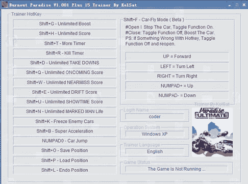
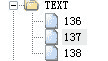
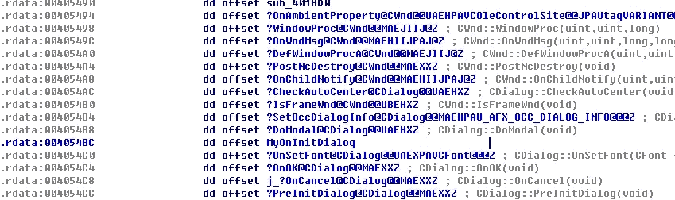
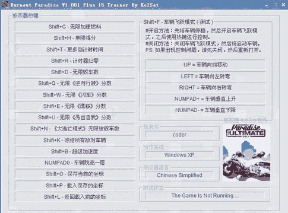

# 初入 Pediy

> 原文：[`www.pediy.com/kssd/pediy10/91274.html`](https://www.pediy.com/kssd/pediy10/91274.html)

在加壳脱壳板块看到这么个帖子:  
http://bbs.pediy.com/showthread.php?t=90927  
  
AsPack2.12 的壳 正好写过它的静态脱壳机 正好拿来脱之  
Peid 载入 查看 Microsoft Visual C++ 6.0 且为 mfc 程序 因为导入了 mfc42.dll  
  
双击运行:  
  
  
脱壳没问题 汉化的话 那么用资源工具修改一下就可以了  
  
于是乎用资源工具载入看看:  
  
  
发现程序已经自带了 英语 简体中文 繁体中文 三种资源  
开始猜测可能是判断系统语言版本后 然后使用对应的资源  
  
既然有现成的资源 那就 pediy 一回吧  
  
IDA 载入脱壳后的程序  
Ctrl+s 选择.rdata 节  
  
然后往下翻 寻找派生后的对话框的虚表  
  
  
  
CDialog::DoModal(void) 函数一般是不会被改写的 所以先找到了这个  
  
那么下个就是 BOOL CDialog:: OnInitDialog (void) 函数了 双击进入  
  
.text:00401310 MyOnInitDialog  proc near               ; DATA XREF: .rdata:004054BC o  
.text:00401310                 push    esi  
.text:00401311                 push    edi  
.text:00401312                 mov     esi, ecx  
.text:00401314                 call    ?OnInitDialog@CDialog@@UAEHXZ ; CDialog::OnInitDialog(void)  
.text:00401319                 mov     eax, \[esi+64h\]  
.text:0040131C                 mov     ecx, \[esi+20h\]  
.text:0040131F                 mov     edi, ds:SendMessageA  
.text:00401325                 push    eax             ; lParam  
.text:00401326                 push    1               ; wParam  
.text:00401328                 push    80h             ; Msg  
.text:0040132D                 push    ecx             ; hWnd  
.text:0040132E                 call    edi ; SendMessageA ; SetIcon  
.text:00401330                 mov     edx, \[esi+64h\]  
.text:00401333                 mov     eax, \[esi+20h\]  
.text:00401336                 push    edx             ; lParam  
.text:00401337                 push    0               ; wParam  
.text:00401339                 push    80h             ; Msg  
.text:0040133E                 push    eax             ; hWnd  
.text:0040133F                 call    edi ; SendMessageA ; SetIcon  
.text:00401341                 mov     ecx, esi  
.text:00401343                 call    sub\_401A20     //这里是用户添加的函数  
.text:00401348                 pop     edi  
.text:00401349                 mov     eax, 1  
.text:0040134E                 pop     esi  
.text:0040134F                 retn  
.text:0040134F MyOnInitDialog  endp  
  
然后我们进入 sub\_401A20 看看:  
.text:00401A20 sub\_401A20      proc near               ; CODE XREF: MyOnInitDialog+33 p  
.text:00401A20                 mov     eax, dword\_40703C  
.text:00401A25                 push    esi  
.text:00401A26                 mov     esi, ecx  
.text:00401A28                 push    eax  
.text:00401A29                 call    ?SetWindowTextA@CWnd@@QAEXPBD@Z ; CWnd::SetWindowTextA(char const \*)  
.text:00401A2E                 push    0  
.text:00401A30                 push    0  
.text:00401A32                 push    0  
.text:00401A34                 push    0  
.text:00401A36                 push    0  
.text:00401A38                 push    offset sub\_401390 ; 遍历进程  
.text:00401A3D                 call    ?AfxBeginThread@@YGPAVCWinThread@@P6AIPAX@Z0HIKPAU\_SECURITY\_ATTRIBUTES@@@Z ; AfxBeginThread(uint (\*)(void \*),void \*,int,uint,ulong,\_SECURITY\_ATTRIBUTES \*)  
.text:00401A42                 mov     ecx, esi  
.text:00401A44                 mov     \[esi+60h\], eax  
.text:00401A47                 call    sub\_401C10      ; 获得操作系统 计算机用户名信息  
.text:00401A4C                 mov     ecx, \[esi+20h\]  
.text:00401A4F                 push    ecx             ; hWnd  
.text:00401A50                 push    4057C000h  
.text:00401A55                 push    0               ; double  
.text:00401A57                 call    sub\_401150  
.text:00401A5C                 add     esp, 0Ch  
.text:00401A5F                 mov     ecx, esi  
.text:00401A61                 call    SetLanguage     ; 判断操作系统语言 设置对应的语言信息  
.text:00401A66                 call    ?AfxGetModuleState@@YGPAVAFX\_MODULE\_STATE@@XZ ; AfxGetModuleState(void)  
.text:00401A6B                 mov     eax, \[eax+4\]  
.text:00401A6E                 push    0               ; dwThreadId  
.text:00401A70                 mov     edx, \[eax+6Ch\]  
.text:00401A73                 push    edx             ; hmod  
.text:00401A74                 push    offset fn       ; lpfn  
.text:00401A79                 push    0Dh             ; idHook  
.text:00401A7B                 call    ds:SetWindowsHookExA  
.text:00401A81                 pop     esi  
.text:00401A82                 retn  
.text:00401A82 sub\_401A20      endp  
  
经过静态分析 可以看到.text:00401A61                 call    SetLanguage  
这个函数里是处理语言的 那么看看它是怎么处理的  
这个就直接上 F5 后的 C 语言的实现代码了  
  
BOOL \_\_fastcall SetLanguage(int a1)  
{  
  int v1; // esi@1  
  BOOL result; // eax@3  
  
  v1 = a1;  
  dword\_406020 = (dword\_406020 + 1) % 3;  
  if ( (dword\_406020 + 1) % 3 )  
  {  
    if ( (dword\_406020 + 1) % 3 == 1 )  
{  
  //简体中文  
}  
    else  
    {  
      result = (dword\_406020 + 1) % 3 - 2;  
      if ( !result )  
      {  
/英语/  
}  
    //下一个就为繁体中文了 省略  
}  
  
获得操作系统语言版本的 API 为 GetSystemDefaultLangID 返回值为一个 WORD  
  
然后自己算一算: 各个版本返回值% 3 的效果  
Chinese (PRC)      0x0804 % 3 = 0 ;  
English (United States)   0x0409 % 3 = 1 ;  
Chinese (Taiwan)     0x0404 % 3 = 2 ;  
  
根据此结果 那么就可以猜出 dword\_406020 里存放着 GetSystemDefaultLangID 的返回值  
  
后来经过简单测试 程序只是将此全局变量赋值为 -1 ;  
后来便再也没有管它 所以导致每次运行都是英语版本的  
  
那么 我们 pediy 的话 就是要调用一下 GetSystemDefaultLangID 并将返回值赋给 dword\_406020  
  
思路有了 看看导入表 没有导入 GetSystemDefaultLangID   
但有 LoadLibraryA 和 GetProcAddress 就够了  
  
找个空白地方 我找的是 404100  
那么开始编写伪代码了  
Push ecx   // 保存 this 指针  
    Call @f  
    szGetSystemDefaultLangID db ‘GetSystemDefaultLangID’,0  
@@:  
    Call @f  
    szKernel32.dll db ‘Kernel32.dll’,0  
@@:  
    Call LoadLibraryA  
    Push eax  
    Call GetProcAddress  
    Call eax  
    Movzx eax,ax  
    Mov MOV DWORD PTR DS:\[406020\],EAX   //将语言标识赋给该全局变量  
    Pop ecx  //恢复 this 指针  
    Jmp 00401311     //jmp 到 CDialog:: OnInitDialog (void) 入口处  
  
  
最后一步 就是将虚表中 CDialog:: OnInitDialog (void)的地址改为我们添加代码的地址  
也即是 404100 用 WinHex 等 16 进制就可以修改了  
  
修改好后 保存 运行之  
  
Ok,成功了 第一次 Pediy 技术含量不高 请各位多多包涵。