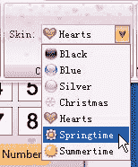
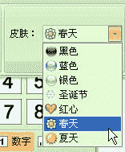
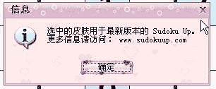
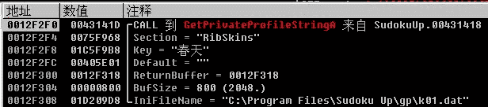
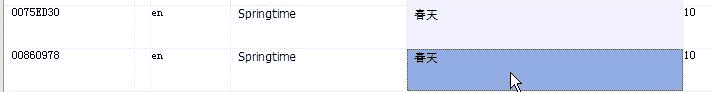
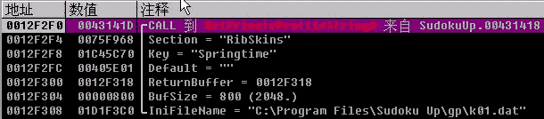
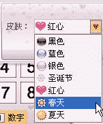

# PEDIY 技术在软件汉化中的应用一例

> 原文：[`www.pediy.com/kssd/pediy11/121564.html`](https://www.pediy.com/kssd/pediy11/121564.html)

PEDIY 技术在软件汉化中的应用一例  
作者：cntrump  
　　在汉化新世纪论坛上看到有一个帖子是申请汉化 Sudoku Up，这是个数独游戏软件，数独千变万化可以用来开发脑力，我还在读高中的时候在班上还曾经流行过一段时间。于是一时来了兴趣，就决定汉化试试。  
  软件没有什么难度，基本上只要读懂单词就能够把它拿下，可是偏偏有一处地方比较特殊，如图：  
  
  
我汉化为：  
  
  
　　每个项目都对应上了，看起来没有什么问题，但是在测试的时候发现，选择其他的皮肤都可以正常显示，但是当选择 “春天” 这个皮肤样式之后，程序就不正常了：  
  
  
　　这就怪了，为什么在原版中正常，在汉化版中其他皮肤也正常的情况，偏偏就“春天”这一项不正常了呢？经过查看安装目录下的文件发现，在 \\gp 目录中的 .dat 文件其实是 ini 格式的文件，用于存储信息，资源保存在 .rgf 文件中，.rgf 文件实质上是资源 DLL。程序通过读取 .dat 文件中的配置信息来加载资源 DLL 中的相应文件。  
在配置文件中有这样的信息（汉化后的配置文件）：  

代码:

```
 \[RibSkins\]
SPRINGTIME=春天
SUMMER2008=夏天

```

　　看起来也没有什么问题，看来答案只能从调试中找了。用 OD 载入主程序，对读取配置文件下断点：bp GetPrivateProfileStringA ，在运行程序，在切换到皮肤“春天”的时候程序被断下，查看此时的堆栈：  
  
  
这下明白了，程序读取的 Key 是“春天”，而配置文件中没有这一项，自然就出错了。明显的汉化过度，在原程序中搜索“春天”对应的字符串，只有两处：  
  
  
　　经过试验发现，要使程序切换到“春天”皮肤时不出错，这两项必须不能被汉化，这样就得出了一条结论：程序是直接使用界面上的 “Springtime”字符串来读取配置文件中的配置，因为界面上的 Springtime 和配置文件中的 SPRINGTIME 是一样的，而配置文件又不区分大小写，所以作者利用这一特点在读取配置文件的时候偷了个懒，直接引用了界面上的字符串，假如被汉化了，自然就得不到准确的值了。  
  再看在原版程序中的：  
  
　　我在 OD 中试着把“春天”改为 “Springtime” 然后再切换到“春天”皮肤，程序能正常换肤了。  
　　这下有办法了，在调用 GetPrivateProfileString 之前，先判断一下 Key 的值，如果是“春天”那么就传入 “Springtime” ，这样程序就能得到正确的调用了。  
　　先说一下，这个游戏是用 Delphi 写的，Delphi 用的是面向对象的技术，也就是说读取 Ini 值的方法是类中的一个成员函数，程序中所有读取 Ini 都会使用到那个成员函数，所以要修改的地方只有一处：  
代码:

```
1.  004313F2    50              push eax
2.  004313F3    68 00080000     push 0x800
3.  004313F8    8D85 00F8FFFF   lea eax,dword ptr ss:\[ebp-0x800\]
4.  004313FE    50              push eax
5.  004313FF    8B45 0C         mov eax,dword ptr ss:\[ebp+0xC\]
6.  00431402    E8 ED49FDFF     call SudokuUp.00405DF4
7.  00431407    50              push eax
8.  00431408    8BC7            mov eax,edi
9.  0043140A    E8 E549FDFF     call SudokuUp.00405DF4
10.  0043140F    50              push eax       ;Key   <-就是这个
11.  00431410    8BC6            mov eax,esi
12.  00431412    E8 DD49FDFF     call SudokuUp.00405DF4
13.  00431417    50              push eax      ;Section
14.  00431418    E8 CB71FDFF     call <jmp.&kernel32.GetPrivateProfileStr>

```

这就是类用来读取 Ini 文件的函数，call SudokuUp.00405DF4 是用于检查参数是否为空。要修改的地方在 Key 入栈的地方：  
代码:

```
1.  0043140F    50              push eax

```

在 push 之前，先跳转到一个地方，然后在那判断 eax 的内容，如果 eax 指向的是“春天”，则把 eax 指向的字符串改为 “Springtime”，然后再跳回来。  
修改如下：  
代码:

```
1.  0043140F    50              push eax
2.  00431410    8BC6            mov eax,esi
3.  00431412    E8 DD49FDFF     call SudokuUp.00405DF4

```

修改为：  
代码:

```
1.  0043140F     /E9 EC054300          jmp \_SudokuU.00861A00 ;跳走
2.  00431414     |90                   nop
3.  00431415     |90                   nop
4.  00431416     |90                   nop

```

跳到下面的地方，然后修改：  
“春天”两个汉字的 ASCII 码为 0xECCCBAB4  
代码:

```
1.  00861A00      8138 B4BACCEC        cmp dword ptr ds:\[eax\],0xECCCBAB4
2.  00861A06      74 0D                je short \_SudokuU.00861A15 ;如果是“春天”，则先转换为 “Springtime”
3.  00861A08      50                   push eax
4.  00861A09      8BC6                 mov eax,esi
5.  00861A0B      E8 E443BAFF          call \_SudokuU.00405DF4
6.  00861A10    ^ E9 01FABCFF          jmp \_SudokuU.00431416        ;完了就跳回
7.  00861A15      C640 FC 0A           mov byte ptr ds:\[eax-0x4\],0xA    ;Delphi 字串是以长度标识来表示字符串长度，而不是以空作为结尾，所以先更改长度标识，再逐个更改字符
8.  00861A19      C600 53              mov byte ptr ds:\[eax\],0x53        ;S
9.  00861A1C      C640 01 70           mov byte ptr ds:\[eax+0x1\],0x70    ;p
10.  00861A20      C640 02 72           mov byte ptr ds:\[eax+0x2\],0x72    ;r
11.  00861A24      C640 03 69           mov byte ptr ds:\[eax+0x3\],0x69    ;i
12.  00861A28      C640 04 6E           mov byte ptr ds:\[eax+0x4\],0x6E    ;n
13.  00861A2C      C640 05 67           mov byte ptr ds:\[eax+0x5\],0x67    ;g
14.  00861A30      C640 06 74           mov byte ptr ds:\[eax+0x6\],0x74    ;t
15.  00861A34      C640 07 69           mov byte ptr ds:\[eax+0x7\],0x69    ;i
16.  00861A38      C640 08 6D           mov byte ptr ds:\[eax+0x8\],0x6D    ;m
17.  00861A3C      C640 09 65           mov byte ptr ds:\[eax+0x9\],0x65    ;e
18.  00861A40    ^ EB C6                jmp short \_SudokuU.00861A08        ;改完就跳上去入栈

```

保存更改，再运行修改后的程序：  
  
界面上可以是中文而又不影响皮肤切换了。搞定！  
  
如果你对这个游戏感兴趣，可以在这里下载到汉化版。  
汉化新世纪：  
  
[Sudoku Up 2010](http://www.hanzify.org/software/12973.html)

上传的附件
|  || PEDIY 技术在软件汉化中的应用一例.pdf  
 |