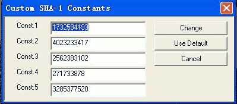

# 给 Hash 计算器增加自定义 SHA-1 初始化常数功能

> 原文：[`www.pediy.com/kssd/pediy08/pediy8-259.htm`](https://www.pediy.com/kssd/pediy08/pediy8-259.htm)

使用工具：PEid, Stud\_PE, ResourceHacker, OllyDbg  
  
  
0. 背景  
  
　　SHA-1 是“安全散列算法”的简称，该算法预先给定 5 个 32-bit 的整数（下称为初始化  
常数），用待加密的信息串对其进行一定变换，最后联成 160-bit 的散列值输出。正统  
SHA-1 算法的初始化常数是（C 语言形式表示）：  
  
      0x67452301, 0xEFCDAB89, 0x98BADCFE, 0x10325476, 0xC3D2E1F0  
  
但有的时候可能有特殊需求，希望使用别的 5 个数值作为初始化常数来进行计算，这时网  
上普遍流行的 Hash 计算器就无能为力了。在本文中，将尝试给一个 Hash 计算器增加自定义  
这些常数的功能。  
  
　　原软件下载地址：http://www.pediy.com/tools/Cryptography/Hash/HashCalc.rar  
  
  
  
1. PE-DIY  
  
　　这个软件用 PEid 检查是 VC6 写的程序，在上述下载地址的同一页面还有另外两款 Hash  
计算器，但都加了 Aspack 的壳，这也是选择本程序下手的主要原因。  
  
　　我们打算在主界面上新建一个按钮，按下此按钮弹出一个对话框，可以在其中进行修  
改 SHA-1 常数的功能，具体情形如下图所示：  
  
  
图中上部是程序主界面，标题为“Custom”的按钮就是我们新增加的，按下此按钮将弹出  
一个如下部所示的对话框，在 5 个文本框中可以分别输入 5 个初始化常数，按下“Change”  
按钮将文本框中的新数值写入到原程序并关闭对话框，按下“Use Default”按钮将把文  
本框中的数值设置为默认值（0x67452301 等）——这是为了在不经意间把数据改乱时可以  
快速恢复到默认的状态，而按下“Cancel”按钮则直接关闭对话框，放弃写入新数值。此  
外，对话框初始化时会将程序中这些常数的现行值读入并显示到文本框中，便于核对。  
  
　　下面来具体实现这些功能。  
  
　  (1) 增加所需资源  
  
　　用 ResHacker 打开原程序。在主界面上增加一个按钮不成问题，找到代表主界面的对  
话框，直接在上面插入一个按钮并对应调整相关控件的尺寸就行了。关键是添加对话框。  
ResHacker 有个缺点，只能从一个现有的.res 文件中添加对话框，而不能白手起家新建一  
个对话框。如果手边没有创建资源的工具，这还真是件恼人的事。幸好还可以用变通的办  
法：在原程序中随便找一个对话框资源，去掉原来的控件、调整大小、新增自己的控件等  
等，把它变成我们的新对话框的样子，完了之后选择“另存为.res 文件”，下面就从这个  
文件中导入新的对话框。这里要注意的是，对话框的资源 ID 直接在资源脚本的界面是改不  
了的，改了这里只会导致脚本编译无法通过。要改这个 ID，只有通过“操作”菜单中选择  
“重命名资源”才可以输入新的 ID。等导入新对话框工作完成以后，还必须点击“编译脚  
本”按钮，这样在保存文件的时候才能把新加的资源信息写到原文件中去。  
  
　　改动过的原程序主界面资源脚本如下：  
  
\============================================================  
102 DIALOGEX 0, 0, 256, 304  
STYLE WS\_MINIMIZEBOX | WS\_POPUP | WS\_VISIBLE | WS\_CAPTION | WS\_SYSMENU | WS\_THICKFRAME  
EXSTYLE WS\_EX\_CLIENTEDGE | WS\_EX\_APPWINDOW  
CAPTION "HashCalc"  
LANGUAGE LANG\_ENGLISH, SUBLANG\_ENGLISH\_US  
FONT 8, "MS Sans Serif"  
{  
   /\* 此部分略 \*/  
   CONTROL "", 1011, EDIT, ES\_LEFT | ES\_AUTOHSCROLL | ES\_READONLY | WS\_CHILD | WS\_VISIBLE | WS\_BORDER, 63, 97, 145, 12   
   /\* 改动这一句，原来的 186 改成现在的 145，即缩小 SHA-1 文本框的宽度 \*/  
   /\* 此部分略 \*/  
   CONTROL "Custom...", 5031, BUTTON, BS\_PUSHBUTTON | WS\_CHILD | WS\_VISIBLE | WS\_TABSTOP, 211, 97, 37, 12  
   /\* 新增加这一句，即添加新按钮 \*/   
}  
\============================================================  
  
　　新增加的对话框资源脚本如下：  
  
\============================================================  
500 DIALOGEX 0, 0, 256, 86  
STYLE DS\_MODALFRAME | WS\_POPUP | WS\_VISIBLE | WS\_CAPTION | WS\_SYSMENU | WS\_THICKFRAME  
EXSTYLE WS\_EX\_CLIENTEDGE  
CAPTION "Custom SHA-1 Constants"  
LANGUAGE LANG\_ENGLISH, SUBLANG\_ENGLISH\_US  
FONT 8, "MS SANS SERIF"  
{  
   CONTROL "", 501, EDIT, ES\_LEFT | ES\_NUMBER | WS\_CHILD | WS\_VISIBLE | WS\_BORDER | WS\_TABSTOP, 51, 4, 107, 14   
   CONTROL "", 502, EDIT, ES\_LEFT | ES\_NUMBER | WS\_CHILD | WS\_VISIBLE | WS\_BORDER | WS\_TABSTOP, 51, 20, 107, 14   
   CONTROL "", 503, EDIT, ES\_LEFT | ES\_NUMBER | WS\_CHILD | WS\_VISIBLE | WS\_BORDER | WS\_TABSTOP, 51, 36, 107, 14   
   CONTROL "", 504, EDIT, ES\_LEFT | ES\_NUMBER | WS\_CHILD | WS\_VISIBLE | WS\_BORDER | WS\_TABSTOP, 51, 52, 107, 14   
   CONTROL "", 505, EDIT, ES\_LEFT | ES\_NUMBER | WS\_CHILD | WS\_VISIBLE | WS\_BORDER | WS\_TABSTOP, 51, 68, 107, 14   
   CONTROL "Const.1", -1, STATIC, SS\_LEFT | WS\_CHILD | WS\_VISIBLE | WS\_GROUP, 13, 4, 32, 14   
   CONTROL "Const.2", -1, STATIC, SS\_LEFT | WS\_CHILD | WS\_VISIBLE | WS\_GROUP, 13, 20, 32, 14   
   CONTROL "Const.3", -1, STATIC, SS\_LEFT | WS\_CHILD | WS\_VISIBLE | WS\_GROUP, 13, 36, 32, 14   
   CONTROL "Const.4", -1, STATIC, SS\_LEFT | WS\_CHILD | WS\_VISIBLE | WS\_GROUP, 13, 52, 32, 14   
   CONTROL "Const.5", -1, STATIC, SS\_LEFT | WS\_CHILD | WS\_VISIBLE | WS\_GROUP, 13, 68, 32, 14   
   CONTROL "Change", 520, BUTTON, BS\_PUSHBUTTON | WS\_CHILD | WS\_VISIBLE | WS\_TABSTOP, 168, 4, 82, 14   
   CONTROL "Use Default", 521, BUTTON, BS\_PUSHBUTTON | WS\_CHILD | WS\_VISIBLE | WS\_TABSTOP, 168, 20, 82, 14   
   CONTROL "Cancel", 522, BUTTON, BS\_PUSHBUTTON | WS\_CHILD | WS\_VISIBLE | WS\_TABSTOP, 168, 36, 82, 14   
}  
\============================================================  
  
这里把输入新常数的文本框设置了 ES\_NUMBER 风格，因而只能输入十进制数值。这其实是  
有些“偷懒”的成分的，本来最自然的是设置成允许输入 16 进制数值，但那样的话还要涉  
及控件的子类化，增加额外的代码。  
  
　　(2) 增加新资源的响应代码  
  
　　首先自然是在原文件中找一块空间来存放新增的代码，由于预先无法估计需要增加的  
代码有多少，为了保险起见，在文件尾新建一个区段作为添加代码的空间。用 Stud\_PE 可  
以完成这个功能，也可以用 LordPE。这里，把新区段的 VirtualSize 和 RawSize 都设置为  
0x1000（4KB）。  
  
　　让我们考虑如何使代码实现我们预期的效果，按下主界面上的“Custom...”按钮等  
于向主窗口发送 wParam 为 5031 的 WM\_COMMAND 消息，主窗口收到这个消息后应该调用  
DialogBoxParam 建立 ID 等于 500 的对话框，取得文本框中的数值和向文本框中设置数值可  
以使用 G(S)etDlgItemInt，最后用 EndDialog 关闭对话框。  
  
　　对于这里用到的 API 函数，我们原则上尽量考虑从原文件的导入表中寻找已有的，而  
不是新增导入函数。因为导入表是块难啃的骨头，修改它不象修改区段信息那么简单，不  
能直接在原来的导入表中插入新的导入函数信息，象 Stud\_PE 等工具对于新增导入函数的  
请求都是采用新建一个区段来存放导入信息的方法，不仅显得拖泥带水，而且一不小心就  
会误操作。  
  
　　用 Stud\_PE 查看原文件导入表可以找到 EndDialog，但却没有 DialogBoxParam，只有一  
个十分“鸡肋”的 CreateDialogIndirectParam，如果要用它建立对话框，如何把资源调  
到内存还是个问题，何况这样建立的对话框还不能用 EndDialog 关闭。用 CreateWindowEx  
也不行，这样无法把定义好的对话框资源当作一个参数提供。幸运的是，原导入表中还有  
GetModuleHandle 和 GetProcAddress，这可是两个至关重要的函数！这意味着可以先获取  
user32.dll 等导入 dll 的句柄，然后再获得其中 DialogBoxParam 等函数的地址，以间接的  
方式调用 API！  
  
　　接下来就是找到原程序中对 WM\_COMMAND 消息的处理代码，以便在此处用我们的代码进  
行挂钩。用 OllyDbg 载入程序，F9 运行后在“窗口”栏目找到主窗口，对它设置  
WM\_COMMAND 消息断点。按下“Custom...”按钮后中断在如下地方：（Alt+F9）  
  
  
\====================以下是代码==================  
  
0044E835  |.  8945 FC       mov     \[ebp-4\], eax  
0044E838  |>  8B45 FC       mov     eax, \[ebp-4\]  
0044E83B  |.  5E            pop     esi  
0044E83C  |.  C9            leave  
0044E83D  \\.  C2 0C00       retn    0C  
0044E840  /$  B8 14814500   mov     eax, 00458114  
0044E845  |.  E8 2636FCFF   call    00411E70  
0044E84A  |.  83EC 54       sub     esp, 54  
0044E84D  |.  8365 F0 00    and     dword ptr \[ebp-10\], 0  
0044E851  |.  53            push    ebx  
0044E852  |.  8B5D 08       mov     ebx, \[ebp+8\]  
0044E855  |.  56            push    esi  
0044E856  |.  57            push    edi  
0044E857  |.  81FB 11010000 cmp     ebx, 111                         ;  Switch (cases 6..111)  
0044E85D  |.  8BF9          mov     edi, ecx  
0044E85F  |.  75 18         jnz     short 0044E879  
0044E861  |.  FF75 10       push    dword ptr \[ebp+10\]               ;  Case 111 (WM\_COMMAND) of switch 0044E857  
0044E864  |.  8B07          mov     eax, \[edi\]  
0044E866  |.  FF75 0C       push    dword ptr \[ebp+C\]  
  
\====================以上是代码==================  
  
  
程序中断在 44E835 处，再往下看就出现了眼熟的常数 111，看 OD 给它加的注释，这十有八  
九应该就是处理 WM\_COMMAND 消息的分支，这次尝试在 44E861 处下断，再按“Custom...”  
按钮，果然中断了！那么我们就选择这里作为挂钩的地方吧：用一个 jmp 语句跳到我们的  
代码处。由于长 jmp 有 5 个字节，将覆盖掉原有的 push \[ebp+10\]和 mov eax, \[edi\]两句，  
这两句应该被转移到我们的代码中。好了，废话不多说了，将这里改成打算去的地方，我  
是把它改成 jmp 474800——新区段是 474000 到 474FFF——而在 474800 处写入：  
  
  
\====================以下是代码==================  
  
00474800    817D 0C A713000>cmp     dword ptr \[ebp+C\], 13A7          ; 判断按下的是不是“Custom”按钮，\[ebp+0C\]中是 wParam  
00474807    75 5A           jnz     short 00474863                   ; 不是，则没事发生  
00474809    60              pushad                                   ; 保存现场  
0047480A    68 00404700     push    00474000                         ; ASCII "kernel32.dll"  
0047480F    FF15 CC914500   call    \[<&KERNEL32.GetModuleHandleA>\]   ; kernel32.GetModuleHandleA  
00474815    A3 004F4700     mov     \[474F00\], eax  
0047481A    68 0D404700     push    0047400D                         ; ASCII "user32.dll"  
0047481F    FF15 CC914500   call    \[<&KERNEL32.GetModuleHandleA>\]   ; kernel32.GetModuleHandleA  
00474825    A3 044F4700     mov     \[474F04\], eax                    ; 获取 user32.dll 句柄  
0047482A    6A 00           push    0  
0047482C    FF15 CC914500   call    \[<&KERNEL32.GetModuleHandleA>\]   ; kernel32.GetModuleHandleA  
00474832    A3 084F4700     mov     \[474F08\], eax                    ; 获取 hInstance 作为下面的 DialogBoxParam 的参数  
00474837    68 18404700     push    00474018                         ; ASCII "DialogBoxParamA"  
0047483C    FF35 044F4700   push    dword ptr \[474F04\]  
00474842    FF15 80914500   call    \[<&KERNEL32.GetProcAddress>\]     ; kernel32.GetProcAddress  
00474848    6A 00           push    0  
0047484A    68 6D484700     push    0047486D  
0047484F    FFB5 D4000000   push    dword ptr \[ebp+D4\]               ; 父窗口句柄  
00474855    68 F4010000     push    1F4  
0047485A    FF35 084F4700   push    dword ptr \[474F08\]  
00474860    FFD0            call    eax                              ; 调用 DialogBoxParamA  
00474862    61              popad                                    ; 调用完毕恢复现场  
00474863    FF75 10         push    dword ptr \[ebp+10\]               ; 执行被覆盖的代码  
00474866    8B07            mov     eax, \[edi\]  
00474868  - E9 F99FFDFF     jmp     0044E866                         ; 回到挂钩的下一句  
0047486D    55              push    ebp                              ; 窗口过程  
0047486E    8BEC            mov     ebp, esp  
00474870    8B45 0C         mov     eax, \[ebp+C\]  
00474873    3D 10010000     cmp     eax, 110                         ; WM\_INITDIALOG 分支，在这里获取一些重要 API 的地址  
00474878    0F85 9F000000   jnz     0047491D  
0047487E    68 28404700     push    00474028                         ; ASCII "GetDlgItemInt"  
00474883    FF35 044F4700   push    dword ptr \[474F04\]  
00474889    FF15 80914500   call    \[<&KERNEL32.GetProcAddress>\]     ; kernel32.GetProcAddress  
0047488F    A3 0C4F4700     mov     \[474F0C\], eax  
00474894    68 36404700     push    00474036                         ; ASCII "SetDlgItemInt"  
00474899    FF35 044F4700   push    dword ptr \[474F04\]  
0047489F    FF15 80914500   call    \[<&KERNEL32.GetProcAddress>\]     ; kernel32.GetProcAddress  
004748A5    A3 104F4700     mov     \[474F10\], eax  
004748AA    6A 00           push    0  
004748AC    FF35 09C34100   push    dword ptr \[41C309\]               ; 将 SHA-1 常数读出并依次显示到 5 个对话框中  
004748B2    68 F5010000     push    1F5  
004748B7    FF75 08         push    dword ptr \[ebp+8\]  
004748BA    FF15 104F4700   call    \[474F10\]                         ; SetDlgItemInt  
004748C0    6A 00           push    0  
004748C2    FF35 10C34100   push    dword ptr \[41C310\]  
004748C8    68 F6010000     push    1F6  
004748CD    FF75 08         push    dword ptr \[ebp+8\]  
004748D0    FF15 104F4700   call    \[474F10\]  
004748D6    6A 00           push    0  
004748D8    FF35 17C34100   push    dword ptr \[41C317\]  
004748DE    68 F7010000     push    1F7  
004748E3    FF75 08         push    dword ptr \[ebp+8\]  
004748E6    FF15 104F4700   call    \[474F10\]  
004748EC    6A 00           push    0  
004748EE    FF35 1EC34100   push    dword ptr \[41C31E\]  
004748F4    68 F8010000     push    1F8  
004748F9    FF75 08         push    dword ptr \[ebp+8\]  
004748FC    FF15 104F4700   call    \[474F10\]  
00474902    6A 00           push    0  
00474904    FF35 25C34100   push    dword ptr \[41C325\]  
0047490A    68 F9010000     push    1F9  
0047490F    FF75 08         push    dword ptr \[ebp+8\]  
00474912    FF15 104F4700   call    \[474F10\]  
00474918    E9 35010000     jmp     00474A52  
0047491D    3D 11010000     cmp     eax, 111                         ; WM\_COMMAND 分支  
00474922    0F85 18010000   jnz     00474A40  
00474928    0FB745 10       movzx   eax, word ptr \[ebp+10\]  
0047492C    3D 08020000     cmp     eax, 208                         ; 按下 Change 按钮  
00474931    0F85 83000000   jnz     004749BA  
00474937    6A 00           push    0  
00474939    6A 00           push    0  
0047493B    68 F5010000     push    1F5  
00474940    FF75 08         push    dword ptr \[ebp+8\]  
00474943    FF15 0C4F4700   call    \[474F0C\]                         ; GetDlgItemInt  
00474949    A3 09C34100     mov     \[41C309\], eax                    ; 依次取得文本框中的常数并写入到程序中  
0047494E    6A 00           push    0  
00474950    6A 00           push    0  
00474952    68 F6010000     push    1F6  
00474957    FF75 08         push    dword ptr \[ebp+8\]  
0047495A    FF15 0C4F4700   call    \[474F0C\]  
00474960    A3 10C34100     mov     \[41C310\], eax  
00474965    6A 00           push    0  
00474967    6A 00           push    0  
00474969    68 F7010000     push    1F7  
0047496E    FF75 08         push    dword ptr \[ebp+8\]  
00474971    FF15 0C4F4700   call    \[474F0C\]  
00474977    A3 17C34100     mov     \[41C317\], eax  
0047497C    6A 00           push    0  
0047497E    6A 00           push    0  
00474980    68 F8010000     push    1F8  
00474985    FF75 08         push    dword ptr \[ebp+8\]  
00474988    FF15 0C4F4700   call    \[474F0C\]  
0047498E    A3 1EC34100     mov     \[41C31E\], eax  
00474993    6A 00           push    0  
00474995    6A 00           push    0  
00474997    68 F9010000     push    1F9  
0047499C    FF75 08         push    dword ptr \[ebp+8\]  
0047499F    FF15 0C4F4700   call    \[474F0C\]  
004749A5    A3 25C34100     mov     \[41C325\], eax  
004749AA    6A 00           push    0  
004749AC    FF75 08         push    dword ptr \[ebp+8\]  
004749AF    FF15 20944500   call    \[<&USER32.EndDialog>\]            ; USER32.EndDialog  
004749B5    E9 9A000000     jmp     00474A54  
004749BA    3D 09020000     cmp     eax, 209                         ; 按下 Use Default 按钮  
004749BF    75 6B           jnz     short 00474A2C  
004749C1    6A 00           push    0  
004749C3    68 01234567     push    67452301  
004749C8    68 F5010000     push    1F5  
004749CD    FF75 08         push    dword ptr \[ebp+8\]  
004749D0    FF15 104F4700   call    \[474F10\]                         ; 将文本框中的数值设置为 SHA-1 的默认值  
004749D6    6A 00           push    0  
004749D8    68 89ABCDEF     push    EFCDAB89  
004749DD    68 F6010000     push    1F6  
004749E2    FF75 08         push    dword ptr \[ebp+8\]  
004749E5    FF15 104F4700   call    \[474F10\]  
004749EB    6A 00           push    0  
004749ED    68 FEDCBA98     push    98BADCFE  
004749F2    68 F7010000     push    1F7  
004749F7    FF75 08         push    dword ptr \[ebp+8\]  
004749FA    FF15 104F4700   call    \[474F10\]  
00474A00    6A 00           push    0  
00474A02    68 76543210     push    10325476  
00474A07    68 F8010000     push    1F8  
00474A0C    FF75 08         push    dword ptr \[ebp+8\]  
00474A0F    FF15 104F4700   call    \[474F10\]  
00474A15    6A 00           push    0  
00474A17    68 F0E1D2C3     push    C3D2E1F0  
00474A1C    68 F9010000     push    1F9  
00474A21    FF75 08         push    dword ptr \[ebp+8\]  
00474A24    FF15 104F4700   call    \[474F10\]  
00474A2A    EB 26           jmp     short 00474A52  
00474A2C    3D 0A020000     cmp     eax, 20A                         ; 按下 Cancel 按钮  
00474A31    75 1F           jnz     short 00474A52  
00474A33    6A 00           push    0  
00474A35    FF75 08         push    dword ptr \[ebp+8\]  
00474A38    FF15 20944500   call    \[<&USER32.EndDialog>\]            ; USER32.EndDialog  
00474A3E    EB 14           jmp     short 00474A54  
00474A40    83F8 10         cmp     eax, 10                          ; WM\_CLOSE 分支  
00474A43    75 0D           jnz     short 00474A52  
00474A45    6A 00           push    0  
00474A47    FF75 08         push    dword ptr \[ebp+8\]  
00474A4A    FF15 20944500   call    \[<&USER32.EndDialog>\]            ; USER32.EndDialog  
00474A50    EB 02           jmp     short 00474A54  
00474A52    33C0            xor     eax, eax  
00474A54    C9              leave  
00474A55    C2 1000         retn    10  
  
\====================以上是代码==================  
  
  
写完这些代码后，将改动复制到可执行文件中就行了。  
  
　　需要说明的几处地方：  
  
　　I)　DialogBoxParam 需要的两个参数 hInstance 和 hWndOwner，程序中都无法即时提  
供，前者还比较好办，只要用参数 NULL 再调用 GetModuleHandle 就可以了，但后者就有些  
麻烦了，实在想不到有哪个 API 可以即时获取，在实践中基于一种思想：主窗口句柄需要  
用做参数来建立各种控件子窗口，因此它必定会在堆栈的某个地方出现，在 OD 的  
“窗口”查看栏中查看到句柄的值后，再在堆栈中搜索这个值，结果才发现在\[ebp+0D4\]  
的位置保存着一份主窗口句柄。  
  
　　II)　为了更改 SHA-1 常数，必须知道这些常数在代码段的什么位置，换言之就是需要  
知道往什么地方写入数据，用 OD 中“查找常量”功能查找特征常量如 0xC3D2E1F0 查到的位  
置有 3 处，怎么办呢，这时 PEid 又发挥作用了，用分析密码学算法插件查到 SHA-1 算法在地  
址 41CE56 处，于是判断正确的位置是在这个地址往上的一处。当然这需要验证。验证的方  
法也很简单，新程序完工后运行一份原程序对同一个字符串算 Hash，其他方法算出来的值  
都一样，只有 SHA-1 不同，就证明我们的操作是正确的。  
  
　　III)　获取 user32.dll 等库的句柄需要提供文件名，获取函数地址需要提供函数名，  
总之就是需要提供一些字符串，这些字符串也写在新建的区里，实践中是写到 474000 开始  
的地方（新区段的起点），到了写入文件的时候，这些改动也要写进去。  
  
　　IV)　调用导入表里的函数方式是间接调用，机器码是 FF15，不要错写成直接调用的  
E8，譬如在 Stud\_PE 里查到导入表中 EndDialog 的 RVA 是 459420 那么指令应该是  
call \[459420\]，实际上很好理解，导入表中怎么可能包含可执行代码呢。（VC 生成的程  
序好象没有跳板，直接 call 向导入表中）  
  
　　V)　原始汇编方式有个难点就是确定跳转的距离，如果跳转的位置无法预计，最好  
都先汇编成长跳转留下 5 个字节的空间，即使以后改短跳转，空出来的字节填些 nop 就行，  
总比先汇编短跳转后发现必须改长跳转好。  
  
　　VI)　最后也是最容易被忽略的一点：由于我们所做的操作是往原来的代码段中读写  
数据，改完之后必须再修改 PE 文件头，把代码段的属性改成可读写，程序才能正常运行。 

 4dd466d0e1e0cc123afbe504da2462ca