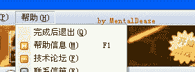

# 给迅雷加上完成后退出

> 原文：[`www.pediy.com/kssd/pediy10/88035.html`](https://www.pediy.com/kssd/pediy10/88035.html)

1，用 Resouce Hacker 给迅雷的帮助菜单加上 一个 “完成后退出"  
  
2，给 ”完成后退出” 加上消息处理。  
  
     第二步有点麻烦，迅雷是用 MFC 写的，里面有个东东叫消息映射表，不能直接添加项，如果替换其他菜单在消息映射表里面的项，又感觉不是很完美，所以，我用一个很 WS 的方法：  
     HOOK AfxFindMessageEntry，发现是自己 菜单 的消息，就发送一个自己构造的 MsgEntry 结构，欺骗下迅雷。  
  
3，找到迅雷下载任务完成的处理例程，加上自己的代码，判断是否退出。  
  
所有代码用 DLL 完成，直接在迅雷里面搞太麻烦了。  
  
OK，将迅雷 Thunder5.exe 入口加上 LoadLibrary 加载我的 DLL。  
  
最终效果如下(迅雷版本：5.8.13.699)  
  

上传的附件
|  || HookXunlei.rar  
 |