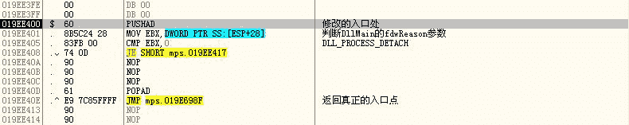
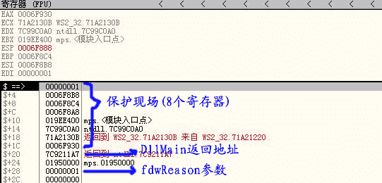
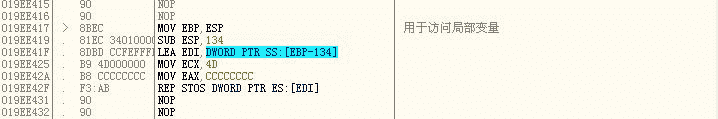
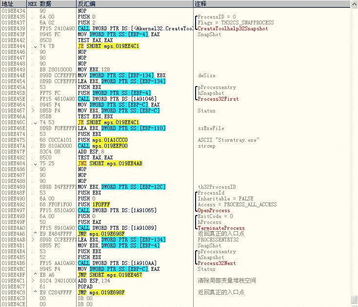

# 给暴风影音添加主程序关闭时自动结束传输进程功能

> 原文：[`www.pediy.com/kssd/pediy12/141485.html`](https://www.pediy.com/kssd/pediy12/141485.html)

【文章标题】:给暴风影音添加主程序关闭时自动结束传输进程功能  
【文章作者】:lpfei  
【软件名称】:暴风影音 Build 版本:3.11.9.12  MEE 版本:3.11.7.15  
【下载地址】:http://115.com/file/aqauicsz#StormII(版本 3.11.9.12).rar  
【使用工具】:OllyDbg,LordPE,Rebaser.exe,Vc,WinHex  
【操作平台】:Windows XP Sp2  
\--------------------------------------------------------------------------------  
【详细过程】  
暴风影音没有提供主程序关闭时结束 Stormtray.exe 功能，Stormtray.exe 会占用宽带资源，于是就想让它随主程序"同死"。  
参考不问年少前辈的这篇文章[`bbs.pediy.com/showthread.php?t=82841`](http://bbs.pediy.com/showthread.php?t=82841)。在此表示感谢。  
我发现暴风播放控件 mps.dll 每次都加载到 0x1950000 处，可以在它的入口函数处添加"同死"代码。可是它的 ImageBase 为 0x10000000，于是可以用 Rebaser.exe 把 ImageBase 修改成 0x1950000，修改 mps.dll 的重定位表，这样就没有地址重定向的问题了。  
然后就可以在 dll 入口处添加自己的代码了，因为我比较菜，把结束代码先用 c 写了一遍(其实也是在网上抄的)，参考反汇编代码写 dll 入口代码。  
#include <windows.h>  
#include <Tlhelp32.h>  
main()  
{  
  HANDLE SnapShot,ProcessHandle;  
  SHFILEINFO shSmall;  
  PROCESSENTRY32 ProcessInfo;   
  BOOL Status;  
  char msg\[20\]={"explorer.exe"}; //可以在此添加需要关闭的进程名称  
  SnapShot = CreateToolhelp32Snapshot(TH32CS\_SNAPPROCESS,0);  
  if(SnapShot!=NULL)   
  {  
    ProcessInfo.dwSize=sizeof(ProcessInfo); //设置 ProcessInfo 的大小  
    Status=Process32First(SnapShot,&ProcessInfo);  
    while(Status)  
    {  
        if(!strcmp(msg,ProcessInfo.szExeFile))   
        {  
          //获取进程句柄，强行关闭  
          ProcessHandle=OpenProcess(PROCESS\_ALL\_ACCESS,FALSE,ProcessInfo.th32ProcessID);  
          TerminateProcess(ProcessHandle,0);  
                  break;  
        }  
        //获取下一个进程的信息  
        Status=Process32Next(SnapShot,&ProcessInfo);  
    }  
  }  
  return 0;  
}  
用 LordPE 添加需要的 api 函数，具体怎么添加可以参考不问年少前辈的文章。添加的时候一定要把总是查看 FirstThunk 选上。记下 ThunkRVA 值，我这里是这样的：  
CreateToolhelp32Snapshot:00141024  
Process32First:          00141046  
OpenProcess:             00141065  
TerminateProcess:        00141089  
Process32Next:           001410AA  
这样就可以用 call \[00141024\]调用 CreateToolhelp32Snapshot 函数。Strcmp 直接从 c 反汇编代码 copy 下就可以使用了。  
设计要使用的变量:  
msg\[20\]:可以用 WinHex 在.data 区段写入”Stormtray.exe”字符串  
其余的使用局部变量比较方便：  
SnapShot:                           ---->ebp-4    
ProcessHandle:                      ---->ebp-8  
Status:                             ---->ebp-C  
ProcessInfo:  ebp-10 --- ebp-134  
typedef struct tagPROCESSENTRY32 {  
  DWORD     dwSize;                 ---->ebp-134  
  DWORD     cntUsage;  
  DWORD     th32ProcessID;          ---->ebp-12C  
  ULONG\_PTR th32DefaultHeapID;  
  DWORD     th32ModuleID;  
  DWORD     cntThreads;  
  DWORD     th32ParentProcessID;  
  LONG      pcPriClassBase;  
  DWORD     dwFlags;  
  TCHAR     szExeFile\[MAX\_PATH\];    ---->ebp-110  
} PROCESSENTRY32, \*PPROCESSENTRY32;  
总共需要 134h 字节的堆栈空间。  
使用 od 在.text 区段写代码：  
  
   
Dll 入口会执行 2 次，我们只需要卸载 dll 的情况。  
Pushad 后的堆栈：  
  
   
开辟堆栈:  
  
   
主体程序:  
  
   
最后用 LordPE 修改 mps.dll 入口点为 0x0009E400。因为修改了多个文件，提供下载的暴风文件可能会被报毒。  
本文介绍的方法局限性比较大，xp 下修改的 mps.dll 直接放在 win7 测试了不可用，不过暴风影音的最新版本倒是可以用。就到这里了，有不对的地方欢迎指正。

上传的附件
|  || 修改的 mps.dll 及 od 的 udd.rar  
 |