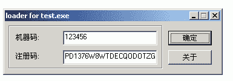

# 实践内存注册机变算法注册机之明码篇

> 原文：[`www.pediy.com/kssd/pediy08/pediy8-452.htm`](https://www.pediy.com/kssd/pediy08/pediy8-452.htm)

    日前，帮朋友分析某软件算法，找到注册码很简单，因为是明码的，但是人家要求写个算法注册机，稍微看了下，大致是用 GetSystemTime 是取 GTM 时间参数，然后跟机器码经过一系列运算得到注册码，所以注册码也是动态的。写个算法注册机挺麻烦的。所以想做个内存注册机给对方，哪知人家说还要替别人算号的，况且该系列的算法模块都是一样的，不喜欢 KEYMAKE 做的内存注册机。  
想起以前在论坛好像碰到过情况，搜索论坛，看了几篇有关进程、线程的文章后，又看了几位前辈写的 LOADER 源码，自己也动手实践了下。  
  
原理非常简单，写个类似补丁的东西，创建一个进程启动目标程序，在机器码和注册码处插入 INT3 断点，然后调试进程，当停在机器码位置时，恢复代码，写入新机器码，通过原来软件的算法流程得到新的注册码。读出注册码就可以了。  
为了更象算法注册机，我加入了注册机的界面。  
  
先分析一下软件：  
  
0046CDE8  |.  8B83 08030000 MOV EAX,DWORD PTR DS:\[EBX+308\]  
0046CDEE  |.  E8 71D0FCFF   CALL <test.@TControl@GetText>            ;  取出机器码  
0046CDF3  |.  8B45 E8       MOV EAX,DWORD PTR SS:\[EBP\-18\]            ;  机器码  
0046CDF6  |.  50            PUSH EAX                                 ;  EAX 为机器码  
0046CDF7  |.  8D55 E4       LEA EDX,DWORD PTR SS:\[EBP\-1C\]  
0046CDFA  |.  8B83 08030000 MOV EAX,DWORD PTR DS:\[EBX+308\]  
0046CE00  |.  E8 5FD0FCFF   CALL <test.@TControl@GetText>  
0046CE05  |.  8B55 E4       MOV EDX,DWORD PTR SS:\[EBP\-1C\]            ;  机器码  
0046CE08  |.  8B45 FC       MOV EAX,DWORD PTR SS:\[EBP\-4\]             ;  注册码  
0046CE0B  |.  59            POP ECX                                  ;  00E52224  
0046CE0C  |.  E8 DFE8FFFF   CALL <test.sub\_46B6F0>                   ;  关键算法,跟入  
0046CE11  |.  84C0          TEST AL,AL  
0046CE13  |.  0F84 EE000000 JE <test.loc\_46CF07>                     ;  爆破  
  
\================== 关键算法  
0046B6F0 >/$  55            PUSH EBP                                  
0046B6F1  |.  8BEC          MOV EBP,ESP  
0046B6F3  |.  83C4 F0       ADD ESP,-10  
0046B6F6  |.  53            PUSH EBX  
0046B6F7  |.  56            PUSH ESI  
0046B6F8  |.  33DB          XOR EBX,EBX  
0046B6FA  |.  895D F0       MOV DWORD PTR SS:\[EBP\-10\],EBX  
0046B6FD  |.  894D F4       MOV DWORD PTR SS:\[EBP\-C\],ECX             ;  机器码  
0046B700  |.  8955 F8       MOV DWORD PTR SS:\[EBP\-8\],EDX  
0046B703  |.  8945 FC       MOV DWORD PTR SS:\[EBP\-4\],EAX             ;  假注册码  
0046B706  |.  8B45 FC       MOV EAX,DWORD PTR SS:\[EBP\-4\]  
0046B709  |.  E8 8A92F9FF   CALL <test.@@LStrAddRef>  
0046B70E  |.  8B45 F8       MOV EAX,DWORD PTR SS:\[EBP\-8\]  
0046B711  |.  E8 8292F9FF   CALL <test.@@LStrAddRef>  
0046B716  |.  8B45 F4       MOV EAX,DWORD PTR SS:\[EBP\-C\]  
0046B719  |.  E8 7A92F9FF   CALL <test.@@LStrAddRef>  
0046B71E  |.  33C0          XOR EAX,EAX  
0046B720  |.  55            PUSH EBP  
0046B721  |.  68 D1B74600   PUSH <test.sub\_46B7D1>  
0046B726  |.  64:FF30       PUSH DWORD PTR FS:\[EAX\]  
0046B729  |.  64:8920       MOV DWORD PTR FS:\[EAX\],ESP  
0046B72C  |.  33DB          XOR EBX,EBX  
0046B72E  |.  8D4D F0       LEA ECX,DWORD PTR SS:\[EBP\-10\]  
0046B731  |.  8B55 F4       MOV EDX,DWORD PTR SS:\[EBP\-C\]             ;  机器码  
0046B734  |.  8B45 F8       MOV EAX,DWORD PTR SS:\[EBP\-8\]  
0046B737  |.  E8 20FEFFFF   CALL <test.sub\_46B55C>                   ;  算法 2，跟入  
0046B73C  |.  A1 2CFA4600   MOV EAX,DWORD PTR DS:\[46FA2C\]  
0046B741  |.  0FB600        MOVZX EAX,BYTE PTR DS:\[EAX\]  
0046B744  |.  8B4D F0       MOV ECX,DWORD PTR SS:\[EBP\-10\]            ;  算法 2 结果  
0046B747  |.  8A4C01 CF     MOV CL,BYTE PTR DS:\[ECX+EAX\-31\]          ;  结果放入 ECX，ECX 就是注册码  
0046B74B  |.  8B75 FC       MOV ESI,DWORD PTR SS:\[EBP\-4\]  
  
由此可见，0046CDF6 中的 EAX 指向的是机器码，0046B747 中的 ECX 指向的是注册码。知道这两点就可以写 LOADER 了，下面是完整代码：  
  
.586  
.model flat, stdcall    
option casemap :none    
;>>>>>>>>>>>>>>>>>>>>>>>>>>>>>>>>>>>>>>>>>>>  
include windows.inc  
include user32.inc  
include kernel32.inc  
includelib user32.lib  
includelib kernel32.lib  
include comdlg32.inc  
includelib comdlg32.lib   
;>>>>>>>>>>>>>>>>>>>>>>>>>>>>>>>>>>>>>>>>>>>  
IDD\_DLG1                equ 1000  
IDC\_NAME                equ 1001  
IDC\_CODE                equ 1002  
IDC\_OK                  equ 1005  
IDC\_ABOUT               equ 1006  
;>>>>>>>>>>>>>>>>>>>>>>>>>>>>>>>>>>>>>>>>>>>  
BREAK\_POINT1   equ 0046CDF6h ;第一个断点  
BREAK\_POINT2   equ 0046B747h ;第二个断点  
;>>>>>>>>>>>>>>>>>>>>>>>>>>>>>>>>>>>>>>>>>>>  
DlgProc proto :HWND,:UINT,:WPARAM,:LPARAM  
GetKey  proto   
;>>>>>>>>>>>>>>>>>>>>>>>>>>>>>>>>>>>>>>>>>>>  
.data  
MsgboxText    db '    -=Author: langxang=-',0dh  
              db ' -=Email:langxang@126.com=-',0  
MsgboxCaption db '关于',0  
MsgBoxText1    db '请输入远程机器码!',0  
MsgBoxCaption1 db '提示',0  
MsgBoxText2    db '请置于 TEST.EXE 软件的根目录！',0  
MsgBoxText3    db '退出进程！',0  
FileName db ".\\test.exe",0  
Startup STARTUPINFO <>  
processinfo PROCESS\_INFORMATION <>  
  
TotalInstruction dd 0  
AppName db "test",0   
int3    db 0cch     
BUFFER  db 8 dup(?)  
value   db 8 dup(?)  
MCode   db 8 dup(?)     
oldbyte1 db 50h  
oldbyte2 db 8Ah  
szFormat db "%X",0  
  
.data?  
buffer db 512 dup(?)   
startinfo STARTUPINFO <>   
pi PROCESS\_INFORMATION <>   
DBEvent DEBUG\_EVENT <>   
context CONTEXT <>  
uExitCode     dd ?  
hInstance     HINSTANCE ?  
hDlg          HINSTANCE ?   
UserID        db 80 dup (?)  
Serial        db 80 dup (?)  
  
;>>>>>>>>>>>>>>>>>>>>>>>>>>>>>>>>>>>>>>>>>>>>  
.code  
start:  
  invoke **GetModuleHandle**,NULL  
       mov hInstance,eax  
  invoke **DialogBoxParam**,hInstance,IDD\_DLG1,NULL,addr DlgProc,NULL  
  invoke **ExitProcess**,0  
;>>>>>>>>>>>>>>>>>>>>>>>>>>>>>>>>>>>>>>>>>>>>>  
DlgProc proc hWin:HWND,uMsg:UINT,wParam:WPARAM,lParam:LPARAM  
        mov eax,uMsg  
  .if     eax\==WM\_CLOSE  
       invoke **EndDialog**,hWin,0  
  .elseif eax\==WM\_INITDIALOG  
       push hWin  
       pop  hDlg       
  .elseif eax\==WM\_COMMAND  
          mov eax,wParam  
             .if eax\==IDC\_OK                  
                invoke **GetDlgItemText**,hDlg,IDC\_NAME,addr UserID,Sizeof UserID                                                          
                   .if eax\==0  
                     invoke **MessageBox**,hDlg,addr MsgBoxText1,addr MsgBoxCaption1,MB\_OK  
                   .elseif    
                     invoke GetKey  
                     invoke **SetDlgItemText**,hDlg,IDC\_CODE,addr value  
                   .endif  
             .elseif eax\==IDC\_ABOUT  
                invoke **MessageBox**,hDlg,addr MsgboxText,addr MsgboxCaption,MB\_OK  
             .endif              
  .else  
    mov eax,FALSE  
    ret  
  .endif  
  mov eax,TRUE  
  ret  
DlgProc endp  
  
GetKey proc    
       pushad  
;\*\*\*\*\*\*\*\*\*\*\*\*\*\*\*\*\*\*\*\*\*\*\*\*\*\*\*\*\*\*\*\*\*\*\*\*\*\*\*\*\*\*\*\*\*\*\*\*\*\*\*\*\*\*\*\*\*\*\*\*\*\*\*\*\*\*\*\*  
; 创建进程  
;\*\*\*\*\*\*\*\*\*\*\*\*\*\*\*\*\*\*\*\*\*\*\*\*\*\*\*\*\*\*\*\*\*\*\*\*\*\*\*\*\*\*\*\*\*\*\*\*\*\*\*\*\*\*\*\*\*\*\*\*\*\*\*\*\*\*\*\*           
       invoke **CreateProcess**, addr FileName, NULL, NULL, NULL, FALSE, DEBUG\_PROCESS or DEBUG\_ONLY\_THIS\_PROCESS, NULL, NULL, addr startinfo, addr pi   
    .if    !eax  
        invoke **MessageBox**,hDlg,addr MsgBoxText2,addr MsgBoxCaption1,MB\_OK  
        invoke **ExitProcess**,NULL  
    .endif  
;\*\*\*\*\*\*\*\*\*\*\*\*\*\*\*\*\*\*\*\*\*\*\*\*\*\*\*\*\*\*\*\*\*\*\*\*\*\*\*\*\*\*\*\*\*\*\*\*\*\*\*\*\*\*\*\*\*\*\*\*\*\*\*\*\*\*\*\*  
; 调试进程  
;\*\*\*\*\*\*\*\*\*\*\*\*\*\*\*\*\*\*\*\*\*\*\*\*\*\*\*\*\*\*\*\*\*\*\*\*\*\*\*\*\*\*\*\*\*\*\*\*\*\*\*\*\*\*\*\*\*\*\*\*\*\*\*\*\*\*\*\*  
   .while TRUE   
      invoke **WaitForDebugEvent**, addr DBEvent, INFINITE   
      .if DBEvent.dwDebugEventCode==EXIT\_PROCESS\_DEBUG\_EVENT   
          invoke **MessageBox**, 0, MsgBoxText3, addr  MsgBoxCaption1, MB\_OK+MB\_ICONINFORMATION   
          .break   
;\*\*\*\*\*\*\*\*\*\*\*\*\*\*\*\*\*\*\*\*\*\*\*\*\*\*\*\*\*\*\*\*\*\*\*\*\*\*\*\*\*\*\*\*\*\*\*\*\*\*\*\*\*\*\*\*\*\*\*\*\*\*\*\*\*\*\*\*  
; 如果进程开始，则将两个断点地址的代码改为 INT3 中断  
;\*\*\*\*\*\*\*\*\*\*\*\*\*\*\*\*\*\*\*\*\*\*\*\*\*\*\*\*\*\*\*\*\*\*\*\*\*\*\*\*\*\*\*\*\*\*\*\*\*\*\*\*\*\*\*\*\*\*\*\*\*\*\*\*\*\*\*\*  
      .elseif DBEvent.dwDebugEventCode==CREATE\_PROCESS\_DEBUG\_EVENT             
          invoke  **WriteProcessMemory**,pi.hProcess,BREAK\_POINT1,addr int3,1,NULL       ;插入 INT3  
          invoke  **WriteProcessMemory**,pi.hProcess,BREAK\_POINT2,addr int3,1,NULL       ;插入 INT3      
;\*\*\*\*\*\*\*\*\*\*\*\*\*\*\*\*\*\*\*\*\*\*\*\*\*\*\*\*\*\*\*\*\*\*\*\*\*\*\*\*\*\*\*\*\*\*\*\*\*\*\*\*\*\*\*\*\*\*\*\*\*\*\*\*\*\*\*\*  
; 中断触发的异常事件，并进入安全模式读写状态  
;\*\*\*\*\*\*\*\*\*\*\*\*\*\*\*\*\*\*\*\*\*\*\*\*\*\*\*\*\*\*\*\*\*\*\*\*\*\*\*\*\*\*\*\*\*\*\*\*\*\*\*\*\*\*\*\*\*\*\*\*\*\*\*\*\*\*\*\*     
      .elseif DBEvent.dwDebugEventCode==EXCEPTION\_DEBUG\_EVENT   
          .if DBEvent.u.Exception.pExceptionRecord.ExceptionCode==EXCEPTION\_BREAKPOINT   
          mov context.ContextFlags, CONTEXT\_FULL   
             invoke **GetThreadContext**, pi.hThread, addr context   
;\*\*\*\*\*\*\*\*\*\*\*\*\*\*\*\*\*\*\*\*\*\*\*\*\*\*\*\*\*\*\*\*\*\*\*\*\*\*\*\*\*\*\*\*\*\*\*\*\*\*\*\*\*\*\*\*\*\*\*\*\*\*\*\*\*\*\*\*  
; 如果在机器码处中断，则恢复原来的代码，并写入新的机器码  
;\*\*\*\*\*\*\*\*\*\*\*\*\*\*\*\*\*\*\*\*\*\*\*\*\*\*\*\*\*\*\*\*\*\*\*\*\*\*\*\*\*\*\*\*\*\*\*\*\*\*\*\*\*\*\*\*\*\*\*\*\*\*\*\*\*\*\*\*                
             .if     context.regEip == BREAK\_POINT1+1  
              dec     context.regEip  
              invoke  **WriteProcessMemory**,pi.hProcess,BREAK\_POINT1,addr oldbyte1,1,NULL    ;恢复代码  
              mov eax,context.regEax                                                      ;机器码在 EAX 中  
              invoke  **WriteProcessMemory**,pi.hProcess,eax,addr UserID,16h,NULL             ;读入 22 位机器码  
              invoke  **SetThreadContext**,pi.hThread, addr context                           ;设置生效  
              ;invoke ReadProcessMemory,pi.hProcess,context.regEax,addr BUFFER,16h,NULL   ;用于检测修改的机器码是否已经生效  
              ;invoke  MessageBox,0, addr BUFFER,addr AppName, MB\_OK+MB\_ICONINFORMATION                
                   
;\*\*\*\*\*\*\*\*\*\*\*\*\*\*\*\*\*\*\*\*\*\*\*\*\*\*\*\*\*\*\*\*\*\*\*\*\*\*\*\*\*\*\*\*\*\*\*\*\*\*\*\*\*\*\*\*\*\*\*\*\*\*\*\*\*\*\*\*  
; 如果在注册码处中断，则恢复原来的代码，并读出注册码  
;\*\*\*\*\*\*\*\*\*\*\*\*\*\*\*\*\*\*\*\*\*\*\*\*\*\*\*\*\*\*\*\*\*\*\*\*\*\*\*\*\*\*\*\*\*\*\*\*\*\*\*\*\*\*\*\*\*\*\*\*\*\*\*\*\*\*\*\*                                                       
            .elseif  context.regEip == BREAK\_POINT2+1  
              dec     context.regEip  
              invoke **WriteProcessMemory**,pi.hProcess,BREAK\_POINT2,addr oldbyte2,1,NULL     ;恢复代码  
              invoke **ReadProcessMemory**,pi.hProcess,context.regEcx,addr value,14h,NULL     ;注册码在 ECX 中  
              ;invoke SetDlgItemText,hDlg,IDC\_CODE,addr value                              ;输出到注册码框  
              invoke **SetThreadContext**,pi.hThread, addr context    
              invoke **TerminateProcess**,pi.hProcess,uExitCode                               ;强行退出   
              .break   
            .endif             
          .endif   
             invoke **ContinueDebugEvent**,    DBEvent.dwProcessId, DBEvent.dwThreadId, DBG\_CONTINUE   
            .continue                
      .endif   
      invoke **ContinueDebugEvent**, DBEvent.dwProcessId, DBEvent.dwThreadId,   DBG\_EXCEPTION\_NOT\_HANDLED   
   .endw   
;\*\*\*\*\*\*\*\*\*\*\*\*\*\*\*\*\*\*\*\*\*\*\*\*\*\*\*\*\*\*\*\*\*\*\*\*\*\*\*\*\*\*\*\*\*\*\*\*\*\*\*\*\*\*\*\*\*\*\*\*\*\*\*\*\*\*\*\*  
; 结束线程  
;\*\*\*\*\*\*\*\*\*\*\*\*\*\*\*\*\*\*\*\*\*\*\*\*\*\*\*\*\*\*\*\*\*\*\*\*\*\*\*\*\*\*\*\*\*\*\*\*\*\*\*\*\*\*\*\*\*\*\*\*\*\*\*\*\*\*\*\*   
   invoke **CloseHandle**,pi.hProcess   
   invoke **CloseHandle**,pi.hThread      
    popad  
    ret   
GetKey endp  
end start     
  
  
文本框 2 中得到的就是利用原程序算法流程计算后得到的注册码，怎么样，俨然一个算法注册机。  
 

附件下载

 4dd466d0e1e0cc123afbe504da2462ca