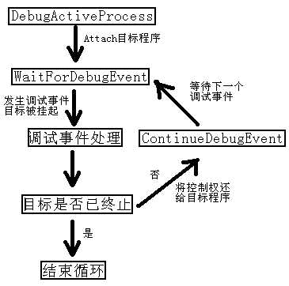
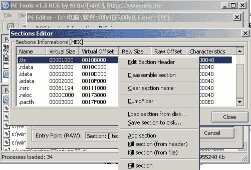
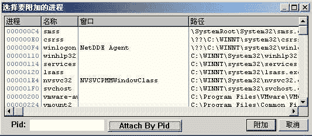

# 为 OllyIce 增加附加隐藏进程的功能----PeDiy 入门教程

> 原文：[`www.pediy.com/kssd/pediy08/pediy8-459.htm`](https://www.pediy.com/kssd/pediy08/pediy8-459.htm)

【文章标题】: 【原创】为 OllyIce 增加附加隐藏进程的功能----PeDiy 入门教程   
【文章作者】: 笨笨雄  
【作者邮箱】: nemo314@gmail.com  
【工具】:OllyIce  PE Tools  
  
最近学习脱壳，喜欢上了 Attach 法到 OEP，这样有很多好处，但是局限性也很大，例如隐藏进程。有留意过一些手动查杀木马的朋友一定有看过使用 Ntsd –P PID Q 命令关进程的文章，Ntsd 其实就是系统附带的调试器。手上有一个旧版的灰鸽子，Ring 3 下的 RootKit，加载之后便 DLL 注入 Explorer，并把该进程隐藏。经 IceSword 查得 Explorer 的 Pid 后，能顺利用 Ntsd 把该进程关掉，于是我就想，如果 OllyIce 也能使用 Pid 直接 Attach 进程，那多好。下面我将以这个例子来介绍如何进行 PeDiy。  
  
在这个例子中，我希望为程序添加 Pid  Attach 功能，所以找了相关资料，一个 Ring3 调试器 Attach 进程的基本流程结构：  
   
显然 DebugActiveProcess 是关键，它的原型如下：  
  
BOOL DebugActiveProcess(  
  
DWORD dwProcessId   // process to be debugged  
);  
  
只有一个参数，而且是 Pid。好了，现在我们知道如何实现 Pid  Attach，可以开始动手修改 OllyIce 了。首先打开 PE tools 先看看 OllyIce 的导入表，这将帮助我们寻找合适的 API 下断，方便定位消息环和窗口初始化代码。如果必要的 API 不存在，我们必须添加上去，这里要注意部分软件是区分大小写的。  
  
我找到了 CreateDialogParamA，CreateWindowExA 和 DialogBoxParamA。这 3 个 API 都是建立窗口的，其中 CreateWindowExA 也能用于建立一个按钮和文本框，获取文本框导入的 GetDlgItemTextA 也在导入表中。  
  
我们知道 OllyIce 支持插件，为了方便与插件互动，程序必须提供导出函数。否则插件便不叫插件，而是内存补丁了。我在导出表里找到\_Attachtoactiveprocess，RVA=77D8C。这让事情变得很简单，也许查看关于 Ollydbg 的插件编写帮助就能找出关于它的调用规则。  
  
这里非常幸运，需要的 API 都有了，需要的函数也放在导出表了。假如没有这个导出函数怎么办？就这个例子来说在 DebugActiveProcess 下断，定位目标函数，分析它的输入参数和返回数值。最坏的情况，调试器根本不提供 Attach 功能，我们必须编写代码来实现它。为了和程序的其他功能互动，我们必须分析调试器加载目标程序的过程，找出相关的数据结构，并在我们自己的代码中填充它。当然，假如遇到最坏的情况，该程序是否还值得 Pe Diy？我想大多数情况都不值得。回到正题，打开 OllyIce 调试自己，RVA+Image Base 来到\_Attachtoactiveprocess。现在假设我们在 DebugActiveProcess 下断，Attach 进程后停在未知函数内部。向上滚动窗口直到看到：  
  
00477D8C >/$  55            push    ebp  
00477D8D  |.  8BEC          mov     ebp, esp  
00477D8F  |.  81C4 ACFAFFFF add     esp, -554  
00477D95  |.  53            push    ebx  
00477D96  |.  56            push    esi  
00477D97  |.  57            push    edi  
  
这是 OEP 的标志，也是每个函数开头的标志。必须注意的是 dword ptr \[ebp+X\]，X 为未知数，对应初始栈  
  
EBP    EBP  
EBP+4  函数的返回地址  
EBP+8  第一个参数  
EBP+C  第二个参数  
  
如此类推，假如你在函数返回之前看到 EBP+20，则代表该函数有 7 个参数，当然这里只有一个。只要留意参数都用在什么地方，我们便知道该传入什么参数。另外一个要注意的地方就是返回值，高级语言编译出的函数一般以 EAX 保存返回值，要注意跳转之前的代码。当然并不是什么跳转都得留意，主要看机器码，看到 jmp，假如机械码是 EB，那么这是一个短跳转，一般函数都没这么短的，可以忽略。假如看到 jcc(条件跳转)，看到第一个机械码为 OF 的，都留意一下，这是一个近跳转。函数完结之前，我找到下面代码：  
  
00477D98  |.  8B75 08       mov     esi, dword ptr \[ebp+8\]      ；第一个参数转到 ESI  
00477D9B  |.  6A 01         push    1                                ; /Arg1 = 00000001  
00477D9D  |.  E8 02DBFFFF   call    004758A4                         ; \\OllyDBG.004758A4  
00477DA2  |.  59            pop     ecx  
00477DA3  |.  85C0          test    eax, eax  
00477DA5  |.  74 08         je      short 00477DAF  
00477DA7  |.  83C8 FF       or      eax, FFFFFFFF        ；EAX=-1  
00477DAA  |.  E9 EF010000   jmp     00477F9E          ；这里跳到最后  
00477DAF  |>  E8 58D6FFFF   call    0047540C  
00477DB4  |.  85C0          test    eax, eax  
00477DB6  |.  74 13         je      short 00477DCB  
00477DB8  |.  68 9F1F4C00   push    004C1F9F                         ; /Arg1 = 004C1F9F ASCII "Unable to allocate enough memory"  
00477DBD  |.  E8 5AC2FDFF   call    \_Error                           ; \\\_Error  
00477DC2  |.  59            pop     ecx  
00477DC3  |.  83C8 FF       or      eax, FFFFFFFF  
00477DC6  |.  E9 D3010000   jmp     00477F9E  
00477DCB  |>  8BDE          mov     ebx, esi    ；第一个参数又从 ESI 转到 EBX  
00477DCD  |.  53            push    ebx                              ; /ProcessId  
00477DCE  |.  E8 03720300   call    <jmp.&KERNEL32.DebugActiveProces>; \\DebugActiveProcess  
00477DD3  |.  85C0          test    eax, eax  
00477DD5  |.  75 08         jnz     short 00477DDF  
00477DD7  |.  83C8 FF       or      eax, FFFFFFFF  
00477DDA  |.  E9 BF010000   jmp     00477F9E  
  
call 004758A4 和 call 0047540C 返回值为 0 则函数返回-1。DebugActiveProces 调用失败则函数返回-1。从 API 的调用来看，可以肯定如果该函数返回-1 就是调用失败了。同样从 API 的调用反推，可知传入参数是 Pid。这个函数的调用相关的参数处理都放在前面了，现在来看看函数的结尾部分。  
  
00477F9C  |.  33C0          xor     eax, eax  
00477F9E  |>  5F            pop     edi    ；EAX=-1 之后的跳转是来到这里的  
00477F9F  |.  5E            pop     esi  
00477FA0  |.  5B            pop     ebx  
00477FA1  |.  8BE5          mov     esp, ebp  
00477FA3  |.  5D            pop     ebp  
00477FA4  \\.  C3            retn        ；这就结束了，没有释放参数占用的堆栈  
  
从这里可以得到两个信息，一是函数正常工作，则 EAX=0，二是参数占用的堆栈得由调用者自己释放。通过上面的分析，我想大家都知道该怎么编写代码了。为了存放我们将要编写的代码，需要在程序的最后增加一个区段。  
   
很多 PE 工具都有类似的界面。需要注意的是一般工具（包括 PE Tools）编辑区段，增加 Raw Size 都会导致文件不可用。因为系统加载 PE 时读取文件数据超出文件大小就会报错。在 PE Tools 中增加区段会自动增加相应的文件大小和自动修正 Image Size。如果你用的工具修改后报错，那么你还得自己手动去做这个工作。例如增加文件大小，你需要使用 WinHex 这样的工具。在本例中，我先增加一个区段，然后把新增的区段 Kill section(from header)，编辑 PACTH 区段的大小。这样做是因为，你们看到，该文件的区段已经够多了。  
  
现在来看看该在哪里插入我们自己的代码。运行 OllyIce，对 CreateDialogParamA，CreateWindowExA 和 DialogBoxParamA 下断。主菜单中的“文件”=>“附加”，中断后看堆栈：  
  
0012E16C   004786AA  /CALL 到 DialogBoxParamA 来自 OllyICE.004786A5  
0012E170   00400000  |hInst = 00400000  
0012E174   004C2198  |pTemplate = "DIA\_GET\_PROC"  
0012E178   00020244  |hOwner = 00020244 (class='MDIClient',parent=0003024E)  
0012E17C   00477FA8  |DlgProc = OllyICE.00477FA8  
0012E180   00000000  \\lParam = NULL  
0012E184   00433A9D  返回到 OllyICE.00433A9D 来自 OllyICE.0047868C  
  
注意|pTemplate 参数，它指向一个对话框资源脚本。如果对话框足够简单，数据窗口跟随到该地址，你便能看到对话框中所有子控件的定义。假如你希望修改某些控件的外观，应该在这里动手。|DlgProc 指向消息处理的例程 00477FA8，跟随，并下断，F9。停下来之后仍然是看堆栈  
  
0012DFAC   77DF2CA8  返回到 USER32.77DF2CA8  
0012DFB0   003C0316  ；hWnd  
0012DFB4   00000030  ；wMsg  
0012DFB8   8F0A07B3  ；wParam  
0012DFBC   00000000  ；lParam  
  
对照|DlgProc 的定义，我们知道堆栈中各数值的用途。在这个例子中，你需要注意两个参数：  
  
hWnd    创建子空间时需要这个参数以填充 hWndParent。  
wMsg    这将帮助我们找到插入代码的地方。  
  
当前 wMsg 的值对应常量 WM\_SETFONT，跟了一下发现程序没有处理这个消息。再次 F9 后，我们看到  
  
0012DFAC   77DF2CA8  返回到 USER32.77DF2CA8  
0012DFB0   003C0316  
0012DFB4   00000110  
0012DFB8   0078031C  
0012DFBC   00000000  
  
110 对应 WM\_INITDIALOG，看看下面代码：  
  
00477FB4   .  8B5D 08       mov     ebx, dword ptr \[ebp+8\]    ；EBX=hWnd  
00477FB7   .  8B45 0C       mov     eax, dword ptr \[ebp+C\]    ；EAX=wMsg  
00477FBA   .  3D 10010000   cmp     eax, 110                         ;  Switch (cases 5..112)  
00477FBF   .  7F 19         jg      short 00477FDA  
00477FC1   .  74 2E         je      short 00477FF1  
00477FC3   .  83E8 05       sub     eax, 5  
00477FC6   .  0F84 5B030000 je      00478327  
00477FCC   .  83E8 1F       sub     eax, 1F  
00477FCF   .  0F84 3A030000 je      0047830F  
00477FD5   .  E9 9D060000   jmp     00478677  
00477FDA   >  2D 11010000   sub     eax, 111        ；111 对应 WM\_COMMAND  
00477FDF   .  0F84 99040000 je      0047847E  
00477FE5   .  48            dec     eax  
00477FE6   .  0F84 6E060000 je      0047865A  
00477FEC   .  E9 86060000   jmp     00478677  
  
注意到当控件被点击的时候，系统便会产生一个 WM\_COMMAND 消息。显然它会带我们到达控件的主要功能代码。来到 0047847E，并下断，以后需要用到。一路跟踪 WM\_INITDIALOG 的处理过程，我看到  
  
0047812F  |.  8B0D 783B4D00 mov     ecx, dword ptr \[4D3B78\]          ; |OllyDBG.00400000  
00478135  |.  51            push    ecx                              ; |hInst => 00400000  
00478136  |.  68 AD0D0000   push    0DAD                             ; |hMenu = 00000DAD  
0047813B  |.  53            push    ebx                              ; |hParent  
0047813C  |.  6A 0A         push    0A                               ; |Height = A (10.)  
0047813E  |.  6A 0A         push    0A                               ; |Width = A (10.)  
00478140  |.  68 18FCFFFF   push    -3E8                             ; |Y = FFFFFC18 (-1000.)  
00478145  |.  68 18FCFFFF   push    -3E8                             ; |X = FFFFFC18 (-1000.)  
0047814A  |.  68 0000B050   push    50B00000                                         ; |Style = WS\_CHILD|WS\_VISIBLE|WS\_VSCROLL|WS\_HSCROLL|WS\_BORDER  
0047814F  |.  68 00174C00   push    004C1700                         ; |WindowName = ""  
00478154  |.  68 00214C00   push    004C2100                         ; |Class = "APROCESS"  
00478159  |.  6A 00         push    0                                ; |ExtStyle = 0  
0047815B  |.  E8 3C720300   call    <jmp.&USER32.CreateWindowExA>    ; \\CreateWindowExA  
  
建立子窗体，个人认为这里插入建立子空间的代码比较合适。需要注意的地方是用寄存器做传入参数，假如以后还需要用到，你必须找出寄存器的数据是哪里来的。因为在调用函数之后，该寄存器的数据可能被破坏。在这个例子中，ECX，由\[4D3B78\]得到。EBX 前面给出的代码中已经注释过了，还记得吗？就是 00477FB4 处的代码。修改后的代码如下：  
  
0047812F   .  8B0D 783B4D00 mov     ecx, dword ptr \[4D3B78\]          ;  OllyICE.00400000  
00478135   .  51            push    ecx  
00478136   .  68 AD0D0000   push    0DAD  
0047813B   .  53            push    ebx  
0047813C   .  891D D8FB5700 mov     dword ptr \[57FBD8\], ebx  
00478142   .  6A 0A         push    0A  
00478144   .  6A 0A         push    0A  
00478146   .  68 18FCFFFF   push    -3E8  
0047814B   .  68 18FCFFFF   push    -3E8  
00478150      68 0000B050   push    50B00000  
00478155      68 00174C00   push    004C1700  
0047815A   .- E9 847A1000   jmp     0057FBE3  
0047815F      90            nop  
00478160   .  8BF0          mov     esi, eax  ；建立完子控件后还要跳回来  
00478162   .  8935 F8D34E00 mov     dword ptr \[4ED3F8\], esi  
00478168   .  85F6          test    esi, esi  
  
需要说明的是我在写代码的时候忘记 EBX 怎么来了，所以在 PUSH EBX 之后把 EBX 保存在\[57FBD8\]。一般情况下，假如程序本身就有存放该数据的全局变量，就应该用那些变量而不是自己另外建立一个，否则其他函数将不能访问你对该变量的修改结果。在 0057FBE3 处写入下面代码：  
  
0057FBE3    68 00214C00     push    004C2100                         ; ASCII "APROCESS"  
0057FBE8    6A 00           push    0  
0057FBEA    E8 ADF7F2FF     call    <jmp.&USER32.CreateWindowExA>  
0057FBEF    6A 00           push    0  
0057FBF1    FF35 783B4D00   push    dword ptr \[4D3B78\]               ; OllyICE.00400000  
0057FBF7    68 34120000     push    1234  
0057FBFC    FF35 D8FB5700   push    dword ptr \[57FBD8\]  
0057FC02    6A 13           push    13  
0057FC04    6A 30           push    30  
0057FC06    68 B6000000     push    0B6  
0057FC0B    6A 10           push    10  
0057FC0D    68 00000050     push    50000000  
0057FC12    68 C4FB5700     push    0057FBC4                         ; ASCII "Pid:"  
0057FC17    68 BDFB5700     push    0057FBBD                         ; ASCII "Static"  
0057FC1C    6A 00           push    0  
0057FC1E    E8 79F7F2FF     call    <jmp.&USER32.CreateWindowExA>  
0057FC23    6A 00           push    0  
0057FC25    FF35 783B4D00   push    dword ptr \[4D3B78\]               ; OllyICE.00400000  
0057FC2B    68 35120000     push    1235  
0057FC30    FF35 D8FB5700   push    dword ptr \[57FBD8\]  
0057FC36    6A 13           push    13  
0057FC38    6A 7F           push    7F  
0057FC3A    68 B6000000     push    0B6  
0057FC3F    6A 30           push    30  
0057FC41    68 00000050     push    50000000  
0057FC46    68 00174C00     push    004C1700  
0057FC4B    68 B8FB5700     push    0057FBB8                         ; ASCII "Edit"  
0057FC50    6A 00           push    0  
0057FC52    E8 45F7F2FF     call    <jmp.&USER32.CreateWindowExA>  
0057FC57    6A 00           push    0  
0057FC59    FF35 783B4D00   push    dword ptr \[4D3B78\]               ; OllyICE.00400000  
0057FC5F    68 36120000     push    1236  
0057FC64    FF35 D8FB5700   push    dword ptr \[57FBD8\]  
0057FC6A    6A 15           push    15  
0057FC6C    6A 7F           push    7F  
0057FC6E    68 B6000000     push    0B6  
0057FC73    68 B5000000     push    0B5  
0057FC78    68 00000050     push    50000000  
0057FC7D    68 C9FB5700     push    0057FBC9                         ; ASCII "Attach By Pid"  
0057FC82    68 B1FB5700     push    0057FBB1                         ; ASCII "Button"  
0057FC87    6A 00           push    0  
0057FC89    E8 0EF7F2FF     call    <jmp.&USER32.CreateWindowExA>  
0057FC8E  - E9 CD84EFFF     jmp     00478160  
  
正如你看到的，我在 0057FBC9 附近添加了一些字符。另外这里仍然是一个错误的例子，我忘记保存寄存器环境了，虽然没出问题，但是要养成进入自己代码前 PUSHAD，返回自己代码后 POPAD 的习惯，假如你在条件跳转前修改代码，你还需要 PUSHFD/POPFD。我们来看看显示效果：  
   
当然这里还不具备实际功能。还记得之前的断点么，现在点一下 Attach By Pid，断在下面的地方  
  
0047847E  |> \\66:8B55 10    mov     dx, word ptr \[ebp+10\]     ;  Case 111 (WM\_COMMAND)  
00478482  |.  66:81E2 FFFF  and     dx, 0FFFF  
00478487  |.  66:83FA 01    cmp     dx, 1  
0047848B  |.  0F85 B1010000 jnz     00478642  
  
这里开始取第三个参数 EBP+10。在该例子中，第三个参数对应 CreateWindowExA 中的 hMenu 参数。程序在这里开始对比是哪个子控件被点击了，修改如下：  
  
0047847E   >-\\E9 2C781000   jmp     0057FCAF      ;  Case 111 (WM\_COMMAND)   
00478483      90            nop  
00478484      90            nop  
00478485      90            nop  
00478486      90            nop  
00478487   .  66:83FA 01    cmp     dx, 1  
0047848B   .  0F85 B1010000 jnz     00478642  
  
在 0057FCAF 编写下面代码：  
  
0057FCAF    8B45 10         mov     eax, dword ptr \[ebp+10\]  
0057FCB2    3D 36120000     cmp     eax, 1236    ；比较是否 Attach By Pid  
0057FCB7    75 57           jnz     short 0057FD10  ；不是就回到程序原流程  
0057FCB9    6A 09           push    9  
0057FCBB    8D75 F6         lea     esi, dword ptr \[ebp-A\]  
0057FCBE    56              push    esi  
0057FCBF    68 35120000     push    1235      ；这是文本编辑框的 hMenu  
0057FCC4    FF35 D8FB5700   push    dword ptr \[57FBD8\]  
0057FCCA    E8 8DF7F2FF     call    <jmp.&USER32.GetDlgItemTextA>  
0057FCCF    85C0            test    eax, eax  
0057FCD1  ^ 0F84 70FEFFFF   je      0057FB47    ；返回失败则显示错误对话框  
0057FCD7    8BC8            mov     ecx, eax  
0057FCD9    33DB            xor     ebx, ebx  
0057FCDB    43              inc     ebx  
0057FCDC    33D2            xor     edx, edx  
0057FCDE    03F1            add     esi, ecx  
0057FCE0    4E              dec     esi  
0057FCE1    0FB606          movzx   eax, byte ptr \[esi\]  
0057FCE4    2C 30           sub     al, 30  
0057FCE6  ^ 0F82 8BFEFFFF   jb      0057FB77    ；不是 30h 到 39h 的 ASCII 字符  
0057FCEC    3C 09           cmp     al, 9      ；则弹出对话框  
0057FCEE  ^ 0F87 83FEFFFF   ja      0057FB77        ；提示用户使用 10 进制  
0057FCF4    0FAFC3          imul    eax, ebx  
0057FCF7    03D0            add     edx, eax  
0057FCF9    6BDB 0A         imul    ebx, ebx, 0A  
0057FCFC    49              dec     ecx  
0057FCFD  ^ 75 E1           jnz     short 0057FCE0  
  
从 0057FCD7 开始是将字符转为数字，并且转为 16 进制的代码。结果保存在 EDX  
  
0057FCFF    52              push    edx     ；传入 Pid  
0057FD00    E8 8780EFFF     call    \_Attachtoactiveprocess  
0057FD05    83C4 04         add     esp, 4     ；从前面分析得知，必须释放传入参数栈  
0057FD08    8B5D 08         mov     ebx, dword ptr \[ebp+8\]  
0057FD0B  - E9 4089EFFF     jmp     00478650  
0057FD10    66:8B55 10      mov     dx, word ptr \[ebp+10\]  
0057FD14    66:81E2 FF00    and     dx, 0FF  
0057FD19  - E9 6987EFFF     jmp     00478487  
  
下面是弹出错误对话框的代码：  
  
0057FB47    6A 00           push    0  
0057FB49    E8 0B000000     call    0057FB59  
0057FB4E    45              inc     ebp  
0057FB4F    72 72           jb      short 0057FBC3  
0057FB51    0000            add     byte ptr \[eax\], al  
0057FB53    0000            add     byte ptr \[eax\], al  
0057FB55    0000            add     byte ptr \[eax\], al  
0057FB57    0000            add     byte ptr \[eax\], al  
0057FB59    E8 0D000000     call    0057FB6B  
0057FB5E    B4 ED           mov     ah, 0ED  
0057FB60    CE              into  
0057FB61    F3:             prefix rep:  
0057FB62    50              push    eax  
0057FB63    696400 00 00000>imul    esp, dword ptr \[eax+eax\], 0  
0057FB6B    6A 00           push    0  
0057FB6D    E8 A4F9F2FF     call    <jmp.&USER32.MessageBoxA>  
0057FB72  - E9 048BEFFF     jmp     0047867B  
0057FB77    6A 00           push    0  
0057FB79    E8 0B000000     call    0057FB89  
0057FB7E    45              inc     ebp  
0057FB7F    72 72           jb      short 0057FBF3  
0057FB81    0000            add     byte ptr \[eax\], al  
0057FB83    0000            add     byte ptr \[eax\], al  
0057FB85    0000            add     byte ptr \[eax\], al  
0057FB87    0000            add     byte ptr \[eax\], al  
0057FB89    E8 0F000000     call    0057FB9D  
0057FB8E    C7              ???                                      ; 未知命令  
0057FB8F  ^ EB CA           jmp     short 0057FB5B  
0057FB91    B9 D3C3CAAE     mov     ecx, AECAC3D3  
0057FB96    BD F8D6C600     mov     ebp, 0C6D6F8  
0057FB9B    0000            add     byte ptr \[eax\], al  
0057FB9D    6A 00           push    0  
0057FB9F    E8 72F9F2FF     call    <jmp.&USER32.MessageBoxA>  
0057FBA4  - E9 D28AEFFF     jmp     0047867B  
  
那些不知所谓的代码其实是字符，我用了 CALL 来传递参数，因为我觉得这样比较好玩，而且不受重定位影响。  
  
结语：感谢大家在看雪读书季中对我的支持，希望你们也同样喜欢我的这篇文章。 

兄弟写得不错，不过有点瞎子点灯白费蜡了，OD 有-p 启动参数的，直接带目标进程的 pid 就可以了。以前 loveboom 用那个啥工具，让 OD 附加 themida，那个工具就用的这个参数