# asprotect 2.x 内存补丁制作示例

> 原文：[`www.pediy.com/kssd/pediy07/pediy7-644.htm`](https://www.pediy.com/kssd/pediy07/pediy7-644.htm)

ASPROTECT 2.x 补丁系列(一)  
  
【目    标】:Icon Searcher 2.91  
【工    具】:Olydbg1.1(diy 版),RadAsm  
【任    务】:不脱壳创建 Loader 破解  
【操作平台】:Windows XP sp2  
【作    者】:LOVEBOOM\[DFCG\]\[FCG\]\[US\]  
【相关链接】:自己搜索下  
【简要说明】:Asprotect 2.x 脱壳已经是非常困难的事了,非常费时间和精力的事,上次和 temerata 聊了下 aspr 2.x 的补丁制作,总体感觉那样还是比较麻烦,于是想到直接做 Loader 来为 aspr 做内存补丁.这种方法比较方便,容易移植.当然这样也就同样没有什么技术含量了:-).看这篇文章之前你得自己先清楚如何切入找到注册点,关于注册分析可以参见我的<<Asprotect 注册检测>>.  
  
【详细过程】:

Loader 附件下载。  
  
  这 Loader Patch 的原理:Loader 加载目标程序,创建一个挂起进程(CREATE\_SUSPENDED),然后让目标进程继续运行,然后定时把目标进程挂起,读取目标进程的注册代码是否已经解压,是否到了 patch 时机(因为壳会如检测,所以不能解压出代码就立刻修改代码的),没有到时机则继续让目标程序运行,Loader 睡眠一定时间后继续检测,到了时机则添加我们自己的 Patch 代码到目标内存中,整个流程如下:

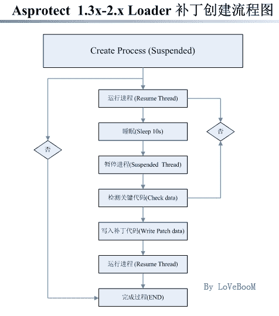  
   
流程图出来了,接着分析下我们具体需要哪些东西:  
patch 的话,先要找到 patch 位置,找到相关位置后还得看什么时候代码解压出来了,解压出来了过了什么地方之后壳不会检测代码是否被修改,找到了还得找地方保存 PATCH 代码和注册名存放地址,PATCH 代码怎么写等等,基本上就这些了.下面一步一步的解决上面的问题:  
1,找 patch 位置:  
  OD 载入目标程序,去除调试标志,开打内存异常项,其它异常全部忽略.  
经过很多次异常后,找到关键点,第三次出现硬件指纹后在 code 段下 f2 断:

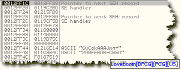  
   
……

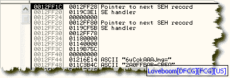  
   
……  
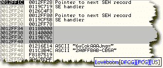 

  
下断后,Shift+f9 继续运行,运行后,中断在如下处:

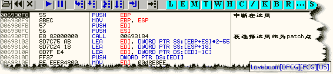  
   
中断后在 esp+4 处就是保存注册名的地址,我们要做的就是直接反地址改成我们自己保存注册名的地方.  
2.找存放 PATCH 代码的地址和保存注册名信息相关数据的地址:  
  
  上面已经找到了 patch 点,第二个,随便找个空白地方写入相关信息?我试着随便找个地方写入注册名,结果出现程序异常了,看来注册名也不能随便写个地方,看过 aspr 的朋友也知道,这个壳的最后一个节里是不会写数据进去的,我们可以把那里做为保存相关数据点,当然同样不是什么地方都可以写的,壳会清除两次最后一个段一定范围内的数据的,好了,重来,用 OD 载入目标程序,载入后直接在最后一个段填充为 FF:  
 

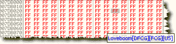  
  
填充完,运行程序让程序运行起来,然后看下就可以选择我们想要保存相关数据和代码的存放点:

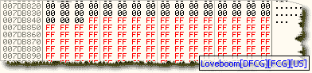  
   
我选择 7db850 保存注册名信息, 7db870 保存相关 patch 代码.这样这一步就完成了,转第三步  
  
3.找 patch 时机:  
  
  重新来过,在 6930f8 处下内存写入断点,这样第一次在这里中断,

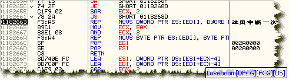  
   
通过上面可以看出来,这里正是在解压代码,我们设置的检测时间为 10s 所以到这里后,检测代码是否为 call xxxx,如果是则表示解压完成,直接在完成解压后写入我们的修改代码?修改一下试试就知道,一修改壳很快就会报错.  
   
再次重来,这次不用急,过了后上面的地方后再下内存访问断点看看:

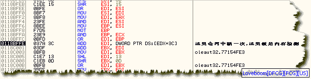  
   
因为壳在检测是否之前先是检测代码是否被修改了,然后填充 IAT,然后再检测是否已经注册了.所以我们可以在填充好一个 API 后写入 PATCH 代码,那样壳就不会检测代码了.  
随便在程序内找一个地方,我找的这里:  
004072F8  - FF25 3C936C00   JMP     DWORD PTR DS:\[6C933C\]  
  
在 6c933c 处下存写入断点,中断后发现这里是 LocalAlloc,填充后,我们修改 patch 点就不会报错了.  
4.写入 patch 代码:  
  相关的信息已经获取到了,下面只需在相关地方写上自己的代码:  
注册名信息:

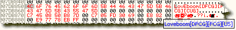  
   
  
Patch 代码:  
   
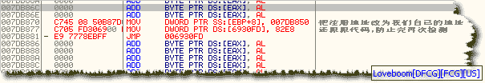  
  
分析到此就结束了,只需写上相关代码就行了(Loader 源码见附件).  
  
这次写的比较简单,反而写文章的时间还多一点.  
你的远去我带走了我的心,留下了你的影子,留下了无限的思念给我!  
  
Love U every Day,wen!!!!!  
  
  
  
  
Greetz:  
 Fly.Jingulong,yock,tDasm.David.hexer,hmimys,ahao.UFO(brother).alan(sister).all of my   
  
friends and you!  
  
          By loveboom\[DFCG\]\[FCG\]\[US\]  
                      http://blog.csdn.net/bmd2chen  
                  
  
                                        Email:loveboom#163.com  
  
  
  
－－－－－－－－－－－－－－－－－－－－  
改进一个重大错误（感谢某网友，也在这里向某网友说声对不起，我真的没有什么时间去解答每一位朋友的问题）．  
严重问题，怪自己没有看 msdn   
修正：  
原 mov handle,eax 行去除，  
原 invoke closehandle,handle  
改成:  
invoke CloseHandle,pi.hThread  
invoke CloseHandle,pi.hProcess  
   

 4dd466d0e1e0cc123afbe504da2462ca