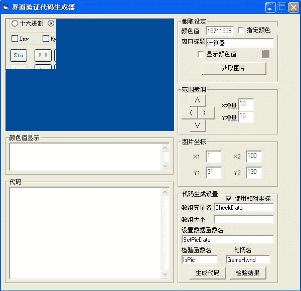
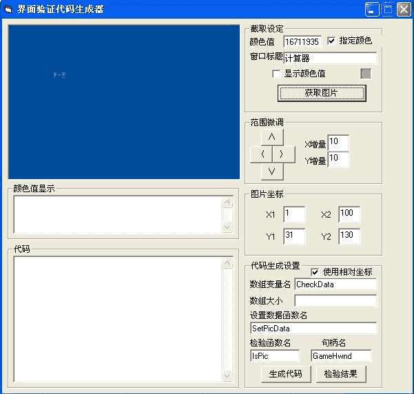

# 【作品提交】界面验证代码生成器

> 原文：[`www.pediy.com/kssd/pediy10/66529.html`](https://www.pediy.com/kssd/pediy10/66529.html)

当你想识别某个程序是否处于某个指定的界面的时候,您是否还在苦苦的编写代码呢,我这个程序能自动帮您生成识别代码(VB 格式),只需要点几下,复制到 VB 的模块里就可以了,您可以自己针对性的修改,当然请保留来源,和作者信息!!  
  
使用方法:  
  我们打开计算器（高级模式）和本程序，然后在本程序的窗口标题里面填写 计算器，然后点获取图片，您可以点击上下左右进行画面的微调  
比如我们想要验证是否有 F-E 这两个粉色的字符，我们只需要将鼠标点到这个字上，您会看到左边的一个方块变成粉色，然后把 指定颜色给勾上再次点获取图片，最后点生成代码就 OK 了，然后  
把代码复制到 VB 里面吧  
  
验证方法：用别的窗口覆盖住计算器，F-E 被覆盖， 然后点本程序的检验结果，出现 FALSE，否则会出现 True  
  
  

上传的附件
|  || 界面验证代码生成器(VB 代码).rar  
 |