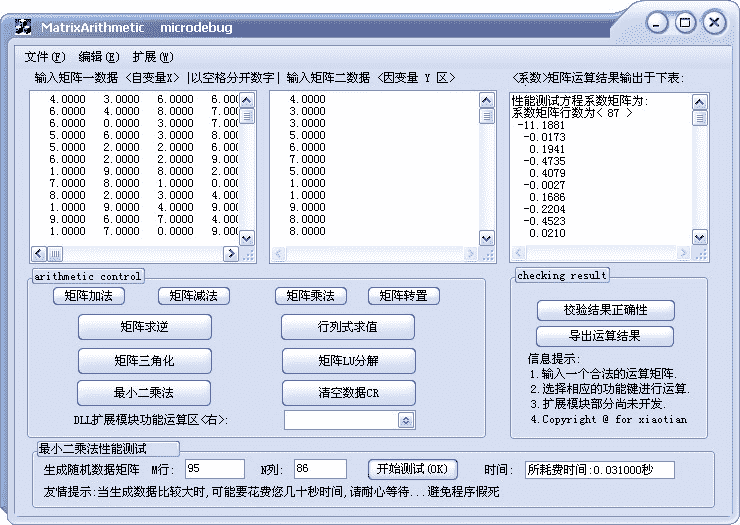

# 矩阵运算小工具

> 原文：[`www.pediy.com/kssd/pediy11/110895.html`](https://www.pediy.com/kssd/pediy11/110895.html)

呵呵，发现人是会变懒的，也是会健忘的；  
大二的时候，写这个东西，只是完成了基本功能；留了扩展接口，想好好写个工具，后来也就不了了之了。  
  
今天又重新翻出来，于是就把它“晒”出来。  
  
代码参考的地方，主要就是几个数值运算函数，以及在 VC 里对字符串的词法解析类的应用,CTokenizer。  
  
实用方面：矩阵运算，最小二乘运算,线性拟合运算  
  
运行时截图：  
  
  
code download.  
metrix.rar