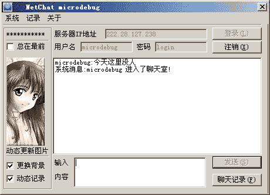
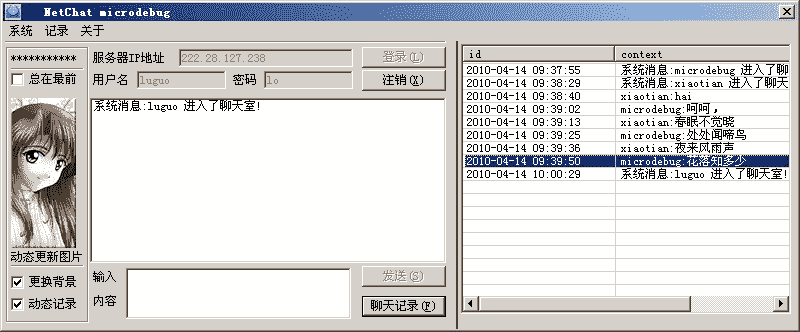

# win32 汇编的一个聊天器&网络与数据库应用

> 原文：[`www.pediy.com/kssd/pediy11/110883.html`](https://www.pediy.com/kssd/pediy11/110883.html)

闲着翻看硬盘，发现以前学习 win32 汇编的时候，写的一个东东；  
简单的聊天器，加了一个保存聊天记录的数据库 access，操作函数都是用原始 API；  
  
关于 win32 汇编，自己的一点感悟：  
1，如果用来编写 WIN 应用程序，有着和 C 语言编写应用程序类似的“SDK 框架”。所以，习惯用 C 编写 WIN 应用程序的来说，总是感觉特别熟悉，二者区别不大；很容易上手。  
2，win32 汇编完美的支持 x86 汇编指令，并且提供了很多的伪指令，大大简化了编写的复杂性。这也促就了很多病毒程序都是用 win32 汇编语言编写的。  
  
  
程序运行时截图，发上来源码，想看的人做个参考吧，我当时也是参考了很多老罗的代码  
  
netChat.rar  
  
  
  
展开聊天记录  
