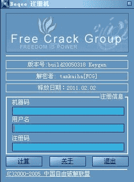

# 自己逆向的 的 you\_known 的某个注册机 源码

> 原文：[`www.pediy.com/kssd/pediy12/133772.html`](https://www.pediy.com/kssd/pediy12/133772.html)

{注册机源码}没有添加 算号功能，有接口 自己添加 感觉界面还不错，大部分由 win32 api 实现  
谢谢 moonife  的邀请码 谢谢看雪  
  

上传的附件
|  || MyKey\_Gen1.rar  
 |