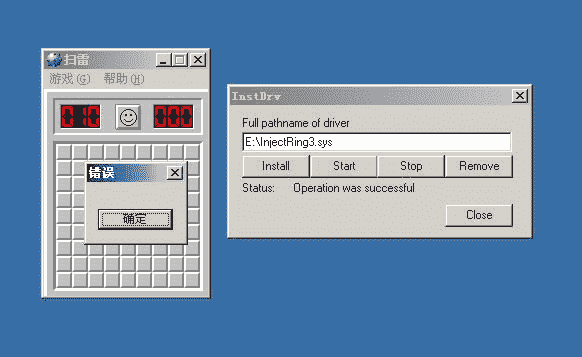

# ring0 注入 ring3 的一种新方法

> 原文：[`www.pediy.com/kssd/pediy10/104069.html`](https://www.pediy.com/kssd/pediy10/104069.html)

插 APC 越来越不好使了，想到了一种新的方法，实践了一下，发出来与大家分享。  
  
其实要注入 ring3 的进程，本质上只是想要借用该进程中的某一个线程来执行一段其它代码而已，再透彻一点讲只是要借用一下某个线程的 eip 来暂时指向我们想让它执行的代码。当然，用完过后要想办法让 eip 能回到原位，这样就不会对该 ring3 线程本身的工作产生干扰。  
  
具体来讲可以这样做：  
  
1、先在要注入的进程中找到一个没有退出的，并且没有被挂起的用户线程。（其实如果找被挂起的还省事一点，就是等的时间长了点，要等它 resume 过后，注入的代码才会被执行。这里以挂起的为例）  
  
2、挂起该线程。这是为了防止它被调度，因为我们要修改它的 EIP。但是 KeSuspendThread 是没有导出的，需要自己实现。（附件的示例代码中是通过查找特征码来做的）  
  
3、我们先来看一看准备注入到 Ring3 的代码。在本示例中，我准备注入的代码如下：  

代码:

```
////////////////////////////////////////////////
//
//  被注入到 ring3 进程的代码
//
////////////////////////////////////////////////
\_declspec (naked) void ShellCode() {
  \_asm {
    push eax
    // 弹个 MessageBox 为例
    push 0
    push 0
    push 0
    push 0
    mov eax, 0x77D66484    // MessageBoxW 的地址，XP SP2
    call eax
    pop eax
    // jmp ds:12345678H, 绝对地址跳转
    \_emit 0xEA
    \_emit 0x78
    \_emit 0x56
    \_emit 0x34
    \_emit 0x12
    \_emit 0x1B
    \_emit 0x00
  }
}

```

ShellCode 以 MessageBoxW(0,0,0,0)为例，代码最后需要有个 jmp ds:0x12345678 的绝对跳转，这是为了跳回 EIP 原来的地方。  
所以现在要做的就是把 0x12345678 改成 KTHREAD->KTRAP\_FRAME->EIP 中的值，再把 ShellCode 拷贝到该 Ring3 线程能够抚摸到的位置，最后把 KTHREAD->KTRAP\_FRAME->EIP 改成 ShellCode 被拷贝到的地址。  
那么将 ShellCode 拷贝到什么地方呢？我一开始为了方便，将 ShellCode 拷贝到了 KUSER\_SHARED\_DATA 的后面，这样可以避免申请空间，以及 KeStackAttachProcess 等麻烦。KUSER\_SHARED\_DATA 所在的地址被同时映射到了内核空间（0xffdf0000）和用户空间（0x7ffe0000）中，大小为 4K，但是其实 KUSER\_SHARED\_DATA 连 1K 都没占到，所以可以把 ShellCode 拷到 KUSER\_SHARED\_DATA 的后面，非常理想^\_^。  
代码片断如下：  
代码:

```
// 将 ShellCode 中的 0x12345678 改成 eip，为了 ShellCode 执行完后自动跳回
for( i = (ULONG)ShellCode; i <= (ULONG)ShellCode + 0x20; ++i ) {
  if( MmIsAddressValid((PVOID)i) && MmIsAddressValid((PVOID)(i+3)) ){
    if ( \*(PULONG)i == 0x12345678 ) {
      DbgPrint("find modify point\\n");
      \*(PULONG)i = pTrapFrame->Eip;
      break;
    }
  }
}

// 拷贝 ShellCode 到“飞地”（使用内核地址）
RtlCopyMemory( (PVOID)0xffdf0800, ShellCode, 0x20 );

// pTrapFrame->EIP 指向“飞地”（使用用户态地址）
pTrapFrame->Eip = 0x7ffe0800;

```

后来发现在非调试模式下，执行 KUSER\_SHARED\_DATA 处的代码会导致 DEP 暴走，遂老老实实地自己分配空间了。  
代码片断如下：  
代码:

```
// 将 ShellCode 中的 0x12345678 改成 eip，为了 ShellCode 执行完后自动跳回
for( i = (ULONG)ShellCode; i <= (ULONG)ShellCode + 0x20; ++i ) {
  if( MmIsAddressValid((PVOID)i) && MmIsAddressValid((PVOID)(i+3)) ){
    if ( \*(PULONG)i == 0x12345678 ) {
      DbgPrint("find modify point\\n");
      \*(PULONG)i = pTrapFrame->Eip;
      break;
    }
  }
}

// 下面的代码是分配空间来放置 ShellCode
// 调用一些相应函数来实现更好，我比较懒，就硬编码了
InitializeObjectAttributes(&oa,0,0,0,0);
pCid = (CLIENT\_ID\*)((ULONG)pThread + 0x1ec);    // Cid   XP SP2
ntstatus = ZwOpenProcess( 
  &hProcess, 
  PROCESS\_ALL\_ACCESS, 
  &oa, 
  pCid 
  );
if ( NT\_SUCCESS(ntstatus) ) {
  PVOID pBuff = NULL;
  SIZE\_T size = 0x20;
  ntstatus = NtAllocateVirtualMemory(
    hProcess, 
    &pBuff, 
    0, 
    &size, 
    MEM\_RESERVE | MEM\_COMMIT,
    PAGE\_EXECUTE\_READWRITE
    );
  if( NT\_SUCCESS(ntstatus) ) {
    KAPC\_STATE kapc;
    // 拷贝 ShellCode 到目标进程中去
    KeStackAttachProcess(pProcess,&kapc);
    RtlCopyMemory(pBuff,ShellCode,size);
    KeUnstackDetachProcess (&kapc);
    // pTrapFrame->Eip 指向 ShellCode
    pTrapFrame->Eip = (ULONG)pBuff;
  }
  ZwClose(hProcess);
}

```

4、KeRusumeThread，恢复该线程的执行，于是该线程会先去执行 ShellCode。  
  
以下是注入扫雷的截图：  
  
  
完整示例代码见附件（测试平台 XP SP2）。

上传的附件
|  || InjectRing3.rar  
 |