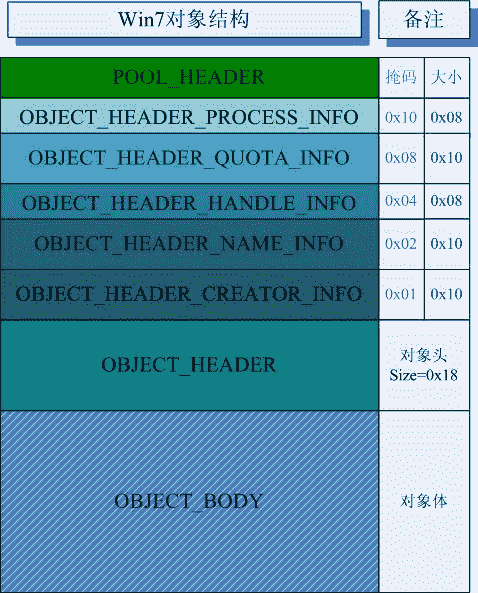

# \[原创\]Win7 可变对象头结构之 InfoMask 解析

> 原文：[`www.pediy.com/kssd/pediy11/118325.html`](https://www.pediy.com/kssd/pediy11/118325.html)

对 Windows 对象管理有一定了解的人都知道，在固定对象头(OBJECT\_HEADER)前面是一块可变区域，称为可变对象头，它所包含的结构内容并不固定。在 Win7 之前，可变区域实际有哪些结构，通常是由 OBJECT\_HEADER 中的几个偏移值指出。如下：  
lkd> dt \_OBJECT\_HEADER(WinXP SP2)  
nt!\_OBJECT\_HEADER  
   +0x000 PointerCount     : Int4B  
   +0x004 HandleCount      : Int4B  
   +0x004 NextToFree       : Ptr32 Void  
   +0x008 Type             : Ptr32 \_OBJECT\_TYPE  
   +0x00c NameInfoOffset   : UChar  
   +0x00d HandleInfoOffset : UChar  
   +0x00e QuotaInfoOffset  : UChar  
   +0x00f Flags            : UChar  
   +0x010 ObjectCreateInfo : Ptr32 \_OBJECT\_CREATE\_INFORMATION  
   +0x010 QuotaBlockCharged : Ptr32 Void  
   +0x014 SecurityDescriptor : Ptr32 Void  
   +0x018 Body             : \_QUAD  
其中的 NameInfoOffset、HandleInfoOffset、QuotaInfoOffset 就是用于指出该结构相对于固定对象头(OBJECT\_HEADER)的偏移。如果 NtGlobalFlags 设置了 MaintainTypeList 标志，那么由于 CreatorInfo 的存在，这个部分还会更复杂一点，还得依据 OBJECT\_HEADER->Flag 中的标志位来作一些判断才能具体确定某个结构的具体偏移。在 Win7 中，这一部分显然经过了精心设计，一个 InfoMask 域再加一个 ObpInfoMaskToOffset 表就搞定了，显得更加简捷快速。  
顾名思义，InfoMask 就是一个掩码，它的每一位表示可变对象头中某个指定的结构是否存在。在 Win7 中，对象的结构大体上没有太大变化，固定对象头的前面仍然是可变对象头。根据不同类型的对象及实际情况，可变对象头可能包含以下 5 个结构中的一个或几个:      
    (Size=0x08)ntkrpamp!\_OBJECT\_HEADER\_PROCESS\_INFO  
    (Size=0x10)ntkrpamp!\_OBJECT\_HEADER\_QUOTA\_INFO  
    (Size=0x08)ntkrpamp!\_OBJECT\_HEADER\_HANDLE\_INFO  
    (Size=0x10)ntkrpamp!\_OBJECT\_HEADER\_NAME\_INFO  
    (Size=0x10)ntkrpamp!\_OBJECT\_HEADER\_CREATOR\_INFO  
这些结构对应的掩码分别为:  
    #define OB\_INFOMASK\_PROCESS\_INFO     0x10  
    #define OB\_INFOMASK\_QUOTA           0x08  
    #define OB\_INFOMASK\_HANDLE         0x04  
    #define OB\_INFOMASK\_NAME           0x02  
    #define OB\_INFOMASK\_CREATOR\_INFO     0x01  
因为可变对象头可能包含 5 种结构，每一种结构包括存在或不存在两种情况，那么一共是 2⁵=32 种结果。所以，ObpInfoMaskToOffset 表定义如下:  

代码:

```
BYTE ObpInfoMaskToOffset\[32\];

```

而存在的结构就要占据一定的空间，那么对象头(OBJECT\_HEADER)距 PoolHeader 的偏移就会因结构存在与否产生对应的变化，该偏移实际上也就是可变对象头的总大小。该表的初始化是在 ObInitSystem()中进行的。初始化代码如下:  
代码:

```
 ULONG i = 0;
 ULONG offset = 0;
    do
    {
      offset = 0;
      if ( i & OB\_INFOMASK\_CREATOR\_INFO )
        offset = sizeof(\_OBJECT\_HEADER\_CREATOR\_INFO);
      if ( i & OB\_INFOMASK\_NAME )
        offset += sizeof(\_OBJECT\_HEADER\_NAME\_INFO);
      if ( i & OB\_INFOMASK\_HANDLE )
        offset += sizeof(\_OBJECT\_HEADER\_HANDLE\_INFO);
      if ( i & OB\_INFOMASK\_QUOTA )
        offset += sizeof(\_OBJECT\_HEADER\_QUOTA\_INFO);
      if ( i & OB\_INFOMASK\_PROCESS\_INFO )
        offset += sizeof(\_OBJECT\_HEADER\_PROCESS\_INFO);
      ObpInfoMaskToOffset\[i++\] = offset;
    }while(i<32);

```

初始化完成后表的内容如下:  
代码:

```
kd> db ObpInfoMaskToOffset
83b97e60  00 10 10 20 08 18 18 28-10 20 20 30 18 28 28 38  ... ...(.  0.((8
83b97e70  08 18 18 28 10 20 20 30-18 28 28 38 20 30 30 40  ...(.  0.((8 00@

```

可以看到，根据掩码不同，那么实际存在的可变头结构就不同，其大小是掩码所代表的有效结构的大小之和。可变头为空，那么偏移自然为 0,若 5 个结构都包含了，那么偏移就是所有结构之和，也就是 0x40。所以，根据对象头中的掩码 InfoMask，就可以确定可变头部分的大小和具体包含的结构，及每一个结构相对于固定对象头(OBJECT\_HEADER)的实际偏移。因为这个偏移是相对于固定对象头(OBJECT\_HEADER)往前的偏移，而在初始化过程中，这个偏移的值却又是依次累加的，所以后来加上的结构大小，在整个可变对象头中反而比较靠上，掩码小的结构离固定对象头越近。我以一个明确的图来说明这些信息：  
  
举个例子，比如某对象的 ObjectHeader->InfoMask 值为 9,那么就说明它包含了\_OBJECT\_HEADER\_CREATOR\_INFO(对应掩码为 1)和\_OBJECT\_HEADER\_QUOTA\_INFO(对应掩码为 8)两个结构，ObpInfoMaskToOffset\[9\]的值为 0x20，正是这两个结构的大小之和。并且，由于掩码小的结构离固定对象头越近，所以可以明确知道 ObjectHeader-0x10 是\_OBJECT\_HEADER\_CREATOR\_INFO 结构，ObjectHeader->0x20 是\_OBJECT\_HEADER\_QUOTA\_INFO 结构。  
下面我以一个实际的例子来详细说明。  
代码:

```
kd> dt \_OBJECT\_TYPE 84e4aa38 //查看对象类型
nt!\_OBJECT\_TYPE
   +0x000 TypeList         : \_LIST\_ENTRY \[ 0x8603a548 \- 0x863593e8 \] //为了便观察到同类型的所有对象，我设置了 MaintainTypeList 标志
   +0x008 Name             : \_UNICODE\_STRING "WindowStation"
   +0x010 DefaultObject    : (null) 
   +0x014 Index            : 0x14 ''
   +0x018 TotalNumberOfObjects : 6
   +0x01c TotalNumberOfHandles : 0x35
   +0x020 HighWaterNumberOfObjects : 6
   +0x024 HighWaterNumberOfHandles : 0x3f
   +0x028 TypeInfo         : \_OBJECT\_TYPE\_INITIALIZER
   +0x078 TypeLock         : \_EX\_PUSH\_LOCK
   +0x07c Key              : 0x646e6957
   +0x080 CallbackList     : \_LIST\_ENTRY \[ 0x84e4aab8 - 0x84e4aab8 \]
kd> !pool 0x8603a548 //观察第一个对象的内存池分配
Pool page 8603a548 region is Nonpaged pool
 8603a500 size:   18 previous size:   48  (Allocated)  MmSi
\*8603a518 size:   b0 previous size:   18  (Allocated) \*Wind (Protected)
        Owning component : Unknown (update pooltag.txt)
 8603a5c8 size:   78 previous size:   b0  (Allocated)  EtwR (Protected)
...

```

可以看到，内存池的分配从 8603a518 开始。  
代码:

```
kd> dd 8603a518 
8603a518  04160003 e46e6957 00000000 00000068
8603a528  00000094 83b44c40 8a42edb8 00000002
8603a538  90ca2cd8 000e000e 90d95cd0 00000000
8603a548  86062f80 84e4aa38 0000016c 00000000
8603a558  0000000c 00000005 00000000 000f0014
8603a568  83b44c40 90d9c23e 00000000 86022848
8603a578  8604d8c8 91badaa0 00000000 ffabb8e8
8603a588  00000000 00000000 00000000 00000000

```

根据对象的 TypeIndex 为 0x14，及 TypeIndex 在 OBJECT\_HEADER 中的偏移，不难看出 8603a558 就是对象头。  
代码:

```
kd> dt \_OBJECT\_HEADER 8603a558  
nt!\_OBJECT\_HEADER
   +0x000 PointerCount     : 12
   +0x004 HandleCount      : 5
   +0x004 NextToFree       : 0x00000005 
   +0x008 Lock             : \_EX\_PUSH\_LOCK
   +0x00c TypeIndex        : 0x14 ''
   +0x00d TraceFlags       : 0 ''
   +0x00e InfoMask         : 0xf ''
   +0x00f Flags            : 0 ''
   +0x010 ObjectCreateInfo : 0x83b44c40 \_OBJECT\_CREATE\_INFORMATION
   +0x010 QuotaBlockCharged : 0x83b44c40 
   +0x014 SecurityDescriptor : 0x90d9c23e 
   +0x018 Body             : \_QUAD

```

可以看到，InfoMask 为 0xF=8+4+2+1，也就是说包含了\_OBJECT\_HEADER\_QUOTA\_INFO(掩码为 8)、\_OBJECT\_HEADER\_HANDLE\_INFO(掩码为 4)、\_OBJECT\_HEADER\_NAME\_INFO(掩码为 2)和\_OBJECT\_HEADER\_CREATOR\_INFO(掩码为 1)这四个结构。掩码最大的结构\_OBJECT\_HEADER\_QUOTA\_INFO 在最上面：  
代码:

```
kd> dt \_OBJECT\_HEADER\_QUOTA\_INFO 8603a520
nt!\_OBJECT\_HEADER\_QUOTA\_INFO
   +0x000 PagedPoolCharge  : 0
   +0x004 NonPagedPoolCharge : 0x68
   +0x008 SecurityDescriptorCharge : 0x94
   +0x00c SecurityDescriptorQuotaBlock : 0x83b44c40 
//加上该结构的大小，就是下一个结构\_OBJECT\_HEADER\_HANDLE\_INFO
kd> dt \_OBJECT\_HEADER\_HANDLE\_INFO 8603a520+10
nt!\_OBJECT\_HEADER\_HANDLE\_INFO
   +0x000 HandleCountDataBase : 0x8a42edb8 \_OBJECT\_HANDLE\_COUNT\_DATABASE
   +0x000 SingleEntry      : \_OBJECT\_HANDLE\_COUNT\_ENTRY
//同理，下一个结构是\_OBJECT\_HEADER\_NAME\_INFO
kd> dt \_OBJECT\_HEADER\_NAME\_INFO 8603a520+10+8
nt!\_OBJECT\_HEADER\_NAME\_INFO
   +0x000 Directory        : 0x90ca2cd8 \_OBJECT\_DIRECTORY
   +0x004 Name             : \_UNICODE\_STRING "WinSta0"
   +0x00c ReferenceCount   : 0
//然后是\_OBJECT\_HEADER\_CREATOR\_INFO
kd> dt \_OBJECT\_HEADER\_CREATOR\_INFO 8603a520+10+8+10
nt!\_OBJECT\_HEADER\_CREATOR\_INFO
   +0x000 TypeList         : \_LIST\_ENTRY \[ 0x86062f80 - 0x84e4aa38 \]
   +0x008 CreatorUniqueProcess : 0x0000016c 
   +0x00c CreatorBackTraceIndex : 0
   +0x00e Reserved         : 0
kd> !process 16c 0
Searching for Process with Cid == 16c
Cid Handle table at 93365000 with 553 Entries in use
PROCESS 84e39d40  SessionId: 0  Cid: 016c    Peb: 7ffd4000  ParentCid: 0140
    DirBase: 1ee8a0a0  ObjectTable: 90cae1f8  HandleCount:  75.
    Image: wininit.exe

```

查看 WinSta0 的创建者，发现是 wininit.exe~~  
理解上以上结构，相信对于获取可变对象头中某个结构的位置已经不在话下。实际上，Win7 的内核导出了一个函数专门用于获取对象头中的\_OBJECT\_HEADER\_NAME\_INFO 结构。该函数就是 ObQueryNameInfo()，还原成源码如下:  
代码:

```
PVOID ObQueryNameInfo(IN PVOID Object)
{
    POBJECT\_HEADER ObjectHeader=OBJECT\_TO\_OBJECT\_HEADER(Object);
    BYTE InfoMask=ObjectHeader->InfoMask;
    ULONG NameInfo=0;
    if(InfoMask & OB\_INFOMASK\_NAME)
    {
        NameInfo=(ULONG)ObjectHeader - ObpInfoMaskToOffset\[InfoMask & (OB\_INFOMASK\_NAME+OB\_INFOMASK\_CREATOR\_INFO)\];
    }
    else
    {
        NameInfo=0;
    }
    return (PVOID)NameInfo;
}

```

源码很好理解，取 ObjectHeader->InfoMask，判断 OB\_INFOMASK\_NAME 标志位是否有效，若无效说明可变头中并没有这个结构。若有效，就根据掩码取\_OBJECT\_HEADER\_NAME\_INFO 靠下的两个结构的大小(包括\_OBJECT\_HEADER\_NAME\_INFO 和\_OBJECT\_HEADER\_CREATOR\_INFO 两个结构)，然后对象头减去这个偏移量，就是\_OBJECT\_HEADER\_NAME\_INFO 结构的位置了，结合前面的结构图，相信不难理解。  
实际上，根据掩码与结构大小的对应关系，完全可以用一个更一般的方式来获取相应的可变对象头结构信息。如下：  
代码:

```
PVOID GetSpecificObjectHeaderInfo(PVOID Object,BYTE HeaderMask)
{
    POBJECT\_HEADER ObjectHeader=(POBJECT\_HEADER)OBJECT\_TO\_OBJECT\_HEADER(Object);
    BYTE InfoMask=ObjectHeader->InfoMask;
    BYTE MaxMask=0;
    ULONG HeaderInfo=0;
    if(InfoMask & HeaderMask)
    {
        MaxMask=2\*HeaderMask-1;
        HeaderInfo=(ULONG)ObjectHeader - ObpInfoMaskToOffset\[InfoMask & MaxMask\];
    }
    else
    {
        HeaderInfo=0;
    }
    return (PVOID)HeaderInfo;
}

```

参数解释：  
    Object : 欲操作的对象  
    HeaderMask : 要获取的对象结构对应的掩码  
    函数中的 ObpInfoMaskToOffset 可以自己定义，反正内容和初始化方式已经清楚了，内容一样用起来没什么影响  
  
这样，直接用 GetSpecificObjectHeaderInfo(Object,OB\_INFOMASK\_NAME)就可以代替 ObQueryNameInfo(Object)了。  
如果要获取\_OBJECT\_HEADER\_HANDLE\_INFO 结构，那么 GetSpecificObjectHeaderInfo(Object,OB\_INFOMASK\_HANDLE)就可以了，获取其它结构信息也是如此，非常方便~~  
  
关于 Win7 的可变对象头，就说到这里~~