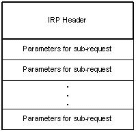
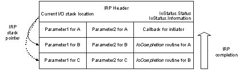

# Windows 内核中 IRP 的处理与完成机制

> 原文：[`www.pediy.com/kssd/pediy10/94025.html`](https://www.pediy.com/kssd/pediy10/94025.html)

近来学习 Windows 内核方面的东西，觉得对 I/O 处理过程没有一个总体的概念。于是，就花了一点时间搜集了很多这方面的资料并自己总结了一下。下面说说我自己的理解。  
在 Windows 内核中的 I/O 请求基本上是通过 I/O Request Packet （IRP）完成的。下面，我就来详细地说下 IRP 请求是怎么样一步一步完成的。   
      首先，我们就需要知道 IRP 是怎么产生。IRP 是由 I/O 管理器发出的，I/O 管理器是用户态与内核态之间的桥梁，当用户态进程发出 I/O 请求时，I/O 管理器就捕获这些请求，将其转换为 IRP 请求，发送给驱动程序。I/O 管理器无疑是非常重要的，具有核心地位。它负责所有 I/O 请求的调度和管理工作，根据请求的不同内容，选择相应的驱动程序对象，设备对象，并生成、发送、释放各种不同的 IRP。整个 I/O 处理流程是在它的指挥下完成的。  
      一个 IRP 是从非分页内存中分配的可变大小的结构，它包括两部分：IRP 首部和辅助请求参数数组，如图 1 所示。这两部分都是由 I/O 管理器建立的。  
  
  
图 1 IRP 简单结构图  
      IRP 首部中包含了指向 IRP 输入输出缓冲区指针、当前拥有 IRP 的驱动指针等。  
紧接着首部的是一个 IO\_STACK\_LOCATION 结构的数组。它的大小由设备栈中的设备数确定（设备栈的概念会在下文中阐述）。IO\_STACK\_LOCATION 结构中保存了一个 I/O 请求的参数及代码、请求当前对应的设备指针、完成函数指针（IoCompletion）等。  
      那么，由 I/O 管理器产生的 IRP 请求发送到哪去了呢？这里我们就要来说说设备栈的概念了，操作系统用设备对象（device object）表示物理设备，每一个物理设备都有一个或多个设备对象与之相关联，设备对象提供了在设备上的所有操作。也有一些设备对象并不表示物理设备。一个唯软件驱动程序（software-only driver，处理 I/O 请求，但是不把这些请求传递给硬件）也必须创建表示它的操作的设备对象。设备常常由多个设备对象所表示，每一个设备对象对应一个驱动程序来管理设备的 I/O 请求。一个设备的所有设备对象被组织成一个设备栈（device stack）。而且，IO\_STACK\_LOCATION 数组中的每个元素和设备栈中的每个设备是一一对应的，一般情况下，只允许层次结构中的每个设备对象访问它自己对应的 IO\_STACK\_LOCATION。无论何时，一个请求操作都在一个设备上被完成，I/O 管理器把 IRP 请求传递给设备栈中顶部设备的驱动程序（IRP 是传递给设备对象的，通过设备对象的 DriverObject 成员找到驱动程序）。驱动程序访问它对应的设备对象在 IRP 中 IO\_STACK\_LOCATION 数组中的元素检查参数，以决定要进行什么操作（通过检查结构中的 MajorFunction 字段，确定执行什么操作及如何解释 Parameters 共用体字段的内容）。驱动程序可以根据 IO\_STACK\_LOCATION 结构中的 MajorFunction 字段进行处理。每一个驱动或者处理 IRP，或者把它传递给设备栈中下一个设备对象的驱动程序。  
  
传递 IRP 请求到底层设备的驱动程序需要经过下面几个步骤：  
1.  为下一个 IO\_STACK\_LOCATION 结构设置参数。可以有以下两种方式：  
  调用 IoGetNextIrpStackLocation 函数获得下个结构的指针，再对参数进行赋值；  
  调用 IoCopyCurrentIrpStackLocationToNext 函数（如果第 2 步中驱动设置了 IoCompletion 函数），或者调用 IoSkipCurrentIrpStackLocation 函数（如果第 2 步中驱动没有设置 IoCompletion 函数）把当前的参数传递给下一个。  
2.  如果需要的话，调用 IoSetCompletionRoutine 函数设置 IoCompletion 函数进行后续处理。  
3.  调用 IoCallDriver 函数将 IRP 请求传递给下一层驱动。这个函数会自动调整 IRP 栈指针，并且执行下一层驱动的派遣函数。  
当驱动程序把 IRP 请求传递给下一层驱动之后，它就不再拥有对该请求的访问权，强行访问会导致系统崩溃。如果驱动程序在传递完之后还想再访问该请求，就必须要设置 IoCompletion 函数。IRP 请求可以再其他驱动程序或者其他线程中完成或取消。  
  
当某一驱动程序调用 IoCompleteRequest 函数时，I/O 操作就完成了。这个函数使得 IRP 的堆栈指针向上移动一个位置，如图 2 所示：  
  
  
图 2 IRP 完成时栈指针的移动  
图 2 所示的当 C 驱动程序调用完 IoCompleteRequest 函数后 I/O 栈的情况。左边的实线箭头表明栈指针现在指向驱动 B 的参数和回调函数；虚线箭头是之前的情况。右边的空心箭头指明了 IoCompletion 函数被调用的顺序。  
如果驱动程序把 IRP 请求传递给设备栈中的下层设备之前设置了 IoCompletion 函数，当 I/O 栈指针再次指回到该驱动程序时，I/O 管理器就将调用该 IoCompletion 函数。  
IoCompletion 函数的返回值有两种：  
（1）STATUS\_CONTINUE\_COMPLETION：告诉 I/O 管理器继续执行上层驱动程序的 IoCompletion 函数。  
（2）STATUS\_MORE\_PROCESSING\_REQUIRED：告诉 I/O 管理器停止执行上层驱动程序，并将栈指针停在当前位置。在当前驱动程序调用 IoCompleteRequest 函数后再继续执行上层驱动的 IoCompletion 函数。  
当所有驱动都完成了它们相应的子请求时，I/O 请求就结束了。I/O 管理器从 Irp >IoStatus.Status 中更新状态信息，从 Irp >IoStatus.Information 中获得传送字节数。  
  
大概就是这样了，我也是刚学习 Windows 内核方面的知识，有什么理解不正确的地方，欢迎大家批评指正！另外，有些内容参考了一些英文资料，翻译上可能有不符合规范的，大家见谅！