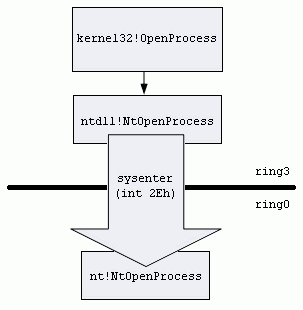
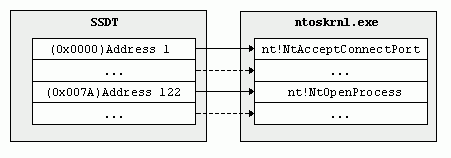

# windows 体系结构学习笔记

> 原文：[`www.pediy.com/kssd/pediy10/84946.html`](https://www.pediy.com/kssd/pediy10/84946.html)

序言:  
接触驱动一个学,感觉路走得很艰难,许多底层知识不了解,也没人可以问,许多大牛发表的文章我等初入 ke  
rnel 的小菜根本都看不懂,最近学习写驱动,有惑于 DeviceIoControl、ZW\*\*函数、NT\*\*函数、SSDT、pspcidtabl  
e、windbg 等底层知识,特参考大牛文章整理一篇文章,此等菜文无颜面世,但想到此时此刻可能有跟我一样  
疑惑的菜鸟,不忍弃之,遂发于此处。牛人给面子的指点下,鄙视的也请指导下,偶全部铭刻于心。 欢迎跟我一样菜的鸟 l 来交流学习。  
Windwos 体系结构:  
\--------------------------------------  
用户模式(ring3)  
系统进程、服务进程、应用程序、环境子系统(向应用程序提供环境和应用程序编程接口 Appplication Progra  
mming Interface-API。Windows 2000/XP 支持三种环境子系统:Win32、POSIX 和 OS/2,其中最重要的环境子  
系统是 Win32 子系统,其他子系统都要通过 Win32 子系统 接收用户的输入和显示输出。环境子系统的作用是  
将基本的执行体系统服务的某些子集提供给应用程序。 用户应用程序调用系统服务时必须通过一个或多个子  
系统动态链接库作为中介才可以完成)、应用程序编程接口(API)、基于 NTDLL.DLL 的本地系统服务  
\--------------------------------------  
内核模式(ring0)  
系统服务调用(SSDT)、执行体(Executive)、系统内核和设备驱动(Kernel)、硬件抽象层(HAL)  
一、Windows 系统服务调用机制  
Windows 2000 的陷阱调度(Trap Dispatching)机制包括了:中断(Interrupt),延迟过程调用(Deferred Proc  
edure Call),异步过程调用(Asynchronous Procedure Call),异常调度(Exception Dispatching)和系统服务  
调用(System Service Call)。在 Intel x86 平台的 Windows 2000 使用 int 0x2e 指令进入 Windows 系统服务调用;  
Windows XP 使用 sysenter 指令使系统陷入系统服务调用程序中;而 AMD 平台的 Windows XP 系统使用 syscall  
指令进入 Windows 系统服务调用。下面是 Intel x86 平台的 Windows 2000 的系统服务调用模型。  
mov eax, ServiceId  
lea edx, ParameterTable  
int 2eh  
ret ParamTableBytes  
其中 ServiceId 是传递给系统服务调用程序的 ID 号,内核使用这个 ID 号来查找系统服务调度表(System Service  
Dispath Table)中的对应系统服务信息。 系统服务调用也是一个接口,是面向 Windows 内核的接口。它实现  
了将用户模式下的请求转发到内核模式下,并引发了处理器模式的切换。在用户看来,系统服务调用就是与 W  
indows 内核通信的一个桥梁。  
二、系统服务调用类型  
在 Windows 2000 中默认存在两个系统服务调度表,它们对应了两类不同的系统服务。这两个系统服务调度表  
分别是:KeServiceDescriptorTable 和 KeServiceDescriptorTableShadow。 前者有 ntoskrnl.exe 导出,后者由 Win3  
2k.sys 导出。在系统中,有三个 DLL 是最重要的:Kernel32.dll、 User32.dll 和 Gdi32.dll,这些 DLL 导出的函数,  
都是通过某种类型的中断进入内核态,然后调用 ntoskrnl.exe 或 Win32k.sys 中的函数。函数 KeAddSystemServic  
eTable 允许 Win32.sys 和其他设备驱动程序添加系统服务表。除了 Win32k.sys 服务表外,使用 KeAddSystemServ  
iceTable 添加的服务表会被同时复制到 KeServiceDescriptorTable 和 KeServiceDescriptorTableShadow 中去。  
说明:  
NTDLL..DLL 和 ntoskrnl.exe 的关系很“微妙”,用户态和内核态的调用也是有分别的,比如:参数检查。还有 N  
ative API 导出了 2 套函数:Zw\*\*\*和 Nt\*\*\*系列,要想彻底了解这些内容,推荐看 Sunwear 写的《浅析本机 API》  
综上所述,Kernel32.dll/Advapi32.dll 进入 NTDLL.DLL 后,使用 int 0x2e 中断进入内核,最后在 ntoskrnl.exe 中实  
现了真正的函数调用;User32.dll 和 Gdi32.dll 则在 Win32k.sys 中实现了真正的函数调用。  
三、本机 API(Native API)  
本机 API 是除了 Win32 API,NT 平台开放了另一个基本接口。本机 API 也被很多人所熟悉,因为内核模式模块  
位于更低的系统级别,在那个级别上环境子系统是不可见的。尽管如此,并不需要驱动级别去访问这个接口,  
普通的 Win32 程序可以在任何时候向下调用本机 API。并没有任何技术上的限制,只不过微软不支持这种应用  
开发方法。User32.dll,kernel32.dll,shell32.dll,gdi32.dll,rpcrt4.dll,comctl32.dll,advapi32.dll,version.dll 等 dll 代表了 Wi  
n32 API 的基本提供者。Win32 API 中的所有调用最终都转向了 ntdll.dll,再由它转发至 ntoskrnl.exe。ntdll.dll 是  
本机 API 用户模式的终端。真正的接口在 ntoskrnl.exe 里完成。事实上,内核模式的驱动大部分时间用这个模  
块,如果它们请求系统服务。Ntdll.dll 的主要作用就是让内核函数的特定子集可以被用户模式下运行的程序调  
用。Ntdll.dll 通过软件中断 int 2Eh 进入 ntoskrnl.exe,就是通过中断门切换 CPU 特权级。比如 kernel32.dll 导出  
的函数 DeviceIoControl()实际上调用 ntdll.dll 中导出的 NtDeviceIoControlFile(),反汇编一下这个函数可以看到,E  
AX 载入 magic 数 0x38,实际上是系统调用号,然后 EDX 指向堆栈。目标地址是当前堆栈指针 ESP+4,所以 ED  
X 指向返回地址后面一个,也就是指向在进入 NtDeviceIoControlFile()之前存入堆栈的东西。事实上就是函数的  
参数。下一个指令是 int 2Eh,转到中断描述符表 IDT 位置 0x2E 处的中断处理程序。  
反编汇这个函数得到:  
mov eax, 38h  
lea edx, \[esp+4\]  
int 2Eh  
ret 28h  
当然 int 2E 接口不仅仅是简单的 API 调用调度员,他是从用户模式进入内核模式的 main gate。  
W2k Native API 由 248 个这么处理的函数组成,比 NT 4.0 多了 37 个。可以从 ntdll.dll 的导出列表中很容易认出  
来:前缀 Nt。Ntdll.dll 中导出了 249 个,原因在于 NtCurrentTeb()为一个纯用户模式函数,所以不需要传给内核。  
令人惊奇的是,仅仅 Native API 的一个子集能够从内核模式调用。而另一方面,ntoskrnl.exe 导出了两个 Nt\*符  
号,它们不存在于 ntdll.dll 中: NtBuildNumber, NtGlobalFlag。它们不指向函数,事实上,是指向 ntoskrnl.exe 的  
变量,可以被使用 C 编译器 extern 关键字的驱动模块导入。Ntdll.dll 和 ntoskrnl.exe 中都有两种前缀 Nt\*,Zw\*。  
事实上 ntdll.dll 中反汇编结果两者是一样的。而在 ntoskrnl.exe 中,nt 前缀指向真正的代码,而 zw 还是一个 int  
2Eh 的 stub。也就是说 zw\*函数集通过用户模式到内核模式门传递的,而 Nt\*符号直接指向模式切换以后的代码。  
Ntdll.dll 中的 NtCurrentTeb()没有相对应的 zw 函数。Ntoskrnl 并不导出配对的 Nt/zw 函数。有些函数只以一种方  
式出现。  
四、系统服务调用示意图  
\------------------------------------  
Win32 API ->Ntdll.h ->SSDT (提供用户态到内核态的的转换)->ntoskrnl.exe  
\-------------------------------------  
Win32 API 包括:User32.dll,kernel32.dll,shell32.dll,gdi32.dll,rpcrt4.dll,comctl32.dll,advapi32.dll,version.dll 等 dll  
Ntdll.h :ZW\*\*和 NT\*\*系列函数  
ntoskrnl.exe:ZW\*\*和 NT\*\*系列函数  
五、SSDT 说明  
什么是 SSDT?  
什么是 SSDT?自然,这个是我必须回答的问题。不过在此之前,请你打开命令行(cmd.exe)窗口,并输入“  
dir”并回车好了,列出了当前目录下的所有文件和子目录。  
那么,以程序员的视角来看,整个过程应该是这样的:  
1.由用户输入 dir 命令。  
2.cmd.exe 获取用户输入的 dir 命令,在内部调用对应的 Win32 API 函数 FindFirstFile、FindNextFile 和 FindClose,  
获取当前目录下的文件和子目录。  
3.cmd.exe 将文件名和子目录输出至控制台窗口,也就是返回给用户。  
到此为止我们可以看到,cmd.exe 扮演了一个非常至关重要的角色,也就是用户与 Win32 API 的交互。你  
大概已经可以猜到,我下面要说到的 SSDT 亦必将扮演这个角色,这实在是一点新意都没有。  
没错,你猜对了。SSDT 的全称是 System Services Descriptor Table,系统服务描述符表。这个表就是一个把 ring  
3 的 Win32 API 和 ring0 的内核 API 联系起来的角色,下面我将以 API 函数 OpenProcess 为例说明这个联系的过  
程。  
你可以用任何反汇编工具来打开你的 kernel32.dll,然后你会发现在 OpenProcess 中有类似这样的汇编代码:  
call ds:NtOpenProcess  
这就是说,OpenProcess 调用了 ntdll.dll 的 NtOpenProcess 函数。那么继续反汇编之,你会发现 ntdll.dll 中的这  
个函数很短:  
mov eax, 7Ah  
mov edx, 7FFE0300h  
call dword ptr \[edx\]  
retn 10h  
另外,call 的一句实质是调用了 KiFastSystemCall:  
mov edx, esp  
sysenter  
上面是我的 XP Professional sp2 中 ntdll.dll 的反汇编结果,如果你用的是 2000 系统,那么可能是这个样子:  
mov eax, 6Ah  
lea edx, \[esp+4\]  
int 2Eh  
retn 10h  
虽然它们存在着些许不同,但都可以这么来概括:  
1.把一个数放入 eax(XP 是 0x7A,2000 是 0x6A),这个数值称作系统的服务号。  
2.把参数堆栈指针(esp+4)放入 edx。  
3.sysenter 或 int 2Eh。  
好了,你在 ring3 能看到的东西就到此为止了。事实上,在 ntdll.dll 中的这些函数可以称作真正的 NT 系统服务  
的存根(Stub)函数。分 隔 ring3 与 ring0 城里城外的这一道叹息之墙,也正是由它们打通的。接下来 SSDT 就  
要出场了,come some music。  
站在城墙看城外  
插一句先,貌似到现在为止我仍然没有讲出来 SSDT 是个什么东西,真正可以算是“犹抱琵琶半遮面”了。  
书接上文,在你调用 sysenter 或 int 2Eh 之后,Windows 系统将会捕获你的这个调用,然后进入 ring0 层,并  
调用内核服务函数 NtOpenProcess,这个过程如下图所示。  
  
  
  
SSDT 在这个过程中所扮演的角色是至关重要的。让我们先看一看它的结构,如下图。  
  
  
  
当程序的处理流程进入 ring0 之后,系统会根据服务号(eax)在 SSDT 这个系统服务描述符表中查找对应的表  
项,这个找到的表项就是系统服务函 数 NtOpenProcess 的真正地址。之后,系统会根据这个地址调用相应的  
系统服务函数,并把结果返回给 ntdll.dll 中的 NtOpenProcess。图中的“SSDT”所示即为系统服务描述符表的  
各个表项;右侧的“ntoskrnl.exe”则为 Windows 系统内核服 务进程(ntoskrnl 即为 NT OS KerneL 的缩写),  
它提供了相对应的各个系统服务函数。ntoskrnl.exe 这个文件位于 Windows 的 system32 目录下,有兴趣的朋友  
可以反汇编一下。  
附带说两点。根据你处理器的不同,系统内核服务进程可能也是不一样的。真正运行于系统上的内核服务进程  
可能还有 ntkrnlmp.exe、ntkrnlpa.exe 这样的情况不过为了统一起见,下文仍统称这个进程为 ntoskrnl.exe。  
另外,SSDT 中 的各个表项也未必会全部指向 ntoskrnl.exe 中的服务函数,因为你机器上的杀毒监控或其它驱动  
程序可能会改写 SSDT 中的某些表项这也就是所 谓的“挂钩 SSDT”以达到它们的“主动防御”式杀毒  
方式或其它的特定目的。  
KeServiceDescriptorTable  
事实上,SSDT 并不仅仅只包含一个庞大的地址索引表,它还包含着一些其它有用的信息,诸如地址索引的基  
地址、服务函数个数等等。 ntoskrnl.exe 中的一个导出项 KeServiceDescriptorTable 即是 SSDT 的真身,亦即它在  
内核中的数据实体。SSDT 的数据结构定义如下:  
typedef struct \_tagSSDT {  
    PVOID pvSSDTBase;  
    PVOID pvServiceCounterTable;  
    ULONG ulNumberOfServices;  
     PVOID pvParamTableBase;  
} SSDT, \*PSSDT;  
其中,pvSSDTBase 就是上面所说的“系统服务描述符表”的基地址。pvServiceCounterTable 则指向另一个索引  
表,该表包 含了每个服务表项被调用的次数;不过这个值只在 Checkd Build 的内核中有效,在 Free Build 的内  
核中,这个值总为 NULL(注:Check/Free 是 DDK 的 Build 模式,如果你只使用 SDK,可以简单地把它们理解为  
Debug/Release)。ulNumberOfServices 表示当前系统所支持的服务个数。pvParamTableBase 指向 SSPT (Syste  
m Service Parameter Table,即系统服务参数表),该表格包含了每个服务所需的参数字节数。  
参考文章:  
《城里城外看 SSDT》----李马  
《hook 小结》-----dahubaobao  
《浅析本机 API》--- Sunwear