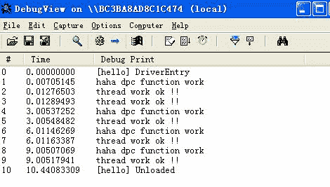

# 关于内核定时器,DPC,线程的使用

> 原文：[`www.pediy.com/kssd/pediy10/88954.html`](https://www.pediy.com/kssd/pediy10/88954.html)

关于内核定时器，及 DPC 的使用，看来一些代码，这个估计是比较规范的用法了，很基础，希望对新手有帮助  
注意，这里的定时器不太精确！  
  

代码:

```
#include <ntddk.h>

typedef struct \_DEVICE\_EXTENSION {
    
    LIST\_ENTRY      list\_head;
    KSPIN\_LOCK      list\_lock;    
    PVOID          thread\_pointer;
    BOOLEAN            terminate\_thread;    
    KEVENT          request\_event;
    KTIMER            my\_timer;
    KDPC            KiTimerExpireDpc;    
} DEVICE\_EXTENSION, \*PDEVICE\_EXTENSION;

#define dprintf if (DBG) DbgPrint
#define nprintf DbgPrint

#define DEVICE\_NAME L"\\\\Device\\\\devhello" // Driver Name
#define LINK\_NAME L"\\\\DosDevices\\\\hello"  // Link Name
//
// The device driver IOCTLs
//
#define IOCTL\_BASE    0x800
#define MY\_CTL\_CODE(i) \\
CTL\_CODE(FILE\_DEVICE\_UNKNOWN, IOCTL\_BASE+i, METHOD\_BUFFERED, FILE\_ANY\_ACCESS)
#define IOCTL\_HELLO    MY\_CTL\_CODE(0)
/////////////////////////////////////////////////////////////////////
//函数声明
NTSTATUS DriverEntry(PDRIVER\_OBJECT pDriverObj, PUNICODE\_STRING pRegistryString);
NTSTATUS DispatchCreate(PDEVICE\_OBJECT pDevObj, PIRP pIrp);
NTSTATUS DispatchClose(PDEVICE\_OBJECT pDevObj, PIRP pIrp);
VOID     DriverUnload(PDRIVER\_OBJECT pDriverObj);
NTSTATUS DispatchIoctl(PDEVICE\_OBJECT pDevObj, PIRP pIrp);
VOID
KiTimerExpirationFunction (
                           IN struct \_KDPC  \*Dpc,
                           IN PVOID  DeferredContext,
                           IN PVOID  SystemArgument1,
                           IN PVOID  SystemArgument2
                           );
NTSTATUS ThreadFunc ( IN PVOID Context);
/////////////////////////////////////////////////////////////////////


NTSTATUS 
DriverEntry(
    PDRIVER\_OBJECT pDriverObj, 
    PUNICODE\_STRING pRegistryString
    )
{
    NTSTATUS status = STATUS\_SUCCESS;
    UNICODE\_STRING ustrLinkName;
    UNICODE\_STRING ustrDevName;    
    PDEVICE\_OBJECT device\_object;
    PDEVICE\_EXTENSION device\_extension;

    HANDLE  thread\_handle;

/\*
    在驱动中是以 100 纳秒为单位的
    1000 纳秒=1 微秒
    1000 微秒=1 毫秒
    1000 毫秒=1 秒    10\*1000\*1000
\*/
    LARGE\_INTEGER duetime = {0};
    #define POLLING\_INTERVAL 3000

    dprintf("\[hello\] DriverEntry\\n");
    
    pDriverObj->MajorFunction\[IRP\_MJ\_CREATE\] = DispatchCreate;
    pDriverObj->MajorFunction\[IRP\_MJ\_CLOSE\] = DispatchClose;
    pDriverObj->MajorFunction\[IRP\_MJ\_DEVICE\_CONTROL\] = DispatchIoctl;
    pDriverObj->DriverUnload = DriverUnload;


    RtlInitUnicodeString(&ustrDevName, DEVICE\_NAME);
    status = IoCreateDevice(pDriverObj, 
                sizeof(DEVICE\_EXTENSION),
                &ustrDevName, 
                FILE\_DEVICE\_UNKNOWN,
                0,
                FALSE,
                &device\_object);

    if(!NT\_SUCCESS(status))    {
        dprintf("\[hello\] IoCreateDevice = 0x%x\\n", status);
        return status;
    }

    RtlInitUnicodeString(&ustrLinkName, LINK\_NAME);
    status = IoCreateSymbolicLink(&ustrLinkName, &ustrDevName); 
    
    if(!NT\_SUCCESS(status)) {
        dprintf("\[hello\] IoCreateSymbolicLink = 0x%x\\n", status);
        IoDeleteDevice(device\_object);  
        return status;
    }

    device\_extension = (PDEVICE\_EXTENSION) device\_object->DeviceExtension;

    InitializeListHead(&device\_extension->list\_head);    
    KeInitializeSpinLock(&device\_extension->list\_lock);
    
    KeInitializeEvent(    &device\_extension->request\_event,
        NotificationEvent,
                         FALSE);

//    KeInitializeTimer(&my\_timer);//这是个旧的函数
    KeInitializeTimerEx(&device\_extension->my\_timer, NotificationTimer);
    // 初始化定时器过期的 DPC 对象  
    KeInitializeDpc(&device\_extension->KiTimerExpireDpc,
    (PKDEFERRED\_ROUTINE)KiTimerExpirationFunction, (PVOID) device\_object);

//    KeSetTimer(&my\_timer,timeout,&KiTimerExpireDpc); 仅仅只能设置一次
//    KeSetTimerEx(&my\_timer, timeout, period, &KiTimerExpireDpc);这个可以循环设置

    KeSetTimerEx(&device\_extension->my\_timer, duetime, POLLING\_INTERVAL, &device\_extension->KiTimerExpireDpc);  

//    KeSetTimerEx 语句启动周期定时器。由于 duetime 参数是 0，
//    所以定时器立即进入信号态。
//  然后每隔 POLLING\_INTERVAL=3 秒触发一次。

    device\_extension->terminate\_thread = FALSE;
    
    status = PsCreateSystemThread(
        &thread\_handle,
        (ACCESS\_MASK) 0L,
        NULL,
        NULL,
        NULL,
        ThreadFunc,
        device\_object
        );

    if (!NT\_SUCCESS(status))
    {
        IoDeleteDevice(device\_object);
        return status;
    }
    
    status = ObReferenceObjectByHandle(
        thread\_handle,
        THREAD\_ALL\_ACCESS,
        NULL,
        KernelMode,
        &device\_extension->thread\_pointer,
        NULL
        );
    
    if (!NT\_SUCCESS(status))
    {
        ZwClose(thread\_handle);
        device\_extension->terminate\_thread = TRUE;//如果出错就关闭创建的线程
        
        KeSetEvent(
            &device\_extension->request\_event,
            (KPRIORITY) 0,
            FALSE
            );
        IoDeleteDevice(device\_object);    
        return status;
    }
    
    ZwClose(thread\_handle);

    return STATUS\_SUCCESS;
}

VOID
KiTimerExpirationFunction (
           IN struct \_KDPC  \*Dpc,
           IN PVOID  DeferredContext,
           IN PVOID  SystemArgument1,
           IN PVOID  SystemArgument2
           )
{    
PDEVICE\_OBJECT pDevObj = (PDEVICE\_OBJECT)DeferredContext;
PDEVICE\_EXTENSION device\_extension = (PDEVICE\_EXTENSION)pDevObj->DeviceExtension;
//kesetevent 必需在较低级别用
//ASSERT(KeGetCurrentIrql() <= DISPATCH\_LEVEL);
//dprintf("level in timer function  is %x\\n",KeGetCurrentIrql());
dprintf("haha dpc function work\\n");
KeSetEvent(&device\_extension->request\_event,
            (KPRIORITY) 0,
            FALSE);
};

NTSTATUS ThreadFunc ( IN PVOID Context)
{ 
    PFILE\_OBJECT ConnectionFileObject, AddressFileObject; 
    HANDLE AddressHandle, ConnectionHandle; 
    NTSTATUS Status; 
    IO\_STATUS\_BLOCK IoStatus;
    KEVENT Event;
    PDEVICE\_OBJECT      device\_object;
    PDEVICE\_EXTENSION  device\_extension;

    device\_object = (PDEVICE\_OBJECT) Context;
    device\_extension = (PDEVICE\_EXTENSION) device\_object->DeviceExtension;
    
    KeSetPriorityThread(KeGetCurrentThread(), LOW\_REALTIME\_PRIORITY);

//\*\*\*\*\*\*\*\*\*\*\*\*\*\*\*\*\*\*\*\*\*\*\*\*\*\*\*\*
//\*\*\*\*\*\*\*\*\*\*\*\*\*\*\*\*\*\*\*\*\*\*\*\*\*\*\*\*
//开始工作  此处用 2 重循环，你可以添加实际的代码
for (;;)
{    
    do 
    {
       dprintf("thread work ok !!\\n");
       goto failselabel;

      } while (TRUE);

failselabel:

  KeWaitForSingleObject(
       &device\_extension->request\_event,
       Executive,
       KernelMode,
       FALSE,
       NULL
       );//在这儿等

    //KeClearEvent(&Event);//清除一下试试
          //killvxk 2007-01-31 11:18 
    //严重提醒不要使用 KeClearEvent(&Event); 
    //如果你还要用那个事件就不要用那个 Clear,要其它手段~如果你不需要那个 event 了，
          //那你应该在 thread 里判断下~ 

  KeResetEvent(&device\_extension->request\_event);

  if (  device\_extension->terminate\_thread )
    {
     PsTerminateSystemThread(STATUS\_SUCCESS);
    }
}

dprintf("never be here !\\n");
    return Status; 
}


VOID 
DriverUnload(
    PDRIVER\_OBJECT pDriverObj
    )
{    
    PDEVICE\_EXTENSION  device\_extension;
    UNICODE\_STRING strLink;
    RtlInitUnicodeString(&strLink, LINK\_NAME);
    device\_extension = (PDEVICE\_EXTENSION) pDriverObj->DeviceObject->DeviceExtension;

//停止创建的线程
    if (KeCancelTimer(&device\_extension->my\_timer) == FALSE)
    {
        //    KeCancelTimer(&device\_extension->my\_timer);//取消定时器
        dprintf( " no timer active at terminate\\n");
    }

    device\_extension->terminate\_thread = TRUE;//停止线程
    KeSetEvent(
        &device\_extension->request\_event,
        (KPRIORITY) 0,
        FALSE
        );

    KeWaitForSingleObject(
        device\_extension->thread\_pointer,//等待线程对象结束,注意哦，是对象
        Executive,
        KernelMode,
        FALSE,
        NULL
        );

    ObDereferenceObject(device\_extension->thread\_pointer);

    IoDeleteSymbolicLink(&strLink);
    IoDeleteDevice(pDriverObj->DeviceObject);
    dprintf("\[hello\] Unloaded\\n");
}


NTSTATUS 
DispatchCreate(
    PDEVICE\_OBJECT pDevObj, 
    PIRP pIrp
    )
{
    pIrp->IoStatus.Status = STATUS\_SUCCESS;
    pIrp->IoStatus.Information = 0;

    dprintf("\[hello\] IRP\_MJ\_CREATE\\n");

    IoCompleteRequest(pIrp, IO\_NO\_INCREMENT);
    return STATUS\_SUCCESS;
}


NTSTATUS 
DispatchClose(
    PDEVICE\_OBJECT pDevObj, 
    PIRP pIrp
    )
{
    pIrp->IoStatus.Status = STATUS\_SUCCESS;
    pIrp->IoStatus.Information = 0;

    dprintf("\[hello\] IRP\_MJ\_CLOSE\\n");

    IoCompleteRequest(pIrp, IO\_NO\_INCREMENT);
    return STATUS\_SUCCESS;
}


NTSTATUS 
DispatchIoctl(
    PDEVICE\_OBJECT pDevObj, 
    PIRP pIrp
    )
{
    NTSTATUS status = STATUS\_INVALID\_DEVICE\_REQUEST;
    PIO\_STACK\_LOCATION pIrpStack;
    ULONG uIoControlCode;
    PVOID pIoBuffer;
    ULONG uInSize;
    ULONG uOutSize;

    pIrpStack = IoGetCurrentIrpStackLocation(pIrp);
    uIoControlCode = pIrpStack->Parameters.DeviceIoControl.IoControlCode;
    pIoBuffer = pIrp->AssociatedIrp.SystemBuffer;
    uInSize = pIrpStack->Parameters.DeviceIoControl.InputBufferLength;
    uOutSize = pIrpStack->Parameters.DeviceIoControl.OutputBufferLength;

    switch(uIoControlCode) {

        case IOCTL\_HELLO: {
            
            dprintf("\[hello\] Hello\\n");
            status = STATUS\_SUCCESS;
        }
        break;

    }

    if(status == STATUS\_SUCCESS)
        pIrp->IoStatus.Information = uOutSize;
    else
        pIrp->IoStatus.Information = 0;
    
    /////////////////////////////////////
    pIrp->IoStatus.Status = status;
    IoCompleteRequest(pIrp, IO\_NO\_INCREMENT);

    return status;
}

```

测试图  
