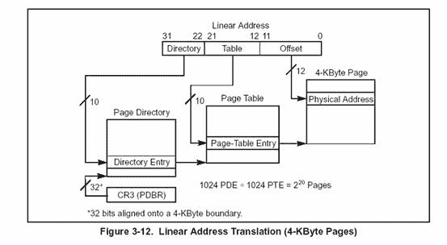
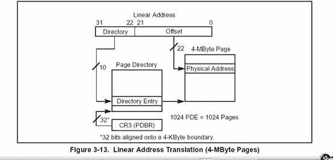
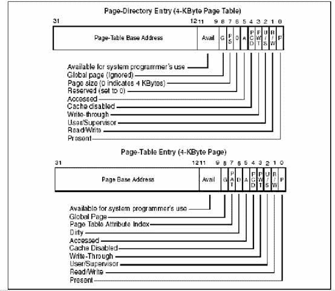
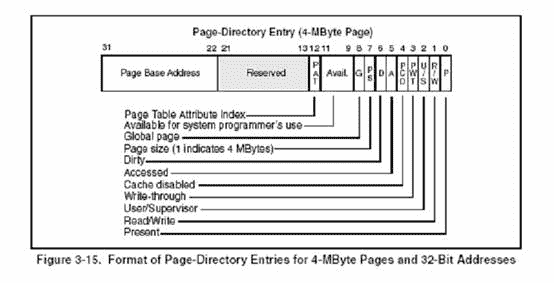
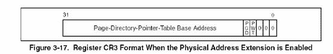
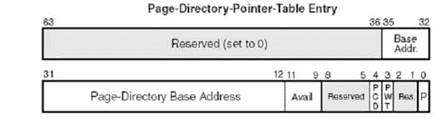
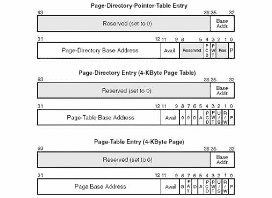
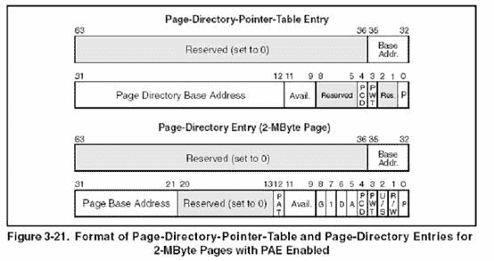

# 跨进程内存读取, 附源码

> 原文：[`www.pediy.com/kssd/pediy10/92353.html`](https://www.pediy.com/kssd/pediy10/92353.html)

在科锐学习的第 4 阶段, 保护模式课后作业,跨进程内存读写的小工具.  
  
第一次内核编程,代码写的比较乱,不免也有些错误.各位牛哥们,见笑乐,!时间仓促,也没对代码进程封装,和界面相关太多.  
1.  切换目标进程的 CR3  
      通常,跨进程读写内存,用到 ReadProcessMemory, WriteProcessMemory, 但需要进程句柄,如果目标进程受到保护,可能获得进程句柄会失败.  
      ReadProcessMemory 最后会调用到 KeStackAttachProcess 附加到目标进程上切换进程环境进行拷贝的, 所以想到拿到目标进程的虚拟内存内容,可以将目标进程的页目录基地址放入 CR3 中即可.  
  
首先要获得目标进程的 cr3 寄存器,即页目录基地址(开启 PAE, 页目录指针表),   
每个进程在内核里都有一个 EPROCESS 结构.  

代码:

```
nt!\_EPROCESS
   +0x000 Pcb              : \_KPROCESS
   +0x06c ProcessLock      : \_EX\_PUSH\_LOCK
   +0x070 CreateTime       : \_LARGE\_INTEGER
   +0x078 ExitTime         : \_LARGE\_INTEGER
   +0x080 RundownProtect   : \_EX\_RUNDOWN\_REF
   …….

```

Pcb 中就有我们想要得到的 CR3  
代码:

```
nt!\_KPROCESS
   +0x000 Header           : \_DISPATCHER\_HEADER
   +0x010 ProfileListHead  : \_LIST\_ENTRY
   +0x018 DirectoryTableBase : \[2\] Uint4B
   +0x020 LdtDescriptor    : \_KGDTENTRY
   +0x028 Int21Descriptor  : \_KIDTENTRY
   ………

```

那只需要获得目标进程 EPROCESS 就可以得到 CR3 了  
遍历 EPROCESS 里的 ActiveProcessLinks 的链表获取指定进程的 EPROCESS  
  
代码:

```
// 获得当前进程 EPROCESS 信息
            ULONG uEprocess = 0;
            \_\_asm
            {
                mov eax, fs:\[0x124\]    // \_ethread
                mov eax, \[eax+0x44\]    // \_kprocess
                mov uEprocess, eax
            }

            KdPrint(("EPROCESS: 0x%08x\\n", uEprocess));
            LIST\_ENTRY ListHead;
            InitializeListHead(&ListHead);

            ULONG uFirstEprocess = uEprocess;
            ULONG uCount = 0;
            PLIST\_ENTRY pActiveProcessLinks;
            ProcessInfoList \*pProcssList = NULL;

            ULONG uNameOffset = GetPlantformDependentInfo(FILE\_NAME\_OFFSET);
            ULONG uPidOffset = GetPlantformDependentInfo(PROCESS\_ID\_OFFSET);
            ULONG uLinkOffset = GetPlantformDependentInfo(PROCESS\_LINK\_OFFSET);
            ULONG uExitTime = GetPlantformDependentInfo(EXIT\_TIME\_OFFSET);
            // 遍历链表获得进程信息
            do 
            {
                
                pProcssList= 
                    (ProcessInfoList \*)ExAllocatePool(PagedPool, sizeof(ProcessInfoList));
                if (pProcssList == NULL)
                {
                    status = STATUS\_INSUFFICIENT\_RESOURCES;
              break;
                }

                PLARGE\_INTEGER ExitTime;
                ExitTime = (PLARGE\_INTEGER)(uEprocess + uExitTime);
                if (ExitTime->QuadPart == 0)
                {
                    if (\*(int \*)(uEprocess + uPidOffset) <= 0)
                    {
                        pProcssList->ProcInfo.uProcessId = 0;
                        pProcssList->ProcInfo.uEprocess = uEprocess;
                        pProcssList->ProcInfo.uCR3 = \*(PULONG)(uEprocess + 0x18);
                        RtlCopyMemory(pProcssList->ProcInfo.pszImageFileName, "Idle", 16);
                        InsertHeadList(&ListHead, &pProcssList->ListEntry);
                        KdPrint(("PID: %d, EPROCESS: 0x%08x, FileName: %s, CR3: 0x%08x\\n",
                            pProcssList->ProcInfo.uProcessId,
                            pProcssList->ProcInfo.uEprocess,
                            pProcssList->ProcInfo.pszImageFileName,
                            pProcssList->ProcInfo.uCR3));
                    }
                    else
                    {

                        pProcssList->ProcInfo.uEprocess = uEprocess;
                        pProcssList->ProcInfo.uCR3 = \*(PULONG)(uEprocess + 0x18);
                        pProcssList->ProcInfo.uProcessId = \*(PULONG)(uEprocess + uPidOffset);
                        RtlCopyMemory(pProcssList->ProcInfo.pszImageFileName, 
                            (PVOID)(uEprocess + uNameOffset), 
                            16);
                        InsertHeadList(&ListHead, &pProcssList->ListEntry);
                        KdPrint(("PID: %d, EPROCESS: 0x%08x, FileName: %s, CR3:  0x%08x\\n",
                            pProcssList->ProcInfo.uProcessId,
                            pProcssList->ProcInfo.uEprocess,
                            pProcssList->ProcInfo.pszImageFileName,
                            pProcssList->ProcInfo.uCR3));


                    }
                    uCount++;
                }

                pActiveProcessLinks = (PLIST\_ENTRY)(uEprocess + uLinkOffset);
                uEprocess = (ULONG)pActiveProcessLinks->Blink - uLinkOffset;


                if (uEprocess == uFirstEprocess)
                {
                    break;
                }
            } while (uEprocess != 0);

```

   引用了北极星 2003 大哥的 GetPlantformDependentInfo 获取 EPROCESS 的成员偏移   
  
   下面是读写内存的:  
代码:

```
            \_try
            {
                WriteMemoryInfo \*pInfo = 
                    (WriteMemoryInfo \*)ExAllocatePool(PagedPool, sizeof(WriteMemoryInfo));

                RtlCopyMemory(pInfo, pIoBuffer, sizeof(WriteMemoryInfo));

                PVOID pWrite =  ExAllocatePool(PagedPool, pInfo->nWriteSize);

                RtlCopyMemory(pWrite, pInfo->pData, pInfo->nWriteSize);
                //pInfo->pData = (PBYTE)ExAllocatePool(PagedPool, pInfo->nWriteSize);
                ULONG uOldCr3 = 0;
                ULONG uCurrentCr3 = \*(PULONG)(pInfo->nEprocess + 0x18);
                if (pInfo->nMemoryAddr == 0)
                {
                    status = STATUS\_UNSUCCESSFUL;
                    break;
                }
                \_\_asm
                {
                    mov eax, cr3
                    mov uOldCr3, eax

                    mov eax, uCurrentCr3
                    mov cr3, eax
                }

                \_\_asm
                {
                    cli
                    push eax
                    mov eax, cr0
                    and eax, not 10000h
                    mov cr0, eax
                }

                RtlCopyMemory((PVOID)pInfo->nMemoryAddr, 
                    pWrite, pInfo->nWriteSize);

                \_\_asm

                {
                    mov eax, CR0
                    or eax, 10000h
                    mov cr0,eax
                    pop eax
                    sti

                }
                \_\_asm
                {
                    mov eax, uOldCr3
                    mov cr3, eax
                }


                uOutSize = pInfo->nWriteSize;
                if (pInfo != NULL)
                {

                    ExFreePool(pInfo);
                    pInfo = NULL;
                }
                // Return success
                status = STATUS\_SUCCESS;
            }
            \_\_except(1)
            {
                status = STATUS\_UNSUCCESSFUL;
            }

```

代码:

```
            \_\_try
            {   
                ReadMemoryInfo \*pInfo = 
                    (ReadMemoryInfo \*)ExAllocatePool(PagedPool, sizeof(ReadMemoryInfo));
                RtlCopyMemory(pInfo, pIoBuffer, sizeof(ReadMemoryInfo));
                ULONG uOldCr3 = 0;
                ULONG uCurrentCr3 = \*(PULONG)(pInfo->nEprocess + 0x18);
                if (pInfo->nMemoryAddr == 0)
                {
                    status = STATUS\_UNSUCCESSFUL;
                    break;
                }
                \_\_asm
                {
                    mov eax, cr3
                    mov uOldCr3, eax

                    mov eax, uCurrentCr3
                    mov cr3, eax

                }
                RtlCopyMemory(pIoBuffer, 
                    (PVOID)pInfo->nMemoryAddr ,pInfo->nReadSize);
                uOutSize = pInfo->nReadSize;
                \_\_asm
                {
                    mov eax, uOldCr3
                    mov cr3, eax
                }

                if (pInfo != NULL)
                {
                    ExFreePool(pInfo);
                    pInfo = NULL;
                }
                // Return success
                status = STATUS\_SUCCESS;
            }
            \_\_except(1)
            {
                status = STATUS\_UNSUCCESSFUL;
            }

```

 2. 根据分页机制,进行手工转换,得到虚拟地址的映射的物理地址,读其物理地址得到目标进程虚拟地址的内容.详见附件分析.  
  
获得了 CR3,,接下来,就是根据分页机制,把虚拟地址转换为物理地址勒.  
在转换之前要判断是否开启 PAE,非 PAE 和开启 PAE 的转换有所不同  
控制寄存器 CR4 的第 5 位标记是否开启 PAE  
代码:

```
// 获得 CR4 的值
\_\_asm
{
      \_emit 0x0F 
      \_emit 0x20
      \_emit 0xE0
      mov uCR4, eax
}

```

未开启 PAE 情况  
通过 CR3 寄存器定位到页目录的基地址  
线性地址的高 10 位作为获取页目录表项的索引, 获得一个页目录的一个表项  
注: windows 的保护实现基本不使用分段机制,主要是通过分页机制来实现保护,这里的就线性地址等于虚拟地址.  
代码:

```
// 获得页目录表项(PDE)
dwPageDirIndex = (dwVirtualAddr & 0xffc00000) >> 22;
DWORD dwPageDirEntry = ReadPageDirEntryNoPAE(dwPageDirIndex);
if (dwPageDirEntry == 0)
{
    return;
}

```

  
根据 PDE 获得页表基地址或者页基地址  
当没有开启 PAE 时,有两种 PDE 格式, 分别指向 4KB 的页表,和 4MB 的内存页  
  
  
  
页目录项的第 7 位判断页大小  
代码:

```
// 获得页大小
DWORD CReadMemoryDlg::GetPageSizeNoPAE(DWORD dwAddr)
{
    if ((dwAddr & 0x00000080) == 0x00000080)
    {
        return MBSIZE;
    }
    else
    {
        return KBSIZE;
    }
}

```

4KB 时, 页目录项的高 20 位为页表基地址.线性地址的 12 位到 21 位作为选取页表的一个表项.(PTE)  
  
  
代码:

```
dwPageTableIndex = (dwVirtualAddr & 0x0003ff000) >> 12;
DWORD dwPageTableBaseAddr = dwPageDirEntry & 0xfffff000;
// 获得页表
DWORD dwPageTable = ReadPageTableNoPAE(dwPageTableBaseAddr, 
                        dwPageTableIndex);
if (dwPageTable == 0)
{
     return;
}
if (IsPresentNoPAE(dwPageTable) == FALSE)
{
     return;
}

```

取 PTE 的高 20 位,作为内存页的基地址,线性地址的低 12 作为页中偏移得到物理地址  
代码:

```
// 页的基地址
DWORD dwPageBaseAddr = dwPageTable & 0xfffff000;
dwPageOffset = dwVirtualAddr & 0x00000fff;

```

这时获得的物理地址就是想要的目标进程虚拟地址的映射的物理地址  
代码:

```
PVOID pReadBuf = new BYTE\[dwReadSize\];
                
BOOL bRet = ReadPageMemoryNoPAE(pReadBuf, 
                    dwPageOffset, 
                    dwReadSize, 
                    dwPageBaseAddr);
if (bRet == FALSE)
{
      return;
}

```

4MB 时,页目录项的高 10 位作为页的基地址, 线性地址的低 22 位在物理地址在页中的偏移  
  
  
  
代码:

```
// 线性地址的低 22 位是页内偏移
DWORD dwPageOffsetMB = dwVirtualAddr & 0x003fffff;
// 高 10 位,是页基地址
DWORD dwPageBaseAddr = dwPageDirEntry & 0xffc00000;

```

这时获得的物理地址就是想要的目标进程虚拟地址的映射的物理地址  
代码:

```
PVOID pReadBuf = new BYTE\[dwReadSize\];

BOOL bRet = ReadPageMemoryPAE(pReadBuf, 
                    dwPageOffsetMB, 
                    dwReadSize, 
                    dwPageBaseAddr);
if (bRet == FALSE)
{
    return;
}

```

  
开启 PAE 情况  
CR4 中的物理地址扩展(PAE)标志可以开启 PAE 机制,将物理地址从 32 位扩展到 36 位.  
当开始 PAE 机制后,处理器支持两种尺寸的页:4KB 和 2Mb 的页.  
增加了页目录指针表项.  
表项的大小从 32 位增加到了 64 位  
表项中的物理基地址扩展到了 24 位  
寄存器 CR3 中的高位页目录基地址被换为 27 位的页目录指针表基地址  
  
  
  
通过 CR3 寄存器定位到页目录指针表起始地址,取线性地址的高 2 位作为选取页目录指针表项的索引  
代码:

```
DWORD dwDirPointerTableIndex = (dwVirtualAddr & 0xc0000000) >> 30;
DWORD dwDirPointerTableBaseAddr = m\_nDirBase & 0xffffffe0;
// 获得页目录指针表
\_\_int64 nPageDirPointerTable = ReadPageDirPAE(dwDirPointerTableIndex, 
                    dwDirPointerTableBaseAddr);
if (nPageDir == 0)
{
       return;
}

```

取线性地址的第 21 位到 29 位作为页目录索引,页目录指针表项的第 12 位到第 35 位为页目录基地址  
  
  
代码:

```
// 页目录基地址
DWORD dwDirBaseAddr = (DWORD)(nPageDirPointerTable &0x0000000ffffff000);
// 页目录项索引
DWORD dwPageDirIndex = (dwVirtualAddr & 0x3fe00000) >> 21;

\_\_int64 nPageDirEntry = ReadPageDirEntryPAE(dwPageDirIndex, dwDirBaseAddr);

if (nPageDirEntry == 0)
{
      return;
}

```

根据页目录项的第 7 位判断页大小,2MB,还是 4KB  
代码:

```
// 获得页大小
DWORD CReadMemoryDlg::GetPageSizePAE(\_\_int64 nAddr)
{
    if ((nAddr & 0x0000000000000080) == 0x0000000000000080)
    {
        return MBSIZE;
    }
    else
    {
        return KBSIZE;
    }
}

```

4KB 时,页目录项的第 12 位到 35 位作为页表基地址的高 24 位.取线性地址第 12 位到 20 位作为在页表中的偏移  
  
  
  
代码:

```
// 获得页表
DWORD dwPageTableBaseAddr = (DWORD)(nPageDirEntry & 0x0000000ffffff000);
DWORD dwPageTableIndex = (dwVirtualAddr & 0x001ff000) >> 12;
\_\_int64 nPageTable = ReadPageTablePAE(dwPageTableIndex, dwPageTableBaseAddr);

if (nPageTable == 0)
{
     return;
}

```

通过页表项的第 12 位到第 35 位作为页基地址的高 24 位,线性地址的低 12 为作为在页中的偏移  
代码:

```
// 读取页内容
DWORD dwPageBaseAddr = (DWORD)(nPageTable & 0x0000000ffffff000);
DWORD dwPageOffsetKb = dwVirtualAddr & 0x00000fff;
PVOID pReadBuf = new BYTE\[dwReadSize\];
BOOL bRet = ReadPageMemoryPAE(pReadBuf, 
                    dwPageOffsetKb, 
                    dwReadSize, 
                    dwPageBaseAddr);
if (bRet == FALSE)
{
     return;
}

```

所得到的内容就是目标进程虚拟地址内存的数据  
  
2MB 时, 页目录项的第 21 位到 35 位作为页的基地址的高位,取线性地址的第 0 位到第 20 位做为物理地址在页中的偏移  
  
  
代码:

```
DWORD dwPageOffsetMB = dwVirtualAddr & 0x000fffff;
// 高-35 位
DWORD dwDirBaseAddr = (DWORD)(nPageDirEntry & 0x00000007fff00000);
PVOID pReadBuf = new BYTE\[dwReadSize\];
BOOL bRet = ReadPageMemoryPAE(pReadBuf, 
                    dwPageOffsetMB, 
                    dwReadSize, 
                    dwDirBaseAddr);
if (bRet == FALSE)
{
return;
}   

```

所得到的内容就是目标进程虚拟地址内存的数据  
  
     这里谢谢钱老师,这近一年的培养,祝钱老师的培训越办越好,!

上传的附件
|  || 源码.rar  
 |