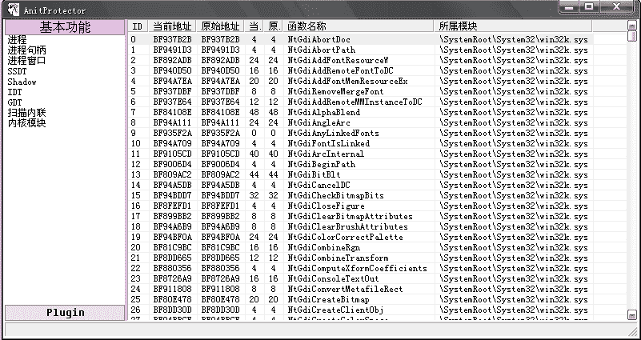

# 提取 ShadowSsdt 原始地址代码

> 原文：[`www.pediy.com/kssd/pediy12/139186.html`](https://www.pediy.com/kssd/pediy12/139186.html)

comment/\*  
BOOLEAN  KeAddSystemServiceTable(  
          IN  PVOID   ServiceTableBase,  
          IN  PVOID   ServiceCounterTableBase,  
          IN  ULONG   NumberOfService,  
          IN  PVOID   ParamTableBase,  
          IN  ULONG   InsertServiceTableIndex  
          )  
  
$-18     > 57               push edi  
$-17     > 68 10E399BF      push BF99E310  
$-12     > FF35 0CE399BF    push dword ptr \[BF99E30C\]  
$-C      > 8935 30899ABF    mov dword ptr \[BF9A8930\],esi  
$-6      > 56               push esi  
$-5      > 68 00D699BF      push BF99D600  
$ ==>    > FF15 580799BF    call dword ptr \[BF990758\]  
  
  
INIT:BF9B3B22                 push    edi          InsertServiceTableIndex  
INIT:BF9B3B23                 push    offset unk\_BF99E310    ParamTableBase  
INIT:BF9B3B28                 push    dword\_BF99E30C      NumberOfService  
INIT:BF9B3B2E                 mov     dword\_BF9A8930, esi  
INIT:BF9B3B34                 push    esi          ServiceCounterTableBase  
INIT:BF9B3B35                 push    offset off\_BF99D600    ServiceTableBase  
INIT:BF9B3B3A                 call    ds:KeAddSystemServiceTable  
\*/  
........................映射代码忽略  
  assume edi:nothing  
  mov edi, BaseAddress  
  add edi, \[edi\].IMAGE\_DOS\_HEADER.e\_lfanew  
  movzx eax, \[edi\].IMAGE\_NT\_HEADERS.FileHeader.NumberOfSections  
  mov Indent, eax  
  add edi, sizeof IMAGE\_NT\_HEADERS  
  assume edi:ptr IMAGE\_SECTION\_HEADER  
  mov VirtualSize, 0  
  .repeat  
    invoke StrCmp,edi,T("INIT")  
    .if eax  
      m2m VirtualSize, \[edi\].Misc.VirtualSize  
      mov edi, \[edi\].PointerToRawData  
      add edi, BaseAddress  
      .break  
    .endif  
    add edi, sizeof IMAGE\_SECTION\_HEADER  
    dec Indent  
  .until Indent == 0  
  cmp VirtualSize, 0  
  je err  
  mov Call\_KeAddSystemServiceTable, 0  
  mov Indent, 0  
  .while TRUE  
    invoke DisasmLen,edi,addr hde  
    .if hde.len == 6 && hde.opcode == 0FFh && hde.modrm == 15h && hde.disp32  
      mov eax, hde.disp32  
      sub eax, \[esi\].OptionalHeader.ImageBase  
      invoke RVAToFileMap,BaseAddress,eax  
      .if eax == Import\_KeAddSystemServiceTable  
        mov Call\_KeAddSystemServiceTable, edi  
        .break  
      .endif  
    .endif  
    mov eax, hde.len  
    add edi, eax  
    add Indent, eax  
    mov eax, Indent  
    .break .if eax >= VirtualSize  
  .endw  
  cmp Call\_KeAddSystemServiceTable, 0  
  jz err  
  m2m ImageBase, \[esi\].OptionalHeader.ImageBase  
  mov edi, Call\_KeAddSystemServiceTable  
    
  mov eax, DWORD ptr\[edi-5+1\]  
  sub eax, \[esi\].OptionalHeader.ImageBase  
  add eax, BaseAddress  
  mov Shadow\_ServiceTableBase, eax  
    
  mov eax, DWORD ptr\[edi-17h+1\]  
  sub eax, \[esi\].OptionalHeader.ImageBase  
  add eax, BaseAddress  
  mov Shadow\_ParamTableBase, eax  
    
  mov eax, DWORD ptr\[edi-12h+2\]  
  sub eax, \[esi\].OptionalHeader.ImageBase  
  add eax, BaseAddress  
  m2m Shadow\_NumberOfService, DWORD ptr\[eax\]  
.................................以下代码忽略  
运行效果  


简单一点吧~reload 后读取就行鸟~  

代码:

```
BOOL GetOriginalW32pTable(PVOID ImageBase,PSERVICE\_DESCRIPTOR\_TABLE W32pTable,DWORD Win32kBase)
{
        BOOL bRet=FALSE;
        PIMAGE\_NT\_HEADERS NtHeaders;
        ULONG\_PTR EntryPoint;
        DWORD dwKeAddSystemServiceTable;
        dwKeAddSystemServiceTable= (DWORD)MiFindExportedRoutine((PVOID)RealKernelBase,TRUE,"KeAddSystemServiceTable",0);
        NtHeaders = RtlImageNtHeader(ImageBase);
        if (NtHeaders)
        {
                DWORD dwEntryPoint;
                DWORD dwCurAddress;
                EntryPoint = NtHeaders->OptionalHeader.AddressOfEntryPoint;
                EntryPoint += (ULONG\_PTR)ImageBase;
                dwEntryPoint=(DWORD)EntryPoint;
                /\*IDA 反汇编结果：
                68 80 A2 99 BF          push    offset off\_BF99A280
                FF 15 58 D4 98 BF       call    ds:KeAddSystemServiceTable
                \*/
                //通过 call    ds:KeAddSystemServiceTable 的定位，该定位应该比较准确
                for(dwCurAddress = dwEntryPoint; dwCurAddress < dwEntryPoint + 0x1000; dwCurAddress++)
                {
                        if(\*(WORD \*)dwCurAddress == 0x15ff )
                        {  
                                //计算出加载后的 ds:KeAddSystemServiceTable 地址，然后该地址中存放的即是 KeAddSystemServiceTable 真实入口地址
                                DWORD dwFunAddress = \*(PDWORD)(\*(PDWORD)(dwCurAddress + 2)-Win32kBase+(DWORD)ImageBase);
                                if(dwKeAddSystemServiceTable == dwFunAddress)
                                {
                                        //将该地址结合内核中 Win32k 的加载地址进行重定位
                                        W32pTable->ServiceTable =(PDWORD) (\*(PDWORD)(dwCurAddress - 4) - Win32kBase + (DWORD)ImageBase);
                                        bRet=TRUE;
                                        break;
                                }
                        }
                }
        }
        return bRet;
}

```

我是为了提取原始参数而已,才写了这个,什么老代码,,前面忽略的是简单才忽略,既然你没能力看懂,那就全部放出来好了  
  
ShadowSsdt proc uses esi edi  
    
  local hde:hde32s  
  local pSSDT,pSSPT,Indent  
  local pKERNEL\_MODULE:KERNEL\_MODULE  
  local Shadow\_ServiceTableBase  
  local Shadow\_NumberOfService  
  local Shadow\_ParamTableBase  
  local Win32Path\[MAX\_PATH+1\]:BYTE  
  local ImageBase,Win32Ring0,dwdelta  
  local szKeAddSystemServiceTable\[30\]:BYTE  
  local hFile,FileSize,hFileMap,BaseAddress  
  local Import\_KeAddSystemServiceTable,Call\_KeAddSystemServiceTable  
  local ShadowSsdtName,VirtualSize  
    
  xor eax, eax  
  mov pSSDT, eax  
  mov pSSPT, eax  
  mov Indent, eax  
  mov BaseAddress, eax  
  mov hFile, eax  
  mov hFileMap, eax  
  m2m ShadowSsdtName, ShadowName  
  invoke GetSystemDirectory,addr Win32Path,MAX\_PATH  
  invoke StrLen,addr Win32Path  
  mov WORD ptr Win32Path\[eax\], "\\"  
  invoke StrCat,addr Win32Path,offset szWin32ksys  
  invoke CreateFile,addr Win32Path,GENERIC\_READ,FILE\_SHARE\_READ+FILE\_SHARE\_WRITE,NULL,OPEN\_EXISTING,FILE\_ATTRIBUTE\_NORMAL,NULL  
  .if eax == INVALID\_HANDLE\_VALUE  
    open\_err:  
    invoke wsprintf,offset TempBuf,offset szScanInline\_Open,offset szWin32ksys  
    invoke SetWindowText,hStausBar,offset TempBuf  
    jmp err  
  .endif  
  mov hFile, eax  
  invoke GetFileSize,eax,NULL  
  mov FileSize, eax  
  invoke CreateFileMapping,hFile,NULL,PAGE\_READONLY,NULL,NULL,NULL  
  or eax, eax  
  jz open\_err  
  mov hFileMap, eax  
  invoke MapViewOfFile,hFileMap,FILE\_MAP\_READ,NULL,NULL,NULL  
  or eax, eax  
  jz open\_err  
  mov BaseAddress, eax  
  lea eax, szKeAddSystemServiceTable  
  mov DWORD ptr\[eax+00000000\], 06441654Bh  
  mov DWORD ptr\[eax+00000004\], 073795364h  
  mov DWORD ptr\[eax+00000008\], 0536D6574h  
  mov DWORD ptr\[eax+00000012\], 069767265h  
  mov DWORD ptr\[eax+00000016\], 061546563h  
  mov DWORD ptr\[eax+00000020\], 000656C62h  
  invoke FindImport,BaseAddress,0,eax  
  or eax, eax  
  jz err  
  mov Import\_KeAddSystemServiceTable, eax  
  mov esi, BaseAddress  
  assume esi:ptr IMAGE\_DOS\_HEADER  
  add esi, \[esi\].e\_lfanew  
  assume esi:ptr IMAGE\_NT\_HEADERS  
  mov Call\_KeAddSystemServiceTable, 0  
  mov Indent, 0  
    
comment/\*  
BOOLEAN  KeAddSystemServiceTable(  
          IN  PVOID   ServiceTableBase,  
          IN  PVOID   ServiceCounterTableBase,  
          IN  ULONG   NumberOfService,  
          IN  PVOID   ParamTableBase,  
          IN  ULONG   InsertServiceTableIndex  
          )  
  
BF9B3B3A - BF800380 = 1B37BA  
014B3B22   57               push edi  
014B3B23   68 10E399BF      push BF99E310        ParamTableBase  
014B3B28   FF35 0CE399BF    push dword ptr \[BF99E30C\]    NumberOfService  
014B3B2E   8935 30899ABF    mov dword ptr \[BF9A8930\],esi  
014B3B34   56               push esi          ServiceCounterTableBase  
014B3B35   68 00D699BF      push BF99D600        ServiceTableBase  
014B3B3A   FF15 580799BF    call dword ptr \[BF990758\]  
  
$-18     > 57               push edi  
$-17     > 68 10E399BF      push BF99E310  
$-12     > FF35 0CE399BF    push dword ptr \[BF99E30C\]  
$-C      > 8935 30899ABF    mov dword ptr \[BF9A8930\],esi  
$-6      > 56               push esi  
$-5      > 68 00D699BF      push BF99D600  
$ ==>    > FF15 580799BF    call dword ptr \[BF990758\]  
  
  
INIT:BF9B3B22                 push    edi          InsertServiceTableIndex  
INIT:BF9B3B23                 push    offset unk\_BF99E310    ParamTableBase  
INIT:BF9B3B28                 push    dword\_BF99E30C      NumberOfService  
INIT:BF9B3B2E                 mov     dword\_BF9A8930, esi  
INIT:BF9B3B34                 push    esi          ServiceCounterTableBase  
INIT:BF9B3B35                 push    offset off\_BF99D600    ServiceTableBase  
INIT:BF9B3B3A                 call    ds:KeAddSystemServiceTable  
\*/  
  assume edi:nothing  
  mov edi, BaseAddress  
  add edi, \[edi\].IMAGE\_DOS\_HEADER.e\_lfanew  
  movzx eax, \[edi\].IMAGE\_NT\_HEADERS.FileHeader.NumberOfSections  
  mov Indent, eax  
  add edi, sizeof IMAGE\_NT\_HEADERS  
  assume edi:ptr IMAGE\_SECTION\_HEADER  
  mov VirtualSize, 0  
  .repeat  
    invoke StrCmp,edi,T("INIT")  
    .if eax  
      m2m VirtualSize, \[edi\].Misc.VirtualSize  
      mov edi, \[edi\].PointerToRawData  
      add edi, BaseAddress  
      .break  
    .endif  
    add edi, sizeof IMAGE\_SECTION\_HEADER  
    dec Indent  
  .until Indent == 0  
  cmp VirtualSize, 0  
  je err  
  mov Call\_KeAddSystemServiceTable, 0  
  mov Indent, 0  
  .while TRUE  
    invoke DisasmLen,edi,addr hde  
    .if hde.len == 6 && hde.opcode == 0FFh && hde.modrm == 15h && hde.disp32  
      mov eax, hde.disp32  
      sub eax, \[esi\].OptionalHeader.ImageBase  
      invoke RVAToFileMap,BaseAddress,eax  
      .if eax == Import\_KeAddSystemServiceTable  
        mov Call\_KeAddSystemServiceTable, edi  
        .break  
      .endif  
    .endif  
    mov eax, hde.len  
    add edi, eax  
    add Indent, eax  
    mov eax, Indent  
    .break .if eax >= VirtualSize  
  .endw  
  cmp Call\_KeAddSystemServiceTable, 0  
  jz err  
  m2m ImageBase, \[esi\].OptionalHeader.ImageBase  
  mov edi, Call\_KeAddSystemServiceTable  
    
  mov eax, DWORD ptr\[edi-5+1\]  
  sub eax, \[esi\].OptionalHeader.ImageBase  
  add eax, BaseAddress  
  mov Shadow\_ServiceTableBase, eax  
    
  mov eax, DWORD ptr\[edi-17h+1\]  
  sub eax, \[esi\].OptionalHeader.ImageBase  
  add eax, BaseAddress  
  mov Shadow\_ParamTableBase, eax  
    
  mov eax, DWORD ptr\[edi-12h+2\]  
  sub eax, \[esi\].OptionalHeader.ImageBase  
  add eax, BaseAddress  
  m2m Shadow\_NumberOfService, DWORD ptr\[eax\]  
    
  invoke DumpKernelModule  
  or eax, eax  
  jz err  
  mov esi, offset KernelModule  
  assume esi:ptr KERNEL\_MODULE  
  .while \[esi\].BaseAddress  
    invoke StrRChr,addr \[esi\].ImageName,"\\"  
    .if eax  
      inc eax  
    .else  
      lea eax, \[esi\].ImageName  
    .endif  
    invoke strnicmp,eax,offset szWin32ksys  
    .if eax  
      mov eax, \[esi\].BaseAddress  
      mov Win32Ring0, eax  
        
      sub eax, ImageBase  
      mov dwdelta, eax  
      .break  
    .endif  
    add esi, sizeof KERNEL\_MODULE  
  .endw  
    
    
  imul eax, Shadow\_NumberOfService, 4  
  invoke GlobalAlloc,GPTR,eax  
  or eax, eax  
  jz err  
  mov pSSDT, eax  
  imul eax, Shadow\_NumberOfService, 4  
  invoke Communications,IOCTL\_DumpShadowSsdt,NULL,NULL,pSSDT,eax  
  or eax, eax  
  jz err  
    
  invoke GlobalAlloc,GPTR,Shadow\_NumberOfService  
  or eax, eax  
  jz err  
  mov pSSPT, eax  
  invoke Communications,IOCTL\_DumpShadowSspt,NULL,NULL,pSSPT,Shadow\_NumberOfService  
  or eax, eax  
  jz err  
    
  mov esi, pSSDT  
  mov edi, Shadow\_ServiceTableBase  
  mov Indent, 0  
  .repeat  
    ;; 序号  
    invoke wsprintf,offset TempBuf,offset szD,Indent  
    invoke ListView\_AddItemEx,hMianDlg,92,NULL,Indent,0,offset TempBuf  
    ;; 当前地址  
    invoke wsprintf,offset TempBuf,offset sz08X,DWORD ptr\[esi\]  
    invoke ListView\_AddItemEx,hMianDlg,92,NULL,Indent,1,offset TempBuf  
    ;; 原始地址  
    mov eax, DWORD ptr\[edi\]  
    add eax, dwdelta  
    invoke wsprintf,offset TempBuf,offset sz08X,eax  
    invoke ListView\_AddItemEx,hMianDlg,92,NULL,Indent,2,offset TempBuf  
    ;; 当前参数  
    mov eax, Indent  
    add eax, pSSPT  
    movzx eax, BYTE ptr\[eax\]  
    invoke wsprintf,offset TempBuf,offset szD,eax  
    invoke ListView\_AddItemEx,hMianDlg,92,NULL,Indent,3,offset TempBuf  
    ;; 原始参数  
    mov eax, Indent  
    add eax, Shadow\_ParamTableBase  
    movzx eax, BYTE ptr\[eax\]  
    invoke wsprintf,offset TempBuf,offset szD,eax  
    invoke ListView\_AddItemEx,hMianDlg,92,NULL,Indent,4,offset TempBuf  
    ;; 名称  
    .if ShadowSsdtName  
      mov eax, ShadowSsdtName  
      invoke ListView\_AddItemEx,hMianDlg,92,NULL,Indent,5,DWORD ptr\[eax\]  
      add ShadowSsdtName, 4  
    .endif  
    ;; 所属模块  
    invoke GetBelongsSys,DWORD ptr\[esi\]  
    .if eax  
      mov ecx, eax  
      invoke ListView\_AddItemEx,hMianDlg,92,0,Indent,6,addr \[ecx\].KERNEL\_MODULE.ImageName  
    .endif  
    add esi, 4  
    add edi, 4  
    inc Indent  
    mov eax, Indent  
  .until eax == Shadow\_NumberOfService  
  err:  
  .if pSSDT  
    invoke GlobalFree,pSSDT  
  .endif  
  .if pSSPT  
    invoke GlobalFree,pSSPT  
  .endif  
  .if BaseAddress  
    invoke UnmapViewOfFile,BaseAddress  
  .endif  
  .if hFile  
    invoke ZwClose,hFile  
  .endif  
  .if hFileMap  
    invoke ZwClose,hFileMap  
  .endif  
  ret  
    
ShadowSsdt endp