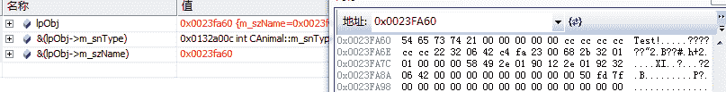
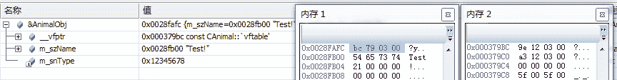
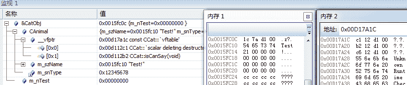
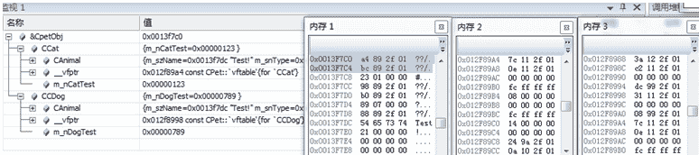
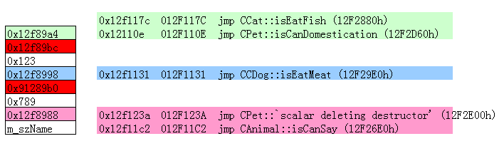

# 2011 年 25 周(6.24) C++内存结构

> 原文：[`www.pediy.com/kssd/pediy12/135961.html`](https://www.pediy.com/kssd/pediy12/135961.html)

声明： 内容都是书上的，自己重写下，加深下印象，如有不妥请指出。  
参数书籍信息：  
<<高质量 C/C++>> 第三版 第十二章 C++面向对象程序设计 电子工业出版社   
<<深度探索 C++对象模型>> 第一章关于对象 华中科技大学出版社  
  
先看下简单类的代码和数据放置的位置  

代码:

```
int CAnimal::m\_snType = 0x12345678;

int \_tmain(int argc, \_TCHAR\* argv\[\])
{    
    CAnimal AnimalObj;
    CAnimal \*lpObj = &AnimalObj;
    printf("%d,%s", lpObj->m\_snType, lpObj->m\_szName);

    return 0;
}

```

函数位置，构造函数和析构函数都在代码区  
代码:

```
class CAnimal
{
public:
    CAnimal()
    { 
        strncpy(m\_szName, "Test!", sizeof(m\_szName));
01322453  mov         esi,esp 
01322455  push        0Ah  
01322457  push        offset string "Test!" (13279B0h) 
0132245C  mov         eax,dword ptr \[this\] 
0132245F  push        eax  
01322460  call        dword ptr \[\_\_imp\_\_strncpy (132B3B4h)\] }
     ~CAnimal()
    {
        \_asm NOP 
00AD210C  nop              
    printf("%d,%s", lpObj->m\_snType, lpObj->m\_szName);
013248E6  mov         esi,esp 
013248E8  mov         eax,dword ptr \[ebp-20h\]   //指针保存的就是类的首址(这里也就字符串的地址)
013248EB  push        eax  
013248EC  mov         ecx,dword ptr \[CAnimal::m\_snType (132A00Ch)\] //(常量区)至少不再栈中
013248F2  push        ecx  
013248F3  push        offset string "%d,%s" (132783Ch) 
013248F8  call        dword ptr \[\_\_imp\_\_printf (132B3ACh)\]

```

类的内存布局如下所示，内存中之存在非静态成员 m\_smName (图一)  
  
这里 Class CAnimal 里面其实只有一个成员就是 m\_szName  
  
在类中增加析构/虚函数和静态函数，将 m\_szName 改为 16byte  
代码:

```
    virtual ~CAnimal()
    virtual bool isCanSay(){}
    static bool isCanFly(){}
main 函数中，这次不用指针在保存对象
    CAnimal AnimalObj;
    AnimalObj.isCanSay();
    AnimalObj.isCanFly();
    printf("class 大小：%d ,%d,%s", sizeof(AnimalObj), AnimalObj.m\_snType, AnimalObj.m\_szName);

```

看下汇编代码  
代码:

```
    CAnimal AnimalObj;
000348F0  lea         ecx,\[ebp-28h\]   //所谓的 this，就是 class 内存块的首地址
000348F3  call        CAnimal::CAnimal (310D7h) 
000348F8  mov         dword ptr \[ebp-4\],0 
    AnimalObj.isCanSay();
000348FF  lea         ecx,\[ebp-28h\] 
00034902  call        CAnimal::isCanSay (312A3h) 
    AnimalObj.isCanFly();
00034907  call        CAnimal::isCanFly (312ADh) 
    printf("class 大小：%d ,%d,%s", sizeof(AnimalObj), AnimalObj.m\_snType, AnimalObj.m\_szName);
0003490C  mov         esi,esp 
0003490E  lea         eax,\[ebp-24h\] 
00034911  push        eax  
00034912  mov         ecx,dword ptr \[CAnimal::m\_snType (3A00Ch)\] 
00034918  push        ecx  
00034919  push        14h  
0003491B  push        offset string "class\\xb4\\xf3\\xd0\\xa1\\xa3\\xba%d ,%d,%s" (37C08h) 
00034920  call        dword ptr \[\_\_imp\_\_printf (3B3ACh)\]

    virtual ~CAnimal()
{
    \_asm NOP 
0003210C  nop  

```

  (图二)  
  
  
0312a3  jmp         CAnimal::isCanSay (312xxh)   
02129e  jmp      CAnimal::~CAnimal (000321xx)   
  
有单继承的情况  
代码:

```
class CCat : public CAnimal
{
public:
    CCat(){m\_nTest = 0;}
    virtual bool isCanSay(){return true;}
    virtual bool isEatFish(){return true;}
    int  m\_nTest;
};
    CCat  CatObj;
00D14930  lea         ecx,\[ebp-48h\] 
00D14933  call        CCat::CCat (0D112CBh) 
      CCat(){m\_nTest = 0;}
00D12390  push        ebp  
00D14938  mov         byte ptr \[ebp-4\],1 
    CatObj.isCanSay();
00D1493C  lea         ecx,\[ebp-48h\] 
00D1493F  call        CCat::isCanSay (0D112B2h) 
00D112B2  jmp         CCat::isCanSay (0D11A20h) //虚表的下标 1 位置
    CatObj.isCanFly();
00D14944  call        CAnimal::isCanFly (0D112ADh) 
00D112AD  jmp         CAnimal::isCanFly (0D11930h)
    printf("class 大小：%d ,%d,%s", sizeof(CatObj), CatObj.m\_snType, CatObj.m\_szName);
00D14949  lea         eax,\[ebp-44h\] 
00D1494C  mov         esi,esp 
00D1494E  push        eax  
00D1494F  mov         ecx,dword ptr \[CAnimal::m\_snType (0D1A00Ch)\] 
00D14955  push        ecx  
00D14956  push        18h  
00D14958  push        offset string "class\\xb4\\xf3\\xd0\\xa1\\xa3\\xba%d ,%d,%s" (0D17C08h) 

```

（图三）  
  
CCat 类内内存的变化是增加了一个 int 变量，只是是 0，看不出来，输出大小为 24(4(虚表)+16+4(int))  
虚表的个数增加了一个，就是新的虚函数 isEatFish， isCanSay 被 CCat 新增的虚函数替换了，  
  
  
  
  
  
再看下复杂点的  
代码:

```
class CAnimal
{
public:
    CAnimal()
    { 
        strncpy(m\_szName, "Test!", sizeof(m\_szName));
    }
    virtual ~CAnimal()
    {
        \_asm NOP 
    }
    virtual bool isCanSay(){return false;}
    static bool isCanFly(){return false;}

public:
    char m\_szName\[16\];
    static int m\_snType;
};

int CAnimal::m\_snType = 0x12345678;

class CCat : virtual public CAnimal
{
public:
    CCat(){m\_nCatTest = 0x123;}
    //virtual bool isCanSay(){return true;}
    virtual bool isEatFish(){return true;}
    int  m\_nCatTest;
};

class CCDog: virtual public CAnimal
{
public:
    CCDog(){m\_nDogTest = 0x789;}
    virtual ~CCDog(){}
    virtual bool isEatMeat(){return true;}
    //virtual  bool isCanSay(){return true;}
    int m\_nDogTest;
};

class CPet :  public  CCat,  public  CCDog
{
public:
    virtual bool isCanDomestication(){return true;} 
};


int \_tmain(int argc, \_TCHAR\* argv\[\])
{    
    CPet CpetObj;
    CpetObj.isEatFish();
    CpetObj.isEatMeat();
    CpetObj.isCanSay();

    return 0;
}

```

 看下汇编  
\[code\]  
   CPet CpetObj;  
012F24B1  push        1      
012F24B3  lea         ecx,\[ebp-84h\]   
012F24B9  call        CPet::CPet (12F1203h)   
012F24BE  mov         byte ptr \[ebp-4\],2   
    CpetObj.isEatFish();  
012F24C2  lea         ecx,\[ebp-84h\]   
012F24C8  call        CCat::isEatFish (12F117Ch)   
    CpetObj.isEatMeat();  
012F24CD  lea         ecx,\[ebp-78h\]   
012F24D0  call        CCDog::isEatMeat (12F1131h)   
    CpetObj.isCanSay();  
012F24D5  mov         eax,dword ptr \[ebp-80h\]   
012F24D8  mov         ecx,dword ptr \[eax+4\]   
012F24DB  lea         ecx,\[ebp+ecx-80h\]   
012F24DF  call        CAnimal::isCanSay (12F11C2h)  
（图四）  
  
虚表对应的跳转代码  
代码:

```
0x12f89a4
  012F117C  jmp         CCat::isEatFish (12F2880h) 
012F110E  jmp         CPet::isCanDomestication (12F2D60h) 
0x12f8998
012F1131  jmp         CCDog::isEatMeat (12F29E0h) 
0x12f8988
012F123A  jmp         CPet::\`scalar deleting destructor' (12F2E00h) 
012F11C2  jmp         CAnimal::isCanSay (12F26E0h) 

```

整理一下，对应图中红色部分，目前还不是很清楚为啥子，等得闲时再看看 (图五)  
  
  
总结下：  
    C++内存分布状况非静态成员都在类内，静态成员在常量区，非 virtual 函数在在 class 不扯关系(不保存表关系)，虚函数 class 内会有虚表指针指向虚表，虚表中保存虚函数的地址，在调用的时候通过间接取调用(要用 new 才能看到到)。  
    有同名同参的虚函数，继承改写，则派生类的虚表中 base class 的虚表会被覆盖，多继承就多几个虚表，成员对象规则符合一般规则。  
   菱形的复杂结构，等搞清楚。。。。  
  
                                                                                           五边形 (2011 年 6 月 24 日)