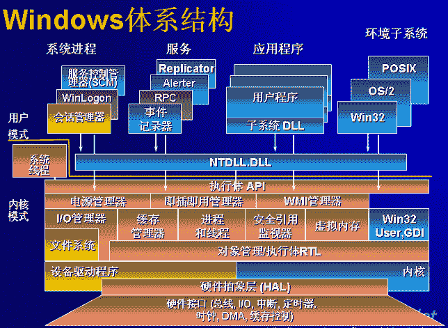

# 一个函数通解 WINDOWS 原理.

> 原文：[`www.pediy.com/kssd/pediy11/121973.html`](https://www.pediy.com/kssd/pediy11/121973.html)

这是本人第一篇论文，称不上什么技术论文，都是关于 windows xp 的一些理论知识。由于学习编程没多久，本篇都是参考网上资料，MSDN，并结合自己的理解写下，本人知识有限，难免会有很多错误和不全面的地方，大牛们勿笑话...，虽然这些东西在网上资料不少，但都不全面，没有系统性的总结 windows 运行原理。本来说要睡觉的，一时心血来潮，遂执笔写下本篇。算是这段对学习做的总结吧..  
本篇并没有详细的介绍 windows 的的运行原理(太多地方都不懂),但大致已经说明了这个意思.嘿嘿  
测试环境：windwos xp sp3  
测试语言：C   汇编语言  
测试工具:OD    IDA   WINDBG  
首先，我们先看一下 windows 体系结构图  
  
图看完了，接下来我们来做本篇准备工作，用 C 语言写一个小程序，很简单的，只需要一个按钮，按钮事件中包含 CreateFile 函数的调用，编译此程序，放到桌面上，接下来本篇以 CreateFile 通篇讲述。  
   
   
第一部分：从鼠标双击到程序显示：  
让我们双击这个程序，开始 windows 之旅................  
当我们鼠标双击的时候，鼠标驱动会产生一个中断(interrupt)，鼠标属于硬件设备,这个中断属于硬件中断，驱动程序是通过 IoConnectInterrupt 链接到给定的中断向量,IoConnectInterrupt 原型见下面:  
NTSTATUS   
  IoConnectInterrupt(  
    OUT PKINTERRUPT  \*InterruptObject,   //中断结构指针  
    IN PKSERVICE\_ROUTINE  ServiceRoutine,//中断服务例程  
    IN PVOID  ServiceContext,// 服务上下文  
    IN PKSPIN\_LOCK  SpinLock  OPTIONAL, //初始化的自旋锁  
    IN ULONG  Vector, //中断向量  
    IN KIRQL  Irql,//  IRQL 等级  
    IN KIRQL  SynchronizeIrql, // ISR  
      IN KINTERRUPT\_MODE    InterruptMode,//中断模式  
    IN BOOLEAN  ShareVector,//是否共享  
    IN KAFFINITY  ProcessorEnableMask,//代表 CPU  
      IN BOOLEAN  FloatingSave  //浮点寄存器  
);  
浮点寄存器 FS 所选择的段描述项接指向该 CPU 的 KPCR 结构,KPCR 结构中有个指针 IDT,这个指针就指向该 CPU 的"中断向量描述表"IDT,这是一个以中断向量为下表的结构数组,数组的每个元素都是一"中断描述项",每个中断描述项有 8 个字节,其中第一个 32 位字节的低 16 位和第二个 32 位字节的高 16 位合在一起就是指向中断响应程序的指针.  
来看一下，鼠标中断向量表，本文只列出鼠标的击键中断和释键中断：  
功能号 05H 入口 AL = 05H；  
BX = 待测的键(0：测左键；1：测右键)   
作用 得到击键信息 出口 AX = 键状态；  
BX = 击键次数；  
CX = 最后一击时，鼠标的水平位置  
DX = 最后一击时，鼠标的垂直位置   
   
功能号 06H 入口 AL = 06H；  
BX = 待测的键(同上)   
作用 得到键释放信息 出口 AX = 键状态；  
BX = 释放键的次数；  
CX = 最后释放时的水平位置  
DX = 最后释放时的垂直位置   
各鼠标的功能是通过在 AX 寄存器设置功能号来调用,这个鼠标中断产生后，利用 INT 33H 调用的相关功能会产生一个中断，并向总线发送。总线接收到中断向量后，会发送一个中断指令给 CPU，令 CPU 暂时停止当前的任务并对中断进行响应,串行口 RBR 寄存器在此取出一个字节的数据，该数据的编码置反映事件中的中断，不同的中断事件导致硬件中断服务程序作出不同的处理,在 INT 33h 的功能 Ch 建立列程。入口时，ES:DX 指向列程 CX 中存放一个位模式，设定几种应当调用的例程事件。其模式为:  
   位                        置 1 的含义  
   0                        鼠标移动  
   1                        按下左按钮  
   2                        释放左按钮  
   3                        按下右按钮  
   4                        释放右按钮  
   5                        按下中按钮  
   6                        释放中按钮  
系统得到这个中断消息，从 IDT 中找出中断响应程序并发送(send)这个消息\[MSG\]，那么应用程序是哪个呢？呵呵，就是我们的 windows 外壳(shell)程序，它的主进程是 explorer.exe，有关消息(MSG)结构定义如下(参考 MSDN)：  
typedef struct tagMSG  
{  
    HWND hwnd，　//接受消息的窗口句柄  
    UINT message，　//消息类型  
    WPARAM wParam，//消息的第一个参数，依消息类型定  
    LPARAM lParam，//消息的第二数，依消息类型定  
    DWORD time，//消息发出的时间  
    POINT pt //消息发出时鼠标的坐标  
} MSG;  
发送消息(SendMessage)函数，定义如下(见 MSDN):  
LRESULT SendMessage(  
        HWND hWnd，//接受消息的窗口句柄  
        UINT Msg，  
        WPARAM wParam，  
        LPARAM IParam);  
接收消息的窗口句柄，就是我们的桌面句柄，利用一些简单的工具就可以得到该句柄，SPY++就系统向桌面发送消息后，消息会放入桌面窗口过程的消息队列，窗口取回消息(GetMessage)，MSDN 定义：  
BOOL GetMessage(  
   LPMSG lpMsg，  
   HWND hWnd，  
   UINT wMsgFilterMin，//指定被检索的最小消息值的整数  
   UINT wMsgFilterMax)  //指定被检索的最大消息的整数  
得到这个消息后，应用程序会翻译(Translate)这个消息,函数原型是  
BOOL TranslateMessage(CONST MSG\*lpMsg);  
消息翻译成功后，会分发这个消息，定义如下：  
LONG DispatchMessage(CONST MSG\*lpmsg);  
分发消息的作用是将消息传递给操作系统，然后操作系统去调用应用程序已经注册的回调(callback)函数，也就是说我们在窗体的过程函数中处理消息，在这里，由于要运行程序，所以系统会调用 CreateProcess 函数，定义如下：  
BOOL CreateProcess(  
    LPCTSTR lpApplicationName,    //可执行模块的字符串  
　　LPTSTR lpCommandLine, 　　  //接收的命令行  
    LPSECURITY\_ATTRIBUTES lpProcessAttributes, //进程 SA 结构   
　　LPSECURITY\_ATTRIBUTES lpThreadAttributes,  //线程 SA 结构  
　　BOOL bInheritHandles, 　  //句柄是否可以被继承  
  　DWORD dwCreationFlags, 　//创建标志  
  　LPVOID lpEnvironment, 　 //进程环境块  
  　LPCTSTR lpCurrentDirectory, 　//当前目录  
　  LPSTARTUPINFO lpStartupInfo,  //STARTUPINF 结构  
  LPPROCESS\_INFORMATION lpProcessInformation);//进程信息结构  
  调用这个函数，系统将创建一个进程内核对象，并设置初始是用计数为 1，进程内核对象不是进程本身，而是操作系统用来管理进程的一个小型数据结构，然后系统会为新进程创建虚拟地址空间，并将可执行文件和所有的必要 DLL 代码及数据加载到进程的地址空间，然后系统会为引用程序创建第一个线程即主线程,这些初始化工作完整后,那么,这个窗口就显示在了桌面上....  
以上部分,大多是摘录资料,只是简单的归纳了一下,没看懂的话,我也是无能为力了,只怪我讲的不好.....接下来:  
   
   
第二部分:从按钮单击到函数实现:  
单击程序上面那个仅有的控件-按钮(button),下文出现了...  
按钮被单击会产生 WM\_LBUTTONDOWN 以及 WM\_LBUTTONUP,这两个是主要的,这个消息被系统捕获,把这个消息发送给应用程序窗口过程,前面已经列出了消息的结构,究竟什么是消息:windows 系统下的编程，消息 message 的传递是贯穿其始终的。系统为每个应用程序都创建了一个消息队列,这个消息我们可以简单理解为一个有特定意义的整数，windows 中定义的消息给初学者的印象似乎是“不计其数”的，常见的一部分消息在 winuser.h 头文件中定义,接下来应用程序从消息队列中取回消息(GetMessage),前面已经给出定义,翻译消息后,把此消息再次转发给系统,系统通过该消息注册的回调函数决定要做什么回应,在这个程序中,简单的说就是调用一个函数 CreateFile,原型如下:  
HANDLE CreateFile(  
  LPCTSTR lpFileName,          // 文件名或路径  
  DWORD dwDesiredAccess,       // 读写权限  
  DWORD dwShareMode,           //共享模式  
  LPSECURITY\_ATTRIBUTES lpSecurityAttributes,  SA 安全属性结构  
  DWORD dwCreationDisposition,  // 创建标志  
  DWORD dwFlagsAndAttributes,  //文件属性  
  HANDLE hTemplateFile)    // 处理以 GENERIC\_READ 权限打开的文件  
这个函数首先在 kernel32.dll 导出,但是在 32 位系统中并没有此函数的存在,实际上存在两个版本,CreateFileA 和 CreateFileW,这两个函数功能完全一样,只是处理的字符格式不一样,A 代表 ANSI(ANSI),是一个 8 位的字符,在 c 语言中定义为 char 类型,W 代表 WIDE(宽)字符,是一种 16 位的 UNICODE 字符,定义为 WCHAR,我们暂且不管是用 A 还是 W 函数,那么应用程序是如何调用 CreateFile 这个函数呢?接下来,我们就要学一点 PE 文件知识了,在 PE 文件中,有一个被称为导入表的结构,这个说明了应用程序需要用的函数名和地址(其实还有很多,结构定义如下:  
typedef struct \_IMAGE\_IMPORT\_BY\_NAME  
{  
   WORD Hint;// 函数输出序号  
   BYTE Name1\[1\];//输出函数名称  
} IMAGE\_IMPORT\_BY\_NAME,\*PIMAGE\_IMPORT\_BY\_NAME  
用一些 PE 工具可以很方便的查看这些信息,例如 CreateFile,用 OD 反汇编此程序,得到如下一段代码:  
0045697D   PUSH 0               ; /hTemplateFile = NULL  
0045697F   PUSH 80                    ; |Attributes = NORMAL  
00456984   LEA EDX,DWORD PTR SS:\[EBP-C\]             ; |  
00456987   PUSH EDI                                 ; |Mode  
00456988   PUSH EDX                                 ; |pSecurity  
00456989   PUSH EAX                                 ; |ShareMode  
0045698A   PUSH ECX                                 ; |Access  
0045698B   PUSH DWORD PTR SS:\[EBP+8\]                ; |FileName  
0045698E   CALL DWORD PTR DS:\[<&KERNEL32.CreateFile>; \\CreateFileA  
程序会先把参数反向压入堆栈,然后是一个 CALL,我们清楚的看到,这个 call 的就是 kernel32 里的 CreateFileA 函数,继续跟踪:  
7C801A28  MOV EDI,EDI  
7C801A2A  PUSH EBP  
7C801A2B  MOV EBP,ESP  
7C801A2D  PUSH DWORD PTR SS:\[EBP+8\]  
7C801A30  CALL 7C80E114  
7C801A35  TEST EAX,EAX  
7C801A37  JE SHORT 7C801A57  
7C801A39  PUSH DWORD PTR SS:\[EBP+20\]        ;hTemplateFile  
7C801A3C  PUSH DWORD PTR SS:\[EBP+1C\]         ; |Attributes  
7C801A3F  PUSH DWORD PTR SS:\[EBP+18\]           ; |Mode  
7C801A42  PUSH DWORD PTR SS:\[EBP+14\]        ; |pSecurity  
7C801A45  PUSH DWORD PTR SS:\[EBP+10\]        ; |ShareMode  
7C801A48  PUSH DWORD PTR SS:\[EBP+C\]        ; |Access  
7C801A4B  PUSH DWORD PTR DS:\[EAX+4\]       ; |FileName  
7C801A4E  CALL CreateFileW                 ; \\CreateFileW  
   
这段代码中有两个 call,第一个 CALL 7C80E114,跟进代码:  
7C80E11C   MOV EAX,DWORD PTR FS:\[18\]  
7C80E122   PUSH DWORD PTR SS:\[EBP+8\]  
7C80E125   LEA ESI,DWORD PTR DS:\[EAX+BF8\]  
7C80E12B   LEA EAX,DWORD PTR SS:\[EBP-8\]  
7C80E12E   PUSH EAX  
7C80E12F   CALL DWORD PTR DS:\[<&ntdll.RtlInitAnsiString>\]    
7C80E135   CMP DWORD PTR DS:\[7C8856E0\],0  
7C80E13C   PUSH 0  
7C80E13E   LEA EAX,DWORD PTR SS:\[EBP-8\]  
7C80E141   PUSH EAX  
7C80E142   PUSH ESI  
7C80E143   JE 7C81CDA6  
7C80E149   CALL DWORD PTR DS:\[<&ntdll.RtlAnsiStringToUnicodeString>\]   
7C80E14F   TEST EAX,EAX  
7C80E151   JL 7C843C0D  
7C80E157   MOV EAX,ESI  
7C80E159   POP ESI  
当然,我们已经猜到,这个调用,有两个功能,第一个就是初始化 ANSI 字符串,第二个就是把 ANSI 字符转换到 UNICODE 字符,我们返回到 CreateFileA 反汇编代码下,就知道 CreateFileA 函数其实只是负责转换字符串的,最终还是要调用 CreateFileW 字符,接下来,我们要到 NATIVE API 咯....  
跟踪 CreateFileW 函数,发现这样一段代码:  
7C8109B0  CALL DWORD PTR DS:\[<&ntdll.NtCreateFile>\]  
到这里又一个新东西出现了,即 ZwCreateFile 和 NtCreateFile,这两个函数由 NTDLL.DLL 导出,反汇编看一下 ZwCreateFile 函数的代码:  
.text:7C92D0AE       mov     eax, 25h        ;  
.text:7C92D0B3       mov     edx, 7FFE0300h  
.text:7C92D0B8       call    dword ptr \[edx\]  
.text:7C92D0BA       retn    2Ch  
25h 是 ntoskrnl.exe 中 NtCreateFile 的服务 ID 十进制是 37，7FFE0300 是参数起始地址  
下面是 NTDLL.DLL 中 NtCreateFile 反汇编代码:  
.text:7C92D0AE   mov     eax, 25h        ; NtCreateFile  
.text:7C92D0B3   mov     edx, 7FFE0300h  
.text:7C92D0B8   call    dword ptr \[edx\]  
.text:7C92D0BA   retn    2Ch  
不难看出,Ntdll 中 Zw 与 Nt 函数的实现是完全一样的,至于为什么要出现两套名字不同,实现方式完全一样的函数,这两种函数,姑且可以这样表示  
Typedef Zw Nt   O(∩\_∩)O  
上面讨论的就是所谓的 native API,这是用户模式下最底层的函数了,但是为什么会有这两种函数?接下来就进入 windows 内核大世界探索这个问题.  
Ntdll.dll 通过软件中断 int 2Eh 进入 ntoskrnl.exe,就是通过中断门切换 CPU 特权级,CPU 特权级共有 4 个级别,分别是 ring0，ring1，ring2，ring3，windows 只使用其中两个 ring0 和 ring3 特权,ring0 拥有最高权限,执行任意代码,windows 的核心就在这个特权级运行,ring3 是最低权限,int 2eh 使 cpu 从 ring3 级切换到 ring0 级,接着上面的代码,从用户模式进入内核模式,只传递了两个参数,一个是系统服务 ID 一个是参数地址,服务 ID 有什么用呢?其实在 Windows NT 中默认存在两个系统服务调度表,它们对应了两类不同的系统服务。这两个系统服务调度表  
分别是:KeServiceDescriptorTable WDBG 看一下:  
kd> dd KeServiceDescriptorTable  
80554020  80502bbc 00000000 0000011c 80503030  
80554030  00000000 00000000 00000000 00000000  
80554040  00000000 00000000 00000000 00000000  
80554050  00000000 00000000 00000000 00000000  
80554060  00002710 bf80c391 00000000 00000000  
80554070  f8974a80 81f17ba8 81e4a5f0 806e2f40  
80554080  00000000 00000000 00000000 00000000  
80554090  c8c5ad40 01cb6858 00000000 00000000  
KeServiceDescriptorTable 中就只有第一项有数据，其他都是 0。其中 80502bbc 就是 KeServiceDescriptorTable.ntoskrnel.ServiceTableBase，服务函数个数为 0x11c 个,十进制表示为 284。再看看 80502bbc 地址里是什么：  
kd> dd 80502bbc  
80502bbc  8059a9ba 805e7e36 805eb694 805e7e68  
80502bcc  805eb6ce 805e7e9e 805eb712 805eb756  
80502bdc  8060cea8 8060dbec 805e3234 805e2e8c  
80502bec  805cbe66 805cbe16 8060d4ce 805ac62e  
80502bfc  8060cae6 8059ee30 805a6a70 805cd944  
80502c0c  80500838 8060e12a 8056cd48 8053603e  
80502c1c  8060617e 805b2cba 805ebbce 8061af14  
80502c2c  805f00e2 8059b0a8 8061b168 8059a95a  
上面这些就是系统服务函数的地址了,当我们在 ring3 调用 CreateFile 时，进入 sysenter 的 ID 是 0x25H(XP SP3)，然后系统查 KeServiceDescriptorTable，大概公式是:KeServiceDescriptorTable.ntoskrnel.ServiceTableBase(80502bbc) + 0x25H \* 4,看一下:  
kd> dd 80502bbc+25H\*4  
80502c50  8056f2ee 8056eccc 805cc908 805cc640  
80502c60  8061b344 8056f3fc 8060e868 8056f328  
80502c70  805a1e18 8059b476 805c84a0 805c83ea  
80502c80  8060ec88 805a175c 8060c204 805ba614  
80502c90  805c8288 8060e138 805f048a 8059b49a  
80502ca0  8063adbc 8063af0c 8060db3c 8060d35e  
80502cb0  8060e12a 8056ce8e 8061b7e0 805ebcda  
80502cc0  8061b9b0 8056f4b4 8060a178 805b48ce  
其中 80502c50 指向 8056f2ee,这个就是 NtCreateFile 的真正地址,跟进看:  
kd> u 8056f2ee L7  
nt!NtCreateFile:  
8056f2ee 8bff            mov     edi,edi  
8056f2f0 55              push    ebp  
8056f2f1 8bec            mov     ebp,esp  
8056f2f3 33c0            xor     eax,eax  
8056f2f5 50              push    eax  
8056f2f6 50              push    eax  
8056f2f7 50              push    eax  
此结构定义如下:  
typedef struct ServiceDescriptorTable  
{  
   PVOID ServiceTableBase;  //服务基址  
   PVOID ServiceCounterTable(0);//服务调用次数  
   unsigned int NumberOfServices;//服务个数  
   PVOID ParamTableBase;//统服务参数字节数表的基地址  
 }SYSTEM\_DESCRIPTOR\_TABLE,\*PSYSTEM\_DESCRIPTOR\_TABLE;这个表由 ntoskrnl.exe 导出,另外系统中存在另一个服务描述表 KeServiceDescriptorTableShadow,其指在 GUI 线程中使用,user32.dll 和 gdi32.dll 两个库依赖此结构,定义如下:  
typedef struct KeServiceDescriptorTableShadow  
{  
   SYSTEM\_SERVICE\_TABLE ntoskrnel; //ntoskrnl.exe 的服务函数  
   SYSTEM\_SERVICE\_TABLE win32k; //win32k.sys 的服务函数  
   SYSTEM\_SERVICE\_TABLE NotUsed1;  
   SYSTEM\_SERVICE\_TABLE NotUsed2;  
}SYSTEM\_DESCRIPTOR\_TABLE,\*PSYSTEM\_DESCRIPTOR\_TABLE;这个表未导出,不过确实存在于 Win32.sys 中,由于涉及 GUI 线程,不在本文谈论范围,略过.....  
原理知道了,接下来讲解刚才留下的问题,为什么会有这两种函数?在内核中叶存在一套与 NATIVE API 类似的函数,Zw\*和 Nt\*,下面做一下对比:  
kd> u NT! ZWCREATEFILE   
nt!ZwCreateFile:  
804ff08c b825000000      mov     eax,25h  
804ff091 8d542404        lea     edx,\[esp+4\]  
804ff095 9c              pushfd  
804ff096 6a08            push    8  
又一次出现 25h,这和 ntdll 中的 ZwCreateFile 还有 NtCreateFile 又一样了,重温一下:  
.text:7C92D0AE   mov     eax, 25h        ; NtCreateFile \\  ZwCreateFile  
.text:7C92D0B3   mov     edx, 7FFE0300h  
.text:7C92D0B8   call    dword ptr \[edx\]  
.text:7C92D0BA   retn    2Ch  
Ntoskrnl 中的 Nt 函数:  
kd> u nt! ntcreatefile L14  
nt!NtCreateFile:  
8056f2ee 8bff            mov     edi,edi  
8056f2f0 55              push    ebp  
8056f2f1 8bec            mov     ebp,esp  
8056f2f3 33c0            xor     eax,eax  
8056f2f5 50              push    eax  
8056f2f6 50              push    eax  
8056f2f7 50              push    eax  
8056f2f8 ff7530          push    dword ptr \[ebp+30h\]  
8056f2fb ff752c          push    dword ptr \[ebp+2Ch\]  
8056f2fe ff7528          push    dword ptr \[ebp+28h\]  
8056f301 ff7524          push    dword ptr \[ebp+24h\]  
8056f304 ff7520          push    dword ptr \[ebp+20h\]  
8056f307 ff751c          push    dword ptr \[ebp+1Ch\]  
8056f30a ff7518          push    dword ptr \[ebp+18h\]  
8056f30d ff7514          push    dword ptr \[ebp+14h\]  
8056f310 ff7510          push    dword ptr \[ebp+10h\]  
8056f313 ff750c          push    dword ptr \[ebp+0Ch\]  
8056f316 ff7508          push    dword ptr \[ebp+8\]  
8056f319 e860d8ffff      call    nt!IoCreateFile (8056cb7e)  
8056f31e 5d              pop     ebp  
通过对比,我们就可以刚才那个问题了:Zw\*函数集合将从用户模式转入内核模式，而 Nt\*符号直接指向的代码会在模式切换后被执行.这个理解了,继续工作,  
上面的代码有一句 8056f319 e860d8ffff      call    nt!IoCreateFile (8056cb7e)  
,看来要继续跟进:  
kd> u nt!IoCreateFile L40  
nt!IoCreateFile:  
8056cb7e 8bff            mov     edi,edi  
8056cb80 55              push    ebp  
8056cb81 8bec            mov     ebp,esp  
8056cb83 83ec0c          sub     esp,0Ch  
8056cb86 53              push    ebx  
8056cb87 56              push    esi  
8056cb88 33f6            xor     esi,esi  
8056cb8a 8975fc          mov     dword ptr \[ebp-4\],esi  
8056cb8d 8b1db80b5580    mov     ebx,dword ptr \[nt!KeI386MachineType+0x3634 (80550bb8)\]  
8056cb93 f6c301          test    bl,1  
8056cb96 7443            je      nt!IoCreateFile+0x5d (8056cbdb)  
8056cb98 8b45fc          mov     eax,dword ptr \[ebp-4\]  
8056cb9b ff45fc          inc     dword ptr \[ebp-4\]  
8056cb9e 85c0            test    eax,eax  
8056cba0 7439            je      nt!IoCreateFile+0x5d (8056cbdb)  
8056cba2 8b45fc          mov     eax,dword ptr \[ebp-4\]  
8056cba5 6aff            push    0FFFFFFFFh  
8056cba7 99              cdq  
8056cba8 68f0d8ffff      push    0FFFFD8F0h  
8056cbad 52              push    edx  
8056cbae 50              push    eax  
8056cbaf e8ac9efcff      call    nt!allmul (80536a60)  
8056cbb4 817dfce8030000  cmp     dword ptr \[ebp-4\],3E8h  
8056cbbb 8945f4          mov     dword ptr \[ebp-0Ch\],eax  
8056cbbe 8955f8          mov     dword ptr \[ebp-8\],edx  
8056cbc1 7e07            jle     nt!IoCreateFile+0x4c (8056cbca)  
8056cbc3 c745fce8030000  mov     dword ptr \[ebp-4\],3E8h  
8056cbca 8d45f4          lea     eax,\[ebp-0Ch\]  
8056cbcd 50              push    eax  
8056cbce 56              push    esi  
8056cbcf 56              push    esi  
8056cbd0 e811daf8ff      call    nt!KeDelayExecutionThread (804fa5e6)  
8056cbd5 8b1db80b5580    mov     ebx,dword ptr \[nt!KeI386MachineType+0x3634 (80550bb8)\]  
8056cbdb 56              push    esi  
8056cbdc 56              push    esi  
8056cbdd ff753c          push    dword ptr \[ebp+3Ch\]  
8056cbe0 ff7538          push    dword ptr \[ebp+38h\]  
8056cbe3 ff7534          push    dword ptr \[ebp+34h\]  
8056cbe6 ff7530          push    dword ptr \[ebp+30h\]  
8056cbe9 ff752c          push    dword ptr \[ebp+2Ch\]  
8056cbec ff7528          push    dword ptr \[ebp+28h\]  
8056cbef ff7524          push    dword ptr \[ebp+24h\]  
8056cbf2 ff7520          push    dword ptr \[ebp+20h\]  
8056cbf5 ff751c          push    dword ptr \[ebp+1Ch\]  
8056cbf8 ff7518          push    dword ptr \[ebp+18h\]  
8056cbfb ff7514          push    dword ptr \[ebp+14h\]  
8056cbfe ff7510          push    dword ptr \[ebp+10h\]  
8056cc01 ff750c          push    dword ptr \[ebp+0Ch\]  
8056cc04 ff7508          push    dword ptr \[ebp+8\]  
8056cc07 e882f2ffff      call    nt!IoCreateDevice+0x346 (8056be8e)  
8056cc0c 3bc6            cmp     eax,esi  
8056cc0e 7d15            jge     nt!IoCreateFile+0xa7 (8056cc25)  
8056cc10 f6c301          test    bl,1  
8056cc13 0f8574ffffff    jne     nt!IoCreateFile+0xf (8056cb8d)  
8056cc19 3b1db80b5580    cmp     ebx,dword ptr \[nt!KeI386MachineType+0x3634 (80550bb8)\]  
8056cc1f 0f8568ffffff    jne     nt!IoCreateFile+0xf (8056cb8d)  
8056cc25 5e              pop     esi  
8056cc26 5b              pop     ebx  
8056cc27 c9              leave  
8056cc28 c23800          ret     38h  
这个函数由 I/O 管理器通过 IoCreateFile 创建 IRP(IRP\_CREATE\_OPERATION),I/O 管理器把此信号传递给文件系统驱动,文件系统驱动通过与硬件抽象层 HAL.DLL 与磁盘交互,如果创建成功,会返回一个 NTSTATUS\_SUCCESS,如果失败会根据失败原因返回相应的错误代码,设置 IRP 一个状态子域,PIRP->Iostatus.Status = status,IoCreateFile 返回的是一个文件对象,然后此对象交给对象管理器负责转换,调用  
VOID ObReferenceObject(  
    IN PVOID  Object  
  );内核把这个句柄返回给系统,如果失败,应用程序可通过 GetLastError 获得失败原因.  
只能写这么点了,好多方面并没有提到,也很重要的,主要本人知识未到位,后面这些纯属个人理解..