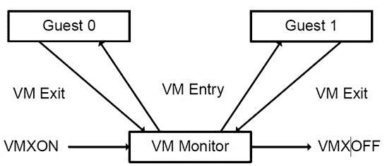
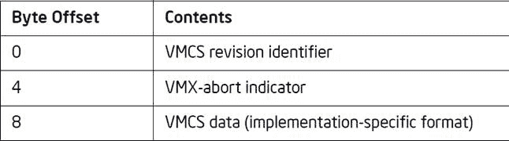
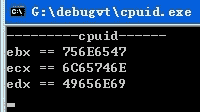
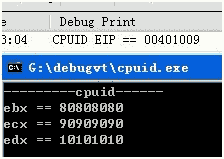

# VT 入门---- 闭门造 VT \[有码\]

> 原文：[`www.pediy.com/kssd/pediy12/144656.html`](https://www.pediy.com/kssd/pediy12/144656.html)

**前言**  
   
   
传说中的 VT 貌似很神秘的样子,关于 VT 入门的资料又很少,于是研究了一番  
由于资源有限,自身水平亦有限,并且是闭门造车之作,如有错误的地方请指正,不胜感激!  
关于 VT 可以先参考海风月影写的关于 VT 调试器[`bbs.pediy.com/showthread.php?t=96122`](http://bbs.pediy.com/showthread.php?t=96122)  
   
运行环境  
操作系统: windows XP   
CPU : intel i3-390M   
状态: 单核运行  
   
驱动没有卸载部分,测试前请先保存好文档.在 boot.ini 文件中添加 /numproc=1,重启  
**VT 简介**  
   
   
Intel VIrtual Techonlogy , intel 硬件虚拟化技术 ,在硬件级别上完成计算机的虚拟化  
   
为实现硬件虚拟化 ,VT 增加了 12 条新的 VMX 指令  
   
\[VMCS 控制 5 条\]  
VMPTRLD   
VMPTRST   
VMCLEAR   
VMREAD   
VMWRITE   
   
\[VMX 命令 5 条\]  
VMLAUNCH   
VMCALL   
VMXON   
VMXOFF   
VMRESUME   
   
\[Guest software 2 条\]  
INVEPT   
INVVPID   
   
   
12 条指令对应的机器码(xen-3.4.1\\xen\\include\\asm-x86\\hvm\\vmx\\vmx.h)  
代码中使用 \_emit  
   
#define VMCALL\_OPCODE ".byte 0x0f,0x01,0xc1\\n"  
#define VMCLEAR\_OPCODE ".byte 0x66,0x0f,0xc7\\n" /\* reg/opcode: /6 \*/  
#define VMLAUNCH\_OPCODE ".byte 0x0f,0x01,0xc2\\n"  
#define VMPTRLD\_OPCODE ".byte 0x0f,0xc7\\n" /\* reg/opcode: /6 \*/  
#define VMPTRST\_OPCODE ".byte 0x0f,0xc7\\n" /\* reg/opcode: /7 \*/  
#define VMREAD\_OPCODE ".byte 0x0f,0x78\\n"  
#define VMRESUME\_OPCODE ".byte 0x0f,0x01,0xc3\\n"  
#define VMWRITE\_OPCODE ".byte 0x0f,0x79\\n"  
#define INVEPT\_OPCODE ".byte 0x66,0x0f,0x38,0x80\\n" /\* m128,r64/32 \*/  
#define INVVPID\_OPCODE ".byte 0x66,0x0f,0x38,0x81\\n" /\* m128,r64/32 \*/  
#define VMXOFF\_OPCODE ".byte 0x0f,0x01,0xc4\\n"  
#define VMXON\_OPCODE ".byte 0xf3,0x0f,0xc7\\n"  
   
   
驱动初在始化一个 VMCS (Virtual Machine Control Structures)内存区域后,启动 VMM (Virtual Machine Monitor) ,   
得到最高权限从而管理硬件资源, 操作系统是运行于 ring0 下  
VMM 要监控管理整个系统的资源,因而 VMM 的权限是大于操作系统,它处于一个全新的级别 ring -1  
用一个形象的比喻来讲就是:当前操作系统的的“政权”被 VMM 颠覆了  
下面这个图是: VMM 与 Guest OS 的联系  
   
  
   
   
下面简单介绍一下 VMM 的建立过程,看看“政权”是如何被颠覆的  
**首先通过 CPUID 检查 CPU 是否支持 VT**  
   
硬件环境的检测,通过指令 CPUID 检测 CPU 是否支持 VT  
ECX 的第 5 个 bit 标志代表对 VT 的支持与否  
(更多检测可以看  
[`bbs.pediy.com/showthread.php?t=96122`](http://bbs.pediy.com/showthread.php?t=96122)  
回贴部分)  
初始化主要的内存区域  
使用 VMXON 进入 VMX (虚拟机指令扩展指令集)操作  
   
执行 VMXON 指令 , EFLAGS.CF 可判断执行是否成功  
\_\_asm  
{  
PUSH 0  
PUSH PhysicalVMXONRegionPtr.LowPart  
   
\_emit 0xF3 // VMXON \[ESP\]  
\_emit 0x0F  
\_emit 0xC7  
\_emit 0x34  
\_emit 0x24  
   
PUSHFD  
POP eFlags  
   
ADD ESP, 8  
}  
   
接下来开始初始化 VMCS 区域,(相当于部署军队,准备起义)  
这个结构只能够被 VMCLEAR, VMPTRLD, VMREAD,和 VMWRITE 操作。  
VMM 运行后 guest 执行这些指令时会引发#VMExit 事件  
   
VMCS 结构如下图  
   
   
   
   
VMCS 是一个 4K 的内存区域  
在逻辑上，虚拟机控制结构被划分为 6 部分：  
1) GUEST-STATE 域：虚拟机从根操作模式进入非根操作模式时，处理器所处的状态；  
2) HOST-STATE 域：虚拟机从非根操作模式退出到根操作模式时，处理器所处的状态；  
3) VM 执行控制域：虚拟机在非根操作模式运行的时候，控制处理器非根操作模式退出到根操作模式；  
4) VM 退出控制域：虚拟机从非根操作模式下退出时，需要保存的信息；  
5) VM 进入控制域：虚拟机从根操作模式进入非根操作模式时，需要读取的信息；  
6) VM 退出信息域：虚拟机从非根操作模式退出到根操作模式时，将退出的原因保存到该域中。  
   
   
在这里初始化的代码比较多,要初始化 host 与 guest 的 CR0，CR3，CR4，IDTR，GDTR，LDTR，Rflag，SYSENTER\_CS，SYSENTER\_EIP，SYSENTER\_ESP 等  
初始化时使用 VMWRITE 指令设置 , 设置时主要的宏是  
GUEST\_ES\_SELECTOR = 0x00000800,  
GUEST\_CS\_SELECTOR = 0x00000802,  
GUEST\_SS\_SELECTOR = 0x00000804,  
GUEST\_DS\_SELECTOR = 0x00000806,  
GUEST\_FS\_SELECTOR = 0x00000808,  
GUEST\_GS\_SELECTOR = 0x0000080a,  
GUEST\_LDTR\_SELECTOR = 0x0000080c,  
GUEST\_TR\_SELECTOR = 0x0000080e,  
HOST\_ES\_SELECTOR = 0x00000c00,  
HOST\_CS\_SELECTOR = 0x00000c02,  
HOST\_SS\_SELECTOR = 0x00000c04,  
HOST\_DS\_SELECTOR = 0x00000c06,  
HOST\_FS\_SELECTOR = 0x00000c08,  
HOST\_GS\_SELECTOR = 0x00000c0a,  
HOST\_TR\_SELECTOR = 0x00000c0c,  
…  
使用 VMWRITE 指令集成的函数  
VOID WriteVMCS( ULONG encoding, ULONG value )  
{  
\_\_asm  
{  
PUSHAD  
PUSH value  
MOV EAX, encoding   
   
\_emit 0x0F   
\_emit 0x79   
\_emit 0x04  
\_emit 0x24  
   
POP EAX  
POPAD  
}  
}  
例如初始化 GDT , IDT 使用的是以下代码  
\_\_asm  
{  
SGDT gdt\_reg  
}  
temp32 = 0;  
temp32 = gdt\_reg.BaseHi;  
temp32 <<= 16;  
temp32 |= gdt\_reg.BaseLo;  
Log( "Setting Host GDTR Base" , temp32 );  
WriteVMCS( HOST\_GDTR\_BASE, temp32 );   
   
   
\_\_asm  
{  
SIDT idt\_reg  
}  
temp32 = 0;  
temp32 = idt\_reg.BaseHi;  
temp32 <<= 16;  
temp32 |= idt\_reg.BaseLo;  
   
Log( "Setting Host IDTR Base" , temp32 );  
WriteVMCS( HOST\_IDTR\_BASE, temp32 );  
   
比较重要的是设置 #VMExit 事件处理入口 HOST\_RIP  
WriteVMCS( HOST\_RIP, (ULONG)VMMEntryPoint ); //0x6C16  
   
最后执行 VMLAUNCH 指令 ,正式启动虚拟机(建立了新的政权)  
\_\_asm  
{  
\_emit 0x0F   
\_emit 0x01  
\_emit 0xC2  
}  
至此,整个 VMM 的帝国已经运行起来,帝国将会管理整个系统资源  
接下来的就是#VMExit 的事件循环处理(类似在调试器中下断点后,等待事件发生)  
运行过程中 Guest OS 遇到要监控的指令,会发生 #VMExit 事件 (相当于被调试程序执行到中断事件)  
此时由 VMM 处理,例如 cpuid ,   
处理完后由 VMRESUME 继续执行 (相当于在 OD 中 F9 继续运行)  
   
**#VMExit 事件的类型**  
   
#VMExit 事件分为二种  
1 无条件事件 CPUID GETSEC INVD XSETBV 所有 VMX 指令  
2 有条件事件 I/O 访问,中断事件, MSR 寄存器访问, HTL 等 (要设置 VMCS 相应部分触发)  
   
   
   
VMM 使用 VMREAD 读取虚拟机状态,主要的一些变量有  
VM\_EXIT\_REASON = 0x00004402, //退出代码  
VM\_EXIT\_INTR\_INFO = 0x00004404, //中断信息  
VM\_EXIT\_INTR\_ERROR\_CODE = 0x00004406,  
IDT\_VECTORING\_INFO = 0x00004408,  
IDT\_VECTORING\_ERROR\_CODE = 0x0000440a,  
VM\_EXIT\_INSTRUCTION\_LEN = 0x0000440c, //指令长度  
VMX\_INSTRUCTION\_INFO = 0x0000440e,  
GUEST\_ES\_LIMIT = 0x00004800,  
GUEST\_CS\_LIMIT = 0x00004802,  
GUEST\_SS\_LIMIT = 0x00004804,  
GUEST\_DS\_LIMIT = 0x00004806,  
…  
其中最重要的就是 VM\_EXIT\_REASON , 可以看作是消息类型  
主要的类型有  
#define EXIT\_REASON\_EXCEPTION\_NMI 0  
#define EXIT\_REASON\_EXTERNAL\_INTERRUPT 1  
#define EXIT\_REASON\_TRIPLE\_FAULT 2  
#define EXIT\_REASON\_INIT 3  
#define EXIT\_REASON\_SIPI 4  
#define EXIT\_REASON\_IO\_SMI 5  
#define EXIT\_REASON\_OTHER\_SMI 6  
#define EXIT\_REASON\_PENDING\_VIRT\_INTR 7  
#define EXIT\_REASON\_PENDING\_VIRT\_NMI 8  
#define EXIT\_REASON\_TASK\_SWITCH 9  
#define EXIT\_REASON\_CPUID 10  
#define EXIT\_REASON\_HLT 12  
#define EXIT\_REASON\_INVD 13  
#define EXIT\_REASON\_INVLPG 14  
#define EXIT\_REASON\_RDPMC 15  
#define EXIT\_REASON\_RDTSC 16  
#define EXIT\_REASON\_RSM 17  
#define EXIT\_REASON\_VMCALL 18  
#define EXIT\_REASON\_VMCLEAR 19  
#define EXIT\_REASON\_VMLAUNCH 20  
#define EXIT\_REASON\_VMPTRLD 21  
#define EXIT\_REASON\_VMPTRST 22  
#define EXIT\_REASON\_VMREAD 23  
#define EXIT\_REASON\_VMRESUME 24  
#define EXIT\_REASON\_VMWRITE 25  
#define EXIT\_REASON\_VMXOFF 26  
#define EXIT\_REASON\_VMXON 27  
…  
   
DWORD VmxRead(DWORD in\_code)  
{  
DWORD m\_vmread = 0;  
\_\_asm  
{  
PUSHAD  
   
MOV EAX, in\_code   
\_emit 0x0F // VMREAD EBX, EAX  
\_emit 0x78  
\_emit 0xC3  
   
MOV m\_vmread, EBX   
POPAD  
}  
return m\_vmread;   
}  
   
VOID VMMReadGuestState( )  
{  
HandlerLogging = 0;  
ExitReason = VmxRead(VM\_EXIT\_REASON); //0x4402  
ExitInterruptionInformation = VmxRead( VM\_EXIT\_INTR\_INFO); //0x4404  
ExitInstructionLength = VmxRead(VM\_EXIT\_INSTRUCTION\_LEN); //0x440c  
ExitQualification = VmxRead(EXIT\_QUALIFICATION) ; //0x6400  
ExitInterruptionInformation = VmxRead(VM\_EXIT\_INTR\_INFO); //0x4404  
ExitInterruptionErrorCode = VmxRead(VM\_EXIT\_INTR\_ERROR\_CODE); //0x4406  
   
IDTVectoringInformationField = VmxRead(IDT\_VECTORING\_INFO); //0X00004408 // IDT-Vectoring Information Field  
IDTVectoringErrorCode = VmxRead(IDT\_VECTORING\_ERROR\_CODE); //0X0000440A // IDT-Vectoring Error Code   
ExitInstructionLength = VmxRead(VM\_EXIT\_INSTRUCTION\_LEN); //0x0000440C // VM-Exit Instruction Length  
ExitInstructionInformation = VmxRead(VMX\_INSTRUCTION\_INFO) ; //0x0000440E //VM-Exit Instruction Information  
GuestEIP = VmxRead(GUEST\_RIP); //0x0000681E; //GuestEIP  
GuestESP = VmxRead(GUEST\_RSP); //0x0000681c //esp  
GuestCR3 = VmxRead(GUEST\_CR3); //0X6802 GuestCR3  
   
}  
   
**CPUID 指令的拦截与修改**  
   
   
当 guest OS 执行 cupid 时,会得到这样一个错误号 10 (VMX\_EXIT\_CPUID )  
当执行到 CPUID 这条指令的时候,响应,然后就可以修改 cpuid 的返回值  
   
if( ExitReason == VMX\_EXIT\_CPUID )   
{   
if( GuestEAX == 0 )  
{  
DbgPrint("CPUID EIP == %08X \\n" , GuestEIP );  
//0x34EC2B   
\_\_asm  
{  
POPAD  
MOV EAX, 0  
CPUID   
   
   
//修改 CPUID 返回值  
MOV EBX, 0x80808080  
MOV ECX, 0x90909090  
MOV EDX, 0x10101010  
JMP Resume  
}  
}  
else  
{  
\_\_asm  
{  
POPAD  
MOV EAX, GuestEAX  
CPUID  
JMP Resume  
}   
}   
}  
   
   
**最后运行的效果**  
   
运行 VT 前 cupid  
  
   
运行 VT 后 cpuid  
   
  
   
顺道打印了执行 CPUID 程序的 EIP,与输出的 00401009 一致  
00401003 |. 53 push ebx  
00401004 |? B8 00000000 mov eax,0  
00401009 |. 0FA2 cpuid  
0040100B |. 894424 0C mov dword ptr ss:\[esp+C\],eax  
0040100F |? 894C24 08 mov dword ptr ss:\[esp+8\],ecx  
00401013 |? 895C24 04 mov dword ptr ss:\[esp+4\],ebx  
00401017 |? 68 10614000 push cpuid.00406110 ; ASCII "---------cpuid------",LF

上传的附件
|  || bin.rar  
 |
|  || intel-vt.rar  
 |