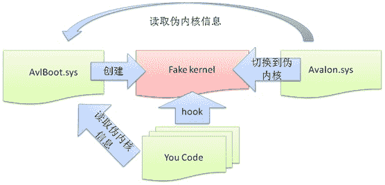
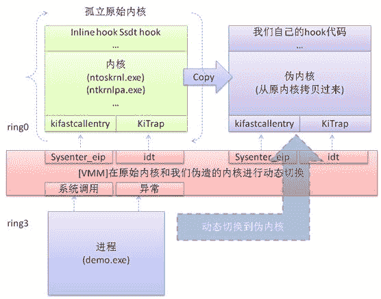

# 【硬件虚拟化第二弹】远离 kernel 的理想乡

> 原文：[`www.pediy.com/kssd/pediy12/134692.html`](https://www.pediy.com/kssd/pediy12/134692.html)

简介  
  
这个故事描述了如何使用硬件虚拟化(HVM)使得自己的一些 hook 代码远离内核不容易被其他内核 hook 所影响并且较难被检测。本文的思路来源于某学校的动态 linux 内核更新的玩意,代码大量抄自 bluepill。  
   
  

**第一章  (Avalon) 阿瓦隆的黎明 **  
由于驱动牛人越来越多系统控制权的争夺愈演愈烈，内核之中几乎无一块净土。inline hook、ssdt hook 等等各种 hook 充斥着我们幼小的内核。他们有些结构复杂，有些相互关联，有些检测监视，想要重新获得那些控制点的控制权必须花些力气研究那些 hook，使得原来很简单的 hook 变得牵一发而动全身。  
  
现在有硬件虚拟化技术，我们可以换个思路来解决那些问题了…  
  
  
  
一、(Avalon)阿瓦隆的构成   
  
(Avalon) 阿瓦隆的本体为以下几个部分：  
  
1.    Avlboot.sys（用于保存刚初始化后还没被 hook 污染的系统内核方便之后使用）  
  
2.       Avalon.sys(用于读取伪内核信息，开启硬件虚拟化加载伪内核)  
  
3.    XXX.sys(用户利用 Avlboot.sys 中所提供的信息进行具体 hook 操作的程序)  
  
  
  
二、(Avalon)阿瓦隆的真相   
  
本文所介绍的(Avalon) 阿瓦隆是一个基于虚拟化的内核加载框架。其利用硬件虚拟化(HVM)和一块没有被 hook 污染的内核内存，使得 PC 中同时运行着两个内核。并且 Avalon 通过控制 sysenter\_eip 和 idt 中指向伪内核的相应地址来获得控制权。  
  
  
  
简而言之，(Avalon)阿瓦隆就是利用硬件虚拟化(HVM)加载自己的内核架空原内核，使得自己能在不被检测的环境下获得内核的控制权。  
  
  
  
实现原理如下图所示：  
  
  
自己的 hook 程序在获得伪内核的基地址后，可以通过 hookport 来处理 ssdt，shadow ssdt(strongod 需要备份其所 hook 的 ssdt 稍微麻烦点,agp 什么的只要把地址偏移一下就能用了)  
  
  
  
  
  
三、(Avalon)阿瓦隆的应用   
  
  
  
其实我们可以把(Avalon)阿瓦隆看成是一种变相的 sysenter hook+idt hook。  
  
由于(Avalon)阿瓦隆基于硬件虚拟化(HVM)使得我们可以架空整个内核，使得内核可以在运行时可以实时的替换。  
  
因为伪内核的所在内存范围不受内存监控，别的程序也无法直接访问，使得我们的伪内核就成了不用考虑其他干扰问题，可以随意 hook 的安全的理想乡。  
  
这种方式的 hook 和传统的一些 hook 相比有着以下优点：  
  
1．  不在传统的内存监控的范围，较难检测。  
  
2．  不干扰系统中原有的 hook 代码，兼容性较高。   
  
但是同样有一些缺点：  
  
1．  无法直接干涉 object hook,irp hook 等不依赖于内核内存的 hook 代码  
  
2． 整个系统依赖于硬件虚拟化(HVM)，对硬件设备有一定要求。   
  
  
  
**第二章     空想具现化 **  
一、纯洁的初始化   
  
首先我们来实现(Avalon)阿瓦隆的初始化，初始化由 4 个部分组成：内核信息获取、伪内核构造、IDT 信息保存、原始 SYSENTER\_EIP 获取。  
  
实现代码如下：  
  
NTSTATUS DriverEntry (IN PDRIVER\_OBJECT DriverObject,IN PUNICODE\_STRING RegistryPath)   
{   
  
...  
  
 KrnlCopy();  
 IDTCopy();  
 ReadMsrSysenter();  
  
...  
  
}  
  
/\*  
  
   内核拷贝  
  
\*/  
  
VOID KrnlCopy()  
{  
 PVOID Buffer;  
 ULONG Size;  
 ULONG RetSize;  
 PSYSTEM\_MODULE\_INFORMATION InfoBuffer;  
 NTSTATUS Status;  
 PVOID ModuleBase;  
 ULONG ModuleSize;  
  
 Size=0x1000;  
  
  
 do {  
  Buffer=ExAllocatePool(NonPagedPool,Size);  
  Status=ZwQuerySystemInformation(SystemModuleInformation,Buffer,Size,&RetSize);  
  if (Status == STATUS\_INFO\_LENGTH\_MISMATCH)  
        {  
            ExFreePool(Buffer);  
            Size = RetSize;  
        }    
 }while(Status == STATUS\_INFO\_LENGTH\_MISMATCH);  
  
 InfoBuffer = (PSYSTEM\_MODULE\_INFORMATION)Buffer;  
  
  
 ModuleBase=(PVOID)(InfoBuffer->ModuleInfo\[0\].Base);  
 Orig\_krnl=(ULONG)ModuleBase;  
  
 DbgPrint("AvlBoot:Orig\_krnl Base=%x\\n",ModuleBase);  
 ModuleSize=InfoBuffer->ModuleInfo\[0\].Size;  
 makeKernelCopy((ULONG)ModuleBase,ModuleSize);  
 DbgPrint("AvlBoot:Avl\_krnl Base=%x\\n",Avl\_krnl);  
 ExFreePool(Buffer);  
}  
  
等初始化之后，其他部件就可以通过访问 Avlboot.sys 来获得伪内核的信息和内核原始信息。  
  
  
二、抄来的虚拟化   
  
这里先简单的向大家介绍下，Intel vt 硬件虚拟化的步骤：  
  
  
  
1.检查 vt 环境  
  
2.开启 vt 功能  
  
3.填充 vt，存储虚拟机状态  
  
4.设定需要拦截项目  
  
5.设定从虚拟机中退出时返回的地址  
  
6.启动虚拟机，等待拦截项目触发  
  
7.拦截项目被触发，进入相关项目的处理例程  
  
8.恢复虚拟机继续运行  
  
 接下来是一些坑爹的代码：  
  
/\*  
   Vmx 初始化  
\*/  
NTSTATUS NTAPI VmxInitialize (  
    PCPU Cpu,  
    PVOID GuestEip,  
    PVOID GuestEsp  
)  
{  
    PHYSICAL\_ADDRESS AlignedVmcsPA;  
    ULONG VaDelta;  
    NTSTATUS Status;  
  
  
    // 为 VMXON region 申请内存空间  
    Cpu->Vmx.OriginaVmxonR = MmAllocateContiguousPages(  
        VMX\_VMXONR\_SIZE\_IN\_PAGES,   
        &Cpu->Vmx.OriginalVmxonRPA);  
    if (!Cpu->Vmx.OriginaVmxonR)   
    {  
  DbgPrint("VmxInitialize(): Failed to allocate memory for original VMCS\\n");  
        return STATUS\_INSUFFICIENT\_RESOURCES;  
    }  
  
    DbgPrint("VmxInitialize(): OriginaVmxonR VA: 0x%x\\n", Cpu->Vmx.OriginaVmxonR);  
    DbgPrint("VmxInitialize(): OriginaVmxonR PA: 0x%llx\\n", Cpu->Vmx.OriginalVmxonRPA.QuadPart);  
  
    // 为 VMCS 申请内存空间   
    Cpu->Vmx.OriginalVmcs = MmAllocateContiguousPages(  
        VMX\_VMCS\_SIZE\_IN\_PAGES,   
        &Cpu->Vmx.OriginalVmcsPA);  
    if (!Cpu->Vmx.OriginalVmcs)   
    {  
  DbgPrint("VmxInitialize(): Failed to allocate memory for original VMCS\\n");  
        return STATUS\_INSUFFICIENT\_RESOURCES;  
    }  
  
    DbgPrint("VmxInitialize(): Vmcs VA: 0x%x\\n", Cpu->Vmx.OriginalVmcs);  
    DbgPrint("VmxInitialize(): Vmcs PA: 0x%llx\\n", Cpu->Vmx.OriginalVmcsPA.QuadPart);  
  
  
    // 开启 vmx  
    if (!NT\_SUCCESS (VmxEnable (Cpu->Vmx.OriginaVmxonR)))  
    {  
        DbgPrint("VmxInitialize(): Failed to enable Vmx\\n");  
        return STATUS\_UNSUCCESSFUL;  
    }  
  
    \*((ULONG64 \*)(Cpu->Vmx.OriginalVmcs)) =   
        (MsrRead (MSR\_IA32\_VMX\_BASIC) & 0xffffffff); //set up vmcs\_revision\_id        
  
    // 填充 VMCS 结构  
 Status = VmxSetupVMCS (Cpu, GuestEip, GuestEsp);  
    if (!NT\_SUCCESS (Status))   
    {  
        DbgPrint("VmxSetupVMCS() failed with status 0x%08hX\\n", Status);  
        VmxDisable();  
        return Status;  
    }  
  
    DbgPrint("VmxInitialize(): Vmx enabled\\n");  
  
   // 保存 EFER  
    Cpu->Vmx.GuestEFER = MsrRead (MSR\_EFER);  
    DbgPrint("Guest MSR\_EFER Read 0x%llx \\n", Cpu->Vmx.GuestEFER);  
  
   // 保存控制寄存器  
    Cpu->Vmx.GuestCR0 = RegGetCr0 ();  
    Cpu->Vmx.GuestCR3 = RegGetCr3 ();  
    Cpu->Vmx.GuestCR4 = RegGetCr4 ();  
  
    CmCli ();  
    return STATUS\_SUCCESS;  
}  
  
  
  
/\*  
   开启 vmx  
\*/  
NTSTATUS NTAPI VmxEnable (  
    PVOID VmxonVA  
)  
{  
    ULONG cr4;  
    ULONG64 vmxmsr;  
    ULONG flags;  
    PHYSICAL\_ADDRESS VmxonPA;  
  
 // 设置 cr4 位，为启用 VM 模式做准备  
    set\_in\_cr4 (X86\_CR4\_VMXE);  
    cr4 = get\_cr4 ();  
    DbgPrint("VmxEnable(): CR4 after VmxEnable: 0x%llx\\n", cr4);  
    if (!(cr4 & X86\_CR4\_VMXE))  
        return STATUS\_NOT\_SUPPORTED;  
  
 // 检测是否支持 vmx  
    vmxmsr = MsrRead (MSR\_IA32\_FEATURE\_CONTROL);  
    if (!(vmxmsr & 4))   
    {  
        DbgPrint("VmxEnable(): VMX is not supported: IA32\_FEATURE\_CONTROL is 0x%llx\\n", vmxmsr);  
        return STATUS\_NOT\_SUPPORTED;  
    }  
  
 //bochs 的 bug，要改 IA32\_FEATURE\_CONTROL 的 Lock 为 1  
 #if bochsdebug  
 MsrWrite(MSR\_IA32\_FEATURE\_CONTROL,5);  
    #endif  
  
    vmxmsr = MsrRead (MSR\_IA32\_VMX\_BASIC);  
    \*((ULONG64 \*) VmxonVA) = (vmxmsr & 0xffffffff);       //set up vmcs\_revision\_id  
    VmxonPA = MmGetPhysicalAddress (VmxonVA);  
  
    DbgPrint("VmxEnable(): VmxonPA:  0x%llx\\n", VmxonPA.QuadPart);  
  
 //开启 VMX  
 VmxTurnOn(VmxonPA);  
    flags = RegGetEflags ();  
    DbgPrint("VmxEnable(): vmcs\_revision\_id: 0x%x  Eflags: 0x%x \\n", vmxmsr, flags);  
  
    return STATUS\_SUCCESS;  
}  
  
  
  
/\*  
   进入虚拟机  
\*/  
NTSTATUS NTAPI VmxVirtualize (  
  PCPU Cpu  
)  
{  
  
    ULONG esp;  
    if (!Cpu)  
        return STATUS\_INVALID\_PARAMETER;  
  
 \*((PULONG) (g\_HostStackBaseAddress + 0x0C00)) = (ULONG) Cpu;  
  
    VmxLaunch ();  
  
    // never returns  
  
    return STATUS\_UNSUCCESSFUL;  
}  
  
三、蛋疼的拦截处理  
  
sysenter 的处理方法：  
  
由于硬件虚拟化(HVM)无法直接拦截 sysenter 指令，所以只能使用其他方法来获得控制权。  
  
这里有两种方法：  
  
1.       在 kifastcallentery 的头部写入 cpuid，int3 等利用中断或特权指令进入 vm。  
  
2.       使用调试寄存器在 kifastcallentery 下硬件执行中断，利用中断进入 vm  
  
3.       进入 VMM 后直接修改 guest 的 sysenter\_eip 地址，通过控制 msr 的读写来欺骗其他访问 msr 的程序。  
  
  
  
为了不被内存检测和充分利用调试寄存器，Avalon 中我选用了方案 3 来控制进程执行 sysenter 后的运行流向。   
  
  
  
部分代码：  
static BOOLEAN NTAPI VmxDispatchMsrRead (  
  PCPU Cpu,  
  PGUEST\_REGS GuestRegs,  
  PNBP\_TRAP Trap,  
  BOOLEAN WillBeAlsoHandledByGuestHv  
)  
{  
  
...  
  
switch (ecx) {  
  case MSR\_IA32\_SYSENTER\_CS:  
    MsrValue.QuadPart = VmxRead (GUEST\_SYSENTER\_CS);  
    break;  
  
  case MSR\_IA32\_SYSENTER\_ESP:  
    MsrValue.QuadPart = VmxRead (GUEST\_SYSENTER\_ESP);  
    break;  
  case MSR\_IA32\_SYSENTER\_EIP:  
    MsrValue.QuadPart = Avlkrnlinfo->SysenterAddr;  
  
...  
  
}  
  
  
  
  
idt 重定向处理方法：  
  
1.       idt 地址欺骗  
  
2.       idt 模拟投递  
  
  
  
第一种是指方案拦截 sidt,lidt 指令填充一份伪造的 idt 地址误导访问者（由系统投递相对稳定）。  
  
第二种是指方案模拟 idt 的处理过程自己写程序投递 idt。  
  
因为方案一需要使用反汇编引擎分析具体的保存地址体积过大，所以本版的 Avalon 使用第二种方案即 idt 模拟投递。  
  
  
  
部分代码：  
  
static BOOLEAN NTAPI VmxDispatchException (  
  PCPU Cpu,  
  PGUEST\_REGS GuestRegs,  
  PNBP\_TRAP Trap,  
  BOOLEAN WillBeAlsoHandledByGuestHv  
)  
  
{  
  
...  
  
  //SETP 7. SET EIP  
  
  if((uIntrInfo & 0xff) == 1){  
   ComPrint("VmxDispatchException():#BD hit  /n");  
   VmxWrite(GUEST\_RIP,Avlkrnlinfo->Fake\_IDTMap\[0\]);  
  }  
  else if ((uIntrInfo & 0xff) == 3){  
   ComPrint("VmxDispatchException():#BP hit /n");  
   VmxWrite(GUEST\_RIP,Avlkrnlinfo->Fake\_IDTMap\[1\]);}  
  
...  
  
}  
  
**第三章     理想乡的黄昏**一、(Avalon)阿瓦隆的检测   
  
对于基于硬件虚拟化(HVM)的程序，首先想到的方法必然就是直接检测和对抗硬件虚拟化。  
  
对硬件虚拟化的检测主要有：efer 的检测，vme 的检测。  
  
对于处理了中断的 vmm 还能通过计算中断前后的时间差来判断自身是否在虚拟机中。  
  
  
  
当然针对 Avalon 还有其他的检测方法（此处省略 xx 字）  
  
  
  
二、未来的更新   
  
Avalon 才刚刚开始功能并不完善，还有好多功能想加进去：  
  
1.       将内核移入 EPT(NPT)让你完全看不到  
  
2.       和 ring3 程序交互…  
  
3.       其他隐藏功能   
  
  
  
  
  
总结  
  
Avalon 只是硬件虚拟化应用的冰山一角，还有更多的应用等待着我们去探索，小弟的水平有限以后还要向各位高手多多请教继续努力学习。  
  
  
  
断章（坑爹的饼）  
  
该 bin 测试环境如下：  
bochs2.4.5  
windows xp sp3  
（注意：这个 bin 只是个简单的样品，真机上运行必蓝，且只针对 ring0 的中断，ring3 有 3 处 bug 未修复）  
  
附件的内容（bin+source+bin=饼+豆沙+饼）：  
avlboot.sys  
avalonreader(读取 avlboot 信息的源码)  
avalon\_vt.sys  
  
坑爹的饼.rar  
  
调试环境建设方法请看下一篇文章  
[用虚拟机调试 vt 程式](http://bbs.pediy.com/showthread.php?t=134693)