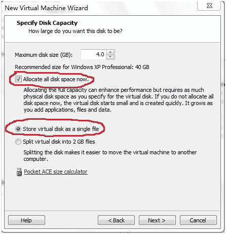
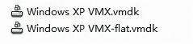
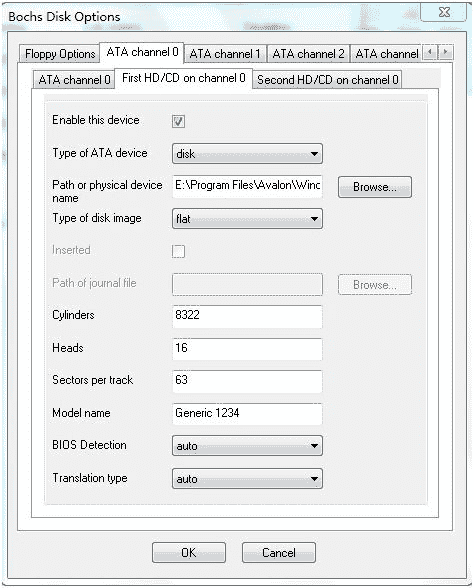
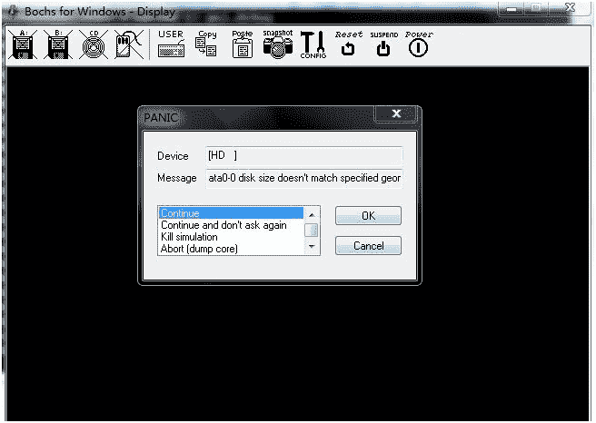
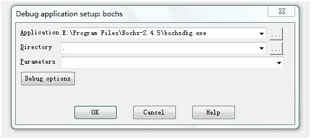
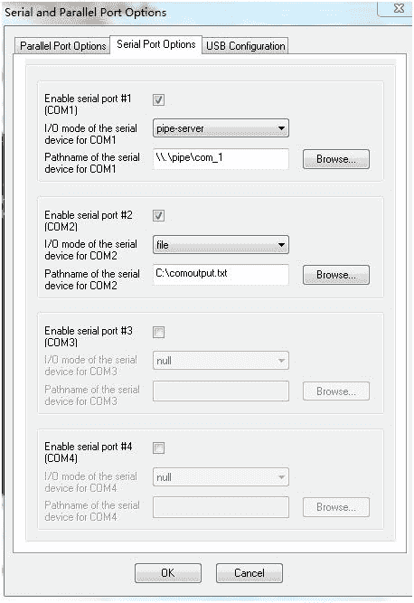
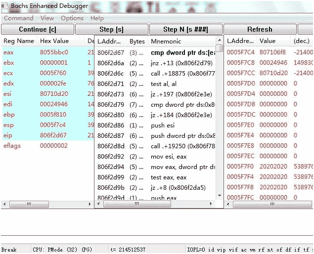
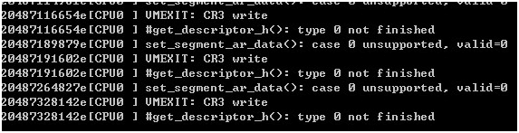

# 以虚御虚-用虚拟机调试 vt 程式

> 原文：[`www.pediy.com/kssd/pediy12/134693.html`](https://www.pediy.com/kssd/pediy12/134693.html)

Intel vt 技术十分诱人，但是如何调试 vt 程式却是让人头疼，让钱包心痛的问题，在走了各种弯路后，终于摸索出一套简单易懂又省钱的 vt 调试方法。如果你有比我更好的方法请第一个告诉我哟！！！  
  
准备工作：  
首先你需要安装以下程式：  
1. vmware(版本 6.0-7.1)  
2. ida(不一定用得到)  
3. windbg(也不一定用得到)  
4. 自行编译一份带 vt 的 bochs(版本 2.4.1-2.4.6，2.4.1 中 vmx 有些部分没实现推荐用 2.4.5 以上版本)  
  
  
然后你需要安装一下操作系统，因为 bochs 装系统太慢，所以我们这里用 vmware 生成一个磁盘文件并安装好系统给 bochs 用。以后也能利用 vmware 把文件放入虚拟机中的硬盘。  
  
创建虚拟机的关键步骤：  
  
  
  
在选择创建硬盘的时候要选择“直接分配所有磁盘空间”  
  
在创建后会有以下两个文件  
  
  
  
其中 xxx.vmdk 比较小存储了硬盘描述信息，其中的信息之后会在 bochs 中用到。xxx-flat.vmdk 为硬盘数据 bochs 也能使用。  
  
在生成完后你需要安装一个操作系统，这里我使用的是 xp sp3。  
  
（注：在 vmware 安装操作系统的时候，尽量使用原版和纯净版减少神奇的意外发生。）  
  
   
  
打开 xxx.vmdk 查看“# The Disk Data Base”这节  
  
记录下以下信息：  
  
ddb.geometry.cylinders = "8322"  
  
ddb.geometry.heads = "16"  
  
ddb.geometry.sectors = "63"  
  
   
  
打开 bochs 将这些信息填入：  
  
  
  
好了这样 bochs 和 vmware 就能共用一个磁盘文件了。  
  
在设置完后启动 bochs 时也有一个地方需要注意：  
  
  
  
因为 vmware 生成的磁盘文件的 cylinders 不一定是 512 的倍数，bochs 会因为这个问题而发出磁盘大小不匹配的警告，但其实是可以用的这里直接 continue 就行了。  
  
  
完成准备工作后接下来你可以有两种选择（有钱人才有的选啊）：  
  
   
  
1.  你拥有 ida5.7 及以上版本且使用 bochs2.4.5(或者你拥有 ida5.5 且使用 bochs2.4.1)  
  
  
  
直接使用 ida 中自带的 bochs 调试功能连接你编译好的 bochs 进行调试，轻松方便。（有钱真好，羡慕嫉妒恨啊！）  
  
   
  
2.  想用 bochs2.4.5 但没有 ida5.7 或以上版本  
  
使用 windbg 做为辅助进行调试，配合程式的 com 输出的信息，在 bochs 中下断点调试。  
  
  
  
Windbg 的设置和用 vmware 调试的时候完全一样，如果你以前设置过直接就可以用了。  
  
   
  
一些符号和地址可以由 windbg 和 com 输出获得然后再 bochs 中下断点进行调试。虽然步骤比有 ida 的同学麻烦点，但是买 ida 的钱是省下来了。  
  
  
  
上图为 bochs 中自带的调试界面，可以在这里下断点。  
  
  
  
在命令行窗口可以看见系统退出 vt 的原因。  
  
至此 vt 的调试环境就搭建好了，勇敢的少年啊快去调试 vt!!!