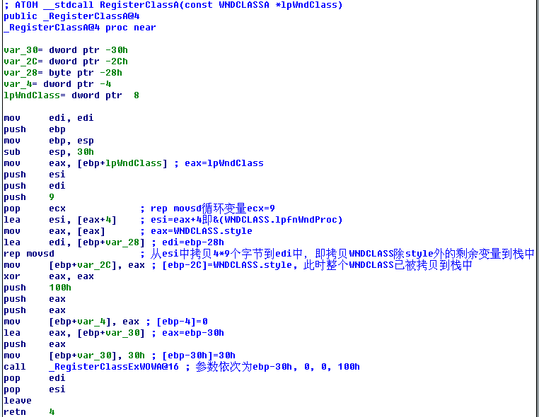

# 逆向 RegisterClass

> 原文：[`www.pediy.com/kssd/pediy12/139853.html`](https://www.pediy.com/kssd/pediy12/139853.html)

菜鸟级别的，高手就不用看了，欢迎指导。  
  
心血来潮逆了下 RegisterClass，结果 RegisterClass--->RegisterClassExWOW--->NtUserRegisterClassExWOW--->System Call  
  
本来只打算逆 RegisterClass 的，结果主要逻辑在 RegisterClassExWOW 中，逆了大部分，应该能管中窥豹了。RegisterClassExWOW 中有些变量类型不是很清楚（指针、句柄或整型），我权且当 int 了。System Call 部分没看。  
  
  

代码:

```
ATOM WINAPI RegisterClassA(\_\_in  const WNDCLASSA \*lpWndClass)
{
  WNDCLASSEXA wcex;
  wcex.cbSize = sizeof(WNDCLASSEX);    // 30h
  memcpy(((char \*)&wcex) + 4, lpWndClass, sizeof(WNDCLASS));
  wcex.hIconSm = NULL;
  return RegisterClassExWOWA(&wcex, 0, 0, 0x100);
}

```

RegisterClassExWOW 就不上图了，直接写出我逆的结果，大家要看码的话，直接把 User32.dll 拖到 IDA 看吧。  
代码:

```
HINSTANCE \_hmodUser = 0;
ATOM WINAPI RegisterClassExWOWA(const WNDCLASSEXA \*lpWndClassEx, int p2, int p3, int p4)
{
  if(0 == HIWORD(p3))
  {
    if(lpWndClassEx->cbClsExtra < 0 || lpWndClassEx->cbWndExtra < 0)
    {
      SetLastError(0x57);    // ERROR\_INVALID\_PARAMETER
      return 0;
    }
    if(\_hmodUser == lpWndClassEx->hInstance)
    {
      if(\*(int \*)(NtCurrentTeb() + 0x6D4) < 0x400)
      {
        SetLastError(0x57);
        return 0;
      }
      if(NULL == lpWndClassEx->hInstance)
      {
        lpWndClassEx->hInstance = GetModuleHandleA(NULL);
      }

      int ver;
      if(NULL == lpWndClassEx->hInstance)
      {
        ver = RtlGetExpWinVer(GetModuleHandleA(NULL));
      }
      else
      {
        ver = RtlGetExpWinVer(lpWndClassEx->hInstance);
      }


      if(0x0F7FC0114 == lpWndClassEx->style)
      {
        if(ver > 0x30A)    // Windows 版本与样式不符
        {
          SetLastError(0x57);
          return 0;
        }
        lpWndClassEx->style &= 0x803FEEB
      }

      if(lpWndClassEx->hbrBackground > 0x1F)    // 小于 0x1F 的画刷没有 Windows 版本的限制，都支持
      {
        if(0 == GdiValidateHandle(lpWndClassEx->hbrBackground))    // 无效的
        {
          if(ver > 0x300)
          {
            SetLastError(0x57);
            return 0;
          }
          lpWndClassEx->hbrBackground = 0;
        }
      }

      int n;
      HMEMU hMem;
      if(InitClsMemuNameA(&hMem, lpWndClassEx->lpszMenuName, &n))    // 失败
      {
        return 0;
      }

      p4 |= 2;
      WNDCLASSEXA wcex;
      memcpy(&wcex, lpWndClassEx, sizeof(WNDCLASSEXA));
      if(ver > 0x30A)
      {
        p4 |= 0x80;
      }
      if(\*(char \*)(NtCurrentTeb() + 0x6E0) != 2)
      {
        if(GetAppCompatFlags2(0x9900) != 0x800000)
        {
          p4 &= 0xBFFFFFFF;
        }
      }
      if(int((p4 << 8) >> 24) != 1)
      {
        int x;
        if(NULL == ClassNameToVersion(lpWndClassEx->lpszClassName, &x, 0, 1))
        {
          ver = 0;
          // 从 loc\_77D1A552 开始下面的流程是根据临时指针变量是否为 NULL 来释放资源
          if(\[ebp+var\_138\] == 0)    // \[ebp+var\_138\]在函数入口处确实被赋值为 0
          {
            RtlFreeHeap(NULL, 0, 0);
          }
          // ...
          return ver;
        }
        else
        {
          // 调用 NtUserRegisterClassExWOW
          // NtUserRegisterClassExWOW 进入系统调用，调用号 11E8h
        }
      }
    }
    else
    {
      // lpWndClassEx->hInstance 有值
    }
  }
  else
  {

  }
}

```

NtUserRegisterClassExWOW 部分比较简单是直接进行系统调用  
代码:

```
mov eax, 11E8h
mov edx, 7FFE0300h
call dword ptr \[edx\]
retn 1Ch

```

有几个不清楚的地方，在此也提出来问下坛子里的大大们：  
RegisterClassExWOW 部分有几处用到了 TEB 中的变量，但其偏移在 WinDbg 中却没显示，可能是微软故意没公开，不知道有没有方法查看，或者直接告诉我这几处偏移的意义。  
NtCurrentTeb() + 0x6D4  
NtCurrentTeb() + 0x6E0