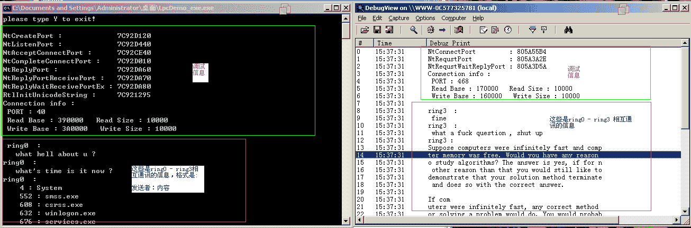

# 1st :使用 LPC 机制进行 ring0-ring3 双向可靠通信

> 原文：[`www.pediy.com/kssd/pediy12/140154.html`](https://www.pediy.com/kssd/pediy12/140154.html)

今天心情很不爽，发几篇初级贴吧，下次心情再不好的话再发点其他好玩的东东，反正放在硬盘里也是占空间  
  
第一篇：就是本篇啦  
  
LPC 这东东大家应该都听说过，至于用没用过，那就另当别论啦。它的全称是 Local Procedure Call  
本地过程调用，是一种建立在 PORT(端口）对象上的完整的可靠的进程间通信机制。  
如果你没听过这东东，也很正常啦，微软把这么好玩的东西留着自己用来着，比如说：csrss 进程。但是咱要发挥铁公鸡精神，你能用老子干嘛不能用？   
  
先打个广告，请问你之前进行 ring0 - ring3 通信是不是用以下方法：  
 1：Device I/O  
 2: 共享内存+同步对象  
 3：其他：如 stack process + read/write virtual memory  
  
首先我并不想说使用 LPC 机制比你正在使用的方法更好，我只想告诉你一种也许你还不知道的方法，如果你已经知道了，飘~过~吧   
  
不废话了，进入正题，咱分两部分，LPC 介绍和 LPC 的应用；  
  
一： LPC (Local Procedure Call)？ what hell is it ?  
  
LPC 机制是建立在 PORT 对象上的进程间通信机制，咱姑且这么理解吧。它是相对于 RPC（Remote Procedure Call）远程过程调用而言的， 无论 LPC 或者 RPC，都是一种现代人称作 C/S 的架构，即 客户端/服务器 模型 。扯远点，其实 native api 调用也是种 LPC 模型，应用层（client）使用 api 发起调用请求，ntdll 中 stub 函数使用 sysenter 进入内核（server），内核处理完调用请求，将结果回送给应用层，这样就完成一次 api 调用。是不是很像 MS 的 socket？  
  
扯远了，收回来。如同 windows 下的网络通讯大都建立在 socket（套字节）上，LPC 是建立在 PORT 的双向通信。LPC 可以发送的数据可以是如下三种：  
 1：数据嵌入在报文中，大概可以发送 300 字节酱紫  
 2：使用 section 对象的映射来交换大数据  
 3：甚至允许直接 read/write 进程空间，交换超大的数据  
  
嘿嘿，很有意思吧？ 那么咱们这段就跳了，至于实现，WRK 里的 LPC 目录里有完整源码，自己深入研究吧  
  
二：LPC 的应用？ how to use it for myself ？  
  
Q1：这可以归结为两个问题，如何在你的工程里添加用于使用 LPC 的 API  
Q2：如何使用这些 API  
  
A1： 我的解决方法是把 LPC 的原型写入头文件，然后动态获取函数地址，也许你说可以用  
\_\_declspec(dllimport) 来修饰，嘿嘿，对于应用层（在 ntdll.dll 中导出），倒是可以。但是内核只导出了 NtConnectPort 一个函数，其他的未导出。至于怎么获取，这个我想各有良方吧，可以用索引硬编码在 KiServiceTable 中找到地址；也可以打开 ntdll.dll，然后自己查找这些函数对于的索引值。 我为了方便，只接用了硬编码咯。  
  
A2：这个问题，让我的代码回答你吧  
  
  
参考资料：  
《undocumented windows nt secret》  
《windows 2000 native api reference》  
  
PS: **小弟才疏学浅，如有错误，欢迎指正；**  
  
\*\*\*\*\*\*\*\*\*\*\*\*\*\*\*\*\*\*邪恶的分割线\*\*\*\*\*\*\*\*\*\*\*\*\*\*\*\*\*\*\*\*\*\*\*\*\*  
上图：  
  
\*\*\*\*\*\*\*\*\*\*\*\*\*\*\*\*\*\*邪恶的分割线\*\*\*\*\*\*\*\*\*\*\*\*\*\*\*\*\*\*\*\*\*\*\*\*\*\*  
上代码+bin：

上传的附件
|  || LpcDemo.7z  
 |