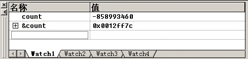
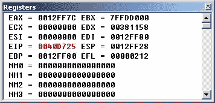
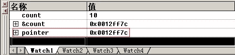
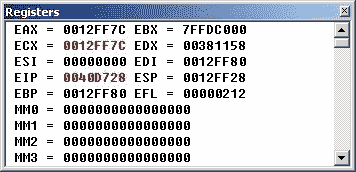
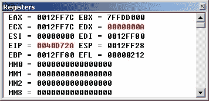

# C 语指针内幕

> 原文：[`www.pediy.com/kssd/pediy11/105674.html`](https://www.pediy.com/kssd/pediy11/105674.html)

作者：乱雪  
来源：hi.baidu.com/lu4nx  
  
R.E.C--F22 叫我来篇稿，我实在不知道写啥，也很久没写过技术方面的东西了，刚看书时突然想到了写指针，所有的 C 语书上都把指针描述得很抽象，所以，老规矩，结合调试器+汇编来理解它。  
  
其实指针和汇编中的间接寻址很像，抽象点说，运用指针可以间接性地访问某变量内容。我说得太抽象了，扔代码上来吧：  
  

代码:

```
/\*

C 语指针演示，by：乱雪

2010.1.21

\*/

#include <stdio.h>

int main(void)
{
int count = 10,lx, \*pointer;  //定义两个整型变量 count 和 lx，一个指针 pointer。

pointer = &count;   //把 count 的内存地址赋给 pointer，“&”是 C 语中的地址运算符，用于取内存地址
lx = \*pointer;        //用“\*”获得指针指向的内容，即 lx = 10
return 0;
}

```

这时 lx 的值就是 10，可以加句 printf("%d \\n",lx);看到。  
  
好了，进调试器来解释吧。编译环境 VC6.0，调试器是 VC6.0 默认的调试器。需要观众有汇编语言的基础。  
  
先在 int count = 10,lx;处下个断点（右键“Insert/Remove Breakpoint”），然后按 F5，进入调试状态后，会自动在断点处停下来，此时点在断点行处右键“Go To Disassembly”，来到汇编窗口。  
  
这个时候断点处的代码如下：  
  
代码:

```
mov         dword ptr \[ebp-4\],0Ah

```

0A 是 10 的 16 进制，ebp-4 是第一个变量 count 的地址，mov 是传送指令。此句的意思是把 10 赋值给 ebp-4，即 count = 10。为了证明这一点，按一下 F10 单步运行，然后打开 Watch 窗口，在“名称”里键入&count，就看到了 count 的地址，如图：  
  
在这里顺便说下，我们定义了三个变量，分别是 count、lx 和 pointer，那么分别对应的地址是 ebp-4、ebp-8、ebp-0Ch，因为整型变量占 4 字节内存，每次 ebp 都会减少 4。  
  
根据刚才代码中的顺序，下一句是 pointer = &count;，将 pointer 指向 count 的内存地址，我们看对应的汇编代码：  
  
代码:

```
lea         eax,\[ebp-4\]
mov         dword ptr \[ebp-0Ch\],eax

```

前面说过，ebp-4 是 count 变量的内存地址，为了直观点，我把上面的汇编代码改一下：  
  
代码:

```
lea         eax,\[count\]
mov         dword ptr \[pointer\],eax

```

lea 指令就是把一个内存变量有效的地址传送给指定的寄存器。第一句 lea   eax,\[ebp-4\]是把 count 的地址传到 eax 寄存器，根据刚才在 Watch 窗口中看到的 count 地址是 0012ff7c，那么 eax 里面的值就是 0012ff7c。第二句 mov   dword ptr \[ebp-0Ch\],eax 是把 eax 中的值传到 ebp-0Ch（pointer）中。很明显，pointer = &count;这句代码就等同于 pointer = 0012ff7c;。为了直观点，打开 Registers 窗口，观察寄存器。按三下 F10 执行三次单步运行，执行完 mov dword ptr \[ebp-0Ch\],eax 指令，这个时候寄存器内容如图：  
  
看 EAX 的值正好是 count 变量的内存地址 0012FF7C。然后在 Watch 窗口中输入 pointer，可以看到 pointer 的内容是 0x0012ff7c，如图：  
  
说明 pointer 已经指到了 count 的内存地址了。  
  
接下来看下一句代码 lx = \*pointer;，对应的汇编代码如下：  
  
代码:

```
mov         ecx,dword ptr \[ebp-0Ch\]
mov         edx,dword ptr \[ecx\]
mov         dword ptr \[ebp-8\],edx

```

为了直观，我改一下代码：  
  
代码:

```
mov         ecx,dword ptr \[pointer\]
mov         edx,dword ptr \[ecx\]
mov         dword ptr \[lx\],edx

```

这行代码意思是取出 pointer 指向的内容赋给变量 lx。汇编代码中第一句 mov   ecx,dword ptr \[ebp-0Ch\]意思是把 ebp-0Ch（pointer）中的值传入到 ecx 寄存器中，刚才已经知道，pointer 的内容是 0x0012ff7c，那么这个时候 ecx 的值就是 0x0012ff7c。第二句 mov edx,dword ptr \[ecx\]意思是取出 ecx 寄存器中的地址对应的值放入 edx 寄存器，此时 edx 寄存器的值就是 count 的值 10 了。最后再 mov dword ptr \[ebp-8\],edx，把 edx 寄存器中的值传到变量 lx 中。为了观察到整个过程，我们单步运行，直到运行完 mov edx,dword ptr \[ecx\]这句指令，然后观察 Registers 窗口，看到 ECX 的值是 0012FF7C。ECX 的值已经是 count 的内存地址了：  
  
再单步运行一次，运行完指令 mov edx,dword ptr \[ecx\]，再看 Registers 窗口，EDX 的值是 0000000A，A 是 10 的十六进制表示。  
  
简单总结下就是：首先将变量的地址放入寄存器中，然后再取出寄存器中存放地址对应的值。C 指针的内幕就这样，自己跟着调试一次代码，就会理解了。如有不足之处欢迎一起讨论：）