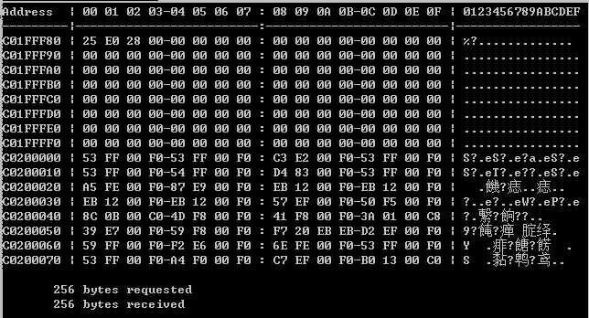
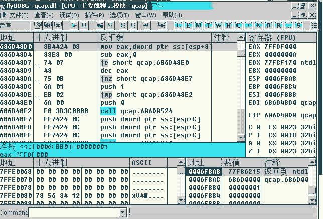
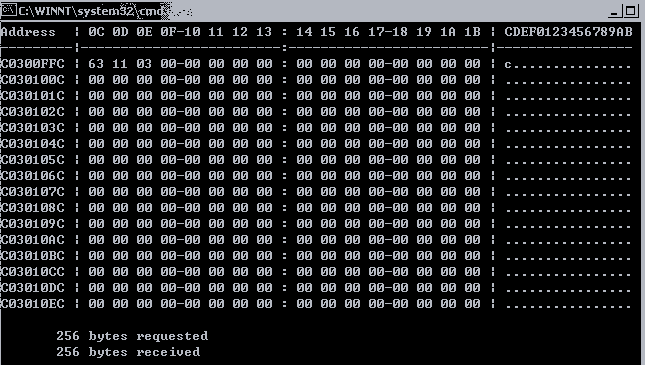
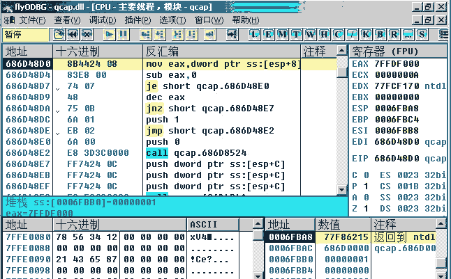

# \[已更新！\]\[原创/探讨\]Windows 核心编程研究系列之一(改变进程 PTE)

> 原文：[`www.pediy.com/kssd/pediy08/pediy8-730.htm`](https://www.pediy.com/kssd/pediy08/pediy8-730.htm)

首先要说明的是我一般在汇编区活动，但考虑到客观人气问题，所以发到这里，这篇  
文章的目的在于想结识一些有同好的朋友一起探讨，完整包括图片的文章可以到我  
的 blog（hopy.blogchina.com）观赏。另外如有不如何错误请多多指正，不胜感谢。  
  
  
Windows 核心编程研究系列之一  
\-改 变 进 程 PTE 属 性-  
  
  
    这是我研究 windows 核心编程的第一篇正式文章，之所以叫核心编程而不叫  
内核编程，是我觉得从字面上来看核心(core)比内核(kernel)更靠近 windows 中心，  
当然只是偶本人的看法的拉。  
      
    我们知道在 win NT 中，系统把每个进程的虚拟 4G 空间分为两大部份，低 2G  
归用户所有，高 2G 归系统所有。用户不得访问系统的空间，连读都不行，更别说  
写了！  
  
    低 2G 的用户空间也并不是都能写入的。现在我要说一个特殊的区域：在每个  
进程虚拟地址 0x7ffe0000 开始的一段空间称为 USER\_SHARED 区域，他和虚拟  
地址空间 0xffdf0000 指向同一物理地址空间，这片区域的长度为 0x2d8。所以不  
同进程的这一虚拟地址空间被映射到同一个物理地址空间，如果可以写入该区域  
就可以实现系统中所有进程共享数据的目的，注意是所有进程！但可惜的是虽然  
0x7ffe0000 在低 2G 的空间，归用户所有，但它只能读不能写。  
           
  
很不爽哦!我前不久在网上看到一篇可以读写物理内存的文章，其实现的思想是：  
  
1 通过系统特权 API 取得 System Object PhysicalMemory 的写权限；  
  
2 通过分析 MmGetPhysicalAddress 写出其在 ring3 下的伪代码，  
  从而得到任意虚拟地址映射的实际物理地址  
  
3 写入物理地址  
  
    我用汇编重写后好像不能实现其目的，编译运行原来 VC++代码也不成功。但据作者  
说他可以运行成功。因为这篇文章写得较早，我怀疑是 windows 在后来的 PACK 中关  
闭了这个通道。但只是猜测，也不排除还有我未考虑到的因素，希望搞成功过的朋友  
谈谈具体的过程。  
      
    我实现的是另一种方法，其主要思想是:  
  
1 找到该虚拟地址在进程页表中的位置；  
  
2 将对应页表项第 2 位改为 1  
  
    每个进程的页表被映射到其虚拟地址空间的 0xc0000000 – 0xc003fffff 空间中。  
经过简单的计算后得到其页表项位置为:0xc0000000 + 0x1FFF80 = 0xC01FFF80 察看  
其内容如图 2 所示，其最低 3 位决定了它存在，属于用户区域，但是只读不能写入！  
                  
                                    图 2  
  
我们下面要做的也非常简单，就是打开其写入标志，使其可写。  
就是将 0x25 改为 0x27 。关键代码如下:  
  
mov  ebx,0c01fff80h  
  mov  edx,\[ebx\]  
  mov  al,27h  
  mov  byte ptr \[ebx\],al  
  mov  eax,cr3  
  mov  cr3,eax  
  
通过一个 kernel driver 注入，修改成功。下面就是在 ring3 中修改 0x7ffe0080  
的内容，以下是代码:  
  
mov  ebx,7ffe0080h  
  mov  eax,12345678h  
  mov  dword ptr \[ebx\],eax  
  
    执行结果可以用任意 ring3 调试器来证实，就是在调试任意程序时察看其进程地址  
0x7ffe0080 都会发现其值被改为 0x12345678。图 3 是验证情况。  
                       
                                           
                                         图 3  
  
到这里貌似可以告一段落了，但是还有更值得挖掘的东西，那就是在 ring3 种直接改写  
高 2GB 的系统内核区域，下面马上将给出的是就是关于改写 0x80000000 – 0xffffffff   
内核区域的方法，敬请期待。   
  
OK,让我们进入这一部分，其实有了上面的基础，这个就变得轻而易举了。但是要注意的是：  
1 要改写的 0x80000000 – 0xffffffff 区域属于内核，可能  
搞不要就要 ODBS;  
2 要修改的不单单是 PTE 还有 页目录表项  
  
现在我们选择写入的位置，上面说过的 0xffdf0000 ~ 0xffdf02d8 是个不错的选择，因为除了开头一段最好别碰以外，后面都是“自由”区域，写入因该没什么问题。我们首先  
    
  
图 4  
要确定修改的页目录项的位置，它可以通过 0xc03000000 + 0xffc 算出等于 0xc0300ffc,如图 4，将 63 改为 67。然后再找到  
页表项的位置，通过 0xc0000000 + 0x3FF7C0 = 0xC03FF7C0，同样的要将 63 改为 67，关键代码为:  
  
mov  ebx,0C0300FFCh  
  mov  edx,\[ebx\]  
  mov  al,67h  
  mov  byte ptr \[ebx\],al  
  mov  eax,cr3  
  mov  cr3,eax  
  mov  ebx,0C03FF7C0h  
  mov  edx,\[ebx\]  
  mov  al,67h  
  mov  byte ptr \[ebx\],al  
  mov  edx,\[ebx\]  
  mov  eax,cr3  
  mov  cr3,eax  
    
That’s All Right !!!，让我们看下实际的效果，如图 5 所示。  
    
图 5  
  
至此我们已经成功地在 ring3 中修改了用户区只读区域，和位于内核的“不可见”区域。呵呵，西游记至此终~真的终么？当然只是 joke 了，呵呵。  

 4dd466d0e1e0cc123afbe504da2462ca